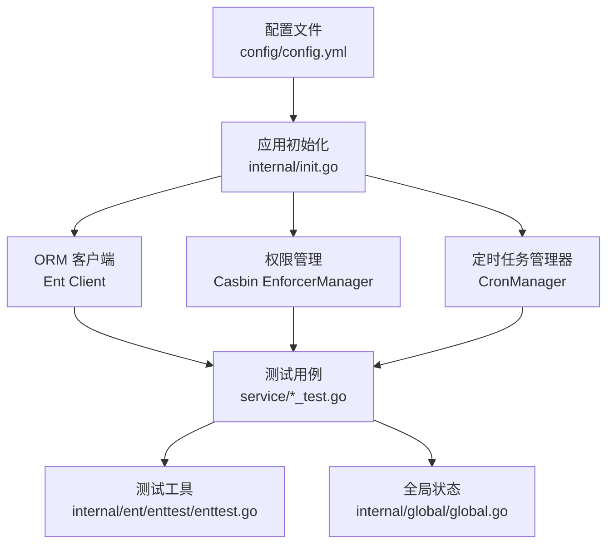
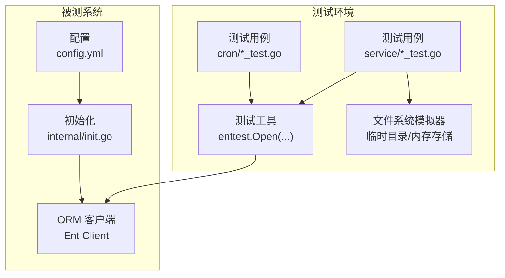
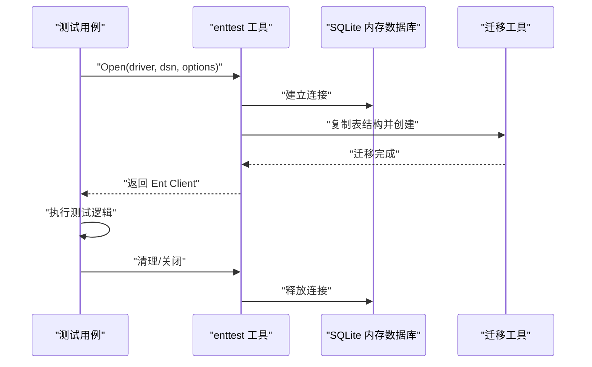
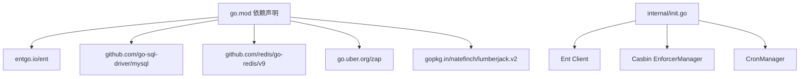

# 测试环境配置

<cite>
**本文引用的文件**
- [config.yml](file://config/config.yml)
- [init.go](file://internal/init.go)
- [global.go](file://internal/global/global.go)
- [enttest.go](file://internal/ent/enttest/enttest.go)
- [attachment_test.go](file://internal/service/attachment_test.go)
- [cron_job_test.go](file://internal/service/cron_job_test.go)
- [manager_test.go](file://internal/cron/manager_test.go)
- [go.mod](file://go.mod)
- [main.go](file://main.go)
</cite>

## 目录
1. [简介](#简介)
2. [项目结构](#项目结构)
3. [核心组件](#核心组件)
4. [架构总览](#架构总览)
5. [详细组件分析](#详细组件分析)
6. [依赖分析](#依赖分析)
7. [性能考虑](#性能考虑)
8. [故障排查指南](#故障排查指南)
9. [结论](#结论)
10. [附录](#附录)

## 简介
本文件面向 Go Admin 管理系统的测试环境配置与运行，目标是帮助开发者快速搭建稳定、可重复的测试环境，覆盖以下关键主题：
- 使用 SQLite 内存数据库进行单元测试与集成测试
- 配置测试专用的数据库连接、超时与事务策略
- 文件存储、缓存与外部 API 的模拟与隔离
- 在 Docker 容器中运行测试与管理测试数据
- 调试技巧：日志查看、失败定位与性能分析
- CI/CD 流水线中的自动化测试与并行执行

## 项目结构
本项目采用模块化与分层架构，测试相关的关键位置如下：
- 配置层：通过配置文件集中管理应用、日志、数据库、缓存、Redis、文件系统等
- 初始化层：应用启动时初始化 ORM、Casbin、定时任务等
- ORM 层：基于 Ent 的客户端与迁移工具，支持测试时的内存数据库
- 服务层：业务逻辑单元，配合测试工具进行隔离与模拟
- 全局状态：集中存放 ORM、Casbin、定时任务等全局对象

图表来源
- [config.yml:1-143](file://config/config.yml#L1-L143)
- [init.go:31-101](file://internal/init.go#L31-L101)
- [enttest.go:56-85](file://internal/ent/enttest/enttest.go#L56-L85)
- [global.go:11-16](file://internal/global/global.go#L11-L16)

章节来源
- [config.yml:1-143](file://config/config.yml#L1-L143)
- [init.go:31-101](file://internal/init.go#L31-L101)
- [global.go:11-16](file://internal/global/global.go#L11-L16)

## 核心组件
- 数据库配置与连接
  - 默认驱动为 MySQL，生产环境使用远程数据库；测试环境推荐使用 SQLite 内存数据库
  - 连接参数包含主机、端口、用户名、密码、数据库名、SSL、表前缀等
- 日志配置
  - 支持控制台输出与文件输出，便于测试时观察日志
- 缓存与 Redis
  - 提供内存缓存与 Redis 缓存配置，测试时可选择内存缓存避免外部依赖
- 文件系统
  - 支持本地磁盘与 S3 存储，测试时可使用内存或临时目录替代真实存储
- ORM 初始化
  - 应用启动时根据配置初始化 ORM 客户端，并创建数据库表结构
- 测试工具
  - 提供内存数据库打开、自动迁移、测试清理等能力

章节来源
- [config.yml:19-76](file://config/config.yml#L19-L76)
- [init.go:69-84](file://internal/init.go#L69-L84)
- [enttest.go:56-85](file://internal/ent/enttest/enttest.go#L56-L85)

## 架构总览
下图展示了测试环境中的关键交互：测试用例通过内存数据库与文件系统模拟器运行，避免对外部服务的依赖。

图表来源
- [attachment_test.go:56-82](file://internal/service/attachment_test.go#L56-L82)
- [cron_job_test.go:26-40](file://internal/service/cron_job_test.go#L26-L40)
- [enttest.go:56-85](file://internal/ent/enttest/enttest.go#L56-L85)
- [config.yml:19-76](file://config/config.yml#L19-L76)
- [init.go:69-84](file://internal/init.go#L69-L84)

## 详细组件分析

### SQLite 内存数据库配置与使用
- 连接字符串
  - 测试中使用 SQLite 内存数据库，连接字符串包含模式、共享缓存与外键约束控制
- 自动迁移
  - 通过测试工具自动复制表结构并创建，确保测试前后数据库结构一致
- 清理机制
  - 测试结束后自动关闭客户端，释放内存资源

图表来源
- [enttest.go:56-85](file://internal/ent/enttest/enttest.go#L56-L85)
- [attachment_test.go:56-82](file://internal/service/attachment_test.go#L56-L82)
- [cron_job_test.go:26-40](file://internal/service/cron_job_test.go#L26-L40)

章节来源
- [enttest.go:56-85](file://internal/ent/enttest/enttest.go#L56-L85)
- [attachment_test.go:56-82](file://internal/service/attachment_test.go#L56-L82)
- [cron_job_test.go:26-40](file://internal/service/cron_job_test.go#L26-L40)

### 测试数据库连接与事务处理
- 连接字符串格式
  - 使用 SQLite 内存数据库时，连接字符串包含模式、共享缓存与外键控制选项
- 超时设置
  - SQLite 内存数据库无需额外超时配置；如需使用其他驱动，可在配置文件中调整相应超时参数
- 事务处理
  - 测试中建议使用单个事务包裹测试逻辑，失败时回滚，保证测试隔离性
  - 对于并发测试，建议使用互斥锁或独立的测试数据库实例

章节来源
- [attachment_test.go:56-82](file://internal/service/attachment_test.go#L56-L82)
- [cron_job_test.go:26-40](file://internal/service/cron_job_test.go#L26-L40)
- [config.yml:19-31](file://config/config.yml#L19-L31)

### 依赖服务配置（文件存储、缓存、外部 API 模拟）
- 文件存储
  - 本地磁盘与 S3 均可配置；测试时使用临时目录或内存存储模拟器，避免真实文件系统依赖
- 缓存
  - 内存缓存适合测试；Redis 可在容器化测试中通过服务发现或 Docker Compose 启动
- 外部 API 模拟
  - 使用接口抽象与依赖注入，在测试中替换为模拟实现，确保测试可重复性

章节来源
- [config.yml:60-76](file://config/config.yml#L60-L76)
- [config.yml:32-41](file://config/config.yml#L32-L41)
- [attachment_test.go:24-55](file://internal/service/attachment_test.go#L24-L55)

### Docker 容器化测试
- 容器镜像
  - 基于官方 Go 镜像构建，安装必要依赖（如 SQLite 开发包）以支持测试
- 网络与服务
  - 如需 Redis 或数据库服务，可通过 Docker Compose 启动并挂载到测试容器
- 测试数据管理
  - 使用只读卷或一次性卷，避免污染宿主机数据
- 并行测试
  - 在容器中启用并行标志，结合互斥锁或独立数据库实例，避免竞争条件

（本节为概念性说明，不直接对应具体源码文件）

### 测试环境调试技巧
- 查看测试日志
  - 启用控制台输出与文件输出，定位错误堆栈与异常信息
- 分析测试失败原因
  - 使用断言与上下文信息，结合数据库快照与日志文件定位问题
- 定位性能问题
  - 使用基准测试与计时器，识别慢查询与热点路径

章节来源
- [config.yml:11-17](file://config/config.yml#L11-L17)

### CI/CD 流水线中的自动化测试与并行执行
- 自动化测试
  - 在流水线中执行测试命令，收集覆盖率与报告
- 并行测试
  - 使用并行标志与互斥资源，确保多任务安全执行
- 结果聚合
  - 统一收集测试结果与日志，便于后续分析

（本节为概念性说明，不直接对应具体源码文件）

## 依赖分析
- 外部依赖
  - ORM：Ent 与 MySQL 驱动
  - 缓存：内存缓存与 Redis
  - 文件系统：本地与 S3
  - 日志：Zap 与 lumberjack
- 内部依赖
  - 初始化模块负责装配 ORM、Casbin、定时任务
  - 全局模块集中管理 ORM、Casbin、定时任务等

图表来源
- [go.mod:5-21](file://go.mod#L5-L21)
- [init.go:31-101](file://internal/init.go#L31-L101)

章节来源
- [go.mod:5-21](file://go.mod#L5-L21)
- [init.go:31-101](file://internal/init.go#L31-L101)

## 性能考虑
- 使用 SQLite 内存数据库进行测试，避免磁盘 I/O 开销
- 控制并发度，避免过多 goroutine 导致上下文切换开销
- 合理设置日志级别，减少不必要的日志输出对性能的影响
- 对热点路径进行基准测试，识别并优化瓶颈

（本节为通用指导，不直接对应具体源码文件）

## 故障排查指南
- 数据库连接失败
  - 检查连接字符串格式与参数是否正确
  - 确认测试数据库已正确初始化与迁移
- 文件系统相关错误
  - 确认临时目录权限与路径是否存在
  - 检查文件系统模拟器的实现是否符合预期
- 缓存失效
  - 确认缓存键生成规则与过期时间设置
  - 在业务变更后清理相关缓存键
- 日志无法输出
  - 检查日志配置项与输出路径权限

章节来源
- [config.yml:11-17](file://config/config.yml#L11-L17)
- [attachment_test.go:24-55](file://internal/service/attachment_test.go#L24-L55)

## 结论
通过 SQLite 内存数据库、测试专用配置与模拟依赖服务，Go Admin 的测试环境具备高可重复性与低耦合特性。结合合理的调试与 CI/CD 集成，可以显著提升测试效率与质量。

## 附录
- 快速开始
  - 在本地安装 Go 与 SQLite 开发包
  - 运行测试命令，观察日志输出
  - 如需 Redis 或数据库服务，使用 Docker Compose 启动并挂载到测试容器
- 最佳实践
  - 每个测试用例尽量独立，避免共享状态
  - 使用断言与上下文信息，提高失败可诊断性
  - 对关键路径进行基准测试，持续监控性能变化