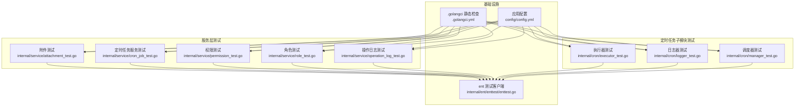
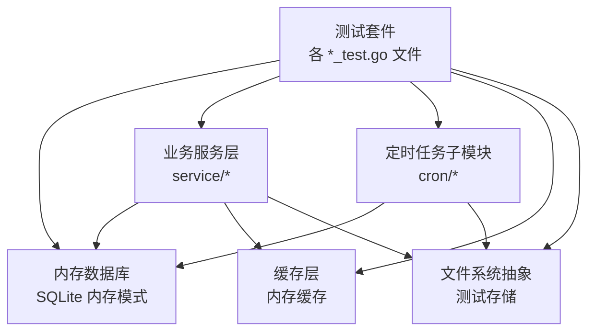
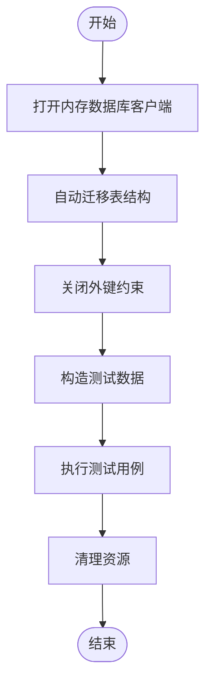
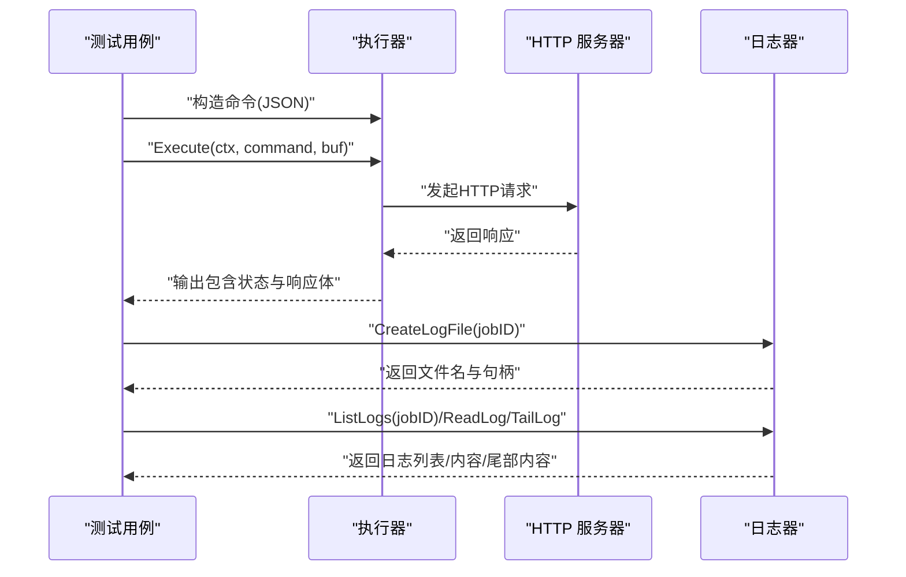
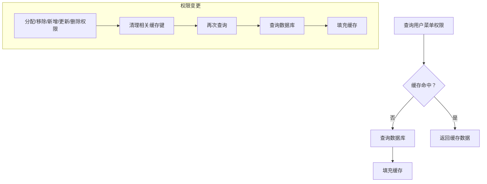
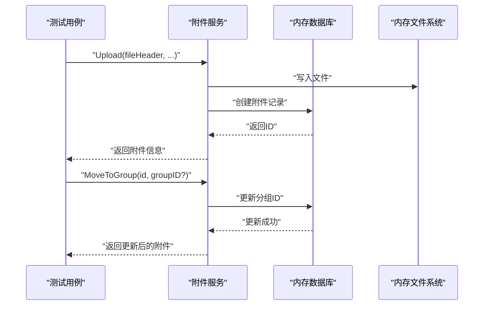
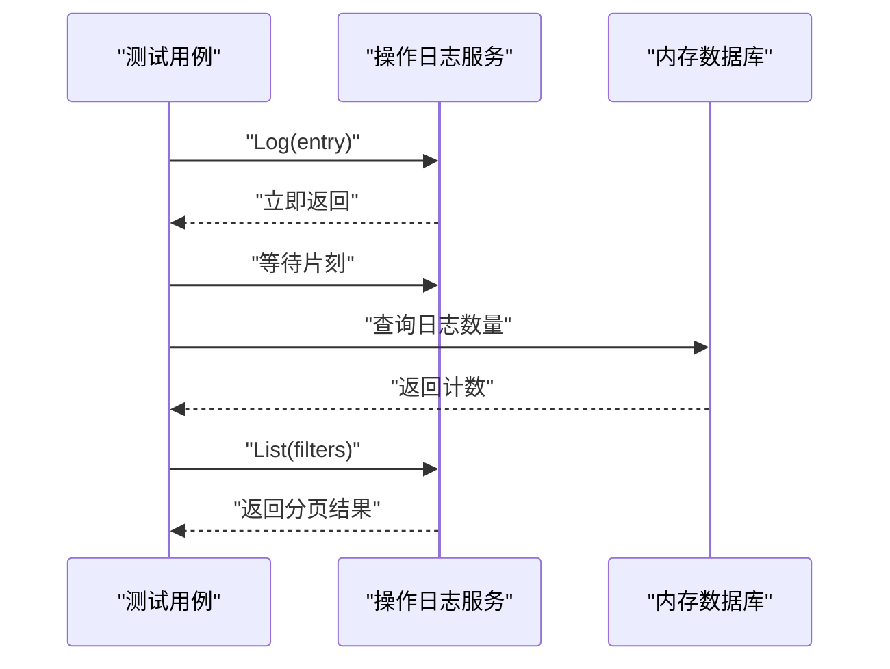
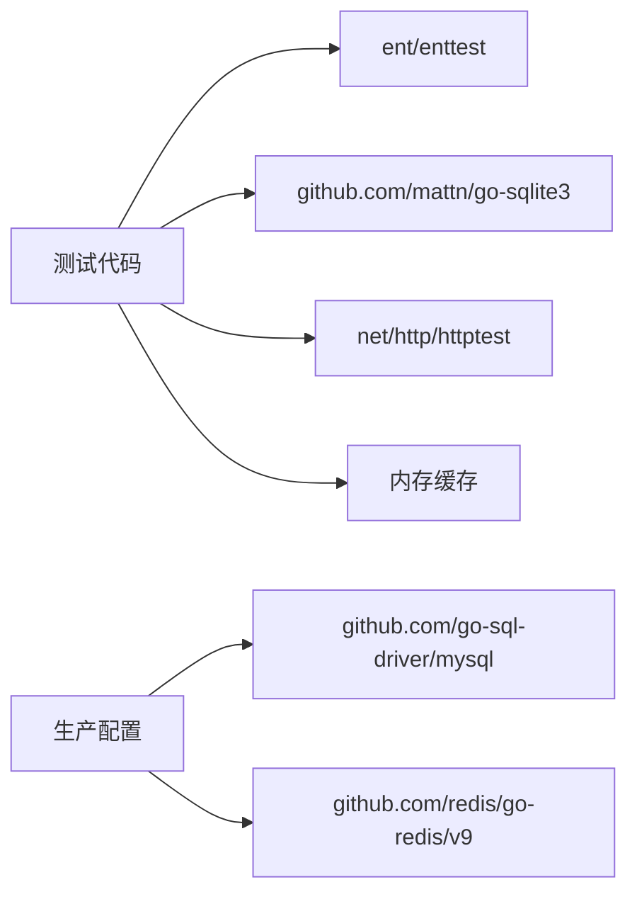

# 测试策略

<cite>
**本文引用的文件**
- [internal/service/attachment_test.go](file://internal/service/attachment_test.go)
- [internal/service/cron_job_test.go](file://internal/service/cron_job_test.go)
- [internal/service/permission_test.go](file://internal/service/permission_test.go)
- [internal/service/role_test.go](file://internal/service/role_test.go)
- [internal/service/operation_log_test.go](file://internal/service/operation_log_test.go)
- [internal/cron/executor_test.go](file://internal/cron/executor_test.go)
- [internal/cron/logger_test.go](file://internal/cron/logger_test.go)
- [internal/cron/manager_test.go](file://internal/cron/manager_test.go)
- [internal/ent/enttest/enttest.go](file://internal/ent/enttest/enttest.go)
- [.golangci.yml](file://.golangci.yml)
- [config/config.yml](file://config/config.yml)
- [go.mod](file://go.mod)
</cite>

## 目录
1. [引言](#引言)
2. [项目结构](#项目结构)
3. [核心组件](#核心组件)
4. [架构总览](#架构总览)
5. [详细组件分析](#详细组件分析)
6. [依赖分析](#依赖分析)
7. [性能考量](#性能考量)
8. [故障排查指南](#故障排查指南)
9. [结论](#结论)
10. [附录](#附录)

## 引言
本文件面向 Go Admin 管理系统的测试策略，系统化梳理单元测试、集成测试与测试最佳实践，覆盖数据库测试、定时任务执行器与日志管理、权限缓存失效与一致性验证等关键领域。文档同时给出测试覆盖率要求与测量建议、测试环境搭建指南以及在持续集成中运行测试与生成报告的建议流程。

## 项目结构
测试文件主要集中在以下位置：
- 服务层测试：internal/service/*.go（如附件、定时任务、权限、角色、操作日志）
- 定时任务子模块测试：internal/cron/*.go（执行器、日志器、调度器）
- 数据访问层测试辅助：internal/ent/enttest/enttest.go（内存数据库迁移与客户端封装）
- 工具与配置：.golangci.yml（静态检查）、config/config.yml（应用配置）

**图表来源**
- [internal/service/attachment_test.go:1-502](file://internal/service/attachment_test.go#L1-L502)
- [internal/service/cron_job_test.go:1-445](file://internal/service/cron_job_test.go#L1-L445)
- [internal/service/permission_test.go:1-528](file://internal/service/permission_test.go#L1-L528)
- [internal/service/role_test.go:1-238](file://internal/service/role_test.go#L1-L238)
- [internal/service/operation_log_test.go:1-329](file://internal/service/operation_log_test.go#L1-L329)
- [internal/cron/executor_test.go:1-183](file://internal/cron/executor_test.go#L1-L183)
- [internal/cron/logger_test.go:1-210](file://internal/cron/logger_test.go#L1-L210)
- [internal/cron/manager_test.go:1-214](file://internal/cron/manager_test.go#L1-L214)
- [internal/ent/enttest/enttest.go:1-86](file://internal/ent/enttest/enttest.go#L1-L86)
- [.golangci.yml:1-38](file://.golangci.yml#L1-L38)
- [config/config.yml:1-143](file://config/config.yml#L1-L143)

**章节来源**
- [internal/service/attachment_test.go:1-502](file://internal/service/attachment_test.go#L1-L502)
- [internal/service/cron_job_test.go:1-445](file://internal/service/cron_job_test.go#L1-L445)
- [internal/service/permission_test.go:1-528](file://internal/service/permission_test.go#L1-L528)
- [internal/service/role_test.go:1-238](file://internal/service/role_test.go#L1-L238)
- [internal/service/operation_log_test.go:1-329](file://internal/service/operation_log_test.go#L1-L329)
- [internal/cron/executor_test.go:1-183](file://internal/cron/executor_test.go#L1-L183)
- [internal/cron/logger_test.go:1-210](file://internal/cron/logger_test.go#L1-L210)
- [internal/cron/manager_test.go:1-214](file://internal/cron/manager_test.go#L1-L214)
- [internal/ent/enttest/enttest.go:1-86](file://internal/ent/enttest/enttest.go#L1-L86)
- [.golangci.yml:1-38](file://.golangci.yml#L1-L38)
- [config/config.yml:1-143](file://config/config.yml#L1-L143)

## 核心组件
- 内存数据库与迁移：通过 enttest.Open 自动迁移表结构，使用 SQLite 内存模式，关闭外键约束以简化测试。
- 服务层测试：围绕业务服务进行 CRUD、搜索、过滤、缓存命中与失效等场景验证。
- 定时任务子模块：Shell/Curl/Task 执行器、作业日志器、调度器管理器的单元测试。
- 权限与缓存：基于 Casbin 规则与内存缓存的权限查询与缓存失效一致性测试。
- 异步日志：操作日志服务采用异步写入，测试中通过等待确保可观测性。

**章节来源**
- [internal/ent/enttest/enttest.go:56-86](file://internal/ent/enttest/enttest.go#L56-L86)
- [internal/service/attachment_test.go:56-82](file://internal/service/attachment_test.go#L56-L82)
- [internal/service/cron_job_test.go:26-40](file://internal/service/cron_job_test.go#L26-L40)
- [internal/service/permission_test.go:47-62](file://internal/service/permission_test.go#L47-L62)
- [internal/service/operation_log_test.go:61-94](file://internal/service/operation_log_test.go#L61-L94)

## 架构总览
下图展示测试策略在系统中的分布与交互：

**图表来源**
- [internal/service/attachment_test.go:24-82](file://internal/service/attachment_test.go#L24-L82)
- [internal/service/cron_job_test.go:20-40](file://internal/service/cron_job_test.go#L20-L40)
- [internal/service/permission_test.go:28-62](file://internal/service/permission_test.go#L28-L62)
- [internal/cron/executor_test.go:16-183](file://internal/cron/executor_test.go#L16-L183)
- [internal/cron/logger_test.go:12-210](file://internal/cron/logger_test.go#L12-L210)
- [internal/cron/manager_test.go:23-214](file://internal/cron/manager_test.go#L23-L214)

## 详细组件分析

### 单元测试组织与编写规范
- 组织结构
  - 每个业务服务对应一个 *_test.go 文件，集中测试该服务的所有功能点。
  - 定时任务子模块单独目录，分别测试执行器、日志器与调度器管理器。
- 编写规范
  - 使用测试辅助函数创建内存数据库客户端与测试数据，保证隔离与可重复性。
  - 使用 t.Helper() 标记辅助函数，减少测试输出噪声。
  - 断言方法：直接比较字段值、错误类型与错误消息；对异步流程使用短暂等待后断言结果。
  - 对外部依赖（文件系统、缓存）使用内存或临时目录替代真实资源，避免跨平台差异。
  - 对并发/异步行为，使用上下文与等待策略确保可观测性。

**章节来源**
- [internal/service/attachment_test.go:56-82](file://internal/service/attachment_test.go#L56-L82)
- [internal/service/cron_job_test.go:26-40](file://internal/service/cron_job_test.go#L26-L40)
- [internal/service/permission_test.go:47-62](file://internal/service/permission_test.go#L47-L62)
- [internal/service/role_test.go:20-48](file://internal/service/role_test.go#L20-L48)
- [internal/service/operation_log_test.go:61-94](file://internal/service/operation_log_test.go#L61-L94)
- [internal/cron/executor_test.go:16-183](file://internal/cron/executor_test.go#L16-L183)
- [internal/cron/logger_test.go:12-210](file://internal/cron/logger_test.go#L12-L210)
- [internal/cron/manager_test.go:23-214](file://internal/cron/manager_test.go#L23-L214)

### 数据库测试（内存数据库与迁移）
- 使用 enttest.Open 创建内存数据库客户端，自动迁移表结构，关闭外键约束以简化测试。
- 在每个测试前构造最小化的初始数据，避免跨测试干扰。
- 对于需要外键引用的场景，通过自定义迁移选项或手动设置 RefTable 修复引用关系。

**图表来源**
- [internal/ent/enttest/enttest.go:56-86](file://internal/ent/enttest/enttest.go#L56-L86)
- [internal/service/permission_test.go:20-26](file://internal/service/permission_test.go#L20-L26)
- [internal/cron/manager_test.go:15-21](file://internal/cron/manager_test.go#L15-L21)

**章节来源**
- [internal/ent/enttest/enttest.go:56-86](file://internal/ent/enttest/enttest.go#L56-L86)
- [internal/service/permission_test.go:20-26](file://internal/service/permission_test.go#L20-L26)
- [internal/cron/manager_test.go:15-21](file://internal/cron/manager_test.go#L15-L21)

### 定时任务执行器与日志（集成测试风格）
- 执行器测试
  - ShellExecutor：验证命令执行与输出。
  - CurlExecutor：验证 HTTP 请求、响应体与状态码。
  - TaskExecutor：验证任务注册与执行。
- 日志器测试
  - 验证日志文件创建、列出、读取、尾读、过期清理与路径穿越防护。
- 调度器管理器测试
  - 验证作业添加/移除、立即执行、启动时仅加载启用作业、日志器获取。

**图表来源**
- [internal/cron/executor_test.go:45-146](file://internal/cron/executor_test.go#L45-L146)
- [internal/cron/logger_test.go:12-210](file://internal/cron/logger_test.go#L12-L210)
- [internal/cron/manager_test.go:87-125](file://internal/cron/manager_test.go#L87-L125)

**章节来源**
- [internal/cron/executor_test.go:16-183](file://internal/cron/executor_test.go#L16-L183)
- [internal/cron/logger_test.go:12-210](file://internal/cron/logger_test.go#L12-L210)
- [internal/cron/manager_test.go:46-198](file://internal/cron/manager_test.go#L46-L198)

### 权限与缓存一致性（集成测试风格）
- 用户菜单/按钮/API 权限查询：首次调用走数据库并填充缓存，后续调用命中缓存。
- 权限变更（新增、更新、删除、分配/移除）：触发缓存失效，重新查询返回最新数据。
- 角色状态变更：影响关联用户的多类权限缓存，均需清理。

**图表来源**
- [internal/service/permission_test.go:114-190](file://internal/service/permission_test.go#L114-L190)
- [internal/service/permission_test.go:340-396](file://internal/service/permission_test.go#L340-L396)
- [internal/service/permission_test.go:398-527](file://internal/service/permission_test.go#L398-L527)
- [internal/service/role_test.go:99-135](file://internal/service/role_test.go#L99-L135)
- [internal/service/role_test.go:137-237](file://internal/service/role_test.go#L137-L237)

**章节来源**
- [internal/service/permission_test.go:114-190](file://internal/service/permission_test.go#L114-L190)
- [internal/service/permission_test.go:340-396](file://internal/service/permission_test.go#L340-L396)
- [internal/service/permission_test.go:398-527](file://internal/service/permission_test.go#L398-L527)
- [internal/service/role_test.go:99-135](file://internal/service/role_test.go#L99-L135)
- [internal/service/role_test.go:137-237](file://internal/service/role_test.go#L137-L237)

### 附件与文件系统（集成测试风格）
- 使用内存存储模拟文件系统，避免磁盘路径差异与并发问题。
- 支持上传、移动分组、批量删除、列表过滤（关键词、分组、MIME 前缀）等场景。
- 上传流程构造 multipart 表单头，模拟真实上传请求。

**图表来源**
- [internal/service/attachment_test.go:280-501](file://internal/service/attachment_test.go#L280-L501)
- [internal/service/attachment_test.go:84-112](file://internal/service/attachment_test.go#L84-L112)

**章节来源**
- [internal/service/attachment_test.go:280-501](file://internal/service/attachment_test.go#L280-L501)
- [internal/service/attachment_test.go:84-112](file://internal/service/attachment_test.go#L84-L112)

### 操作日志（异步测试）
- 日志服务异步写入，测试中通过短暂等待确保落库后再断言。
- 支持按模块、动作、用户名、时间范围等条件筛选与分页。

**图表来源**
- [internal/service/operation_log_test.go:61-137](file://internal/service/operation_log_test.go#L61-L137)
- [internal/service/operation_log_test.go:224-276](file://internal/service/operation_log_test.go#L224-L276)

**章节来源**
- [internal/service/operation_log_test.go:61-137](file://internal/service/operation_log_test.go#L61-L137)
- [internal/service/operation_log_test.go:224-276](file://internal/service/operation_log_test.go#L224-L276)

## 依赖分析
- 测试依赖
  - ent 用于 ORM 与自动迁移，enttest 提供内存数据库客户端。
  - SQLite 驱动用于内存数据库。
  - httptest 用于 HTTP 执行器测试。
  - 内存缓存用于权限与角色相关测试。
- 外部依赖
  - MySQL 驱动用于生产数据库连接（测试中通常不直接使用）。
  - Redis 客户端库用于缓存连接（测试中可用内存缓存替代）。

**图表来源**
- [internal/ent/enttest/enttest.go:56-86](file://internal/ent/enttest/enttest.go#L56-L86)
- [go.mod:5-21](file://go.mod#L5-L21)
- [config/config.yml:19-59](file://config/config.yml#L19-L59)

**章节来源**
- [internal/ent/enttest/enttest.go:56-86](file://internal/ent/enttest/enttest.go#L56-L86)
- [go.mod:5-21](file://go.mod#L5-L21)
- [config/config.yml:19-59](file://config/config.yml#L19-L59)

## 性能考量
- 内存数据库与临时目录：避免磁盘 I/O 与网络延迟，提升测试吞吐。
- 缓存命中与失效：通过缓存命中测试与失效验证，确保缓存策略正确，避免不必要的数据库压力。
- 异步流程等待：对异步写入的日志服务，使用合理等待时间平衡稳定性与测试时长。
- 并发与竞争：对并发敏感的测试，使用上下文与同步机制确保断言时机正确。

## 故障排查指南
- 内存数据库外键问题
  - 症状：迁移时报外键错误。
  - 处理：通过 enttest.WithMigrateOptions 关闭外键约束，或在 TestMain 中修复 RefTable。
- 缓存未命中或未失效
  - 症状：权限变更后仍返回旧数据。
  - 处理：确认缓存键拼接规则一致，变更操作后清理相关缓存键。
- 文件系统路径问题
  - 症状：上传/下载失败或路径异常。
  - 处理：使用临时目录与内存存储，避免绝对路径与跨平台分隔符。
- 异步日志未落库
  - 症状：日志计数为 0。
  - 处理：增加等待时间或使用更稳健的轮询/通知机制。

**章节来源**
- [internal/ent/enttest/enttest.go:56-86](file://internal/ent/enttest/enttest.go#L56-L86)
- [internal/service/permission_test.go:20-26](file://internal/service/permission_test.go#L20-L26)
- [internal/service/operation_log_test.go:83-94](file://internal/service/operation_log_test.go#L83-L94)

## 结论
本测试策略以“内存数据库 + 服务层与子模块单元测试”为核心，结合权限缓存一致性与异步日志的可观测性设计，形成覆盖关键业务路径的测试体系。通过统一的测试辅助函数与断言规范，确保测试可维护性与可重复性。建议在持续集成中引入覆盖率统计与静态检查，进一步提升测试质量与代码健康度。

## 附录

### 测试覆盖率要求与测量方法
- 覆盖率目标
  - 服务层与子模块关键逻辑覆盖率不低于 80%，核心路径不低于 90%。
- 测量方法
  - 使用 go test -cover 生成覆盖率报告，结合 go test -coverprofile 生成覆盖率文件，再用 go tool cover -html 生成可视化报告。
  - 在 CI 中将覆盖率阈值纳入门禁，未达标则阻断合并。
- 质量评估
  - 结合 .golangci.yml 的静态检查规则，确保代码风格与潜在问题及时发现。

**章节来源**
- [.golangci.yml:14-38](file://.golangci.yml#L14-L38)

### 测试环境搭建指南
- 本地开发
  - 确保已安装 Go 与 SQLite 驱动，使用 go test 运行单个包或全仓库测试。
- 测试数据库
  - 使用 enttest.Open 的内存数据库模式，无需额外数据库实例。
- 配置文件
  - 应用配置位于 config/config.yml，测试期间可按需覆盖或使用默认值。
- 依赖管理
  - go.mod 中声明了测试所需依赖，确保 go mod tidy 后再运行测试。

**章节来源**
- [internal/ent/enttest/enttest.go:56-86](file://internal/ent/enttest/enttest.go#L56-L86)
- [config/config.yml:1-143](file://config/config.yml#L1-L143)
- [go.mod:1-127](file://go.mod#L1-L127)

### 持续集成中的测试自动化与报告生成
- 测试自动化
  - 在 CI 中执行 go test ./...，开启 -cover 与 -race（可选）。
  - 将覆盖率文件上传至覆盖率平台（如 codecov），并设置阈值门禁。
- 报告生成
  - 使用 go tool cover -html 生成 HTML 报告，或导出为 JSON 供 CI 平台消费。
- 最佳实践
  - 将 .golangci.yml 集成到 CI，确保静态检查与格式化一致性。
  - 对定时任务与异步日志测试，适当放宽等待时间或使用更稳健的断言策略。

**章节来源**
- [.golangci.yml:1-38](file://.golangci.yml#L1-L38)