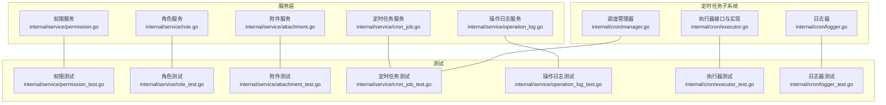
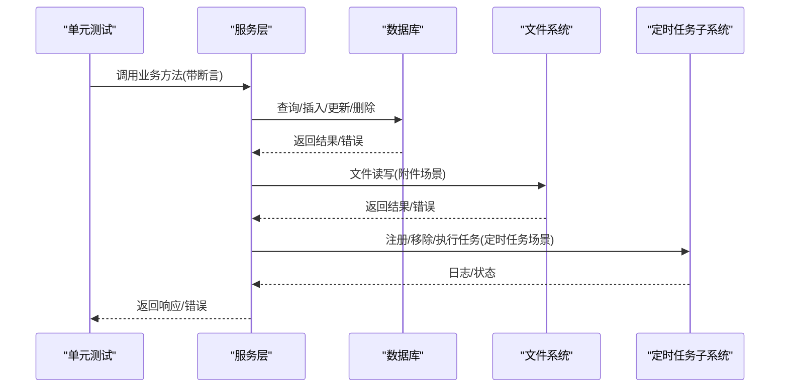
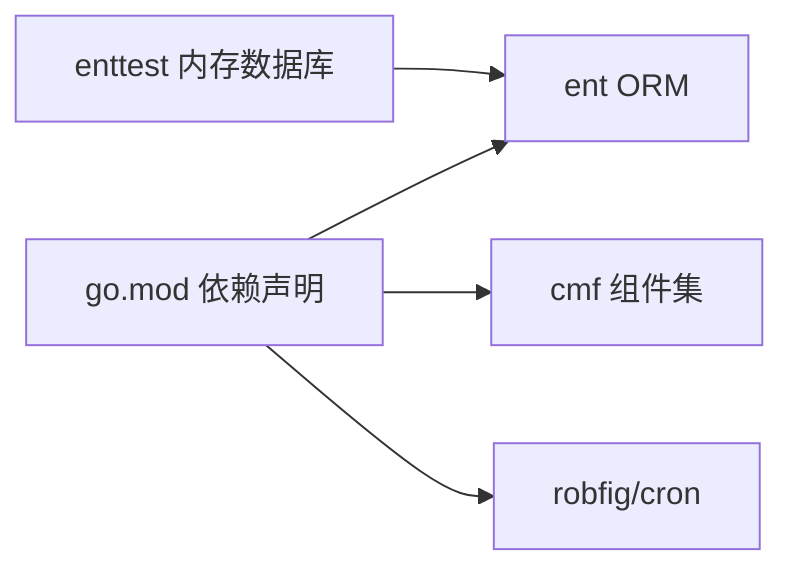

# 测试覆盖率

<cite>
**本文引用的文件**
- [go.mod](file://go.mod)
- [.golangci.yml](file://.golangci.yml)
- [internal/service/attachment_test.go](file://internal/service/attachment_test.go)
- [internal/service/cron_job_test.go](file://internal/service/cron_job_test.go)
- [internal/service/permission_test.go](file://internal/service/permission_test.go)
- [internal/service/role_test.go](file://internal/service/role_test.go)
- [internal/service/operation_log_test.go](file://internal/service/operation_log_test.go)
- [internal/cron/executor_test.go](file://internal/cron/executor_test.go)
- [internal/cron/logger_test.go](file://internal/cron/logger_test.go)
- [internal/service/permission.go](file://internal/service/permission.go)
- [internal/service/role.go](file://internal/service/role.go)
- [internal/service/attachment.go](file://internal/service/attachment.go)
- [internal/service/cron_job.go](file://internal/service/cron_job.go)
- [internal/service/operation_log.go](file://internal/service/operation_log.go)
- [internal/cron/executor.go](file://internal/cron/executor.go)
- [internal/cron/manager.go](file://internal/cron/manager.go)
</cite>

## 目录
1. [简介](#简介)
2. [项目结构](#项目结构)
3. [核心组件](#核心组件)
4. [架构总览](#架构总览)
5. [详细组件分析](#详细组件分析)
6. [依赖关系分析](#依赖关系分析)
7. [性能考量](#性能考量)
8. [故障排查指南](#故障排查指南)
9. [结论](#结论)
10. [附录](#附录)

## 简介
本文件围绕 Go Admin 管理系统的测试覆盖率展开，系统性阐述覆盖率概念与意义，覆盖代码覆盖率、分支覆盖率与函数覆盖率；给出覆盖率配置与运行方式、报告生成与解读方法；提供覆盖率阈值设定与在持续集成中的检查配置建议；并总结提升覆盖率的最佳实践与常见陷阱。

## 项目结构
该项目采用模块化与分层架构组织，测试集中在 internal/service 与 internal/cron 目录下，分别覆盖业务服务与定时任务子系统。整体结构如下：

图示来源
- [internal/service/permission.go](file://internal/service/permission.go)
- [internal/service/role.go](file://internal/service/role.go)
- [internal/service/attachment.go](file://internal/service/attachment.go)
- [internal/service/cron_job.go](file://internal/service/cron_job.go)
- [internal/service/operation_log.go](file://internal/service/operation_log.go)
- [internal/cron/executor.go](file://internal/cron/executor.go)
- [internal/cron/logger.go](file://internal/cron/logger.go)
- [internal/cron/manager.go](file://internal/cron/manager.go)
- [internal/service/permission_test.go](file://internal/service/permission_test.go)
- [internal/service/role_test.go](file://internal/service/role_test.go)
- [internal/service/attachment_test.go](file://internal/service/attachment_test.go)
- [internal/service/cron_job_test.go](file://internal/service/cron_job_test.go)
- [internal/service/operation_log_test.go](file://internal/service/operation_log_test.go)
- [internal/cron/executor_test.go](file://internal/cron/executor_test.go)
- [internal/cron/logger_test.go](file://internal/cron/logger_test.go)

章节来源
- [go.mod](file://go.mod)
- [.golangci.yml](file://.golangci.yml)

## 核心组件
- 权限服务：负责权限的增删改查、角色权限分配与缓存失效、用户多类权限查询与校验。
- 角色服务：负责角色的增删改查、启停状态变更与用户权限缓存清理。
- 附件服务：负责文件上传、删除、批量删除、列表检索、移动分组等。
- 定时任务服务：负责任务的创建、更新、启停、立即执行、日志查看与尾读。
- 操作日志服务：异步记录操作日志，支持列表查询与详情获取。
- 定时任务子系统：执行器（Shell/Curl/Task）、日志器（文件日志管理）、调度管理器（robfig/cron 集成）。

章节来源
- [internal/service/permission.go](file://internal/service/permission.go)
- [internal/service/role.go](file://internal/service/role.go)
- [internal/service/attachment.go](file://internal/service/attachment.go)
- [internal/service/cron_job.go](file://internal/service/cron_job.go)
- [internal/service/operation_log.go](file://internal/service/operation_log.go)
- [internal/cron/executor.go](file://internal/cron/executor.go)
- [internal/cron/manager.go](file://internal/cron/manager.go)

## 架构总览
下图展示了测试覆盖的关键交互路径与断言点，帮助定位未覆盖分支与边界条件。

图示来源
- [internal/service/permission_test.go](file://internal/service/permission_test.go)
- [internal/service/role_test.go](file://internal/service/role_test.go)
- [internal/service/attachment_test.go](file://internal/service/attachment_test.go)
- [internal/service/cron_job_test.go](file://internal/service/cron_job_test.go)
- [internal/service/operation_log_test.go](file://internal/service/operation_log_test.go)
- [internal/cron/executor_test.go](file://internal/cron/executor_test.go)
- [internal/cron/logger_test.go](file://internal/cron/logger_test.go)

## 详细组件分析

### 权限服务测试覆盖率分析
- 覆盖点
  - 权限创建/更新/删除/查询/列表
  - 角色权限分配/移除/查询
  - 用户菜单/按钮/API 权限查询
  - 缓存命中与失效（角色与用户维度）
  - 错误类型断言（不存在、非法类型、已存在等）
- 未覆盖风险
  - 权限类型校验与动态推断分支
  - Casbin 规则查询的组合条件分支
  - 缓存键构造与 TTL 控制的边界
- 建议补充
  - 增加非法权限类型的创建/更新用例
  - 增加空角色/无权限用户的查询用例
  - 增加缓存异常场景（如缓存不可用）

章节来源
- [internal/service/permission_test.go](file://internal/service/permission_test.go)
- [internal/service/permission.go](file://internal/service/permission.go)

### 角色服务测试覆盖率分析
- 覆盖点
  - 角色创建/查询/列表/更新/删除
  - 角色启停状态变更
  - 用户权限缓存清理（多类型）
- 未覆盖风险
  - 系统内置角色保护分支
  - 角色使用状态检查与删除保护
  - 更新字段白名单控制
- 建议补充
  - 系统内置角色的更新/删除用例
  - 角色被用户占用时的删除用例
  - 多种状态组合下的启停用例

章节来源
- [internal/service/role_test.go](file://internal/service/role_test.go)
- [internal/service/role.go](file://internal/service/role.go)

### 附件服务测试覆盖率分析
- 覆盖点
  - 上传（含文件头解析、MIME 推断、UUID 路径生成）
  - 删除/批量删除
  - 列表检索（关键词、分组、MIME 前缀）
  - 移动到分组（清空分组）
  - 文件数据读取
- 未覆盖风险
  - 文件系统写入失败回滚
  - 数据库记录失败回滚
  - 非法文件头/空扩展名场景
- 建议补充
  - 文件系统写失败的回滚用例
  - 数据库写失败的清理用例
  - 非法扩展名/空扩展名的健壮性用例

章节来源
- [internal/service/attachment_test.go](file://internal/service/attachment_test.go)
- [internal/service/attachment.go](file://internal/service/attachment.go)

### 定时任务服务测试覆盖率分析
- 覆盖点
  - 任务创建（表达式校验、任务类型校验、唯一性校验）
  - 任务更新（表达式/类型/命令变更与重注册）
  - 任务启停（调度器注册/移除）
  - 立即执行
  - 日志列表/读取/尾读
- 未覆盖风险
  - 任务类型为 task 时的注册校验
  - 表达式解析失败的处理
  - 调度器注册/移除异常
- 建议补充
  - 无效表达式的创建/更新用例
  - 未注册 task 的创建用例
  - 调度器异常场景的容错用例

章节来源
- [internal/service/cron_job_test.go](file://internal/service/cron_job_test.go)
- [internal/service/cron_job.go](file://internal/service/cron_job.go)

### 操作日志服务测试覆盖率分析
- 覆盖点
  - 异步日志记录
  - 列表查询（多维过滤）
  - 详情查询（不存在场景）
- 未覆盖风险
  - 异步写入失败的降级
  - 时间范围解析异常
- 建议补充
  - 异步写入失败的兜底用例
  - 非法时间格式的容错用例

章节来源
- [internal/service/operation_log_test.go](file://internal/service/operation_log_test.go)
- [internal/service/operation_log.go](file://internal/service/operation_log.go)

### 定时任务子系统测试覆盖率分析
- 覆盖点
  - Shell 执行器（跨平台命令执行）
  - Curl 执行器（JSON 命令解析、HTTP 请求、状态码校验）
  - Task 执行器（任务注册查找）
  - 日志器（创建/列出/读取/尾读、过期清理、路径穿越防护）
- 未覆盖风险
  - Curl 命令解析失败
  - HTTP 请求超时/错误状态
  - 日志文件过期清理时机
- 建议补充
  - 无效 JSON 的解析错误用例
  - 非 2xx 状态码的错误用例
  - 路径穿越攻击防护用例
  - 过期日志清理的边界用例

章节来源
- [internal/cron/executor_test.go](file://internal/cron/executor_test.go)
- [internal/cron/logger_test.go](file://internal/cron/logger_test.go)
- [internal/cron/executor.go](file://internal/cron/executor.go)

## 依赖关系分析
- 服务层依赖 ent ORM 进行数据库访问，依赖 cmf 组件（缓存、加密、JWT、文件系统）。
- 定时任务子系统依赖 robfig/cron 实现调度，依赖 cmf 日志组件。
- 测试通过 enttest 在内存数据库上运行，避免外部依赖。

图示来源
- [go.mod](file://go.mod)

章节来源
- [go.mod](file://go.mod)

## 性能考量
- 测试并发与资源隔离：使用内存数据库与临时文件，避免磁盘与网络依赖，提高测试稳定性与速度。
- 缓存与日志：权限服务的缓存命中与失效对性能影响显著，需关注缓存键构造与 TTL。
- 定时任务：日志清理与任务执行的异步化减少主线程阻塞。

## 故障排查指南
- 常见错误类型
  - 权限服务：权限不存在、非法类型、已存在、角色不存在
  - 角色服务：角色不存在、名称已存在、系统角色保护、角色在用
  - 附件服务：附件不存在、上传/删除失败
  - 定时任务服务：任务不存在、表达式无效、任务未注册、日志不存在
  - 操作日志服务：日志不存在
- 排查步骤
  - 核对输入参数与约束（长度、枚举、格式）
  - 检查数据库唯一性与外键约束
  - 校验文件系统路径与权限
  - 验证定时任务表达式与任务注册状态
  - 确认缓存键与 TTL 设置

章节来源
- [internal/service/permission.go](file://internal/service/permission.go)
- [internal/service/role.go](file://internal/service/role.go)
- [internal/service/attachment.go](file://internal/service/attachment.go)
- [internal/service/cron_job.go](file://internal/service/cron_job.go)
- [internal/service/operation_log.go](file://internal/service/operation_log.go)

## 结论
当前测试覆盖了核心业务流程与关键分支，但仍存在部分边界与异常场景未覆盖。建议在现有基础上补充以下方面：非法输入与异常路径、缓存与文件系统异常、定时任务调度器异常、日志清理边界等。通过持续改进测试用例与引入覆盖率阈值，可进一步提升代码质量与系统可靠性。

## 附录

### 测试覆盖率概念与重要性
- 代码覆盖率：已执行语句占总语句的比例，反映测试对代码的“触达”程度。
- 分支覆盖率：已执行分支占总分支的比例，衡量条件判断的覆盖情况。
- 函数覆盖率：已调用函数占总函数的比例，评估功能模块的测试完整性。
- 重要性：高覆盖率有助于发现未测试路径、降低回归风险、提升代码可维护性。

### 如何配置与运行覆盖率测试
- 基本命令
  - 运行全部包的覆盖率测试并生成 HTML 报告：
    - go test ./... -cover -covermode=atomic -coverprofile=coverage.out
    - go tool cover -html=coverage.out -o coverage.html
  - 运行特定包的覆盖率测试：
    - go test ./internal/service -cover -covermode=atomic -coverprofile=coverage.out
  - 输出文本报告：
    - go tool cover -func=coverage.out
- 参数说明
  - -cover：启用覆盖率统计
  - -covermode=atomic：线程安全模式
  - -coverprofile：输出覆盖率文件
  - -html/-func：生成 HTML 或函数级报告

### 覆盖率报告解读方法
- 未覆盖的行/分支/函数：优先定位到具体文件与行号，结合业务逻辑分析是否为死代码或遗漏分支。
- 低覆盖率模块：集中补充边界条件与异常路径测试，如空值、越界、非法输入、外部依赖失败等。
- 缓存与并发：关注并发安全与缓存一致性，确保多线程场景下的正确性。

### 覆盖率阈值与持续集成
- 阈值建议
  - 语句覆盖率：≥80%
  - 分支覆盖率：≥70%
  - 函数覆盖率：≥90%
- CI 集成
  - 在 CI 中增加覆盖率检查步骤，若低于阈值则失败。
  - 使用覆盖率文件作为后续优化依据，定期回顾未覆盖路径。

### 提升覆盖率的最佳实践
- 从失败场景入手：重点覆盖错误输入、边界值、异常路径。
- 分层测试：服务层、数据层、外部依赖层分别设计用例。
- 使用表驱动测试：用例数据结构化，便于扩展与维护。
- 避免覆盖率陷阱：仅为了提高覆盖率而添加无意义断言，应确保测试具备实际价值。

### 使用 golangci-lint 进行代码质量检查与覆盖率统计
- 配置要点
  - 跳过目录与文件：skip-dirs、skip-files
  - 启用 linters：gofmt、golint、govet
  - 问题数量限制：max-issues-per-linter、max-same-issues
- 覆盖率统计
  - golangci-lint 本身不直接生成覆盖率报告，建议配合 go test 与 go tool cover 使用。
  - 可在 CI 中先运行 golangci-lint，再运行覆盖率测试，双管齐下保障质量。

章节来源
- [.golangci.yml](file://.golangci.yml)