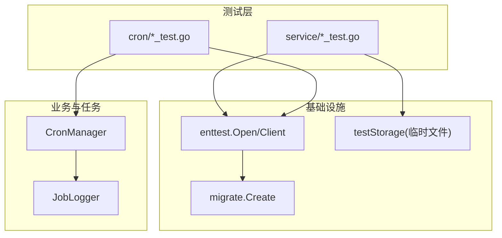
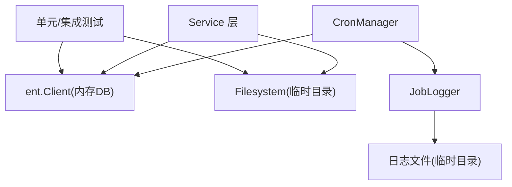
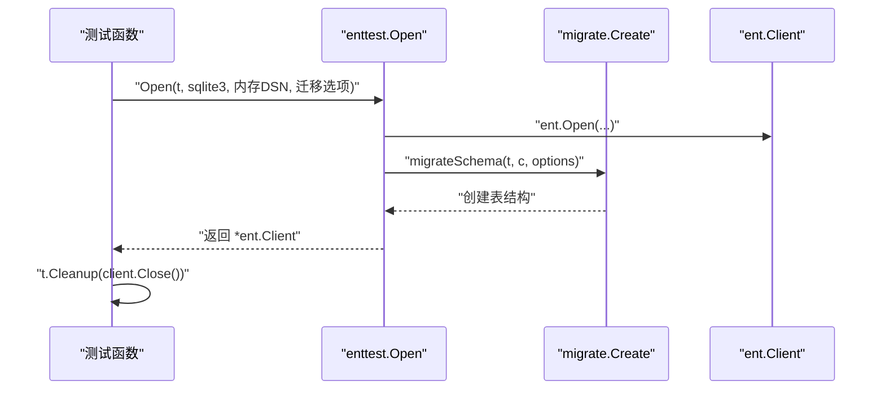
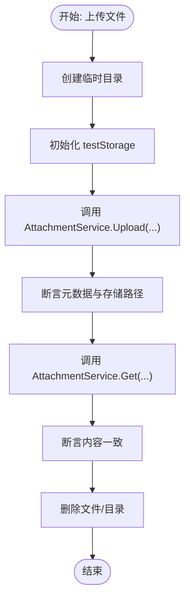
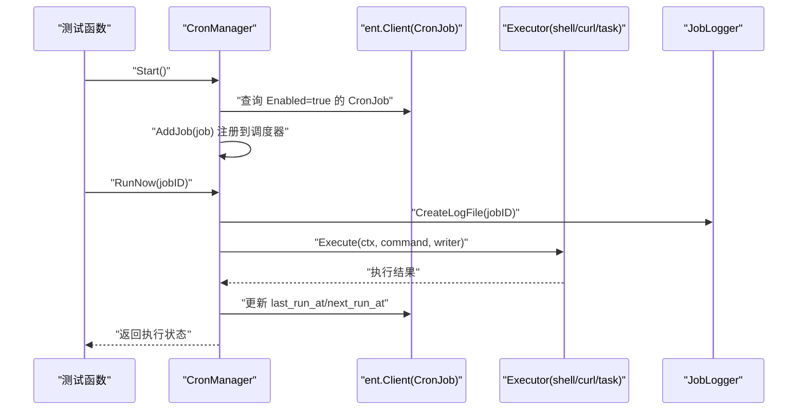
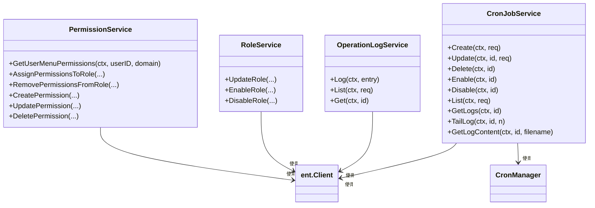
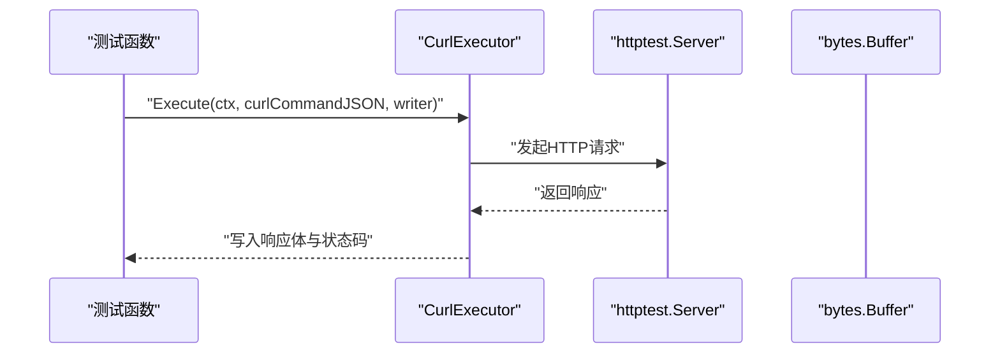
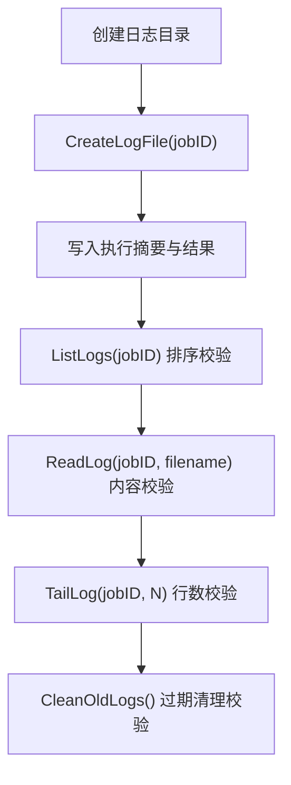
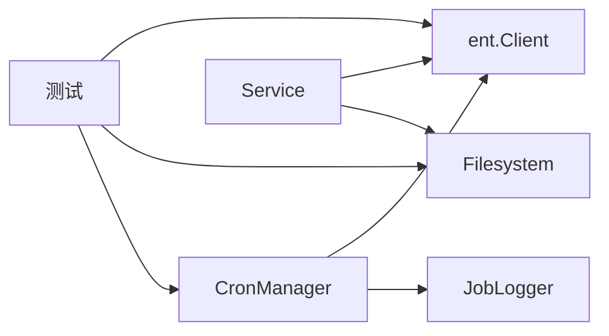

# 集成测试

<cite>
**本文引用的文件**
- [main.go](file://main.go)
- [config.yml](file://config/config.yml)
- [app.go](file://internal/app.go)
- [enttest.go](file://internal/ent/enttest/enttest.go)
- [migrate.go](file://internal/ent/migrate/migrate.go)
- [attachment_test.go](file://internal/service/attachment_test.go)
- [cron_job_test.go](file://internal/service/cron_job_test.go)
- [operation_log_test.go](file://internal/service/operation_log_test.go)
- [permission_test.go](file://internal/service/permission_test.go)
- [role_test.go](file://internal/service/role_test.go)
- [executor_test.go](file://internal/cron/executor_test.go)
- [logger_test.go](file://internal/cron/logger_test.go)
- [manager_test.go](file://internal/cron/manager_test.go)
- [manager.go](file://internal/cron/manager.go)
- [user.go](file://internal/service/user.go)
</cite>

## 目录
1. [简介](#简介)
2. [项目结构](#项目结构)
3. [核心组件](#核心组件)
4. [架构总览](#架构总览)
5. [详细组件分析](#详细组件分析)
6. [依赖分析](#依赖分析)
7. [性能考虑](#性能考虑)
8. [故障排查指南](#故障排查指南)
9. [结论](#结论)
10. [附录](#附录)

## 简介
本文件面向 Go Admin 管理系统的集成测试，系统性阐述测试设计理念与实施策略，覆盖服务层测试、API 接口测试、数据库集成测试、文件系统集成测试以及定时任务集成测试。重点说明如何使用 enttest 包进行内存数据库的初始化、迁移与清理；如何模拟临时文件存储并验证文件操作；如何配置与验证定时任务调度、执行监控与日志清理；并提供端到端测试的思路与步骤，包括请求构造、响应验证与错误场景测试。

## 项目结构
- 测试集中在 internal/service 与 internal/cron 目录，分别覆盖业务服务与定时任务模块。
- 数据库集成测试统一通过 internal/ent/enttest 提供的 Open/Client 工具进行内存数据库初始化与迁移。
- 文件系统测试通过自定义 testStorage 模拟临时目录中的文件读写，避免真实磁盘问题。
- 定时任务测试通过 CronManager 的 Start/Stop 生命周期与 JobLogger 的日志文件管理进行验证。

**图示来源**
- [enttest.go:56-85](file://internal/ent/enttest/enttest.go#L56-L85)
- [migrate.go:44-55](file://internal/ent/migrate/migrate.go#L44-L55)
- [manager.go:27-38](file://internal/cron/manager.go#L27-L38)

**章节来源**
- [main.go:47-104](file://main.go#L47-L104)
- [config.yml:1-143](file://config/config.yml#L1-L143)
- [app.go:15-26](file://internal/app.go#L15-L26)

## 核心组件
- 数据库集成测试基座：enttest.Open/Client 自动迁移，支持内存数据库（SQLite 内存模式）与外键控制选项。
- 文件系统集成测试基座：testStorage 实现基于临时目录的文件存取，隔离真实存储。
- 定时任务集成测试基座：CronManager 负责任务注册、执行与日志记录；JobLogger 负责日志文件生命周期管理。
- 服务层测试基座：各 Service 在测试中注入 ent.Client 与可选缓存/文件系统实例，确保端到端链路可测。

**章节来源**
- [enttest.go:56-85](file://internal/ent/enttest/enttest.go#L56-L85)
- [migrate.go:44-55](file://internal/ent/migrate/migrate.go#L44-L55)
- [manager.go:17-38](file://internal/cron/manager.go#L17-L38)

## 架构总览
下图展示了集成测试在系统中的位置与交互关系：测试通过 enttest 初始化内存数据库，按需注入文件系统与缓存，调用服务层与定时任务管理器，最终验证数据一致性、文件操作与日志行为。

**图示来源**
- [enttest.go:56-85](file://internal/ent/enttest/enttest.go#L56-L85)
- [manager.go:17-38](file://internal/cron/manager.go#L17-L38)
- [logger_test.go:12-38](file://internal/cron/logger_test.go#L12-L38)

## 详细组件分析

### 数据库集成测试（enttest）
- 初始化与迁移
  - 使用 enttest.Open 打开内存数据库连接，传入 SQLite 内存 DSN，并通过 WithMigrateOptions 控制外键等迁移选项。
  - Open 内部调用 migrate.Create 完成表结构迁移，确保测试前 schema 就绪。
- 清理流程
  - 通过 t.Cleanup 注册关闭钩子，确保测试结束后释放连接与资源。
- 外键约束控制
  - 在部分测试中通过 WithForeignKeys(false) 关闭外键校验，便于快速插入测试数据与验证约束逻辑。

**图示来源**
- [enttest.go:56-85](file://internal/ent/enttest/enttest.go#L56-L85)
- [migrate.go:44-55](file://internal/ent/migrate/migrate.go#L44-L55)

**章节来源**
- [enttest.go:56-85](file://internal/ent/enttest/enttest.go#L56-L85)
- [migrate.go:44-55](file://internal/ent/migrate/migrate.go#L44-L55)

### 文件系统集成测试（临时文件存储）
- 临时文件存储模拟
  - 通过 t.TempDir() 创建临时目录，testStorage 基于该目录实现 Get/Set/Delete，避免真实磁盘耦合。
- 上传/下载/删除验证
  - 附件服务测试中，构造 multipart 表单文件头，调用 Upload/Delete 并断言元数据与存储结果。
- 文件操作边界
  - 通过 CreateLogFile/ReadLog/TailLog 验证日志文件的创建、读取与尾部查看能力，确保路径安全与内容正确。

**图示来源**
- [attachment_test.go:24-82](file://internal/service/attachment_test.go#L24-L82)
- [logger_test.go:87-148](file://internal/cron/logger_test.go#L87-L148)

**章节来源**
- [attachment_test.go:24-82](file://internal/service/attachment_test.go#L24-L82)
- [logger_test.go:87-148](file://internal/cron/logger_test.go#L87-L148)

### 定时任务集成测试（调度、执行与日志）
- 任务管理器初始化
  - 通过 NewCronManager 注入 ent.Client、日志目录与日志保留时长，内置 shell/curl/task 三种执行器。
- 任务注册与启停
  - Start 从数据库加载启用的任务并注册到调度器；Stop 优雅停止。
- 立即执行与日志记录
  - RunNow 支持立即执行指定任务，内部创建日志文件并记录开始/结束时间、耗时与状态；同时更新任务的 last_run_at 与 next_run_at。
- 日志清理
  - 内部注册每日凌晨 2 点的日志清理任务，清理过期日志文件。

**图示来源**
- [manager.go:40-147](file://internal/cron/manager.go#L40-L147)
- [manager_test.go:142-198](file://internal/cron/manager_test.go#L142-L198)

**章节来源**
- [manager.go:17-237](file://internal/cron/manager.go#L17-L237)
- [manager_test.go:15-214](file://internal/cron/manager_test.go#L15-L214)

### 服务层集成测试（权限、角色、操作日志、定时任务）
- 权限服务测试
  - 通过缓存与数据库联动，验证菜单/按钮/API 权限的缓存命中与失效；对角色权限变更触发用户权限缓存清理。
- 角色服务测试
  - 验证角色启用/禁用与更新操作对用户权限缓存的影响。
- 操作日志服务测试
  - 异步写入后等待落库，验证过滤条件（模块、动作、用户名、时间范围）与分页查询。
- 定时任务服务测试
  - 对 CronJob 的增删改查、启用/禁用、日志查看与尾部查看进行验证；结合 CronManager 的 AddJob/RunNow 行为。

**图示来源**
- [permission_test.go:46-62](file://internal/service/permission_test.go#L46-L62)
- [role_test.go:20-48](file://internal/service/role_test.go#L20-L48)
- [operation_log_test.go:16-26](file://internal/service/operation_log_test.go#L16-L26)
- [cron_job_test.go:26-40](file://internal/service/cron_job_test.go#L26-L40)

**章节来源**
- [permission_test.go:46-62](file://internal/service/permission_test.go#L46-L62)
- [role_test.go:20-48](file://internal/service/role_test.go#L20-L48)
- [operation_log_test.go:16-26](file://internal/service/operation_log_test.go#L16-L26)
- [cron_job_test.go:26-40](file://internal/service/cron_job_test.go#L26-L40)

### 执行器集成测试（Shell/Curl/Task）
- ShellExecutor
  - 验证简单命令输出与失败命令的错误传播。
- CurlExecutor
  - 通过 httptest.NewServer 模拟 HTTP 服务，验证 GET/POST 请求、状态码错误与 JSON 解析错误。
- TaskExecutor
  - 通过全局注册表注册任务，验证已注册与未注册任务的执行行为。

**图示来源**
- [executor_test.go:45-110](file://internal/cron/executor_test.go#L45-L110)

**章节来源**
- [executor_test.go:18-183](file://internal/cron/executor_test.go#L18-L183)

### 日志管理器集成测试（文件生命周期）
- 日志文件创建、列出、读取、尾部查看与过期清理
  - 通过临时目录与时间戳命名保证日志文件有序可读；路径穿越防护确保安全性；过期清理验证保留策略生效。

**图示来源**
- [logger_test.go:12-210](file://internal/cron/logger_test.go#L12-L210)

**章节来源**
- [logger_test.go:12-210](file://internal/cron/logger_test.go#L12-L210)

## 依赖分析
- 组件耦合
  - CronManager 依赖 ent.Client 进行任务持久化与状态更新，依赖 JobLogger 进行日志文件管理。
  - Service 层依赖 ent.Client 与可选缓存/文件系统，确保业务逻辑与基础设施解耦。
- 外部依赖
  - SQLite 内存数据库用于测试隔离；robfig/cron/v3 作为调度器；zap 用于日志记录。
- 循环依赖
  - 当前结构清晰，未发现循环依赖迹象。

**图示来源**
- [manager.go:17-38](file://internal/cron/manager.go#L17-L38)
- [app.go:15-26](file://internal/app.go#L15-L26)

**章节来源**
- [manager.go:17-38](file://internal/cron/manager.go#L17-L38)
- [app.go:15-26](file://internal/app.go#L15-L26)

## 性能考虑
- 内存数据库优势：SQLite 内存模式速度快、无需磁盘 IO，适合高并发测试。
- 缓存与异步：权限与操作日志服务涉及缓存与异步写入，测试中需适当等待以保证数据一致性。
- 日志清理：定期清理过期日志降低磁盘占用，建议在测试中验证保留策略与清理时机。

## 故障排查指南
- 数据库迁移失败
  - 检查 WithMigrateOptions 参数与表结构定义；确认外键设置与测试数据插入顺序。
- 文件系统异常
  - 确认临时目录权限与路径拼接；避免路径穿越攻击（日志读取测试已覆盖）。
- 定时任务未执行
  - 校验任务表达式与调度器启动状态；确认 RunNow 的 jobID 存在且类型匹配。
- 日志缺失
  - 检查日志目录权限与 CleanOldLogs 的保留时长；确认执行器输出被写入日志文件。

**章节来源**
- [enttest.go:56-85](file://internal/ent/enttest/enttest.go#L56-L85)
- [logger_test.go:160-210](file://internal/cron/logger_test.go#L160-L210)
- [manager_test.go:127-140](file://internal/cron/manager_test.go#L127-L140)

## 结论
本文系统梳理了 Go Admin 管理系统的集成测试策略与实现要点，围绕 enttest 数据库初始化、临时文件存储模拟、定时任务调度与日志管理、服务层业务验证等方面提供了可复用的测试模式。通过上述方法，可在保证测试隔离与稳定性的前提下，全面覆盖核心业务与基础设施的关键路径。

## 附录
- 端到端测试建议
  - 构造登录请求获取令牌，随后携带令牌访问受保护接口，断言响应状态与业务数据。
  - 错误场景：无效令牌、权限不足、参数校验失败等，断言错误码与提示信息。
- 配置参考
  - 应用、日志、数据库、缓存、文件系统与 Casbin 的配置项可参考配置文件。

**章节来源**
- [config.yml:1-143](file://config/config.yml#L1-L143)
- [user.go:132-213](file://internal/service/user.go#L132-L213)