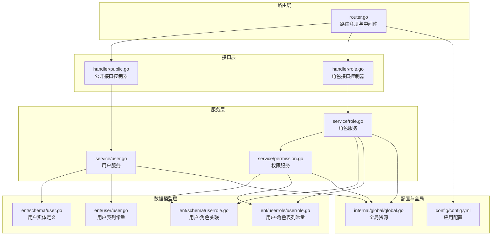
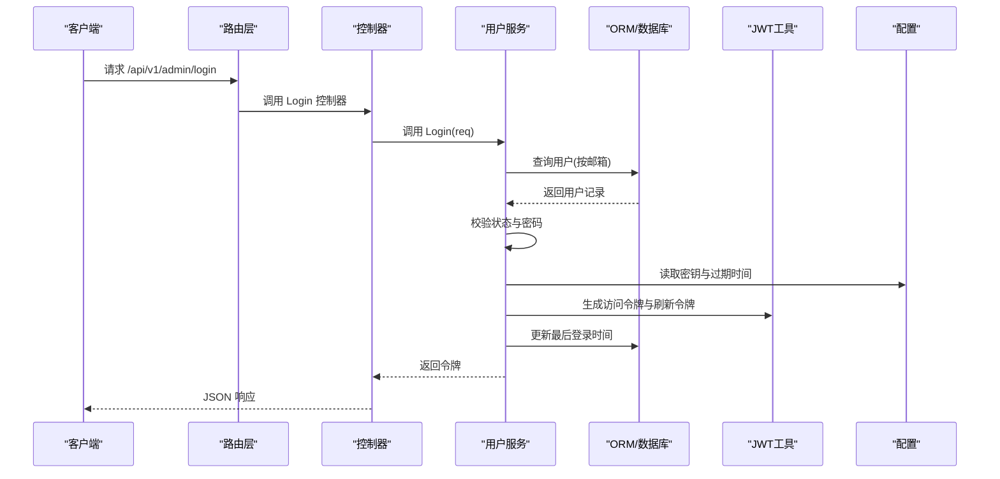
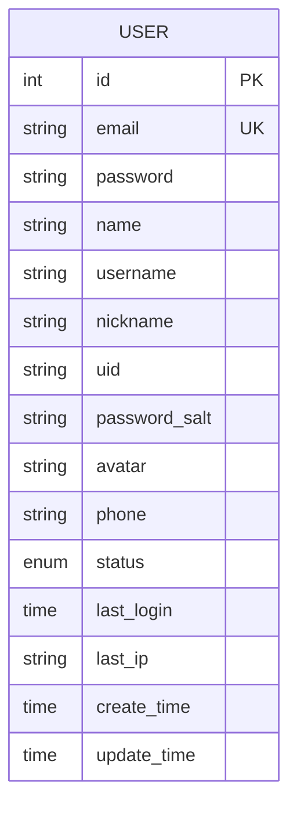
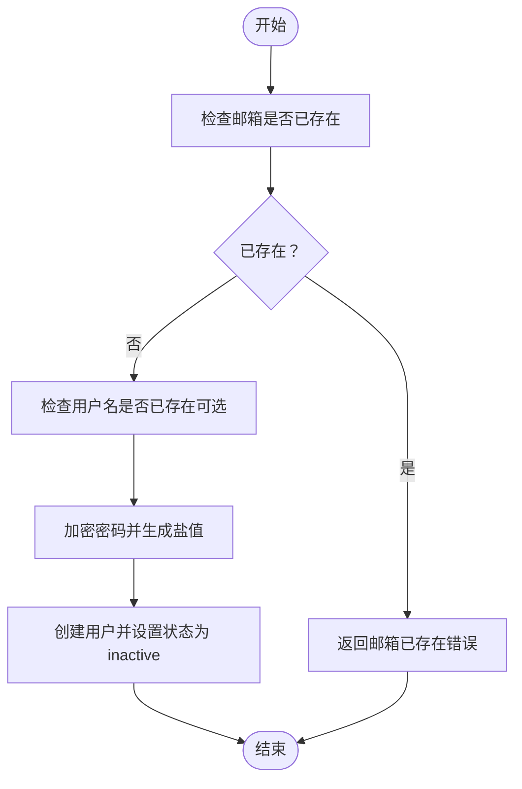
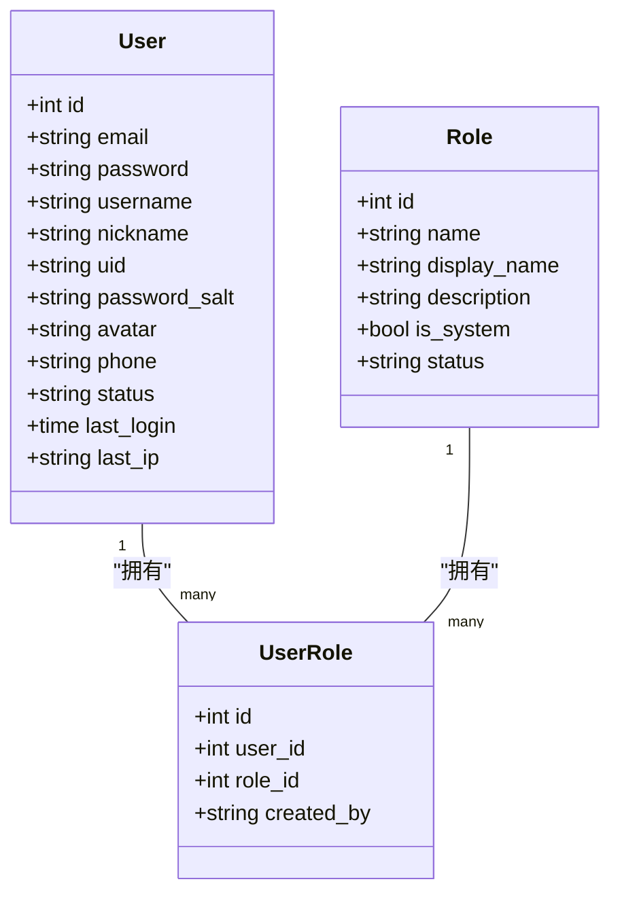
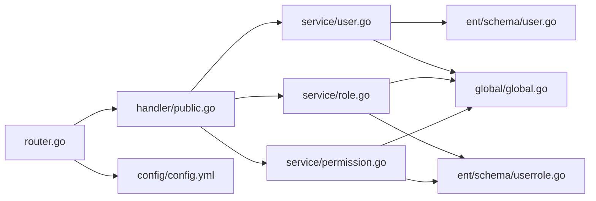

# 用户管理

<cite>
**本文档引用的文件**
- [internal/ent/schema/user.go](file://internal/ent/schema/user.go)
- [internal/ent/user/user.go](file://internal/ent/user/user.go)
- [internal/service/user.go](file://internal/service/user.go)
- [internal/router.go](file://internal/router.go)
- [internal/handler/public.go](file://internal/handler/public.go)
- [internal/ent/schema/userrole.go](file://internal/ent/schema/userrole.go)
- [internal/ent/userrole/userrole.go](file://internal/ent/userrole/userrole.go)
- [internal/service/role.go](file://internal/service/role.go)
- [internal/service/permission.go](file://internal/service/permission.go)
- [config/config.yml](file://config/config.yml)
- [internal/global/global.go](file://internal/global/global.go)
</cite>

## 目录
1. [简介](#简介)
2. [项目结构](#项目结构)
3. [核心组件](#核心组件)
4. [架构总览](#架构总览)
5. [详细组件分析](#详细组件分析)
6. [依赖关系分析](#依赖关系分析)
7. [性能考虑](#性能考虑)
8. [故障排查指南](#故障排查指南)
9. [结论](#结论)
10. [附录](#附录)

## 简介
本文件面向Go Admin管理系统中的用户管理功能，系统化阐述用户实体设计、CRUD实现、状态与激活机制、数据校验与完整性约束、查询接口使用方式、权限继承与角色分配、批量与导入导出能力现状、安全策略以及最佳实践与常见问题。文档基于实际源码进行分析，确保技术细节准确可靠。

## 项目结构
用户管理相关代码主要分布在以下模块：
- 数据模型层：ent/schema/user.go 定义用户实体及字段约束；ent/user/user.go 提供数据库列名与枚举常量。
- 服务层：service/user.go 实现用户登录、注册、信息更新、密码修改、令牌刷新等核心逻辑。
- 接口层：handler/public.go 定义公开路由与控制器，绑定到 Fiber 路由。
- 路由层：router.go 注册公开与认证路由，并挂载 JWT 与权限中间件。
- 角色与权限：ent/schema/userrole.go、service/role.go、service/permission.go 支持角色与权限体系。
- 配置：config/config.yml 提供应用密钥、登录过期时间等配置项。
- 全局：internal/global/global.go 暴露 ORM 客户端与 Casbin 策略管理器。

图表来源
- [internal/router.go:14-73](file://internal/router.go#L14-L73)
- [internal/handler/public.go:13-180](file://internal/handler/public.go#L13-L180)
- [internal/service/user.go:19-394](file://internal/service/user.go#L19-L394)
- [internal/ent/schema/user.go:17-104](file://internal/ent/schema/user.go#L17-L104)
- [internal/ent/user/user.go:14-216](file://internal/ent/user/user.go#L14-L216)
- [internal/ent/schema/userrole.go:11-56](file://internal/ent/schema/userrole.go#L11-L56)
- [internal/ent/userrole/userrole.go:14-145](file://internal/ent/userrole/userrole.go#L14-L145)
- [internal/service/role.go:25-396](file://internal/service/role.go#L25-L396)
- [internal/service/permission.go:92-671](file://internal/service/permission.go#L92-L671)
- [config/config.yml:1-143](file://config/config.yml#L1-L143)
- [internal/global/global.go:10-15](file://internal/global/global.go#L10-L15)

章节来源
- [internal/router.go:14-73](file://internal/router.go#L14-L73)
- [internal/handler/public.go:13-180](file://internal/handler/public.go#L13-L180)
- [internal/service/user.go:19-394](file://internal/service/user.go#L19-L394)
- [internal/ent/schema/user.go:17-104](file://internal/ent/schema/user.go#L17-L104)
- [internal/ent/user/user.go:14-216](file://internal/ent/user/user.go#L14-L216)
- [internal/ent/schema/userrole.go:11-56](file://internal/ent/schema/userrole.go#L11-L56)
- [internal/ent/userrole/userrole.go:14-145](file://internal/ent/userrole/userrole.go#L14-L145)
- [internal/service/role.go:25-396](file://internal/service/role.go#L25-L396)
- [internal/service/permission.go:92-671](file://internal/service/permission.go#L92-L671)
- [config/config.yml:1-143](file://config/config.yml#L1-L143)
- [internal/global/global.go:10-15](file://internal/global/global.go#L10-L15)

## 核心组件
- 用户实体与字段
  - 字段覆盖：邮箱、密码、姓名、用户名、昵称、唯一标识、密码盐、头像、手机号、状态、最后登录时间、最后登录IP。
  - 约束与索引：邮箱、手机号、用户名唯一索引；状态枚举值限定；敏感字段标记。
- 用户服务
  - 登录、注册、刷新令牌、修改密码、获取用户信息、更新用户信息。
  - 密码加密与校验、JWT 令牌签发与刷新、登录时间与IP记录。
- 路由与控制器
  - 公开接口：登录、刷新令牌。
  - 认证接口：获取当前用户、更新用户、修改密码。
- 角色与权限
  - 用户-角色关联表 user_roles；角色与权限通过 Casbin 策略管理。
- 配置与全局
  - 应用密钥、登录过期时间；全局 ORM 客户端与 Casbin 管理器。

章节来源
- [internal/ent/schema/user.go:23-104](file://internal/ent/schema/user.go#L23-L104)
- [internal/ent/user/user.go:14-216](file://internal/ent/user/user.go#L14-L216)
- [internal/service/user.go:27-394](file://internal/service/user.go#L27-L394)
- [internal/router.go:14-73](file://internal/router.go#L14-L73)
- [internal/handler/public.go:13-180](file://internal/handler/public.go#L13-L180)
- [internal/ent/schema/userrole.go:16-56](file://internal/ent/schema/userrole.go#L16-L56)
- [internal/ent/userrole/userrole.go:14-145](file://internal/ent/userrole/userrole.go#L14-L145)
- [internal/service/role.go:25-396](file://internal/service/role.go#L25-L396)
- [internal/service/permission.go:92-671](file://internal/service/permission.go#L92-L671)
- [config/config.yml:1-143](file://config/config.yml#L1-L143)
- [internal/global/global.go:10-15](file://internal/global/global.go#L10-L15)

## 架构总览
用户管理采用分层架构：接口层负责请求解析与响应封装；路由层组织 REST API 并挂载中间件；服务层实现业务逻辑；数据模型层定义实体与约束；配置与全局模块提供运行时资源。

图表来源
- [internal/router.go:28-29](file://internal/router.go#L28-L29)
- [internal/handler/public.go:22-45](file://internal/handler/public.go#L22-L45)
- [internal/service/user.go:127-206](file://internal/service/user.go#L127-L206)
- [config/config.yml:8-10](file://config/config.yml#L8-L10)

章节来源
- [internal/router.go:14-73](file://internal/router.go#L14-L73)
- [internal/handler/public.go:13-180](file://internal/handler/public.go#L13-L180)
- [internal/service/user.go:19-394](file://internal/service/user.go#L19-L394)
- [config/config.yml:1-143](file://config/config.yml#L1-L143)

## 详细组件分析

### 用户实体与字段设计
- 字段与约束
  - 邮箱：唯一、最大长度、正则匹配、注释“用户邮箱”。
  - 密码：最大长度、敏感字段、非空、注释“用户密码”。
  - 姓名、用户名、昵称：可选、最大长度。
  - 唯一标识 UID：可选、最大长度。
  - 密码盐：可选、敏感、最大长度。
  - 头像：可选、最大长度。
  - 手机号：可选、最大长度、正则匹配、注释“手机号码”。
  - 状态：枚举 active/inactive/suspended，默认 inactive。
  - 最后登录时间与IP：可选、最大长度。
- 索引与时间混入
  - 邮箱、手机号、用户名建立唯一索引。
  - mixin.Time 提供 create_time/update_time 自动维护。
- 数据库列常量
  - 表名与列名映射，支持排序选项与列名校验。

图表来源
- [internal/ent/schema/user.go:23-104](file://internal/ent/schema/user.go#L23-L104)
- [internal/ent/user/user.go:14-216](file://internal/ent/user/user.go#L14-L216)

章节来源
- [internal/ent/schema/user.go:23-104](file://internal/ent/schema/user.go#L23-L104)
- [internal/ent/user/user.go:14-216](file://internal/ent/user/user.go#L14-L216)

### 用户CRUD与核心流程
- 注册
  - 校验邮箱唯一性；可选校验用户名唯一性；密码加密与盐值生成；创建用户并默认状态为 inactive。
- 登录
  - 按邮箱查询用户；校验状态必须为 active；校验密码；生成访问令牌与刷新令牌；更新最后登录时间。
- 获取用户
  - 通过 JWT 中的用户标识查询用户，返回基本信息。
- 更新用户
  - 校验用户存在；支持更新昵称、手机号、头像、状态等字段。
- 刷新令牌
  - 解析并验证刷新令牌；校验令牌类型与用户状态；重新签发访问令牌。
- 修改密码
  - 校验旧密码；加密新密码与盐值；更新数据库记录。

图表来源
- [internal/service/user.go:82-125](file://internal/service/user.go#L82-L125)

章节来源
- [internal/service/user.go:82-206](file://internal/service/user.go#L82-L206)
- [internal/handler/public.go:22-45](file://internal/handler/public.go#L22-L45)

### 用户状态管理与激活机制
- 状态枚举：active、inactive、suspended。
- 登录前校验：仅 active 状态用户可登录。
- 更新用户时可设置状态字段，但未在服务层暴露专门的“激活”接口。
- 建议：可通过更新用户状态接口实现邮箱验证后的激活流程。

章节来源
- [internal/ent/schema/user.go:69-72](file://internal/ent/schema/user.go#L69-L72)
- [internal/ent/user/user.go:112-137](file://internal/ent/user/user.go#L112-L137)
- [internal/service/user.go:127-206](file://internal/service/user.go#L127-L206)

### 数据验证规则与完整性约束
- 字段验证
  - 邮箱：正则匹配；最大长度；唯一索引。
  - 密码：最大长度；非空；敏感字段。
  - 手机号：正则数字匹配；最大长度。
  - 名称、用户名、昵称、UID、头像、最后IP：最大长度限制。
- 枚举验证：状态字段值限定。
- 唯一索引：邮箱、手机号、用户名。
- 时间字段：自动维护 create_time/update_time。

章节来源
- [internal/ent/schema/user.go:12-15](file://internal/ent/schema/user.go#L12-L15)
- [internal/ent/schema/user.go:29-79](file://internal/ent/schema/user.go#L29-L79)
- [internal/ent/user/user.go:112-137](file://internal/ent/user/user.go#L112-L137)

### 用户查询接口与使用示例
- 登录接口
  - 方法：POST
  - 路径：/api/v1/admin/login
  - 请求体：包含 email 与 password
  - 响应：access_token、token_type、expires_in、refresh_token
- 刷新令牌接口
  - 方法：POST
  - 路径：/api/v1/admin/refresh-token
  - 请求体：包含 refresh_token
  - 响应：新的 access_token 与 refresh_token
- 获取当前用户接口
  - 方法：GET
  - 路径：/api/v1/admin/auth/user
  - 需要 Bearer 认证
  - 响应：用户基本信息（过滤敏感字段）
- 更新用户接口
  - 方法：PUT
  - 路径：/api/v1/admin/auth/user
  - 需要 Bearer 认证
  - 请求体：可更新字段集合（昵称、手机号、头像、状态）
- 修改密码接口
  - 方法：PUT
  - 路径：/api/v1/admin/auth/password
  - 需要 Bearer 认证
  - 请求体：old_password、new_password

章节来源
- [internal/router.go:28-40](file://internal/router.go#L28-L40)
- [internal/handler/public.go:13-180](file://internal/handler/public.go#L13-L180)

### 权限继承与角色分配机制
- 用户-角色关联
  - user_roles 表存储 user_id 与 role_id，唯一索引保证唯一性。
  - 通过 UserRole 边关联 User 与 Role。
- 角色服务
  - 创建、查询、更新、删除角色；启用/禁用角色；校验唯一性与系统角色保护。
- 权限服务
  - 基于 Casbin 的策略管理，支持 API、菜单、按钮三类权限。
  - 用户权限查询：菜单权限、按钮权限、API 权限。
  - 角色权限分配与移除。
- 权限验证
  - CheckPermission 根据用户角色集合判断对象与动作的授权。

图表来源
- [internal/ent/schema/userrole.go:16-40](file://internal/ent/schema/userrole.go#L16-L40)
- [internal/ent/userrole/userrole.go:14-62](file://internal/ent/userrole/userrole.go#L14-L62)
- [internal/ent/schema/user.go:17-20](file://internal/ent/schema/user.go#L17-L20)

章节来源
- [internal/ent/schema/userrole.go:16-40](file://internal/ent/schema/userrole.go#L16-L40)
- [internal/ent/userrole/userrole.go:14-62](file://internal/ent/userrole/userrole.go#L14-L62)
- [internal/service/role.go:94-396](file://internal/service/role.go#L94-L396)
- [internal/service/permission.go:92-671](file://internal/service/permission.go#L92-L671)

### 批量操作与导入导出
- 当前实现
  - 用户实体支持批量创建构建器（MapCreateBulk），可用于批量插入场景。
  - 未发现专门的用户导入/导出接口或服务。
- 建议
  - 在服务层扩展批量导入/导出接口，结合 CSV/Excel 工具与批量创建构建器实现。

章节来源
- [internal/ent/client.go:525-543](file://internal/ent/client.go#L525-L543)

### 用户安全策略
- 密码策略
  - 注册与修改密码均使用加密算法生成哈希与盐值，字段标记敏感。
- 令牌策略
  - 登录与刷新令牌使用 HMAC 签名；配置中提供密钥与过期时间。
- 登录限制
  - 代码中未发现显式的登录失败次数限制或账户锁定机制。
- 建议
  - 引入登录失败计数与临时锁定、滑动窗口限流、强密码规则等增强安全。

章节来源
- [internal/service/user.go:107-121](file://internal/service/user.go#L107-L121)
- [internal/service/user.go:358-393](file://internal/service/user.go#L358-L393)
- [config/config.yml:8-10](file://config/config.yml#L8-L10)

## 依赖关系分析
- 组件耦合
  - 路由层依赖控制器；控制器依赖服务层；服务层依赖 ORM 与配置；权限服务依赖 Casbin。
- 外部依赖
  - JWT 工具用于令牌生成与解析；Casbin 用于权限策略；Fiber 作为 Web 框架。
- 循环依赖
  - 通过接口与全局资源避免循环依赖。

图表来源
- [internal/router.go:14-73](file://internal/router.go#L14-L73)
- [internal/handler/public.go:13-180](file://internal/handler/public.go#L13-L180)
- [internal/service/user.go:19-394](file://internal/service/user.go#L19-L394)
- [internal/service/role.go:25-396](file://internal/service/role.go#L25-L396)
- [internal/service/permission.go:92-671](file://internal/service/permission.go#L92-L671)
- [internal/ent/schema/user.go:17-104](file://internal/ent/schema/user.go#L17-L104)
- [internal/ent/schema/userrole.go:11-56](file://internal/ent/schema/userrole.go#L11-L56)
- [internal/global/global.go:10-15](file://internal/global/global.go#L10-L15)
- [config/config.yml:1-143](file://config/config.yml#L1-L143)

章节来源
- [internal/router.go:14-73](file://internal/router.go#L14-L73)
- [internal/handler/public.go:13-180](file://internal/handler/public.go#L13-L180)
- [internal/service/user.go:19-394](file://internal/service/user.go#L19-L394)
- [internal/service/role.go:25-396](file://internal/service/role.go#L25-L396)
- [internal/service/permission.go:92-671](file://internal/service/permission.go#L92-L671)
- [internal/ent/schema/user.go:17-104](file://internal/ent/schema/user.go#L17-L104)
- [internal/ent/schema/userrole.go:11-56](file://internal/ent/schema/userrole.go#L11-L56)
- [internal/global/global.go:10-15](file://internal/global/global.go#L10-L15)
- [config/config.yml:1-143](file://config/config.yml#L1-L143)

## 性能考虑
- 索引优化：邮箱、手机号、用户名建立唯一索引，减少重复校验与查询成本。
- 缓存策略：Redis 配置可用作会话或策略缓存，建议结合登录态与权限缓存。
- 令牌过期：登录过期时间配置可平衡安全性与用户体验。
- 批量写入：利用 MapCreateBulk 提升批量导入效率。

章节来源
- [internal/ent/schema/user.go:91-97](file://internal/ent/schema/user.go#L91-L97)
- [config/config.yml:32-58](file://config/config.yml#L32-L58)
- [config/config.yml:8-10](file://config/config.yml#L8-L10)
- [internal/ent/client.go:525-543](file://internal/ent/client.go#L525-L543)

## 故障排查指南
- 常见错误
  - 用户不存在：登录、刷新令牌、修改密码时可能返回用户不存在错误。
  - 密码无效：登录或修改密码时旧密码不匹配。
  - 用户状态无效：非 active 状态用户无法登录。
  - 参数解析失败：请求体格式不正确导致解析失败。
- 建议排查步骤
  - 检查请求体字段与格式；确认用户状态为 active；核对邮箱/用户名唯一性；查看日志与响应码。

章节来源
- [internal/service/user.go:19-25](file://internal/service/user.go#L19-L25)
- [internal/handler/public.go:32-42](file://internal/handler/public.go#L32-L42)

## 结论
用户管理模块以清晰的分层架构实现了用户实体、认证与授权的基础能力。通过 JWT 令牌与 Casbin 权限模型，系统具备良好的扩展性。建议后续完善用户激活流程、登录失败限制、批量导入导出与更强的密码策略，以进一步提升安全性与易用性。

## 附录
- 配置项参考
  - 应用密钥：用于 JWT 签名与刷新令牌验证。
  - 登录过期时间：控制访问令牌有效期。
  - Redis 缓存：可配置内存或 Redis 存储。

章节来源
- [config/config.yml:8-10](file://config/config.yml#L8-L10)
- [config/config.yml:32-58](file://config/config.yml#L32-L58)