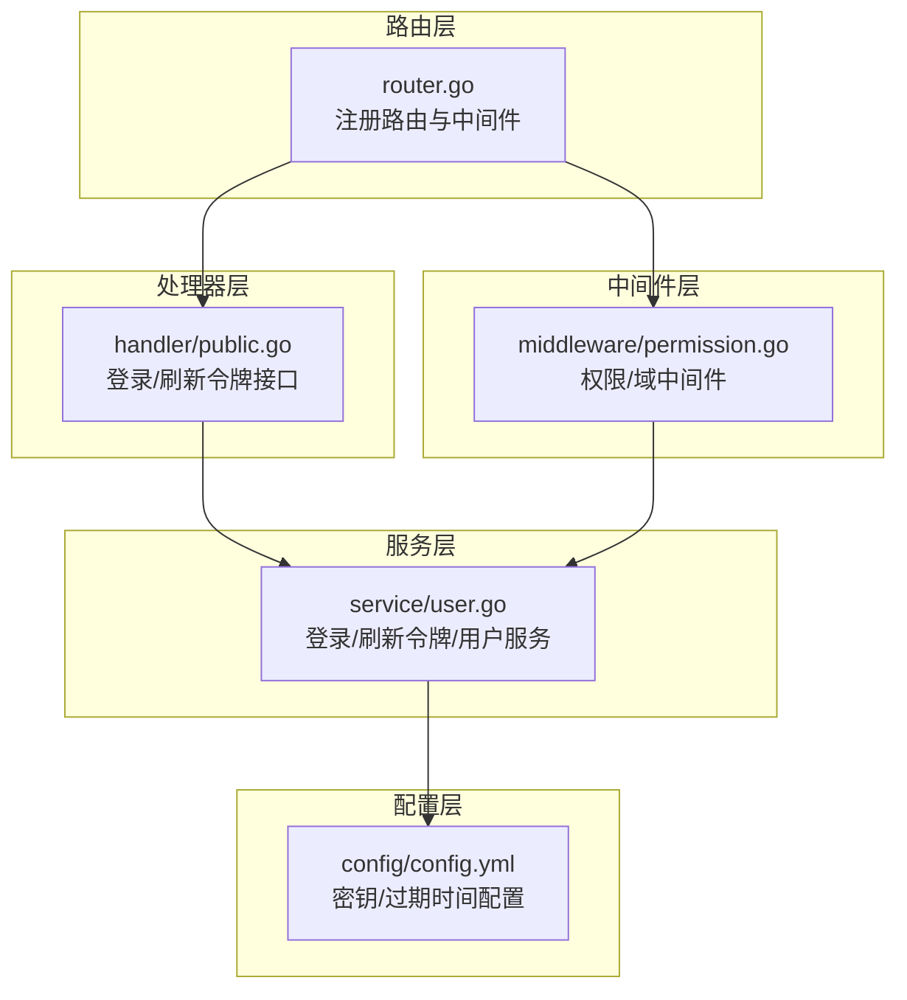
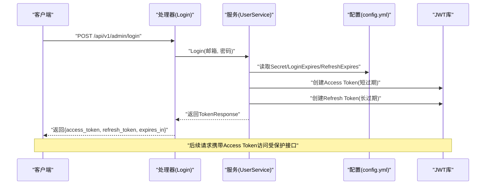
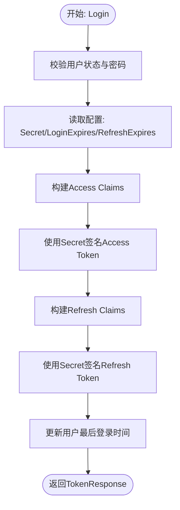
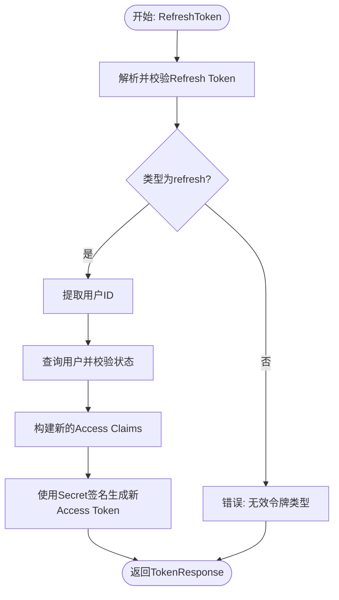
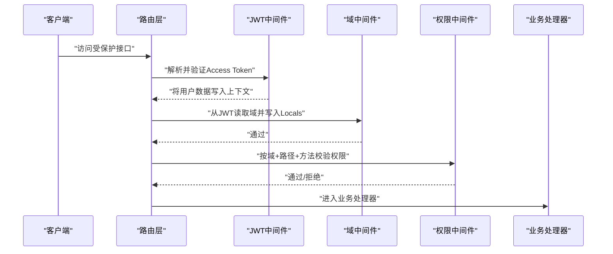
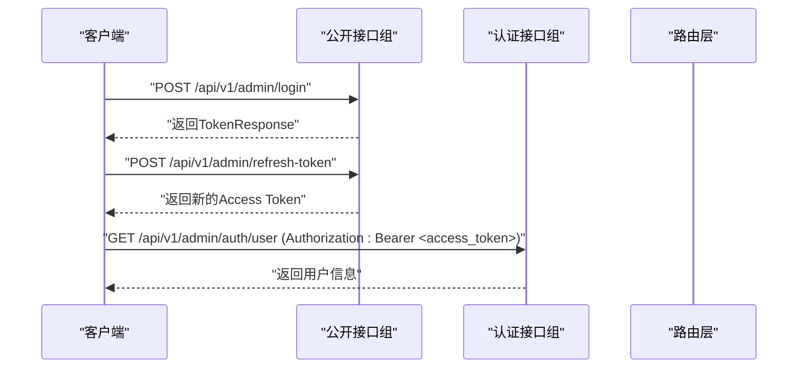
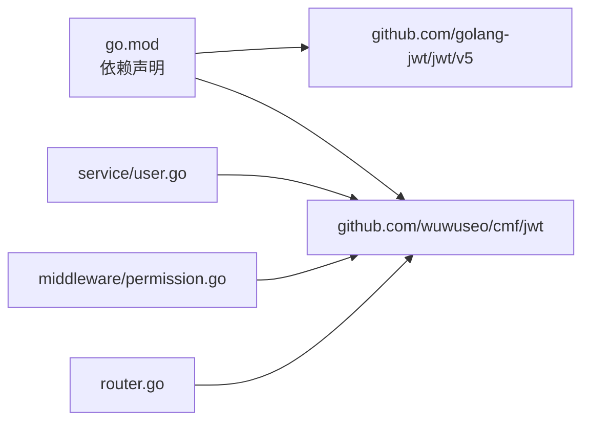

# JWT令牌管理

<cite>
**本文档引用的文件**
- [internal/service/user.go](file://internal/service/user.go)
- [internal/handler/public.go](file://internal/handler/public.go)
- [internal/middleware/permission.go](file://internal/middleware/permission.go)
- [internal/router.go](file://internal/router.go)
- [config/config.yml](file://config/config.yml)
- [go.mod](file://go.mod)
</cite>

## 目录
1. [简介](#简介)
2. [项目结构](#项目结构)
3. [核心组件](#核心组件)
4. [架构总览](#架构总览)
5. [详细组件分析](#详细组件分析)
6. [依赖关系分析](#依赖关系分析)
7. [性能考虑](#性能考虑)
8. [故障排查指南](#故障排查指南)
9. [结论](#结论)

## 简介
本文件针对 Go Admin 管理系统的 JWT 令牌管理模块进行系统化技术文档整理，覆盖访问令牌与刷新令牌的生成、验证与刷新流程；解释令牌声明结构及各字段作用；梳理令牌生命周期、签名验证与安全策略；并提供在服务层与中间件中的使用范式，以及 API 请求中令牌的传递方式。

## 项目结构
围绕 JWT 的关键代码分布在以下模块：
- 服务层：负责登录签发访问/刷新令牌、刷新访问令牌、用户信息查询与变更
- 处理器层：对外暴露登录、刷新令牌、用户信息等 API 接口
- 中间件层：基于 JWT 的权限校验与域解析
- 路由层：定义公开接口与受保护接口，并挂载 JWT 与权限中间件
- 配置层：应用密钥、登录过期时间、刷新过期时间等参数

图表来源
- [internal/router.go:16-62](file://internal/router.go#L16-L62)
- [internal/handler/public.go:33-60](file://internal/handler/public.go#L33-L60)
- [internal/service/user.go:133-213](file://internal/service/user.go#L133-L213)
- [internal/middleware/permission.go:14-93](file://internal/middleware/permission.go#L14-L93)
- [config/config.yml:1-10](file://config/config.yml#L1-L10)

章节来源
- [internal/router.go:16-62](file://internal/router.go#L16-L62)
- [internal/handler/public.go:33-60](file://internal/handler/public.go#L33-L60)
- [internal/service/user.go:133-213](file://internal/service/user.go#L133-L213)
- [internal/middleware/permission.go:14-93](file://internal/middleware/permission.go#L14-L93)
- [config/config.yml:1-10](file://config/config.yml#L1-L10)

## 核心组件
- 访问令牌（Access Token）：短期有效，用于日常 API 请求的身份验证
- 刷新令牌（Refresh Token）：长期有效，用于在访问令牌过期后换取新的访问令牌
- 令牌声明（Claims）：包含用户标识、域、发行者、过期时间、签发时间、令牌类型等
- 中间件链：JWT 解析 → 域解析 → 权限校验
- 配置项：应用密钥、登录过期秒数、刷新过期秒数

章节来源
- [internal/service/user.go:164-194](file://internal/service/user.go#L164-L194)
- [internal/handler/public.go:180-213](file://internal/handler/public.go#L180-L213)
- [internal/middleware/permission.go:14-93](file://internal/middleware/permission.go#L14-L93)
- [config/config.yml:1-10](file://config/config.yml#L1-L10)

## 架构总览
下图展示了从客户端发起登录到获取访问令牌，再到使用访问令牌访问受保护资源的完整流程。

图表来源
- [internal/handler/public.go:33-60](file://internal/handler/public.go#L33-L60)
- [internal/service/user.go:133-213](file://internal/service/user.go#L133-L213)
- [config/config.yml:1-10](file://config/config.yml#L1-L10)

## 详细组件分析

### 组件一：令牌生成与签发（登录）
- 输入：邮箱、密码
- 输出：访问令牌、刷新令牌、过期秒数
- 关键步骤：
  - 校验用户状态与密码
  - 读取配置：密钥、登录过期秒数、刷新过期秒数
  - 构造访问令牌声明（含用户ID、用户名、域、发行者、过期时间、签发时间、令牌类型）
  - 构造刷新令牌声明（同上，但过期时间更长）
  - 使用密钥对两个令牌进行签名
  - 更新用户最后登录时间

图表来源
- [internal/service/user.go:133-213](file://internal/service/user.go#L133-L213)
- [config/config.yml:1-10](file://config/config.yml#L1-L10)

章节来源
- [internal/service/user.go:133-213](file://internal/service/user.go#L133-L213)
- [config/config.yml:1-10](file://config/config.yml#L1-L10)

### 组件二：令牌刷新（使用刷新令牌换取新的访问令牌）
- 输入：刷新令牌
- 输出：新的访问令牌（可复用原刷新令牌）
- 关键步骤：
  - 解析并校验刷新令牌（必须为“refresh”类型）
  - 从令牌中提取用户ID并查询用户
  - 校验用户状态为活跃
  - 重新构造访问令牌声明（使用原域）
  - 使用密钥签名生成新的访问令牌

图表来源
- [internal/service/user.go:304-363](file://internal/service/user.go#L304-L363)

章节来源
- [internal/service/user.go:304-363](file://internal/service/user.go#L304-L363)

### 组件三：中间件链（JWT解析、域解析、权限校验）
- JWT 解析中间件：从请求中解析并验证访问令牌，将用户数据写入上下文
- 域中间件：从 JWT 中读取域信息并写入 Locals
- 权限中间件：结合 Casbin 执行器，按“用户ID+域+路径+方法”进行权限校验

图表来源
- [internal/router.go:53-59](file://internal/router.go#L53-L59)
- [internal/middleware/permission.go:14-93](file://internal/middleware/permission.go#L14-L93)

章节来源
- [internal/router.go:53-59](file://internal/router.go#L53-L59)
- [internal/middleware/permission.go:14-93](file://internal/middleware/permission.go#L14-L93)

### 组件四：API 接口与请求传递
- 登录接口：POST /api/v1/admin/login，返回访问令牌与刷新令牌
- 刷新令牌接口：POST /api/v1/admin/refresh-token，输入刷新令牌，返回新的访问令牌
- 受保护接口：需在 Authorization 头中携带 Bearer Token

图表来源
- [internal/router.go:49-62](file://internal/router.go#L49-L62)
- [internal/handler/public.go:33-60](file://internal/handler/public.go#L33-L60)
- [internal/handler/public.go:180-213](file://internal/handler/public.go#L180-L213)

章节来源
- [internal/router.go:49-62](file://internal/router.go#L49-L62)
- [internal/handler/public.go:33-60](file://internal/handler/public.go#L33-L60)
- [internal/handler/public.go:180-213](file://internal/handler/public.go#L180-L213)

## 依赖关系分析
- 依赖库：golang-jwt/jwt/v5 用于令牌解析与签名；wuwuseo/cmf/jwt 提供便捷的 JWT 工具函数
- 内部依赖：服务层依赖配置服务获取密钥与过期时间；中间件依赖 JWT 库解析用户数据；路由层组合中间件形成完整的鉴权链

图表来源
- [go.mod:12-18](file://go.mod#L12-L18)
- [internal/service/user.go:13-16](file://internal/service/user.go#L13-L16)
- [internal/middleware/permission.go:10-11](file://internal/middleware/permission.go#L10-L11)
- [internal/router.go:11-12](file://internal/router.go#L11-L12)

章节来源
- [go.mod:12-18](file://go.mod#L12-L18)
- [internal/service/user.go:13-16](file://internal/service/user.go#L13-L16)
- [internal/middleware/permission.go:10-11](file://internal/middleware/permission.go#L10-L11)
- [internal/router.go:11-12](file://internal/router.go#L11-L12)

## 性能考虑
- 令牌过期时间：登录过期时间与刷新过期时间分别由配置项控制，建议根据业务安全需求调整
- 中间件顺序：JWT 解析与域解析在权限校验之前执行，避免重复解析
- 缓存：路由层已支持注入缓存以优化权限与角色服务性能（具体取决于运行时环境）

章节来源
- [config/config.yml:1-10](file://config/config.yml#L1-L10)
- [internal/router.go:36-44](file://internal/router.go#L36-L44)

## 故障排查指南
- 未授权访问（401）：
  - JWT 中缺少用户ID或域信息
  - 令牌类型不是“access”
  - 令牌解析失败或签名不匹配
- 权限不足（403）：
  - Casbin 权限校验失败
  - 域信息缺失或为空
- 刷新令牌无效（401）：
  - 令牌类型不是“refresh”
  - 令牌中用户ID无效或用户不存在
  - 用户状态非活跃

章节来源
- [internal/middleware/permission.go:18-76](file://internal/middleware/permission.go#L18-L76)
- [internal/service/user.go:304-363](file://internal/service/user.go#L304-L363)
- [internal/handler/public.go:180-213](file://internal/handler/public.go#L180-L213)

## 结论
本系统采用标准 JWT 实践：短期访问令牌与长期刷新令牌配合，结合中间件链完成身份解析、域识别与权限校验。通过配置集中管理密钥与过期时间，既保证安全性也兼顾可用性。建议在生产环境中：
- 使用强随机密钥并妥善保管
- 合理设置过期时间，平衡用户体验与安全
- 对刷新令牌进行审计与监控
- 在网关或反向代理层统一处理 Authorization 头