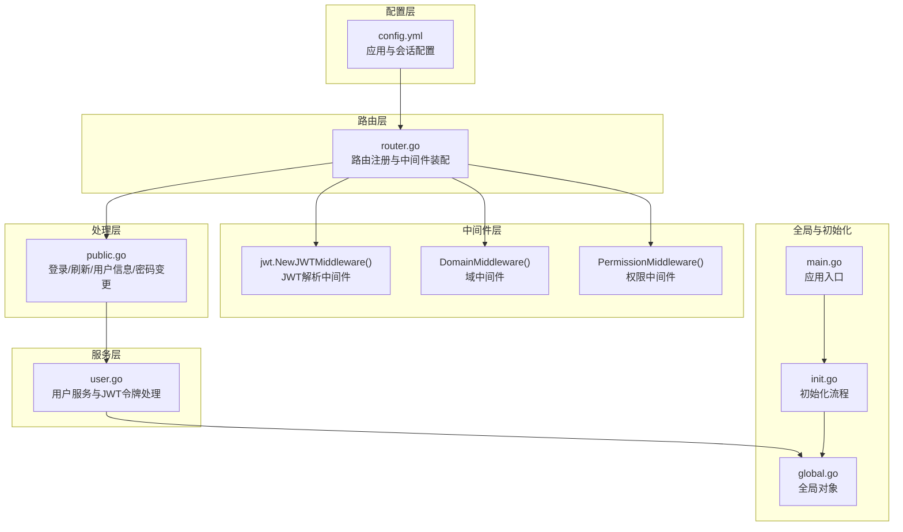
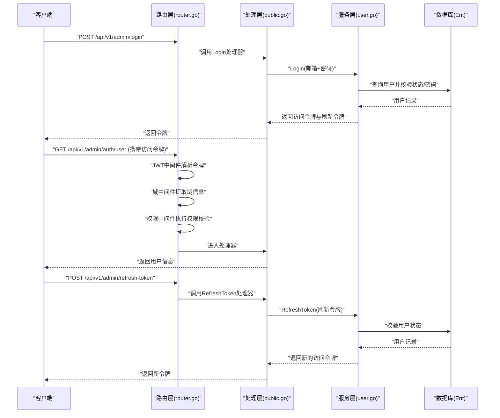
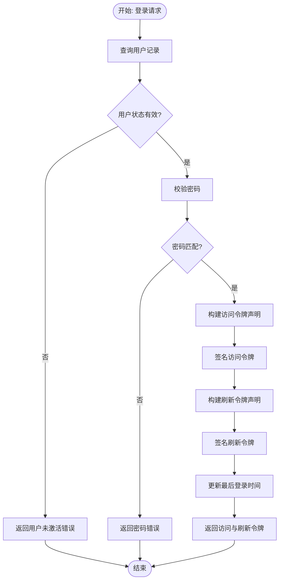
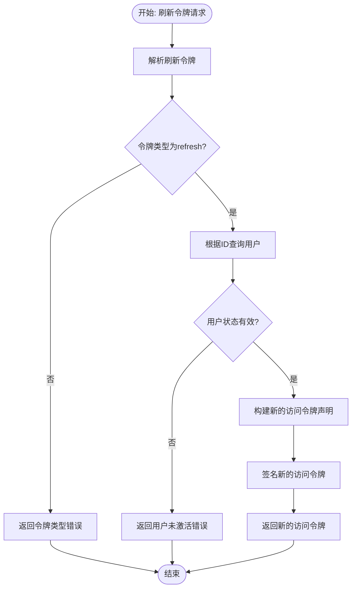
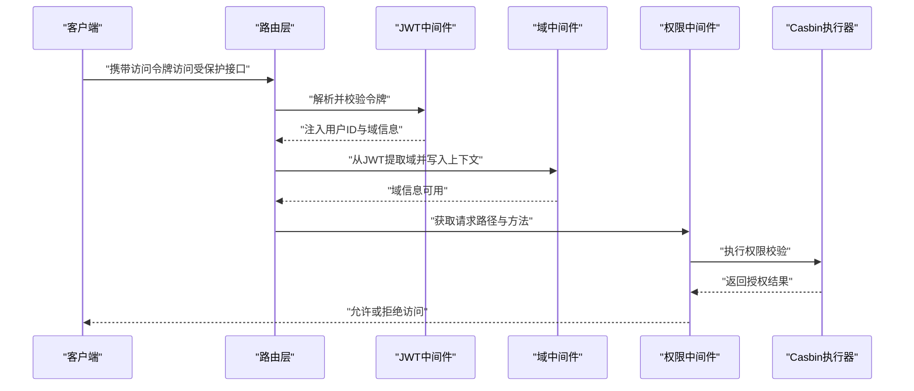
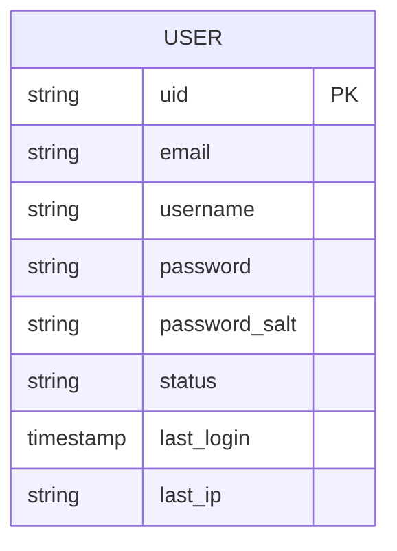
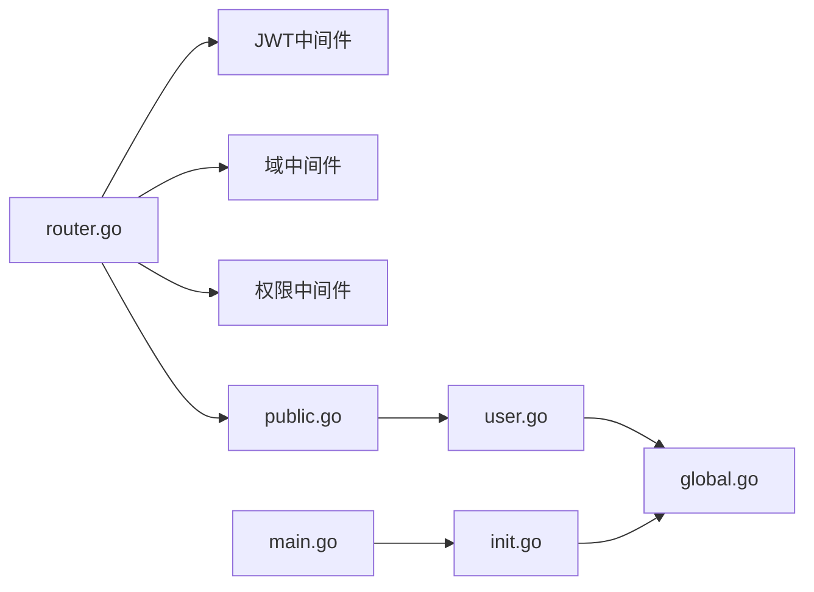

# 会话管理

<cite>
**本文引用的文件**
- [config.yml](file://config/config.yml)
- [router.go](file://internal/router.go)
- [public.go](file://internal/handler/public.go)
- [user.go](file://internal/service/user.go)
- [permission.go](file://internal/middleware/permission.go)
- [global.go](file://internal/global/global.go)
- [init.go](file://internal/init.go)
- [main.go](file://main.go)
- [user.go](file://internal/ent/user/where.go)
</cite>

## 目录
1. [简介](#简介)
2. [项目结构](#项目结构)
3. [核心组件](#核心组件)
4. [架构总览](#架构总览)
5. [详细组件分析](#详细组件分析)
6. [依赖分析](#依赖分析)
7. [性能考虑](#性能考虑)
8. [故障排查指南](#故障排查指南)
9. [结论](#结论)
10. [附录](#附录)

## 简介
本文件围绕 Go Admin 管理系统的会话管理进行系统化说明，重点覆盖基于 JWT 的会话生命周期（建立、维护、刷新与销毁）、会话状态跟踪（登录状态持久化与过期处理）、多设备登录支持与并发会话管理、会话安全策略（会话固定、会话劫持防护与敏感操作二次验证）以及配置项与性能优化建议。文档同时提供常见问题诊断与解决方案，帮助开发者与运维人员快速定位与解决问题。

## 项目结构
会话管理相关能力主要分布在以下模块：
- 配置层：应用与会话相关的配置项集中于配置文件，包括密钥、登录过期间隔等。
- 路由层：公开登录与刷新令牌接口，认证后接口通过 JWT 中间件与权限中间件保护。
- 处理层：登录、刷新令牌、获取用户信息、修改密码等接口处理。
- 服务层：用户服务负责 JWT 令牌签发与刷新逻辑，并与数据库交互更新登录时间等状态。
- 中间件层：JWT 中间件解析令牌，域中间件与权限中间件分别负责域识别与权限校验。
- 全局与初始化：全局对象注入、Casbin 权限执行器初始化、应用启动流程。

图表来源
- [config.yml:1-143](file://config/config.yml#L1-L143)
- [router.go:16-149](file://internal/router.go#L16-L149)
- [public.go:19-213](file://internal/handler/public.go#L19-L213)
- [user.go:132-364](file://internal/service/user.go#L132-L364)
- [permission.go:14-93](file://internal/middleware/permission.go#L14-L93)
- [global.go:11-16](file://internal/global/global.go#L11-L16)
- [init.go:31-100](file://internal/init.go#L31-L100)
- [main.go:55-104](file://main.go#L55-L104)

章节来源
- [config.yml:1-143](file://config/config.yml#L1-L143)
- [router.go:16-149](file://internal/router.go#L16-L149)
- [public.go:19-213](file://internal/handler/public.go#L19-L213)
- [user.go:132-364](file://internal/service/user.go#L132-L364)
- [permission.go:14-93](file://internal/middleware/permission.go#L14-L93)
- [global.go:11-16](file://internal/global/global.go#L11-L16)
- [init.go:31-100](file://internal/init.go#L31-L100)
- [main.go:55-104](file://main.go#L55-L104)

## 核心组件
- JWT 令牌与声明
  - 访问令牌与刷新令牌均采用 MapClaims 结构，包含用户标识、域、签发者、过期时间与令牌类型等字段。
  - 访问令牌过期时间由配置项决定；刷新令牌过期时间另行配置。
- 登录与刷新流程
  - 登录成功后返回访问令牌与刷新令牌；刷新令牌用于换取新的访问令牌。
- 中间件链路
  - JWT 中间件负责解析并校验令牌，域中间件从令牌中提取域信息，权限中间件基于 Casbin 执行权限校验。
- 会话状态跟踪
  - 登录成功后更新用户最后登录时间；域信息存储于 JWT 声明并在中间件中传递。

章节来源
- [user.go:164-197](file://internal/service/user.go#L164-L197)
- [user.go:281-364](file://internal/service/user.go#L281-L364)
- [router.go:53-59](file://internal/router.go#L53-L59)
- [permission.go:14-93](file://internal/middleware/permission.go#L14-L93)
- [public.go:33-60](file://internal/handler/public.go#L33-L60)

## 架构总览
下图展示从客户端到服务端的典型会话流程：登录获取令牌、携带令牌访问受保护接口、权限校验、刷新令牌维持会话。

图表来源
- [router.go:49-62](file://internal/router.go#L49-L62)
- [public.go:33-60](file://internal/handler/public.go#L33-L60)
- [public.go:192-213](file://internal/handler/public.go#L192-L213)
- [user.go:132-213](file://internal/service/user.go#L132-L213)
- [user.go:281-364](file://internal/service/user.go#L281-L364)

## 详细组件分析

### 组件A：JWT 会话建立（登录）
- 关键点
  - 登录接口接收邮箱与密码，校验用户状态与密码后，构造访问令牌与刷新令牌的声明。
  - 访问令牌过期时间由配置项决定；刷新令牌过期时间另行配置。
  - 登录成功后更新用户最后登录时间。
- 数据流

图表来源
- [user.go:132-213](file://internal/service/user.go#L132-L213)

章节来源
- [public.go:33-60](file://internal/handler/public.go#L33-L60)
- [user.go:132-213](file://internal/service/user.go#L132-L213)

### 组件B：JWT 会话维护与刷新
- 关键点
  - 刷新令牌接口接收刷新令牌，解析并校验其类型与签名，随后根据用户状态生成新的访问令牌。
  - 刷新过程中保持域信息不变，确保多域场景下的一致性。
- 流程图

图表来源
- [public.go:192-213](file://internal/handler/public.go#L192-L213)
- [user.go:281-364](file://internal/service/user.go#L281-L364)

章节来源
- [public.go:192-213](file://internal/handler/public.go#L192-L213)
- [user.go:281-364](file://internal/service/user.go#L281-L364)

### 组件C：权限中间件与会话状态
- 关键点
  - 权限中间件从 JWT 中提取用户ID与域信息，结合请求路径与方法，通过 Casbin 执行权限校验。
  - 域中间件从 JWT 中提取域并写入上下文，供权限中间件使用。
- 顺序图

图表来源
- [router.go:53-59](file://internal/router.go#L53-L59)
- [permission.go:14-93](file://internal/middleware/permission.go#L14-L93)

章节来源
- [permission.go:14-93](file://internal/middleware/permission.go#L14-L93)
- [router.go:53-59](file://internal/router.go#L53-L59)

### 组件D：会话状态跟踪与持久化
- 关键点
  - 登录成功后更新用户最后登录时间，便于审计与会话统计。
  - 用户最后登录时间与最后登录IP等字段可用于会话冲突检测与异常登录告警。
- 数据模型关联

图表来源
- [user.go:83-84](file://internal/service/user.go#L83-L84)
- [user.go:199-205](file://internal/service/user.go#L199-L205)
- [user.go:927-970](file://internal/ent/user/where.go#L927-L970)

章节来源
- [user.go:199-205](file://internal/service/user.go#L199-L205)
- [user.go:927-970](file://internal/ent/user/where.go#L927-L970)

### 组件E：多设备登录与并发会话管理
- 当前实现要点
  - 系统通过刷新令牌机制支持多设备登录：同一用户可在不同设备上持有不同访问令牌，但共享同一刷新令牌。
  - 刷新令牌用于换取新的访问令牌，从而延长会话有效期。
- 并发会话管理建议
  - 在用户表中引入“会话ID”或“设备指纹”字段，配合刷新令牌与访问令牌的签发记录，实现更精细的并发会话控制。
  - 对高风险操作（如修改密码、支付）实施二次验证或临时令牌机制，降低会话劫持风险。

章节来源
- [user.go:181-197](file://internal/service/user.go#L181-L197)
- [user.go:338-364](file://internal/service/user.go#L338-L364)

### 组件F：会话安全策略
- 会话固定攻击防护
  - 登录成功后签发新的访问令牌与刷新令牌，避免复用旧令牌。
  - 刷新令牌仅用于换取新的访问令牌，不直接用于接口访问。
- 会话劫持防范
  - 使用强随机密钥与合理的过期时间；对敏感接口启用二次验证。
  - 建议在用户表中记录设备指纹与IP白名单，结合刷新令牌与访问令牌的签发日志进行异常检测。
- 敏感操作二次验证
  - 对修改密码、删除账户等高危操作，要求用户提供旧密码或二次验证码，再由服务层执行变更。

章节来源
- [public.go:149-177](file://internal/handler/public.go#L149-L177)
- [user.go:366-401](file://internal/service/user.go#L366-L401)

## 依赖分析
- 组件耦合
  - 路由层依赖 JWT 中间件、域中间件与权限中间件；处理层依赖用户服务；用户服务依赖数据库与配置。
- 外部依赖
  - JWT 解析与签名依赖外部库；权限校验依赖 Casbin；数据库 ORM 依赖 Ent。
- 初始化流程
  - 应用启动时初始化数据库与 Casbin 执行器，注入全局对象，随后注册路由与中间件。

图表来源
- [router.go:16-149](file://internal/router.go#L16-L149)
- [permission.go:14-93](file://internal/middleware/permission.go#L14-L93)
- [public.go:19-213](file://internal/handler/public.go#L19-L213)
- [user.go:132-364](file://internal/service/user.go#L132-L364)
- [global.go:11-16](file://internal/global/global.go#L11-L16)
- [init.go:31-100](file://internal/init.go#L31-L100)
- [main.go:55-104](file://main.go#L55-L104)

章节来源
- [router.go:16-149](file://internal/router.go#L16-L149)
- [permission.go:14-93](file://internal/middleware/permission.go#L14-L93)
- [public.go:19-213](file://internal/handler/public.go#L19-L213)
- [user.go:132-364](file://internal/service/user.go#L132-L364)
- [global.go:11-16](file://internal/global/global.go#L11-L16)
- [init.go:31-100](file://internal/init.go#L31-L100)
- [main.go:55-104](file://main.go#L55-L104)

## 性能考虑
- 令牌过期时间
  - 合理设置登录过期时间与刷新过期时间，平衡用户体验与安全强度。
- 缓存与中间件
  - 权限中间件可结合缓存减少 Casbin 查询压力；路由层中间件链路尽量精简，避免重复解析。
- 数据库与索引
  - 对用户最后登录时间、最后登录IP等字段建立索引，提升查询效率。
- 日志与监控
  - 开启请求日志中间件，记录异常登录与权限拒绝事件，辅助性能与安全分析。

章节来源
- [config.yml:1-143](file://config/config.yml#L1-L143)
- [router.go:17-20](file://internal/router.go#L17-L20)
- [user.go:199-205](file://internal/service/user.go#L199-L205)

## 故障排查指南
- 常见错误与定位
  - 未授权访问：检查 JWT 中间件是否正确解析令牌，域中间件是否注入域信息。
  - 权限不足：检查权限中间件的 Casbin 执行器是否正确加载，策略是否匹配。
  - 无效刷新令牌：检查刷新令牌签名、类型与用户状态，确认刷新令牌未被篡改。
  - 用户未激活：检查用户状态字段，确保登录前用户已被激活。
- 排查步骤
  - 确认配置文件中的密钥与过期时间设置是否合理。
  - 检查路由中间件装配顺序，确保 JWT、域与权限中间件按序执行。
  - 查看数据库中用户最后登录时间与IP字段，判断是否存在异常登录行为。
  - 开启请求日志中间件，定位具体请求失败环节。

章节来源
- [permission.go:14-93](file://internal/middleware/permission.go#L14-L93)
- [public.go:33-60](file://internal/handler/public.go#L33-L60)
- [public.go:192-213](file://internal/handler/public.go#L192-L213)
- [user.go:145-148](file://internal/service/user.go#L145-L148)
- [router.go:53-59](file://internal/router.go#L53-L59)

## 结论
本系统采用基于 JWT 的会话管理方案，通过登录与刷新令牌机制实现会话的建立与维护；借助域中间件与权限中间件保障多域与细粒度权限控制；通过更新最后登录时间实现会话状态的持久化跟踪。建议在现有基础上引入设备指纹与会话ID、二次验证与临时令牌等增强措施，进一步完善多设备登录与并发会话管理，提升整体安全性与可运维性。

## 附录

### 配置项说明（节选）
- 应用配置
  - 名称、端口、调试模式、空闲超时、预取、Swagger、密钥、登录过期时间等。
- 缓存与Redis
  - 缓存驱动、默认TTL、Redis连接参数等。
- 数据库
  - 默认连接、驱动、主机、端口、用户、密码、数据库名、SSL模式、表前缀等。
- Casbin
  - 默认域、域列表与模型配置等。

章节来源
- [config.yml:1-143](file://config/config.yml#L1-L143)