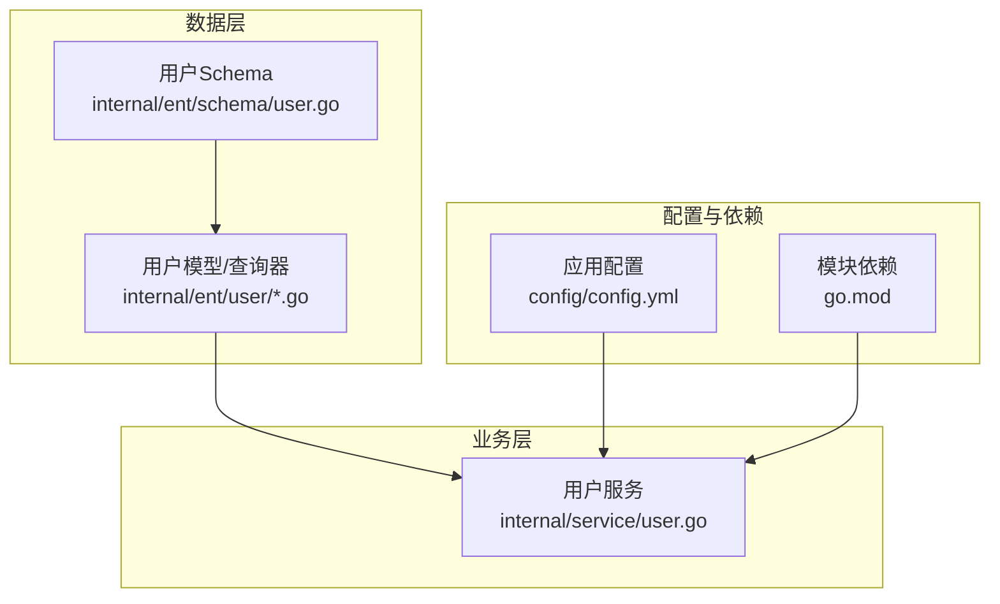
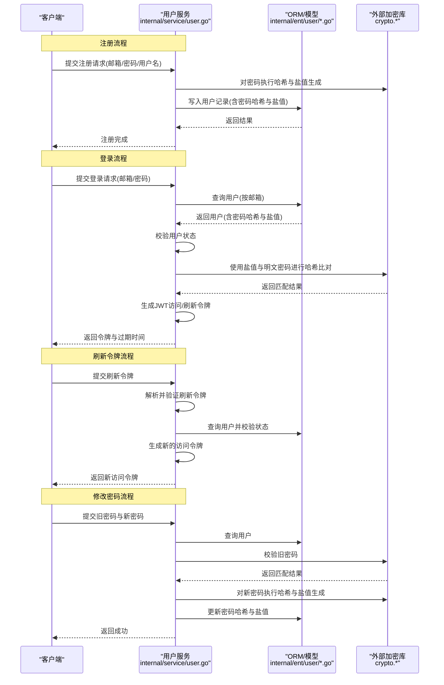
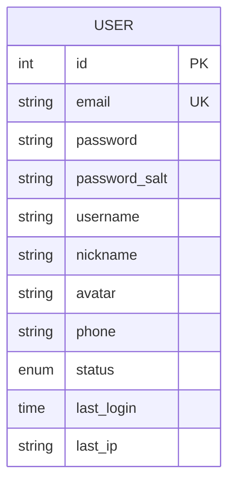
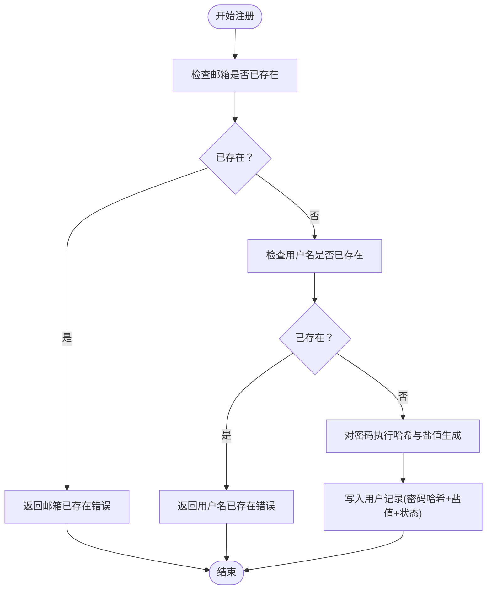
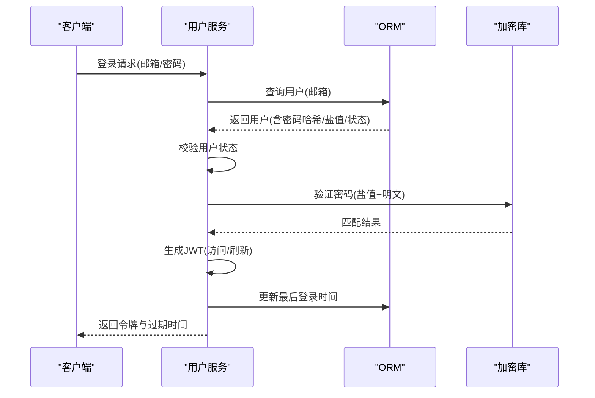
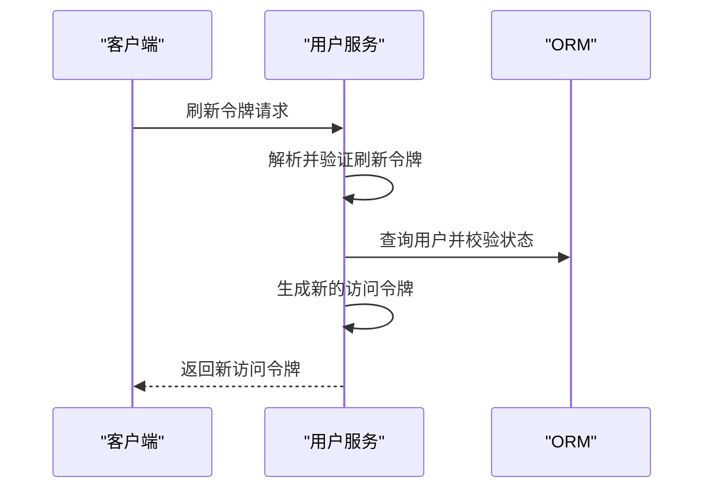
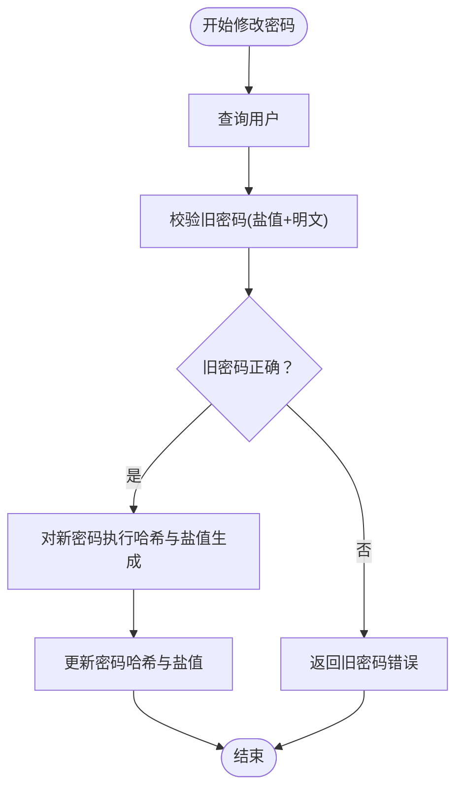
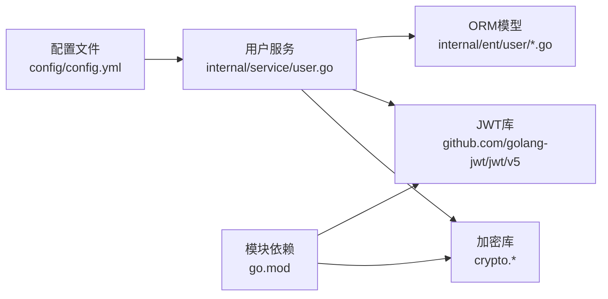

# 密码安全机制

<cite>
**本文引用的文件**
- [internal/ent/schema/user.go](file://internal/ent/schema/user.go)
- [internal/service/user.go](file://internal/service/user.go)
- [config/config.yml](file://config/config.yml)
- [go.mod](file://go.mod)
- [internal/ent/user/user.go](file://internal/ent/user/user.go)
- [internal/ent/user/where.go](file://internal/ent/user/where.go)
- [internal/global/msg.go](file://internal/global/msg.go)
</cite>

## 目录
1. [简介](#简介)
2. [项目结构](#项目结构)
3. [核心组件](#核心组件)
4. [架构总览](#架构总览)
5. [详细组件分析](#详细组件分析)
6. [依赖分析](#依赖分析)
7. [性能考虑](#性能考虑)
8. [故障排查指南](#故障排查指南)
9. [结论](#结论)
10. [附录](#附录)

## 简介
本文件面向Go Admin管理系统中的密码安全机制，围绕密码加密存储、盐值生成与安全存储策略、密码验证流程、强度要求、注册与修改密码流程、防暴力破解与密码过期策略、安全审计、错误处理与用户反馈、以及配置建议等方面进行系统化说明。文档基于仓库中实际实现进行分析，确保内容可追溯至具体源文件。

## 项目结构
与密码安全直接相关的模块主要分布在以下位置：
- 数据模型定义：用户实体包含密码字段与盐值字段，用于持久化存储
- 业务服务层：用户服务负责注册、登录、刷新令牌、修改密码等流程
- 配置文件：应用密钥、登录过期时间等关键参数
- 外部依赖：密码哈希与JWT签名等安全能力由外部库提供

**图表来源**
- [internal/ent/schema/user.go:1-104](file://internal/ent/schema/user.go#L1-L104)
- [internal/ent/user/user.go:1-216](file://internal/ent/user/user.go#L1-L216)
- [internal/service/user.go:1-402](file://internal/service/user.go#L1-L402)
- [config/config.yml:1-143](file://config/config.yml#L1-L143)
- [go.mod:1-127](file://go.mod#L1-L127)

**章节来源**
- [internal/ent/schema/user.go:1-104](file://internal/ent/schema/user.go#L1-L104)
- [internal/ent/user/user.go:1-216](file://internal/ent/user/user.go#L1-L216)
- [internal/service/user.go:1-402](file://internal/service/user.go#L1-L402)
- [config/config.yml:1-143](file://config/config.yml#L1-L143)
- [go.mod:1-127](file://go.mod#L1-L127)

## 核心组件
- 用户数据模型：包含密码字段与盐值字段，均标记为敏感信息，长度限制合理，便于安全存储与传输
- 用户服务：封装注册、登录、刷新令牌、修改密码等流程；调用外部加密库进行哈希与校验
- 配置项：应用密钥用于JWT签名，登录过期时间控制令牌有效期
- 错误码与消息：统一的响应常量与错误消息映射，便于前端与运维侧统一处理

**章节来源**
- [internal/ent/schema/user.go:34-59](file://internal/ent/schema/user.go#L34-L59)
- [internal/service/user.go:27-44](file://internal/service/user.go#L27-L44)
- [config/config.yml:8-9](file://config/config.yml#L8-L9)
- [internal/global/msg.go:45-83](file://internal/global/msg.go#L45-L83)

## 架构总览
密码安全相关的关键交互如下：
- 注册：对明文密码进行哈希与盐值生成，保存到数据库
- 登录：根据邮箱查询用户，校验状态，使用盐值与明文密码进行哈希比对，签发JWT
- 刷新令牌：解析并验证刷新令牌，签发新的访问令牌
- 修改密码：先校验旧密码，再对新密码进行哈希与盐值更新

**图表来源**
- [internal/service/user.go:87-130](file://internal/service/user.go#L87-L130)
- [internal/service/user.go:133-213](file://internal/service/user.go#L133-L213)
- [internal/service/user.go:282-364](file://internal/service/user.go#L282-L364)
- [internal/service/user.go:367-401](file://internal/service/user.go#L367-L401)
- [internal/ent/user/user.go:1-216](file://internal/ent/user/user.go#L1-L216)

**章节来源**
- [internal/service/user.go:87-130](file://internal/service/user.go#L87-L130)
- [internal/service/user.go:133-213](file://internal/service/user.go#L133-L213)
- [internal/service/user.go:282-364](file://internal/service/user.go#L282-L364)
- [internal/service/user.go:367-401](file://internal/service/user.go#L367-L401)
- [internal/ent/user/user.go:1-216](file://internal/ent/user/user.go#L1-L216)

## 详细组件分析

### 数据模型与字段设计
- 敏感字段标注：密码与盐值字段均标记为敏感，有助于在序列化/日志输出时进行屏蔽
- 字段长度限制：密码与盐值最大长度限制，避免异常输入导致存储问题
- 索引与唯一性：邮箱字段唯一索引，用户名等字段建立索引，便于快速检索
- 状态与审计：包含用户状态、最后登录时间与IP等字段，支持安全审计

**图表来源**
- [internal/ent/schema/user.go:23-80](file://internal/ent/schema/user.go#L23-L80)

**章节来源**
- [internal/ent/schema/user.go:23-80](file://internal/ent/schema/user.go#L23-L80)

### 注册流程与密码加密存储
- 输入校验：邮箱格式、用户名最小长度、密码最小长度等
- 哈希与盐值：使用外部加密库对密码进行哈希与盐值生成
- 存储策略：将哈希后的密码与盐值分别存入对应字段，状态初始为非活跃，需后续激活
- 错误处理：重复邮箱与用户名时返回特定错误

**图表来源**
- [internal/service/user.go:87-130](file://internal/service/user.go#L87-L130)

**章节来源**
- [internal/service/user.go:87-130](file://internal/service/user.go#L87-L130)

### 登录流程与密码验证
- 用户查询：按邮箱精确查询用户
- 状态校验：仅活跃用户允许登录
- 密码验证：使用盐值与明文密码进行哈希比对
- 令牌签发：生成访问令牌与刷新令牌，设置过期时间
- 登录后审计：更新最后登录时间

**图表来源**
- [internal/service/user.go:133-213](file://internal/service/user.go#L133-L213)

**章节来源**
- [internal/service/user.go:133-213](file://internal/service/user.go#L133-L213)

### 刷新令牌流程
- 解析与验证：使用应用密钥解析并验证刷新令牌签名与类型
- 用户校验：确认用户存在且状态有效
- 重新签发：生成新的访问令牌，保持刷新令牌可用

**图表来源**
- [internal/service/user.go:282-364](file://internal/service/user.go#L282-L364)

**章节来源**
- [internal/service/user.go:282-364](file://internal/service/user.go#L282-L364)

### 修改密码流程
- 旧密码校验：使用盐值与明文旧密码进行哈希比对
- 新密码处理：对新密码执行哈希与盐值生成
- 更新存储：替换密码哈希与盐值

**图表来源**
- [internal/service/user.go:367-401](file://internal/service/user.go#L367-L401)

**章节来源**
- [internal/service/user.go:367-401](file://internal/service/user.go#L367-L401)

### 密码强度要求与输入约束
- 注册请求中对密码最小长度进行约束
- 邮箱格式正则校验
- 用户名最小长度约束
- 密码字段最大长度限制，盐值字段最大长度限制

**章节来源**
- [internal/service/user.go:46-53](file://internal/service/user.go#L46-L53)
- [internal/ent/schema/user.go:12-15](file://internal/ent/schema/user.go#L12-L15)
- [internal/ent/schema/user.go:34-59](file://internal/ent/schema/user.go#L34-L59)

### 安全配置要点
- 应用密钥：用于JWT签名，必须妥善保管与轮换
- 登录过期时间：控制访问令牌有效期
- 日志与审计：记录登录时间、IP等信息，便于安全审计

**章节来源**
- [config/config.yml:8-9](file://config/config.yml#L8-L9)
- [config/config.yml:9](file://config/config.yml#L9)
- [internal/ent/schema/user.go:73-79](file://internal/ent/schema/user.go#L73-L79)

## 依赖分析
密码安全相关的关键依赖与集成点：
- 外部加密库：提供密码哈希与盐值生成、密码验证能力
- JWT库：用于签发与解析访问/刷新令牌
- ORM模型：承载密码与盐值字段，提供查询与更新能力

**图表来源**
- [internal/service/user.go:13-16](file://internal/service/user.go#L13-L16)
- [go.mod:12-18](file://go.mod#L12-L18)
- [config/config.yml:8-9](file://config/config.yml#L8-L9)

**章节来源**
- [internal/service/user.go:13-16](file://internal/service/user.go#L13-L16)
- [go.mod:12-18](file://go.mod#L12-L18)
- [config/config.yml:8-9](file://config/config.yml#L8-L9)

## 性能考虑
- 哈希成本：密码哈希算法选择应平衡安全性与性能，避免过高的CPU开销影响登录体验
- 缓存策略：对频繁访问的用户信息可采用缓存，但需注意密码相关数据不缓存
- 并发与锁：更新密码时使用ORM事务，保证一致性
- 索引优化：邮箱、用户名等字段建立索引，减少查询延迟

## 故障排查指南
- 常见错误码与消息：统一的响应常量与错误消息映射，便于定位问题
- 登录失败：检查用户状态、密码哈希与盐值是否正确、JWT签名是否有效
- 修改密码失败：确认旧密码验证通过、新密码哈希生成成功、数据库更新成功
- 配置问题：核对应用密钥与过期时间配置，确保JWT签发与解析一致

**章节来源**
- [internal/global/msg.go:45-83](file://internal/global/msg.go#L45-L83)
- [internal/service/user.go:133-213](file://internal/service/user.go#L133-L213)
- [internal/service/user.go:367-401](file://internal/service/user.go#L367-L401)

## 结论
Go Admin的密码安全机制通过“密码哈希+盐值”的组合实现安全存储，结合JWT令牌体系保障认证与会话管理。注册、登录、刷新与修改密码等流程均围绕这一核心策略展开，并辅以输入约束、状态校验与审计字段，形成完整的安全闭环。建议在生产环境中强化密钥轮换、引入防暴力破解与密码过期策略，并完善安全审计与告警机制。

## 附录
- 最佳实践清单
  - 强制使用高强度密码策略（长度、复杂度）
  - 启用登录失败次数限制与账户锁定
  - 实施密码过期策略与历史密码检查
  - 定期轮换应用密钥，严格保密
  - 记录并监控异常登录行为
  - 对密码相关字段进行脱敏输出与日志过滤