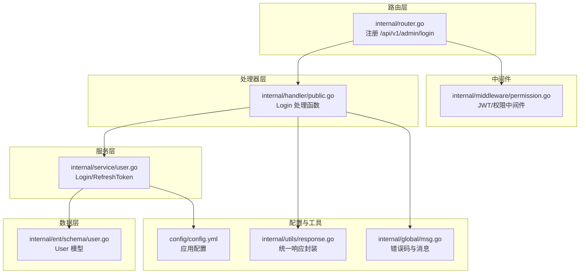
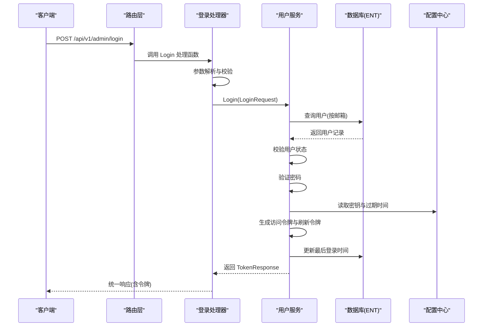
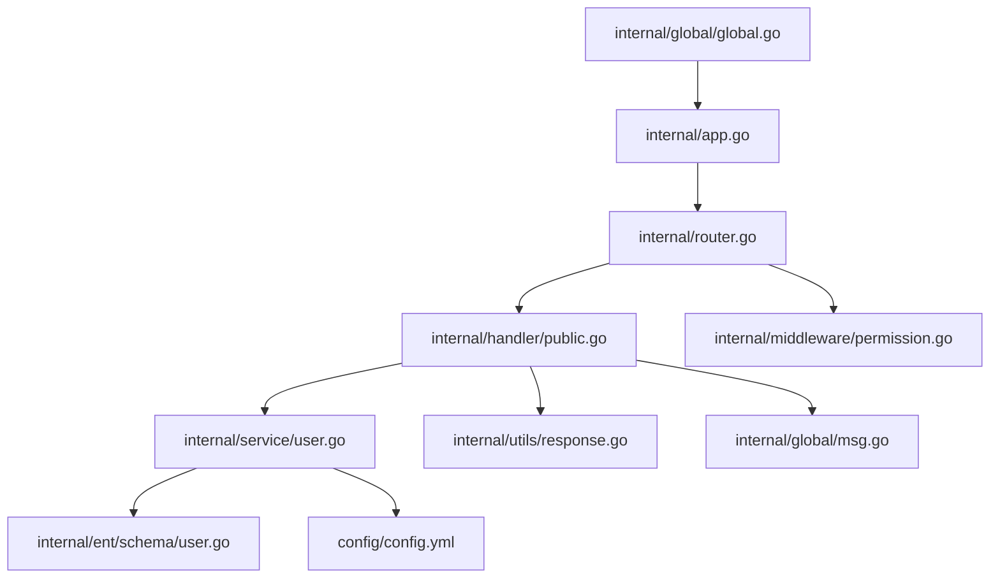
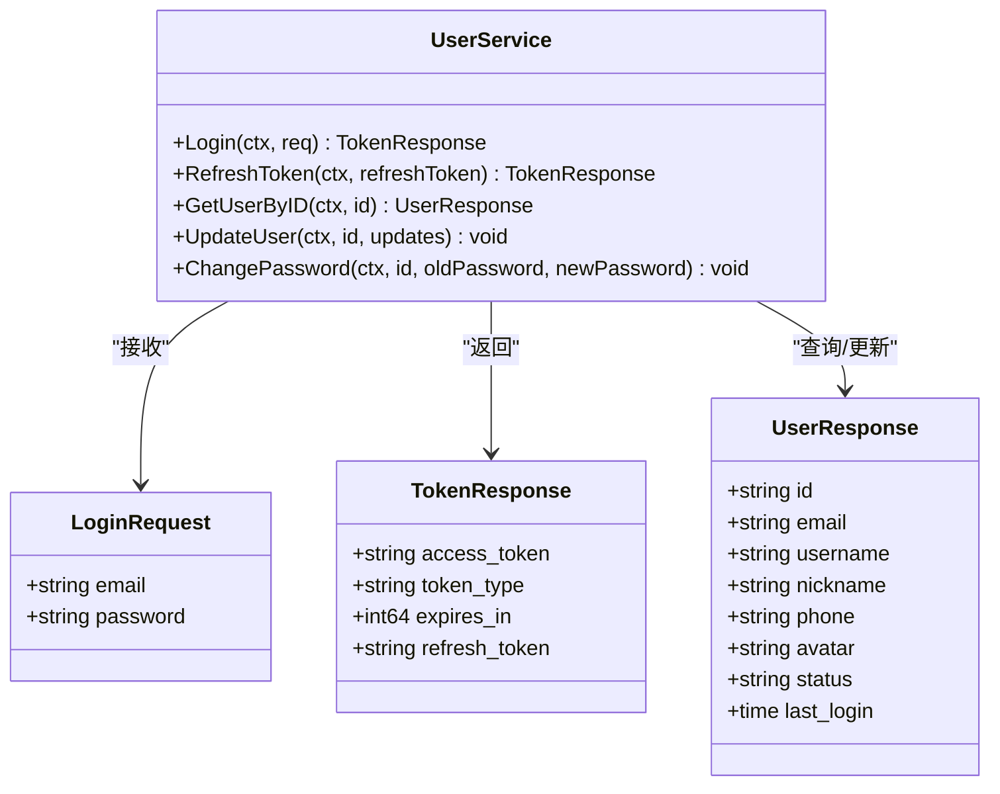

# 用户登录流程

<cite>
**本文档引用的文件**
- [internal/router.go](file://internal/router.go)
- [internal/handler/public.go](file://internal/handler/public.go)
- [internal/service/user.go](file://internal/service/user.go)
- [internal/ent/schema/user.go](file://internal/ent/schema/user.go)
- [internal/utils/response.go](file://internal/utils/response.go)
- [internal/global/msg.go](file://internal/global/msg.go)
- [internal/middleware/permission.go](file://internal/middleware/permission.go)
- [config/config.yml](file://config/config.yml)
- [internal/app.go](file://internal/app.go)
- [internal/global/global.go](file://internal/global/global.go)
</cite>

## 目录
1. [简介](#简介)
2. [项目结构](#项目结构)
3. [核心组件](#核心组件)
4. [架构总览](#架构总览)
5. [详细组件分析](#详细组件分析)
6. [依赖分析](#依赖分析)
7. [性能考虑](#性能考虑)
8. [故障排查指南](#故障排查指南)
9. [结论](#结论)
10. [附录](#附录)

## 简介
本文件面向Go Admin管理系统中的用户登录流程，提供从请求提交到成功获取访问令牌的完整说明。文档覆盖以下要点：
- 登录请求参数校验与错误处理
- 身份验证步骤：邮箱查找、状态检查、密码验证
- 安全考虑：JWT令牌生成与刷新、密码加密存储
- 登录成功后的用户信息更新与最后登录时间记录
- 登录API调用示例与响应格式说明
- 常见登录问题排查方法

## 项目结构
Go Admin采用分层架构，登录流程涉及路由注册、处理器、服务层、数据模型与中间件等模块协同工作。

图表来源
- [internal/router.go:49](file://internal/router.go#L49)
- [internal/handler/public.go:33](file://internal/handler/public.go#L33)
- [internal/service/user.go:133](file://internal/service/user.go#L133)
- [internal/ent/schema/user.go:18](file://internal/ent/schema/user.go#L18)
- [internal/middleware/permission.go:15](file://internal/middleware/permission.go#L15)
- [config/config.yml:1](file://config/config.yml#L1)
- [internal/utils/response.go:9](file://internal/utils/response.go#L9)
- [internal/global/msg.go:4](file://internal/global/msg.go#L4)

章节来源
- [internal/router.go:16-60](file://internal/router.go#L16-L60)
- [internal/handler/public.go:19-60](file://internal/handler/public.go#L19-L60)
- [internal/service/user.go:132-213](file://internal/service/user.go#L132-L213)
- [internal/ent/schema/user.go:18-80](file://internal/ent/schema/user.go#L18-L80)
- [internal/middleware/permission.go:15-77](file://internal/middleware/permission.go#L15-L77)
- [config/config.yml:1](file://config/config.yml#L1)
- [internal/utils/response.go:9-49](file://internal/utils/response.go#L9-L49)
- [internal/global/msg.go:44-83](file://internal/global/msg.go#L44-L83)

## 核心组件
- 路由注册：在路由层注册登录接口，绑定到处理器。
- 登录处理器：负责参数解析与校验、调用服务层、返回统一响应。
- 用户服务：实现登录、刷新令牌、用户信息查询与更新等核心逻辑。
- 数据模型：定义用户字段、索引与状态枚举，支撑登录与权限控制。
- 中间件：JWT解码与权限校验，确保后续接口的安全访问。
- 配置与工具：应用配置（如密钥、过期时间）、统一响应封装与错误码映射。

章节来源
- [internal/router.go:49](file://internal/router.go#L49)
- [internal/handler/public.go:33-60](file://internal/handler/public.go#L33-L60)
- [internal/service/user.go:27-34](file://internal/service/user.go#L27-L34)
- [internal/ent/schema/user.go:23-80](file://internal/ent/schema/user.go#L23-L80)
- [internal/middleware/permission.go:15-77](file://internal/middleware/permission.go#L15-L77)
- [config/config.yml:1](file://config/config.yml#L1)
- [internal/utils/response.go:9-49](file://internal/utils/response.go#L9-L49)
- [internal/global/msg.go:44-83](file://internal/global/msg.go#L44-L83)

## 架构总览
登录流程从HTTP请求进入，经过路由、处理器、服务层，最终返回JWT令牌；同时更新用户最后登录时间。

图表来源
- [internal/router.go:49](file://internal/router.go#L49)
- [internal/handler/public.go:33-60](file://internal/handler/public.go#L33-L60)
- [internal/service/user.go:133-213](file://internal/service/user.go#L133-L213)
- [internal/ent/schema/user.go:29-75](file://internal/ent/schema/user.go#L29-L75)
- [config/config.yml:8-9](file://config/config.yml#L8-L9)

## 详细组件分析

### 登录API定义与路由绑定
- 路由：在v1版本下，公开接口组注册了登录与刷新令牌接口。
- 认证：登录接口无需认证，刷新令牌接口需通过JWT中间件保护。
- 处理器：登录处理器负责参数校验、调用服务层、返回统一响应。

章节来源
- [internal/router.go:29-50](file://internal/router.go#L29-L50)
- [internal/handler/public.go:19-60](file://internal/handler/public.go#L19-L60)

### 登录处理器（参数校验与错误处理）
- 参数解析：使用通用校验库解析并校验请求体。
- 错误处理：针对不同校验错误返回对应的状态码与消息。
- 服务调用：调用用户服务执行登录逻辑。
- 统一响应：使用统一响应封装返回结果。

章节来源
- [internal/handler/public.go:33-60](file://internal/handler/public.go#L33-L60)
- [internal/utils/response.go:9-49](file://internal/utils/response.go#L9-L49)
- [internal/global/msg.go:44-83](file://internal/global/msg.go#L44-L83)

### 用户服务（登录与令牌生成）
- 用户查找：根据邮箱精确查询用户。
- 状态检查：仅允许状态为“active”的用户登录。
- 密码验证：使用盐值进行密码比对。
- 令牌生成：生成访问令牌与刷新令牌，设置过期时间与声明。
- 最后登录更新：登录成功后更新最后登录时间。

章节来源
- [internal/service/user.go:133-213](file://internal/service/user.go#L133-L213)
- [internal/ent/schema/user.go:69-75](file://internal/ent/schema/user.go#L69-L75)
- [config/config.yml:8-9](file://config/config.yml#L8-L9)

### 数据模型（用户字段与约束）
- 字段定义：邮箱、密码、用户名、昵称、头像、手机、状态、最后登录时间等。
- 索引：邮箱、手机号、用户名建立索引，提升查询效率。
- 状态枚举：支持active、inactive、suspended三种状态。

章节来源
- [internal/ent/schema/user.go:23-80](file://internal/ent/schema/user.go#L23-L80)

### JWT中间件与权限控制
- JWT中间件：从请求头中提取并解析JWT，注入用户信息到上下文。
- 权限中间件：基于Casbin进行API级权限校验，结合域信息与请求路径/方法判断。
- 域中间件：从JWT中提取域信息，供权限中间件使用。

章节来源
- [internal/middleware/permission.go:15-77](file://internal/middleware/permission.go#L15-L77)

### 刷新令牌流程
- 请求解析：解析刷新令牌请求体并进行校验。
- 令牌解析：使用密钥解析并验证刷新令牌的有效性与类型。
- 用户状态校验：确认用户仍处于活跃状态。
- 新令牌生成：生成新的访问令牌，保持刷新令牌可用。

章节来源
- [internal/handler/public.go:180-213](file://internal/handler/public.go#L180-L213)
- [internal/service/user.go:282-364](file://internal/service/user.go#L282-L364)

### 登录成功后的用户信息更新
- 最后登录时间：登录成功后更新用户最后登录时间为当前时间。
- 最后登录IP：模型中包含最后登录IP字段，可在扩展中完善。

章节来源
- [internal/service/user.go:199-205](file://internal/service/user.go#L199-L205)
- [internal/ent/schema/user.go:73-79](file://internal/ent/schema/user.go#L73-L79)

## 依赖分析
登录流程的关键依赖关系如下：

图表来源
- [internal/router.go:16](file://internal/router.go#L16)
- [internal/handler/public.go:33](file://internal/handler/public.go#L33)
- [internal/service/user.go:133](file://internal/service/user.go#L133)
- [internal/ent/schema/user.go:18](file://internal/ent/schema/user.go#L18)
- [config/config.yml:1](file://config/config.yml#L1)
- [internal/utils/response.go:9](file://internal/utils/response.go#L9)
- [internal/global/msg.go:4](file://internal/global/msg.go#L4)
- [internal/middleware/permission.go:15](file://internal/middleware/permission.go#L15)
- [internal/app.go:16](file://internal/app.go#L16)
- [internal/global/global.go:11](file://internal/global/global.go#L11)

章节来源
- [internal/router.go:16-60](file://internal/router.go#L16-L60)
- [internal/handler/public.go:33-60](file://internal/handler/public.go#L33-L60)
- [internal/service/user.go:133-213](file://internal/service/user.go#L133-L213)
- [internal/ent/schema/user.go:18-80](file://internal/ent/schema/user.go#L18-L80)
- [internal/middleware/permission.go:15-77](file://internal/middleware/permission.go#L15-L77)
- [internal/app.go:16-25](file://internal/app.go#L16-L25)
- [internal/global/global.go:11-16](file://internal/global/global.go#L11-L16)

## 性能考虑
- 数据库查询优化：用户表对邮箱、手机号、用户名建立索引，登录时按邮箱查询可利用索引提升性能。
- 密码验证成本：密码哈希与盐值验证为CPU密集操作，建议在高并发场景下合理配置实例数量与连接池。
- JWT生成与解析：令牌生成与解析为轻量操作，但需注意密钥长度与算法选择。
- 缓存策略：可考虑对热点用户信息进行缓存，减少数据库压力（当前服务层未直接使用缓存）。

## 故障排查指南
- 参数校验失败
  - 现象：返回400错误，提示请求体无效或字段校验失败。
  - 排查：检查请求体格式与字段是否符合要求（邮箱格式、密码长度等）。
  - 参考：处理器中的参数解析与校验逻辑。
  
  章节来源
  - [internal/handler/public.go:36-42](file://internal/handler/public.go#L36-L42)

- 用户不存在
  - 现象：返回404错误，提示用户不存在。
  - 排查：确认邮箱是否正确，数据库中是否存在该用户。
  - 参考：服务层用户查找逻辑。
  
  章节来源
  - [internal/service/user.go:135-143](file://internal/service/user.go#L135-L143)

- 用户状态异常
  - 现象：返回403错误，提示用户未激活。
  - 排查：确认用户状态为active，若非active需先完成激活流程。
  - 参考：服务层状态检查逻辑。
  
  章节来源
  - [internal/service/user.go:145-148](file://internal/service/user.go#L145-L148)

- 密码错误
  - 现象：返回401错误，提示密码无效。
  - 排查：确认输入密码与盐值匹配，避免大小写或特殊字符问题。
  - 参考：服务层密码验证逻辑。
  
  章节来源
  - [internal/service/user.go:150-157](file://internal/service/user.go#L150-L157)

- 服务器内部错误
  - 现象：返回500错误。
  - 排查：检查数据库连接、密钥配置、JWT生成过程与日志输出。
  - 参考：统一响应封装与错误码映射。
  
  章节来源
  - [internal/handler/public.go:54-56](file://internal/handler/public.go#L54-L56)
  - [internal/utils/response.go:35-44](file://internal/utils/response.go#L35-L44)
  - [internal/global/msg.go:44-83](file://internal/global/msg.go#L44-L83)

- 刷新令牌无效
  - 现象：返回401错误，提示刷新令牌无效。
  - 排查：确认刷新令牌格式正确、未过期、签名有效且类型为refresh。
  - 参考：刷新令牌处理器与服务层解析逻辑。
  
  章节来源
  - [internal/handler/public.go:192-213](file://internal/handler/public.go#L192-L213)
  - [internal/service/user.go:282-302](file://internal/service/user.go#L282-L302)

## 结论
Go Admin的用户登录流程遵循清晰的分层设计：路由层负责暴露接口，处理器层进行参数校验与统一响应，服务层完成身份验证与令牌生成，数据层提供用户模型与状态约束，中间件保障JWT与权限控制。整体流程安全、可扩展，并提供了完善的错误处理与响应规范。

## 附录

### 登录API调用示例
- 请求地址
  - POST /api/v1/admin/login
- 请求头
  - Content-Type: application/json
- 请求体
  - email: 用户邮箱（必填，邮箱格式）
  - password: 用户密码（必填）
- 成功响应
  - code: 1
  - message: 成功
  - data.access_token: 访问令牌
  - data.token_type: Bearer
  - data.expires_in: 令牌过期秒数
  - data.refresh_token: 刷新令牌（可选）
- 失败响应
  - code: 对应错误码（如401、403、404、500）
  - message: 对应错误消息
  - data: 可为空

章节来源
- [internal/router.go:49](file://internal/router.go#L49)
- [internal/handler/public.go:19-60](file://internal/handler/public.go#L19-L60)
- [internal/service/user.go:55-67](file://internal/service/user.go#L55-L67)
- [internal/utils/response.go:9-49](file://internal/utils/response.go#L9-L49)
- [internal/global/msg.go:44-83](file://internal/global/msg.go#L44-L83)

### 刷新令牌API调用示例
- 请求地址
  - POST /api/v1/admin/refresh-token
- 请求头
  - Content-Type: application/json
- 请求体
  - refresh_token: 刷新令牌（必填）
- 成功响应
  - code: 1
  - message: 成功
  - data.access_token: 新的访问令牌
  - data.token_type: Bearer
  - data.expires_in: 令牌过期秒数
  - data.refresh_token: 原刷新令牌（可复用）
- 失败响应
  - code: 401
  - message: 无效的刷新令牌

章节来源
- [internal/router.go:50](file://internal/router.go#L50)
- [internal/handler/public.go:180-213](file://internal/handler/public.go#L180-L213)
- [internal/service/user.go:69-72](file://internal/service/user.go#L69-L72)

### 登录流程类图

图表来源
- [internal/service/user.go:55-84](file://internal/service/user.go#L55-L84)
- [internal/service/user.go:133-213](file://internal/service/user.go#L133-L213)
- [internal/service/user.go:282-364](file://internal/service/user.go#L282-L364)
- [internal/service/user.go:216-235](file://internal/service/user.go#L216-L235)