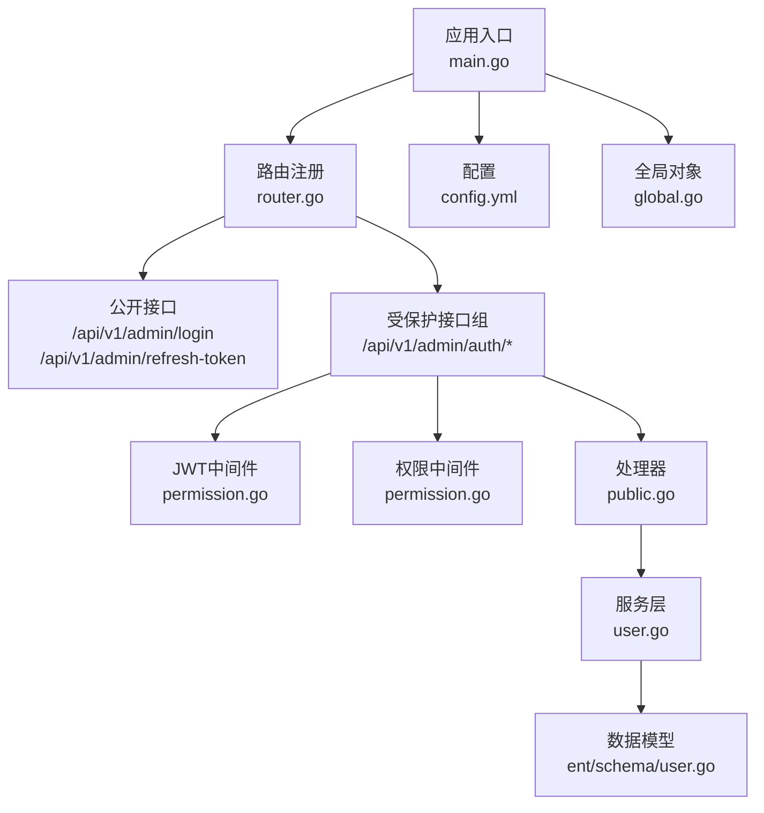
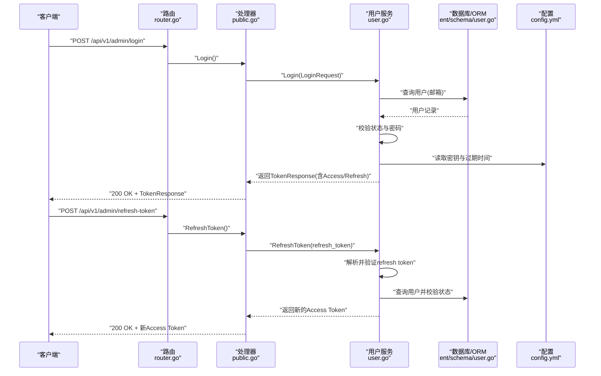
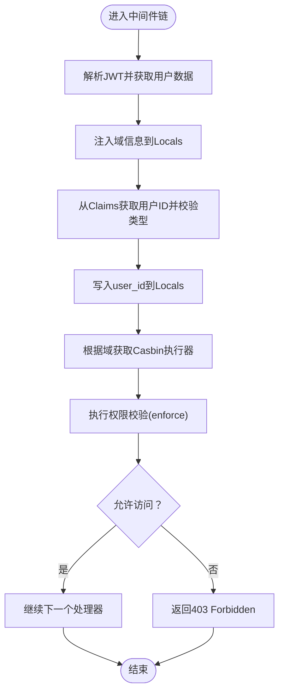
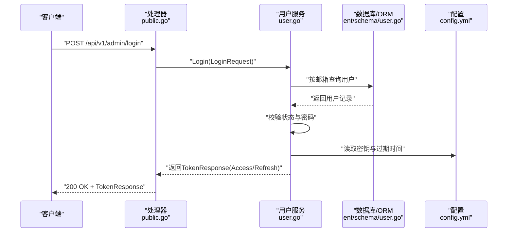
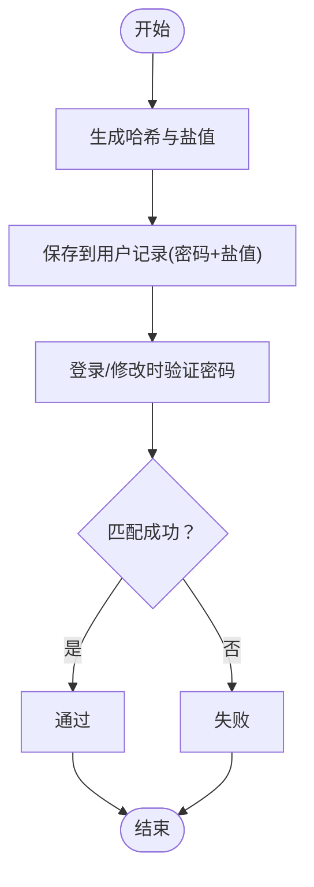
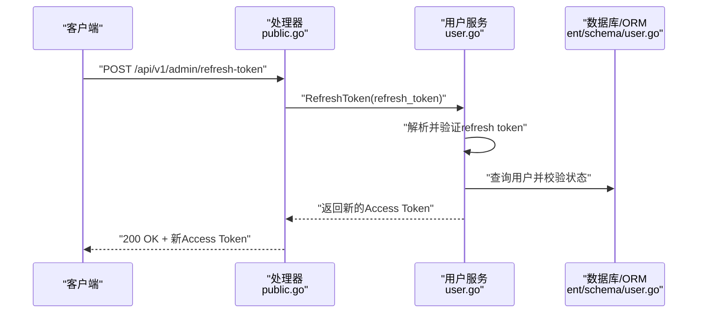
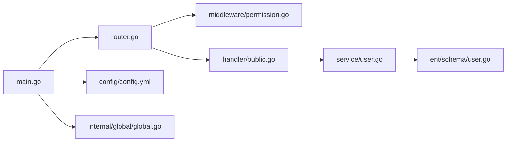

# 用户认证系统

<cite>
**本文引用的文件**
- [main.go](file://main.go)
- [app.go](file://internal/app.go)
- [router.go](file://internal/router.go)
- [permission.go](file://internal/middleware/permission.go)
- [user.go](file://internal/service/user.go)
- [public.go](file://internal/handler/public.go)
- [config.yml](file://config/config.yml)
- [user.go](file://internal/ent/schema/user.go)
- [global.go](file://internal/global/global.go)
</cite>

## 目录
1. [简介](#简介)
2. [项目结构](#项目结构)
3. [核心组件](#核心组件)
4. [架构总览](#架构总览)
5. [详细组件分析](#详细组件分析)
6. [依赖关系分析](#依赖关系分析)
7. [性能考量](#性能考量)
8. [故障排查指南](#故障排查指南)
9. [结论](#结论)
10. [附录](#附录)

## 简介
本文件面向Go Admin管理系统的用户认证子系统，系统采用基于JWT的无状态认证机制，结合Fiber路由与中间件、Casbin权限控制、Ent ORM以及CMF工具库，实现登录、注册、密码加密存储、令牌签发与刷新、权限校验与会话管理等完整能力。本文将深入解析JWT令牌的生成、验证与刷新流程，覆盖密码哈希算法、盐值生成与安全存储方案，并给出认证失败的错误处理与重试建议、多设备登录的安全策略，以及实际的API调用示例与序列图。

## 项目结构
围绕认证的关键模块与职责如下：
- 应用入口与引导：负责初始化应用、挂载静态资源、注册路由与中间件
- 路由与控制器：定义公开与受保护的API端点，绑定处理器
- 中间件：JWT解析与权限校验、域信息注入
- 服务层：用户登录、注册、密码变更、令牌刷新等业务逻辑
- 数据模型：用户实体及字段约束
- 配置：应用密钥、JWT过期时间、Casbin多域策略等

图表来源
- [main.go:47-104](file://main.go#L47-L104)
- [router.go:16-149](file://internal/router.go#L16-L149)
- [permission.go:14-93](file://internal/middleware/permission.go#L14-L93)
- [public.go:19-213](file://internal/handler/public.go#L19-L213)
- [user.go:36-401](file://internal/service/user.go#L36-L401)
- [user.go:17-104](file://internal/ent/schema/user.go#L17-L104)
- [config.yml:1-143](file://config/config.yml#L1-L143)
- [global.go:11-16](file://internal/global/global.go#L11-L16)

章节来源
- [main.go:47-104](file://main.go#L47-L104)
- [router.go:16-149](file://internal/router.go#L16-L149)

## 核心组件
- JWT中间件：负责从请求中提取并解析JWT，注入域信息与用户ID到上下文
- 权限中间件：基于Casbin执行器对用户在指定域下的路径与HTTP方法进行授权校验
- 用户服务：封装登录、注册、密码变更、令牌刷新等核心业务
- 处理器：对接Fiber路由，负责参数校验、调用服务层并返回统一响应
- 数据模型：用户实体包含邮箱、密码、盐值、状态、最后登录时间等字段
- 配置：包含应用密钥、登录与刷新令牌过期秒数、Casbin多域策略等

章节来源
- [permission.go:14-93](file://internal/middleware/permission.go#L14-L93)
- [user.go:27-401](file://internal/service/user.go#L27-L401)
- [public.go:19-213](file://internal/handler/public.go#L19-L213)
- [user.go:17-104](file://internal/ent/schema/user.go#L17-L104)
- [config.yml:1-143](file://config/config.yml#L1-L143)

## 架构总览
下图展示认证系统在请求生命周期中的交互关系：

图表来源
- [router.go:49-50](file://internal/router.go#L49-L50)
- [public.go:33-60](file://internal/handler/public.go#L33-L60)
- [user.go:132-213](file://internal/service/user.go#L132-L213)
- [router.go:50](file://internal/router.go#L50)
- [public.go:192-213](file://internal/handler/public.go#L192-L213)
- [user.go:281-364](file://internal/service/user.go#L281-L364)
- [user.go:17-104](file://internal/ent/schema/user.go#L17-L104)
- [config.yml:1-143](file://config/config.yml#L1-L143)

## 详细组件分析

### JWT中间件与权限中间件
- JWT中间件负责从请求上下文中提取JWT用户数据，注入域信息与用户ID到Locals，供后续中间件与处理器使用
- 权限中间件从Locals读取域与用户ID，结合Casbin执行器进行权限校验，拒绝无权访问

图表来源
- [permission.go:14-93](file://internal/middleware/permission.go#L14-L93)

章节来源
- [permission.go:14-93](file://internal/middleware/permission.go#L14-L93)

### 登录流程（含密码校验与令牌签发）
- 处理器接收登录请求，进行参数校验
- 服务层查询用户并校验状态与密码
- 生成访问令牌与刷新令牌，设置过期时间与域信息
- 返回统一响应

图表来源
- [public.go:33-60](file://internal/handler/public.go#L33-L60)
- [user.go:132-213](file://internal/service/user.go#L132-L213)
- [user.go:17-104](file://internal/ent/schema/user.go#L17-L104)
- [config.yml:1-143](file://config/config.yml#L1-L143)

章节来源
- [public.go:33-60](file://internal/handler/public.go#L33-L60)
- [user.go:132-213](file://internal/service/user.go#L132-L213)

### 密码加密与存储
- 注册与修改密码时，使用密码哈希函数生成哈希值与盐值
- 用户记录保存密码哈希与盐值，查询时使用盐值与输入密码进行验证
- 数据模型中明确标注密码与盐值字段为敏感信息

图表来源
- [user.go:86-130](file://internal/service/user.go#L86-L130)
- [user.go:366-401](file://internal/service/user.go#L366-L401)
- [user.go:34-59](file://internal/ent/schema/user.go#L34-L59)

章节来源
- [user.go:86-130](file://internal/service/user.go#L86-L130)
- [user.go:366-401](file://internal/service/user.go#L366-L401)
- [user.go:34-59](file://internal/ent/schema/user.go#L34-L59)

### 令牌刷新流程
- 处理器接收刷新请求，进行参数校验
- 服务层解析并验证刷新令牌，确保类型为refresh且有效
- 查询用户并校验状态，生成新的访问令牌
- 返回新的访问令牌

图表来源
- [public.go:192-213](file://internal/handler/public.go#L192-L213)
- [user.go:281-364](file://internal/service/user.go#L281-L364)
- [user.go:17-104](file://internal/ent/schema/user.go#L17-L104)

章节来源
- [public.go:192-213](file://internal/handler/public.go#L192-L213)
- [user.go:281-364](file://internal/service/user.go#L281-L364)

### 会话管理与多设备登录
- 系统采用JWT无状态认证，不维护服务端会话；刷新令牌可用于续期
- 多设备登录可通过同一刷新令牌在不同设备上换取新的访问令牌
- 建议策略：
  - 强制刷新令牌定期轮换（服务端可引入刷新令牌黑名单/白名单）
  - 对高风险操作增加二次验证
  - 记录登录IP与时间，异常登录触发风控

章节来源
- [user.go:132-213](file://internal/service/user.go#L132-L213)
- [user.go:281-364](file://internal/service/user.go#L281-L364)

### 错误处理与重试机制
- 参数校验失败：返回统一错误响应
- 用户不存在/密码错误/状态异常：返回相应HTTP状态与错误码
- 刷新令牌无效：返回401 Unauthorized
- 建议重试策略：
  - 登录失败N次后临时封禁账户或验证码校验
  - 刷新令牌失败时提示重新登录

章节来源
- [public.go:33-60](file://internal/handler/public.go#L33-L60)
- [public.go:192-213](file://internal/handler/public.go#L192-L213)
- [user.go:132-213](file://internal/service/user.go#L132-L213)
- [user.go:281-364](file://internal/service/user.go#L281-L364)

## 依赖关系分析
- 应用入口依赖路由注册、中间件与静态资源挂载
- 路由依赖JWT中间件、域中间件与权限中间件
- 处理器依赖服务层与统一响应工具
- 服务层依赖ORM、配置与密码工具
- 数据模型定义用户字段与索引

图表来源
- [main.go:47-104](file://main.go#L47-L104)
- [router.go:16-149](file://internal/router.go#L16-L149)
- [permission.go:14-93](file://internal/middleware/permission.go#L14-L93)
- [public.go:19-213](file://internal/handler/public.go#L19-L213)
- [user.go:36-401](file://internal/service/user.go#L36-L401)
- [user.go:17-104](file://internal/ent/schema/user.go#L17-L104)
- [config.yml:1-143](file://config/config.yml#L1-L143)
- [global.go:11-16](file://internal/global/global.go#L11-L16)

章节来源
- [main.go:47-104](file://main.go#L47-L104)
- [router.go:16-149](file://internal/router.go#L16-L149)

## 性能考量
- JWT中间件与权限中间件均在请求链路早期执行，避免重复解析与鉴权
- Casbin执行器按域加载，建议高频域启用自动加载以减少首次延迟
- 缓存与Redis配置可用作扩展，用于令牌黑名单、限流与会话状态缓存
- 登录与刷新令牌的过期时间需平衡用户体验与安全强度

章节来源
- [config.yml:32-59](file://config/config.yml#L32-L59)
- [config.yml:77-143](file://config/config.yml#L77-L143)

## 故障排查指南
- 401未授权：检查Authorization头格式与令牌有效性；确认JWT中间件正确注入域与用户ID
- 403禁止访问：检查Casbin策略与用户域；确认enforcer加载与规则匹配
- 400参数错误：检查请求体结构与字段校验
- 500服务器错误：关注服务层异常与数据库连接问题

章节来源
- [permission.go:14-93](file://internal/middleware/permission.go#L14-L93)
- [public.go:33-60](file://internal/handler/public.go#L33-L60)
- [public.go:192-213](file://internal/handler/public.go#L192-L213)

## 结论
本认证系统以JWT为核心，结合中间件与Casbin实现细粒度权限控制，配合密码哈希与盐值存储保障安全性。通过清晰的路由分组与中间件链路，实现了登录、注册、密码变更与令牌刷新的完整闭环。建议在生产环境中进一步完善刷新令牌轮换、风控策略与缓存优化，以提升整体安全与性能。

## 附录

### API调用示例（路径参考）
- 登录
  - 方法与路径：POST /api/v1/admin/login
  - 请求体：service.LoginRequest
  - 响应体：utils.Response{data=service.TokenResponse}
  - 处理器路径：[internal/handler/public.go:33-60](file://internal/handler/public.go#L33-L60)
- 刷新令牌
  - 方法与路径：POST /api/v1/admin/refresh-token
  - 请求体：service.RefreshTokenRequest
  - 响应体：utils.Response{data=service.TokenResponse}
  - 处理器路径：[internal/handler/public.go:192-213](file://internal/handler/public.go#L192-L213)
- 获取当前用户信息
  - 方法与路径：GET /api/v1/admin/auth/user
  - 安全要求：Bearer Token
  - 响应体：utils.Response{data=UserResponse}
  - 处理器路径：[internal/handler/public.go:73-99](file://internal/handler/public.go#L73-L99)
- 修改密码
  - 方法与路径：PUT /api/v1/admin/auth/password
  - 安全要求：Bearer Token
  - 请求体：ChangePasswordRequest
  - 响应体：utils.Response
  - 处理器路径：[internal/handler/public.go:135-178](file://internal/handler/public.go#L135-L178)

章节来源
- [public.go:19-213](file://internal/handler/public.go#L19-L213)