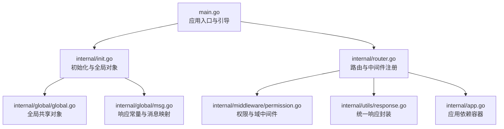
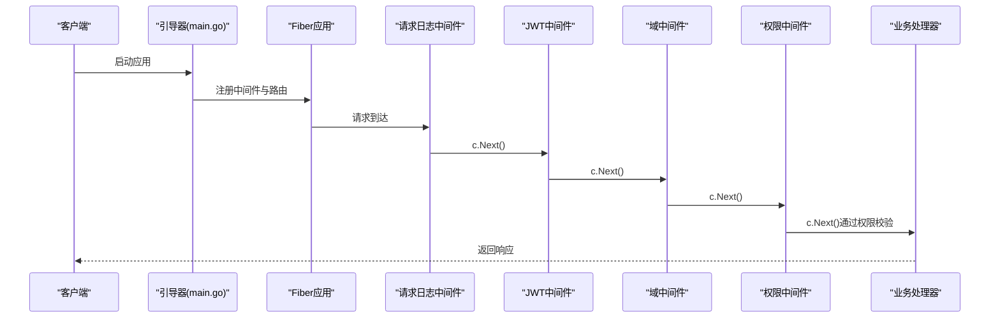
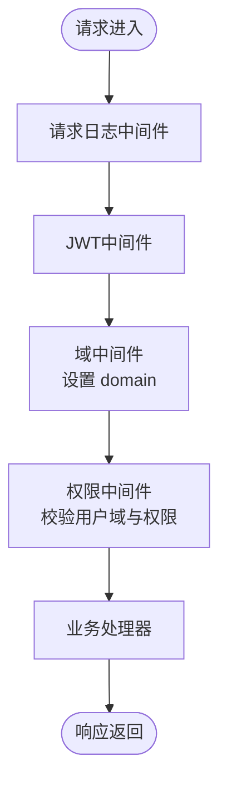
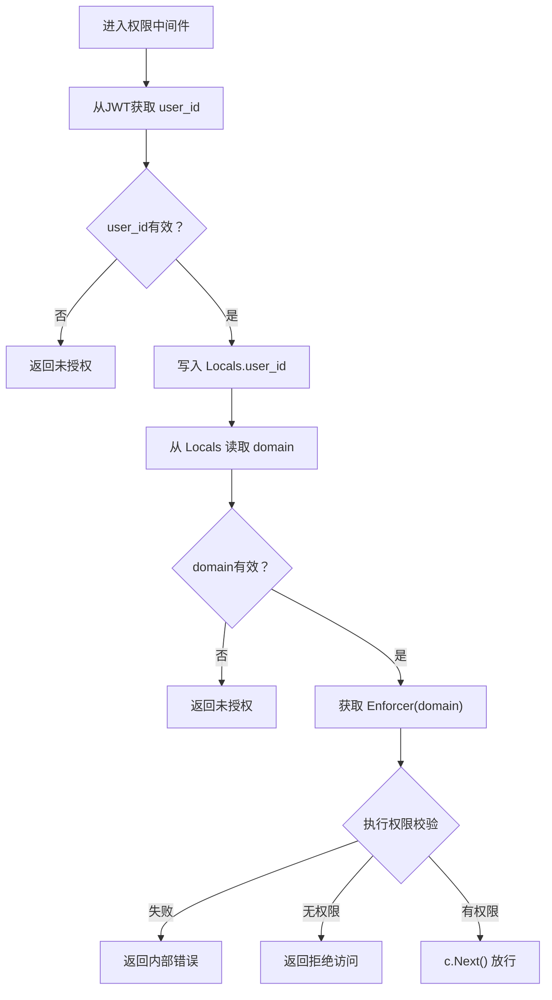
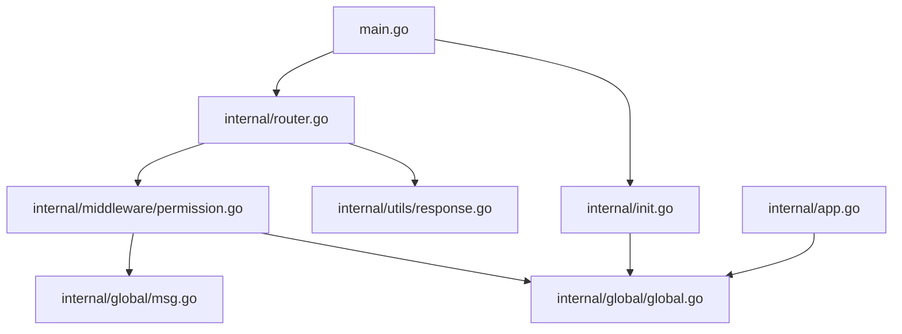

# 中间件架构

<cite>
**本文引用的文件**
- [main.go](file://main.go)
- [internal/router.go](file://internal/router.go)
- [internal/middleware/permission.go](file://internal/middleware/permission.go)
- [internal/utils/response.go](file://internal/utils/response.go)
- [internal/global/global.go](file://internal/global/global.go)
- [internal/global/msg.go](file://internal/global/msg.go)
- [internal/init.go](file://internal/init.go)
- [internal/app.go](file://internal/app.go)
</cite>

## 目录
1. [简介](#简介)
2. [项目结构](#项目结构)
3. [核心组件](#核心组件)
4. [架构总览](#架构总览)
5. [详细组件分析](#详细组件分析)
6. [依赖分析](#依赖分析)
7. [性能考虑](#性能考虑)
8. [故障排查指南](#故障排查指南)
9. [结论](#结论)
10. [附录](#附录)

## 简介
本文件面向Go Admin管理系统，系统性阐述基于Fiber Web框架的中间件架构与执行机制，重点覆盖：
- 中间件的注册方式与执行顺序（链式调用）
- JWT认证中间件、权限控制中间件与自定义中间件的实现原理
- 执行上下文在中间件间的传递（Locals）
- 错误处理策略与响应封装
- 中间件开发最佳实践（性能、日志、异常处理）
- 典型中间件的代码示例路径与自定义中间件创建指南

## 项目结构
本项目采用“模块化+路由分层”的组织方式，中间件相关代码集中在以下位置：
- 根入口与全局初始化：main.go、internal/init.go、internal/app.go
- 路由与中间件注册：internal/router.go
- 自定义中间件：internal/middleware/permission.go
- 统一响应封装：internal/utils/response.go
- 全局常量与状态码：internal/global/msg.go
- 全局共享对象：internal/global/global.go

图表来源
- [main.go:1-105](file://main.go#L1-L105)
- [internal/router.go:1-150](file://internal/router.go#L1-L150)
- [internal/middleware/permission.go:1-94](file://internal/middleware/permission.go#L1-L94)
- [internal/utils/response.go:1-50](file://internal/utils/response.go#L1-L50)
- [internal/global/global.go:1-17](file://internal/global/global.go#L1-L17)
- [internal/global/msg.go:1-84](file://internal/global/msg.go#L1-L84)
- [internal/init.go:1-101](file://internal/init.go#L1-L101)
- [internal/app.go:1-26](file://internal/app.go#L1-L26)

章节来源
- [main.go:1-105](file://main.go#L1-L105)
- [internal/router.go:1-150](file://internal/router.go#L1-L150)

## 核心组件
- Fiber应用与引导
  - 应用通过引导器注册中间件、路由与清理函数，确保中间件在路由之前生效。
  - 示例路径：[main.go:59-93](file://main.go#L59-L93)
- 路由与中间件注册
  - 在路由组上注册多个中间件，形成链式调用；每个中间件可设置Locals供后续处理器使用。
  - 示例路径：[internal/router.go:16-59](file://internal/router.go#L16-L59)
- 权限与域中间件
  - 从JWT中提取用户域与用户ID，校验权限并通过Casbin执行器判断是否放行。
  - 示例路径：[internal/middleware/permission.go:14-93](file://internal/middleware/permission.go#L14-L93)
- 统一响应封装
  - 提供Success/Fail与ToJSON输出，统一错误码与消息映射。
  - 示例路径：[internal/utils/response.go:9-49](file://internal/utils/response.go#L9-L49)
- 全局常量与状态码
  - 定义标准HTTP状态码与业务错误码，便于统一处理。
  - 示例路径：[internal/global/msg.go:4-83](file://internal/global/msg.go#L4-L83)
- 全局共享对象
  - EnforcerManager、CronManager等全局对象在初始化阶段注入。
  - 示例路径：[internal/global/global.go:11-16](file://internal/global/global.go#L11-L16)
- 应用依赖容器
  - App结构体承载配置、日志、数据库、验证器、缓存、Ent客户端、Casbin执行器、文件系统等。
  - 示例路径：[internal/app.go:15-25](file://internal/app.go#L15-L25)

章节来源
- [internal/middleware/permission.go:14-93](file://internal/middleware/permission.go#L14-L93)
- [internal/router.go:16-59](file://internal/router.go#L16-L59)
- [internal/utils/response.go:9-49](file://internal/utils/response.go#L9-L49)
- [internal/global/msg.go:4-83](file://internal/global/msg.go#L4-L83)
- [internal/global/global.go:11-16](file://internal/global/global.go#L11-L16)
- [internal/app.go:15-25](file://internal/app.go#L15-L25)

## 架构总览
下图展示从请求进入应用到路由处理的整体流程，以及中间件链式调用与上下文传递的关键节点。

图表来源
- [main.go:59-93](file://main.go#L59-L93)
- [internal/router.go:16-59](file://internal/router.go#L16-L59)
- [internal/middleware/permission.go:14-93](file://internal/middleware/permission.go#L14-L93)

## 详细组件分析

### 中间件注册与执行顺序
- 注册方式
  - 在路由组上直接注册多个中间件，形成链式调用；每个中间件通过调用c.Next()将控制权交给下一个中间件或最终处理器。
  - 示例路径：[internal/router.go:22-59](file://internal/router.go#L22-L59)
- 执行顺序
  - 从外到内：全局日志中间件 -> JWT中间件 -> 域中间件 -> 权限中间件 -> 业务处理器。
  - 示例路径：[internal/router.go:17-19](file://internal/router.go#L17-L19)，[internal/router.go:53-59](file://internal/router.go#L53-L59)
- 上下文传递
  - 中间件通过c.Locals设置键值对，后续中间件与处理器可通过c.Locals读取。
  - 示例路径：[internal/router.go:25](file://internal/router.go#L25)，[internal/router.go:54-57](file://internal/router.go#L54-L57)，[internal/middleware/permission.go:44](file://internal/middleware/permission.go#L44)，[internal/middleware/permission.go:90](file://internal/middleware/permission.go#L90)

图表来源
- [internal/router.go:17-19](file://internal/router.go#L17-L19)
- [internal/router.go:53-59](file://internal/router.go#L53-L59)
- [internal/middleware/permission.go:14-93](file://internal/middleware/permission.go#L14-L93)

章节来源
- [internal/router.go:16-59](file://internal/router.go#L16-L59)
- [internal/middleware/permission.go:14-93](file://internal/middleware/permission.go#L14-L93)

### JWT认证中间件
- 实现要点
  - 从JWT中解析用户域与用户ID，若缺失则返回未授权错误。
  - 将用户ID写入Locals供后续中间件使用。
  - 示例路径：[internal/middleware/permission.go:17-44](file://internal/middleware/permission.go#L17-L44)
- 错误处理
  - 用户ID类型不匹配或转换失败时返回未授权错误。
  - 示例路径：[internal/middleware/permission.go:25-41](file://internal/middleware/permission.go#L25-L41)
- 与路由集成
  - 在/admin/auth路由组上注册，作为权限控制前的必要步骤。
  - 示例路径：[internal/router.go:53](file://internal/router.go#L53)

章节来源
- [internal/middleware/permission.go:17-44](file://internal/middleware/permission.go#L17-L44)
- [internal/router.go:53](file://internal/router.go#L53)

### 权限控制中间件
- 实现要点
  - 从Locals读取domain与user_id，结合请求路径与方法，通过EnforcerManager获取对应域的执行器进行权限校验。
  - 示例路径：[internal/middleware/permission.go:46-76](file://internal/middleware/permission.go#L46-L76)
- 错误处理
  - 获取执行器失败或权限检查异常时返回内部错误；无权限时返回拒绝访问。
  - 示例路径：[internal/middleware/permission.go:58-74](file://internal/middleware/permission.go#L58-L74)
- 全局对象
  - EnforcerManager在初始化阶段注入，支持多域权限模型。
  - 示例路径：[internal/global/global.go:14](file://internal/global/global.go#L14)，[internal/init.go:49-57](file://internal/init.go#L49-L57)

图表来源
- [internal/middleware/permission.go:14-93](file://internal/middleware/permission.go#L14-L93)
- [internal/global/global.go:14](file://internal/global/global.go#L14)

章节来源
- [internal/middleware/permission.go:46-76](file://internal/middleware/permission.go#L46-L76)
- [internal/global/global.go:14](file://internal/global/global.go#L14)
- [internal/init.go:49-57](file://internal/init.go#L49-L57)

### 域中间件
- 实现要点
  - 从JWT中提取domain并写入Locals，供权限中间件使用。
  - 示例路径：[internal/middleware/permission.go:80-93](file://internal/middleware/permission.go#L80-L93)
- 与JWT中间件配合
  - JWT中间件负责解析JWT，域中间件负责提取域信息，两者共同构成权限校验前置条件。
  - 示例路径：[internal/router.go:53](file://internal/router.go#L53)

章节来源
- [internal/middleware/permission.go:80-93](file://internal/middleware/permission.go#L80-L93)
- [internal/router.go:53](file://internal/router.go#L53)

### 统一响应封装
- 实现要点
  - Response结构体包含code、message、data；提供Success/Fail与ToJSON输出。
  - 结合全局常量与消息映射，保证响应一致性。
  - 示例路径：[internal/utils/response.go:9-49](file://internal/utils/response.go#L9-L49)，[internal/global/msg.go:45-83](file://internal/global/msg.go#L45-L83)

章节来源
- [internal/utils/response.go:9-49](file://internal/utils/response.go#L9-L49)
- [internal/global/msg.go:45-83](file://internal/global/msg.go#L45-L83)

### 日志中间件
- 实现要点
  - 通过引导器注册请求日志中间件，确保每次请求都有统一的日志输出。
  - 示例路径：[internal/router.go:17-19](file://internal/router.go#L17-L19)，[main.go:59-93](file://main.go#L59-L93)

章节来源
- [internal/router.go:17-19](file://internal/router.go#L17-L19)
- [main.go:59-93](file://main.go#L59-L93)

## 依赖分析
- 组件耦合
  - 路由层依赖中间件层与工具层；中间件层依赖JWT库与全局共享对象；工具层依赖全局常量。
- 外部依赖
  - Fiber Web框架、JWT库、Casbin执行器、Ent ORM、Zap日志等。
- 初始化流程
  - 初始化阶段注入全局对象（如EnforcerManager），供中间件与处理器使用。

图表来源
- [internal/router.go:1-150](file://internal/router.go#L1-L150)
- [internal/middleware/permission.go:1-94](file://internal/middleware/permission.go#L1-L94)
- [internal/utils/response.go:1-50](file://internal/utils/response.go#L1-L50)
- [internal/global/global.go:1-17](file://internal/global/global.go#L1-L17)
- [internal/global/msg.go:1-84](file://internal/global/msg.go#L1-L84)
- [internal/init.go:1-101](file://internal/init.go#L1-L101)
- [main.go:1-105](file://main.go#L1-L105)
- [internal/app.go:1-26](file://internal/app.go#L1-L26)

章节来源
- [internal/router.go:1-150](file://internal/router.go#L1-L150)
- [internal/middleware/permission.go:1-94](file://internal/middleware/permission.go#L1-L94)
- [internal/utils/response.go:1-50](file://internal/utils/response.go#L1-L50)
- [internal/global/global.go:1-17](file://internal/global/global.go#L1-L17)
- [internal/global/msg.go:1-84](file://internal/global/msg.go#L1-L84)
- [internal/init.go:1-101](file://internal/init.go#L1-L101)
- [main.go:1-105](file://main.go#L1-L105)
- [internal/app.go:1-26](file://internal/app.go#L1-L26)

## 性能考虑
- 中间件链长度控制
  - 仅在必要处添加中间件，避免过长链导致延迟增加。
- 缓存与复用
  - 对于权限检查与服务实例，可在路由组中间件中通过Locals注入缓存或复用对象，减少重复初始化。
  - 示例路径：[internal/router.go:36-44](file://internal/router.go#L36-L44)，[internal/router.go:54-57](file://internal/router.go#L54-L57)
- 日志级别与采样
  - 对高频接口适当降低日志级别或启用采样，避免日志成为瓶颈。
- 异常快速失败
  - 在中间件中尽早校验输入与上下文，出现异常立即返回，减少后续处理成本。
  - 示例路径：[internal/middleware/permission.go:17-41](file://internal/middleware/permission.go#L17-L41)，[internal/middleware/permission.go:46-51](file://internal/middleware/permission.go#L46-L51)

## 故障排查指南
- 未授权访问
  - 检查JWT是否正确携带且包含必需字段（user_id、domain）。
  - 示例路径：[internal/middleware/permission.go:17-23](file://internal/middleware/permission.go#L17-L23)，[internal/middleware/permission.go:84-89](file://internal/middleware/permission.go#L84-L89)
- 无效的用户ID
  - 检查JWT中的user_id类型与格式，确保可被正确解析。
  - 示例路径：[internal/middleware/permission.go:25-41](file://internal/middleware/permission.go#L25-L41)
- 缺少域信息
  - 确认JWT中包含domain字段，且域中间件已正确设置到Locals。
  - 示例路径：[internal/middleware/permission.go:46-51](file://internal/middleware/permission.go#L46-L51)，[internal/middleware/permission.go:84-90](file://internal/middleware/permission.go#L84-L90)
- 权限不足
  - 检查Casbin规则与EnforcerManager配置，确认用户域与请求路径/方法匹配。
  - 示例路径：[internal/middleware/permission.go:58-74](file://internal/middleware/permission.go#L58-L74)，[internal/global/global.go:14](file://internal/global/global.go#L14)
- 内部错误
  - 关注权限检查过程中的异常分支，查看日志定位具体环节。
  - 示例路径：[internal/middleware/permission.go:60-62](file://internal/middleware/permission.go#L60-L62)，[internal/middleware/permission.go:66-69](file://internal/middleware/permission.go#L66-L69)

章节来源
- [internal/middleware/permission.go:17-74](file://internal/middleware/permission.go#L17-L74)
- [internal/global/global.go:14](file://internal/global/global.go#L14)

## 结论
本项目的中间件架构以Fiber为核心，通过引导器统一注册全局中间件，再在路由组上叠加JWT、域与权限中间件，形成清晰的链式调用与上下文传递机制。配合统一响应封装与全局常量，实现了高内聚、低耦合且易于扩展的中间件体系。建议在实际开发中遵循“短链路、早失败、可缓存”的原则，持续优化性能与可观测性。

## 附录

### 自定义中间件创建指南
- 步骤
  - 定义fiber.Handler函数，接收c *fiber.Ctx并返回error。
  - 在函数体内进行前置校验与上下文设置（c.Locals）。
  - 通过c.Next()将控制权交给下一个中间件或处理器；若发生错误，返回统一响应。
- 参考路径
  - JWT中间件与域中间件的实现模式：[internal/middleware/permission.go:14-93](file://internal/middleware/permission.go#L14-L93)
  - 统一响应封装：[internal/utils/response.go:9-49](file://internal/utils/response.go#L9-L49)
  - 路由注册中间件的方式：[internal/router.go:53-59](file://internal/router.go#L53-L59)

### 典型中间件代码示例路径
- JWT与域中间件
  - [internal/middleware/permission.go:14-93](file://internal/middleware/permission.go#L14-L93)
- 权限中间件
  - [internal/middleware/permission.go:14-77](file://internal/middleware/permission.go#L14-L77)
- 统一响应封装
  - [internal/utils/response.go:9-49](file://internal/utils/response.go#L9-L49)
- 路由与中间件注册
  - [internal/router.go:16-59](file://internal/router.go#L16-L59)
- 全局初始化与对象注入
  - [internal/init.go:31-67](file://internal/init.go#L31-L67)
  - [internal/global/global.go:11-16](file://internal/global/global.go#L11-L16)