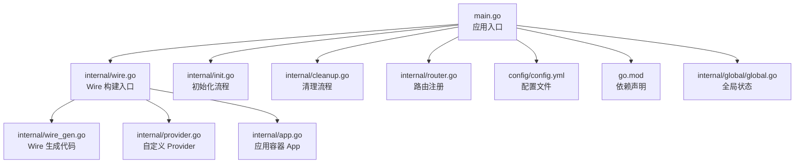
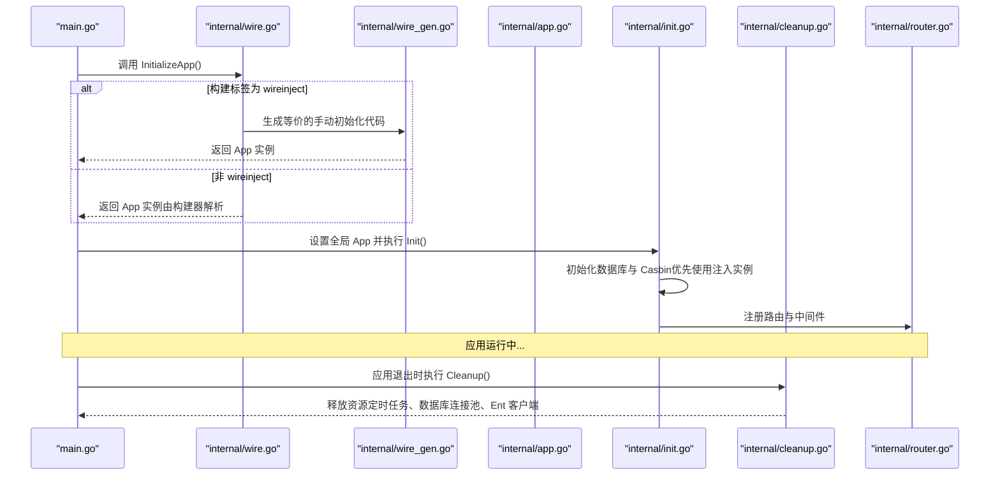
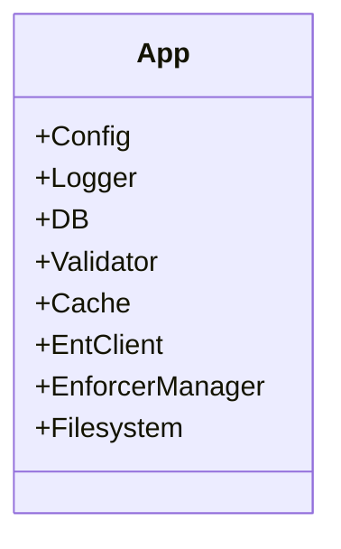
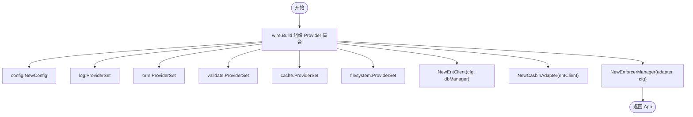
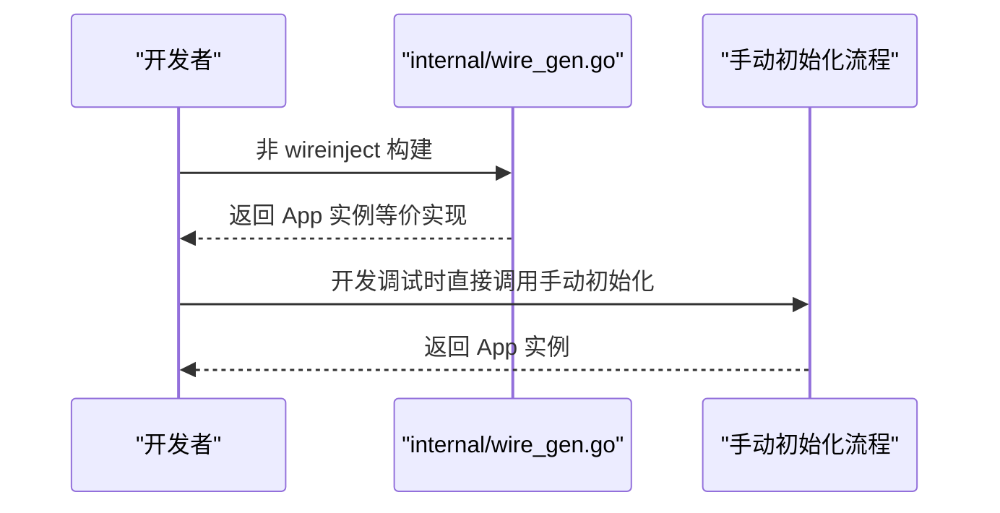
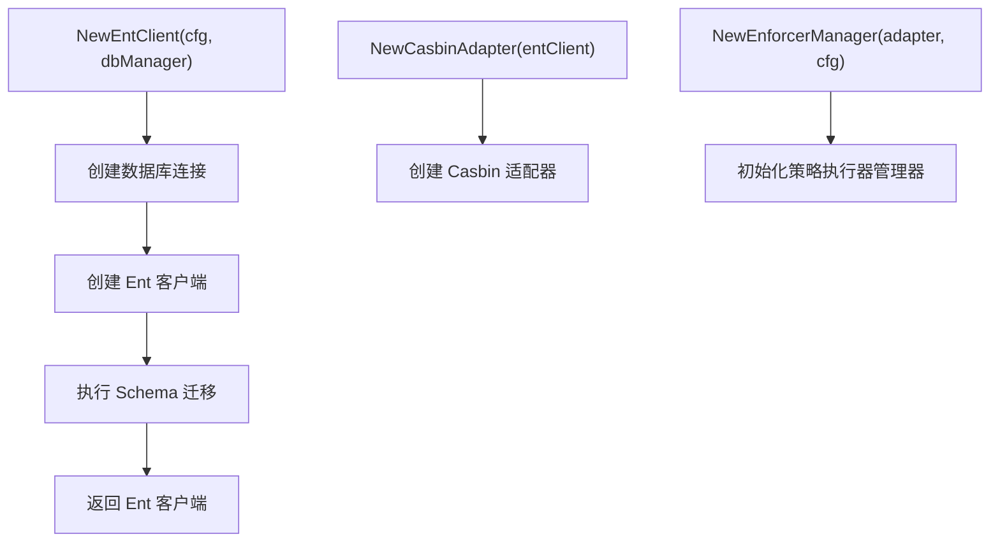
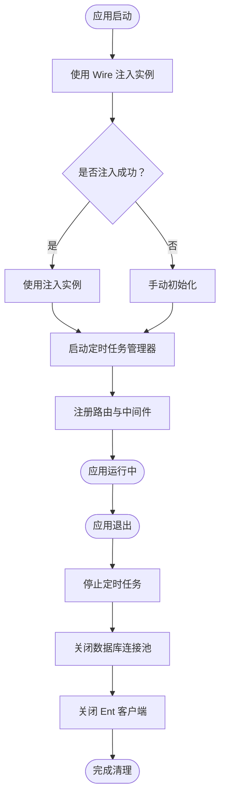
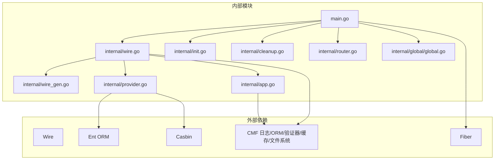

# 依赖注入系统

<cite>
**本文档引用的文件**
- [main.go](file://main.go)
- [internal/wire.go](file://internal/wire.go)
- [internal/wire_gen.go](file://internal/wire_gen.go)
- [internal/provider.go](file://internal/provider.go)
- [internal/app.go](file://internal/app.go)
- [internal/init.go](file://internal/init.go)
- [internal/cleanup.go](file://internal/cleanup.go)
- [internal/router.go](file://internal/router.go)
- [config/config.yml](file://config/config.yml)
- [go.mod](file://go.mod)
- [internal/global/global.go](file://internal/global/global.go)
</cite>

## 目录
1. [简介](#简介)
2. [项目结构](#项目结构)
3. [核心组件](#核心组件)
4. [架构总览](#架构总览)
5. [详细组件分析](#详细组件分析)
6. [依赖关系分析](#依赖关系分析)
7. [性能考虑](#性能考虑)
8. [故障排除指南](#故障排除指南)
9. [结论](#结论)
10. [附录](#附录)

## 简介
本文件系统性阐述 Go Admin 管理系统的依赖注入体系，重点围绕 Google Wire 框架的配置与使用展开，涵盖 Provider 函数的定义、注入标记的使用、生成器运行机制以及应用容器 App 结构体的设计理念。文档同时总结了依赖注入的优势、配置最佳实践与常见问题解决方案，并提供对 Wire 配置文件的详细解析与自定义 Provider 的创建指南。

## 项目结构
该系统采用分层与模块化组织方式：
- 根入口负责应用启动与生命周期管理，通过 Wire 构建应用容器并交由引导框架执行初始化与路由注册。
- 内部模块包含依赖注入配置、应用容器、初始化与清理逻辑、路由注册等。
- 配置文件集中管理应用、日志、数据库、缓存、Redis、文件系统与 Casbin 等子系统参数。

图表来源
- [main.go:47-104](file://main.go#L47-L104)
- [internal/wire.go:22-37](file://internal/wire.go#L22-L37)
- [internal/wire_gen.go:17-62](file://internal/wire_gen.go#L17-L62)
- [internal/provider.go:17-43](file://internal/provider.go#L17-L43)
- [internal/app.go:15-25](file://internal/app.go#L15-L25)
- [internal/init.go:31-67](file://internal/init.go#L31-L67)
- [internal/cleanup.go:10-37](file://internal/cleanup.go#L10-L37)
- [internal/router.go:16-149](file://internal/router.go#L16-L149)
- [config/config.yml:1-143](file://config/config.yml#L1-L143)
- [go.mod:1-127](file://go.mod#L1-L127)
- [internal/global/global.go:11-16](file://internal/global/global.go#L11-L16)

章节来源
- [main.go:47-104](file://main.go#L47-L104)
- [internal/wire.go:22-37](file://internal/wire.go#L22-L37)
- [internal/wire_gen.go:17-62](file://internal/wire_gen.go#L17-L62)
- [internal/provider.go:17-43](file://internal/provider.go#L17-L43)
- [internal/app.go:15-25](file://internal/app.go#L15-L25)
- [internal/init.go:31-67](file://internal/init.go#L31-L67)
- [internal/cleanup.go:10-37](file://internal/cleanup.go#L10-L37)
- [internal/router.go:16-149](file://internal/router.go#L16-L149)
- [config/config.yml:1-143](file://config/config.yml#L1-L143)
- [go.mod:1-127](file://go.mod#L1-L127)
- [internal/global/global.go:11-16](file://internal/global/global.go#L11-L16)

## 核心组件
- 应用容器 App：统一承载配置、日志、数据库、验证器、缓存、Ent ORM 客户端、Casbin 策略执行器与文件系统等核心依赖。
- Wire 构建入口：通过 wire.Build 组织 Provider 集合，定义依赖解析规则与注入顺序。
- 生成器代码：在非 wireinject 构建标签下，提供与构建器等价的手动初始化实现，便于开发调试与兼容旧模式。
- 自定义 Provider：封装复杂对象创建逻辑，如 Ent 客户端、Casbin 适配器与策略执行器管理器。
- 初始化与清理：在引导阶段完成数据库与权限系统的初始化；在应用退出前有序释放资源。

章节来源
- [internal/app.go:15-25](file://internal/app.go#L15-L25)
- [internal/wire.go:22-37](file://internal/wire.go#L22-L37)
- [internal/wire_gen.go:17-62](file://internal/wire_gen.go#L17-L62)
- [internal/provider.go:17-43](file://internal/provider.go#L17-L43)
- [internal/init.go:31-67](file://internal/init.go#L31-L67)
- [internal/cleanup.go:10-37](file://internal/cleanup.go#L10-L37)

## 架构总览
Wire 通过 Provider 集合与自定义 Provider 函数，将配置、日志、数据库、验证器、缓存、文件系统、Ent ORM 与 Casbin 等组件装配到 App 容器中。主程序在启动时调用 InitializeApp 获取 App 实例，随后进入引导框架的生命周期管理。

图表来源
- [main.go:47-104](file://main.go#L47-L104)
- [internal/wire.go:22-37](file://internal/wire.go#L22-L37)
- [internal/wire_gen.go:17-62](file://internal/wire_gen.go#L17-L62)
- [internal/init.go:31-67](file://internal/init.go#L31-L67)
- [internal/cleanup.go:10-37](file://internal/cleanup.go#L10-L37)
- [internal/router.go:16-149](file://internal/router.go#L16-L149)

## 详细组件分析

### 应用容器 App 设计
App 结构体作为依赖容器，聚合了系统所需的核心组件，便于在各层之间传递与共享。字段覆盖配置、日志、数据库、验证器、缓存、Ent 客户端、Casbin 策略执行器与文件系统等。

图表来源
- [internal/app.go:15-25](file://internal/app.go#L15-L25)

章节来源
- [internal/app.go:15-25](file://internal/app.go#L15-L25)

### Wire 构建器与 Provider 集合
- 构建入口：InitializeApp 在 wireinject 构建标签下，通过 wire.Build 组织 Provider 集合，明确依赖解析顺序与注入关系。
- Provider 集合：包含基础库 ProviderSet（日志、ORM、验证器、缓存、文件系统）与自定义 Provider（Ent 客户端、Casbin 适配器、策略执行器管理器）。
- 上下文提供：provideContext 提供根上下文，确保后续组件可使用一致的上下文环境。

图表来源
- [internal/wire.go:22-37](file://internal/wire.go#L22-L37)
- [internal/provider.go:17-43](file://internal/provider.go#L17-L43)

章节来源
- [internal/wire.go:22-37](file://internal/wire.go#L22-L37)
- [internal/provider.go:17-43](file://internal/provider.go#L17-L43)

### 生成器运行机制与等价实现
- 构建标签控制：wireinject 标签启用构建器；非 wireinject 标签下，wire_gen.go 提供与构建器等价的手动初始化实现，便于开发调试与兼容旧模式。
- 手动初始化顺序：与构建器一致，依次创建配置、日志、数据库管理器、验证器、缓存、Ent 客户端、Casbin 适配器、策略执行器管理器与文件系统，最终组装 App。

图表来源
- [internal/wire_gen.go:17-62](file://internal/wire_gen.go#L17-L62)

章节来源
- [internal/wire_gen.go:17-62](file://internal/wire_gen.go#L17-L62)

### 自定义 Provider 分析
- Ent 客户端 Provider：基于配置与数据库管理器创建 Ent 客户端，并执行自动迁移，确保 schema 一致性。
- Casbin 适配器 Provider：基于 Ent 客户端创建 Casbin 适配器，为策略执行器提供数据源。
- 策略执行器管理器 Provider：基于适配器与配置初始化 Casbin 策略执行器管理器。

图表来源
- [internal/provider.go:17-43](file://internal/provider.go#L17-L43)

章节来源
- [internal/provider.go:17-43](file://internal/provider.go#L17-L43)

### 初始化与生命周期管理
- 初始化流程：在引导阶段，优先使用 Wire 注入的实例；若未注入，则回退到手动初始化，保证兼容性。随后启动定时任务管理器并注册路由。
- 生命周期管理：应用退出时，先停止定时任务，再关闭数据库连接池与 Ent 客户端，确保资源有序释放。

图表来源
- [internal/init.go:31-67](file://internal/init.go#L31-L67)
- [internal/cleanup.go:10-37](file://internal/cleanup.go#L10-L37)
- [internal/router.go:16-149](file://internal/router.go#L16-L149)

章节来源
- [internal/init.go:31-67](file://internal/init.go#L31-L67)
- [internal/cleanup.go:10-37](file://internal/cleanup.go#L10-L37)
- [internal/router.go:16-149](file://internal/router.go#L16-L149)

### 路由与中间件集成
- 中间件链：在注册路由前添加请求日志中间件；根据 App 注入情况选择性启用缓存与文件系统相关服务。
- 路由分组：按 API 版本与权限控制进行分组，结合 JWT 与权限中间件实现细粒度访问控制。

章节来源
- [internal/router.go:16-149](file://internal/router.go#L16-L149)

## 依赖关系分析
- 外部依赖：Wire、CMF（日志、ORM、验证器、缓存、文件系统、Casbin）、Ent ORM、Fiber Web 框架、Casbin 权限引擎等。
- 内部耦合：main.go 仅负责启动与生命周期管理；内部模块通过 App 容器解耦，避免跨层直接依赖。
- 循环依赖：未发现明显循环依赖；Provider 与自定义 Provider 严格遵循单向依赖链。

图表来源
- [go.mod:1-127](file://go.mod#L1-L127)
- [main.go:47-104](file://main.go#L47-L104)
- [internal/wire.go:22-37](file://internal/wire.go#L22-L37)
- [internal/wire_gen.go:17-62](file://internal/wire_gen.go#L17-L62)
- [internal/provider.go:17-43](file://internal/provider.go#L17-L43)
- [internal/app.go:15-25](file://internal/app.go#L15-L25)
- [internal/init.go:31-67](file://internal/init.go#L31-L67)
- [internal/cleanup.go:10-37](file://internal/cleanup.go#L10-L37)
- [internal/router.go:16-149](file://internal/router.go#L16-L149)
- [internal/global/global.go:11-16](file://internal/global/global.go#L11-L16)

章节来源
- [go.mod:1-127](file://go.mod#L1-L127)
- [main.go:47-104](file://main.go#L47-L104)
- [internal/wire.go:22-37](file://internal/wire.go#L22-L37)
- [internal/wire_gen.go:17-62](file://internal/wire_gen.go#L17-L62)
- [internal/provider.go:17-43](file://internal/provider.go#L17-L43)
- [internal/app.go:15-25](file://internal/app.go#L15-L25)
- [internal/init.go:31-67](file://internal/init.go#L31-L67)
- [internal/cleanup.go:10-37](file://internal/cleanup.go#L10-L37)
- [internal/router.go:16-149](file://internal/router.go#L16-L149)
- [internal/global/global.go:11-16](file://internal/global/global.go#L11-L16)

## 性能考虑
- 依赖解析顺序：合理安排 Provider 顺序，避免不必要的重复初始化与资源竞争。
- 缓存与文件系统：在路由层按需启用缓存与文件系统服务，减少无谓的资源占用。
- 数据库连接池：确保在清理阶段正确关闭连接池，防止连接泄漏导致性能下降。
- 日志输出：生产环境建议使用 JSON 格式日志，便于日志收集与分析。

## 故障排除指南
- Wire 构建失败：检查 wire.Build 中的 Provider 是否正确导入且签名匹配；确认构建标签是否正确。
- Ent 迁移失败：检查数据库连接配置与权限；确保迁移选项（如自动删除索引与列）符合预期。
- Casbin 初始化异常：确认适配器创建成功且模型配置正确；检查策略执行器管理器初始化参数。
- 资源未释放：在 Cleanup 中确保按顺序停止定时任务、关闭数据库连接池与 Ent 客户端。
- 配置错误：核对 config.yml 中数据库、缓存、Redis、文件系统与 Casbin 的配置项，确保路径与凭据正确。

章节来源
- [internal/wire.go:22-37](file://internal/wire.go#L22-L37)
- [internal/provider.go:17-43](file://internal/provider.go#L17-L43)
- [internal/cleanup.go:10-37](file://internal/cleanup.go#L10-L37)
- [config/config.yml:1-143](file://config/config.yml#L1-L143)

## 结论
该依赖注入系统通过 Google Wire 将配置、日志、数据库、验证器、缓存、文件系统、Ent ORM 与 Casbin 等组件有序装配到 App 容器中，实现了清晰的职责分离与可维护性。配合手动初始化等价实现与完善的生命周期管理，系统在开发与生产环境中均具备良好的稳定性与可扩展性。建议在新增组件时遵循现有 Provider 模式，保持依赖注入的一致性与可测试性。

## 附录

### Wire 配置文件详细解析
- 构建标签：wireinject 控制启用构建器；!wireinject 控制启用生成器等价实现。
- Provider 集合：包含基础库 ProviderSet 与自定义 Provider，确保依赖解析完整。
- 上下文提供：provideContext 提供根上下文，保证后续组件可用一致上下文。

章节来源
- [internal/wire.go:1-37](file://internal/wire.go#L1-L37)
- [internal/wire_gen.go:1-62](file://internal/wire_gen.go#L1-L62)

### 自定义 Provider 创建指南
- 定义 Provider：遵循函数签名与返回值约定，确保与 wire.Build 中的依赖类型匹配。
- 处理依赖：在 Provider 内部正确处理依赖关系，避免循环依赖。
- 错误处理：对可能失败的操作进行错误处理与返回，确保构建器能够捕获并报告错误。
- 测试：为自定义 Provider 编写单元测试，验证其在不同配置下的行为。

章节来源
- [internal/provider.go:17-43](file://internal/provider.go#L17-L43)
- [internal/wire.go:22-37](file://internal/wire.go#L22-L37)