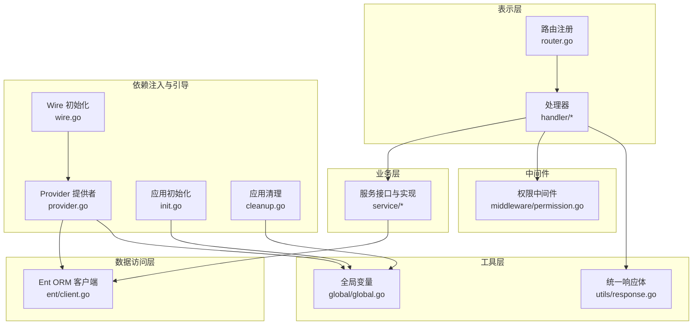
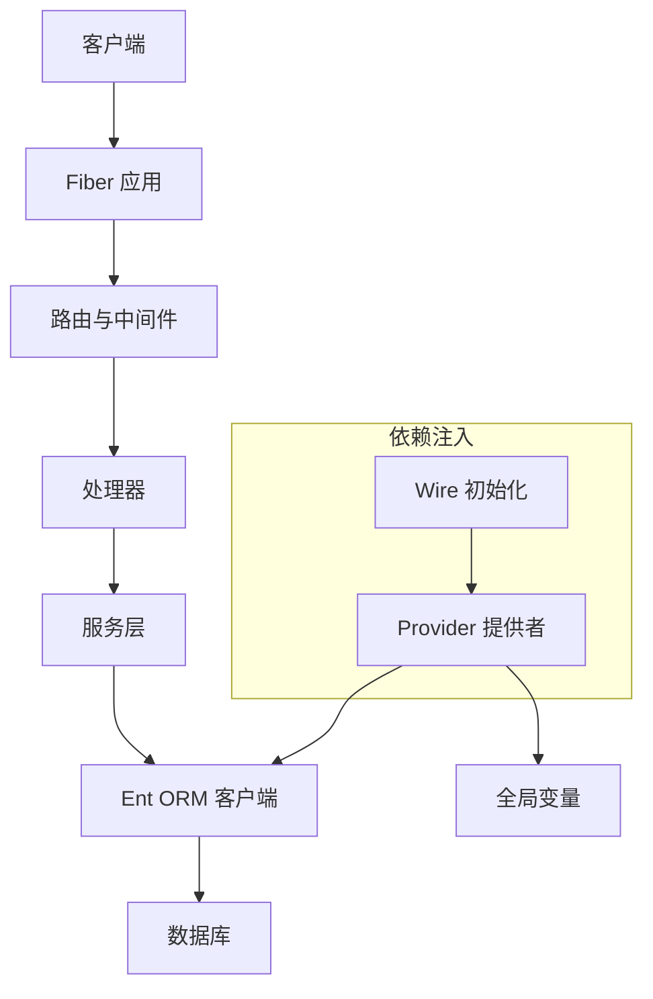
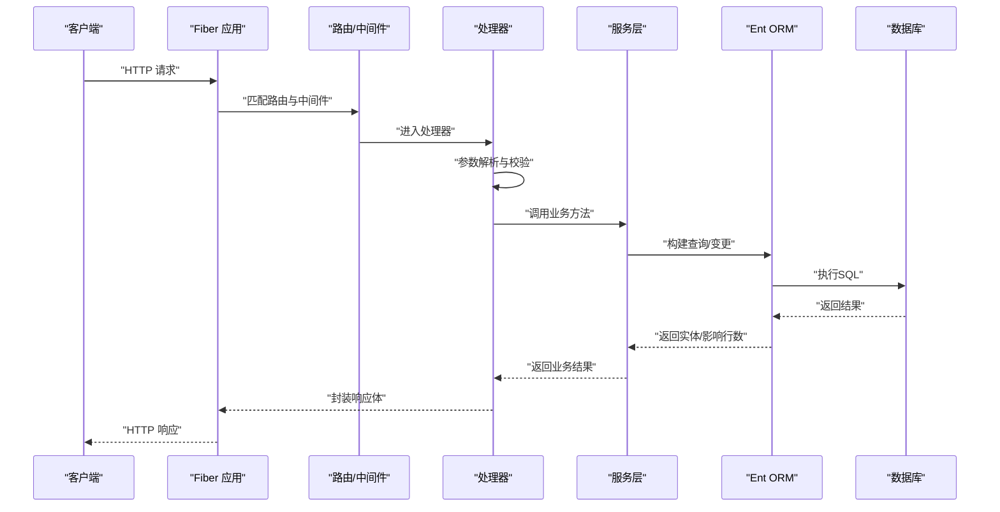
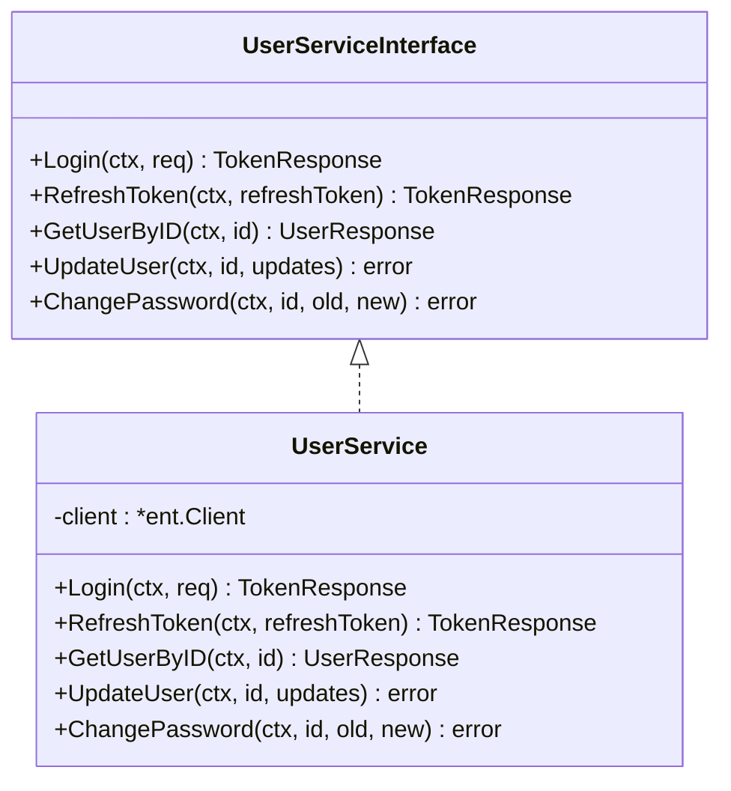
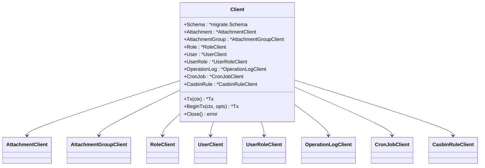
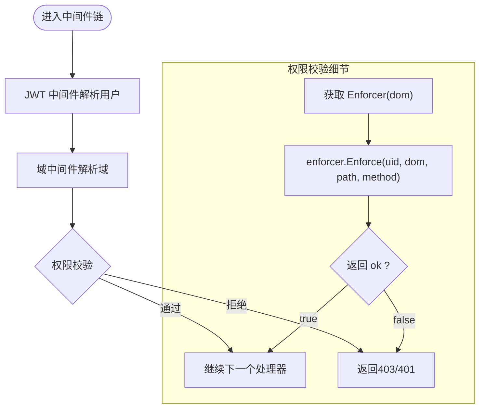
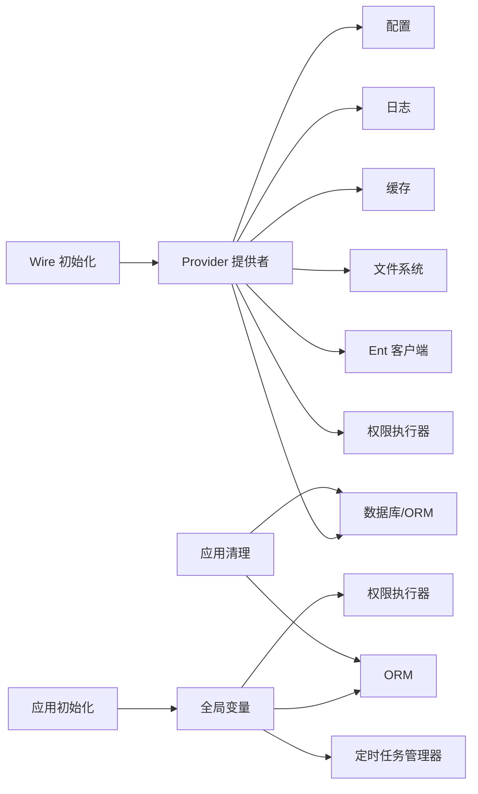

# 分层架构设计

<cite>
**本文引用的文件**
- [main.go](file://main.go)
- [app.go](file://internal/app.go)
- [router.go](file://internal/router.go)
- [provider.go](file://internal/provider.go)
- [wire.go](file://internal/wire.go)
- [public.go](file://internal/handler/public.go)
- [user.go](file://internal/service/user.go)
- [client.go](file://internal/ent/client.go)
- [permission.go](file://internal/middleware/permission.go)
- [response.go](file://internal/utils/response.go)
- [global.go](file://internal/global/global.go)
- [init.go](file://internal/init.go)
- [cleanup.go](file://internal/cleanup.go)
- [config.yml](file://config/config.yml)
</cite>

## 目录
1. [简介](#简介)
2. [项目结构](#项目结构)
3. [核心组件](#核心组件)
4. [架构总览](#架构总览)
5. [详细组件分析](#详细组件分析)
6. [依赖分析](#依赖分析)
7. [性能考虑](#性能考虑)
8. [故障排查指南](#故障排查指南)
9. [结论](#结论)
10. [附录](#附录)

## 简介
本文件面向Go Admin管理系统，提供完整的分层架构设计文档。系统采用经典的三层架构：表示层（表现层）、业务层（服务层）、数据访问层（持久化层），并辅以中间件与工具层。表示层负责HTTP请求处理与响应封装；业务层负责领域逻辑编排与规则校验；数据访问层通过Ent ORM访问数据库；中间件负责鉴权与权限控制；工具层提供统一响应体与日志等基础设施。

## 项目结构
系统采用按功能域组织的目录结构，核心模块如下：
- 表示层：Fiber路由与处理器，负责接收HTTP请求、参数校验、调用服务层、封装响应。
- 业务层：服务接口与实现，负责业务编排、错误处理、调用数据访问层。
- 数据访问层：Ent ORM客户端与实体构建器，负责数据库读写与事务。
- 中间件：JWT解析、域设置、权限控制。
- 工具层：统一响应体、日志、配置。
- 初始化与依赖注入：Wire提供者集、引导启动、清理。

图表来源
- [router.go:16-150](file://internal/router.go#L16-L150)
- [public.go:19-214](file://internal/handler/public.go#L19-L214)
- [user.go:27-402](file://internal/service/user.go#L27-L402)
- [client.go:29-50](file://internal/ent/client.go#L29-L50)
- [permission.go:14-94](file://internal/middleware/permission.go#L14-L94)
- [response.go:9-50](file://internal/utils/response.go#L9-L50)
- [global.go:11-16](file://internal/global/global.go#L11-L16)
- [wire.go:22-38](file://internal/wire.go#L22-L38)
- [provider.go:17-44](file://internal/provider.go#L17-L44)
- [init.go:31-67](file://internal/init.go#L31-L67)
- [cleanup.go:10-38](file://internal/cleanup.go#L10-L38)

章节来源
- [main.go:47-104](file://main.go#L47-L104)
- [router.go:16-150](file://internal/router.go#L16-L150)
- [wire.go:22-38](file://internal/wire.go#L22-L38)
- [provider.go:17-44](file://internal/provider.go#L17-L44)
- [init.go:31-67](file://internal/init.go#L31-L67)

## 核心组件
- 应用依赖容器：集中管理配置、日志、数据库、验证器、缓存、Ent客户端、权限执行器、文件系统等。
- 路由与中间件：注册API路由组、版本中间件、JWT鉴权、域中间件、权限中间件、请求日志中间件。
- 处理器：登录、刷新令牌、获取用户、更新用户、修改密码等接口，负责参数解析与错误映射。
- 服务层：用户服务接口与实现，封装登录、刷新令牌、查询、更新、改密等业务逻辑，并通过Ent访问数据库。
- 数据访问层：Ent客户端与实体构建器，提供查询、创建、更新、删除与事务支持。
- 工具层：统一响应体封装，便于前后端一致的数据结构输出。
- 初始化与清理：Wire注入、数据库与权限系统初始化、定时任务启动、优雅关闭。

章节来源
- [app.go:15-26](file://internal/app.go#L15-L26)
- [router.go:16-150](file://internal/router.go#L16-L150)
- [public.go:19-214](file://internal/handler/public.go#L19-L214)
- [user.go:27-402](file://internal/service/user.go#L27-L402)
- [client.go:29-50](file://internal/ent/client.go#L29-L50)
- [response.go:9-50](file://internal/utils/response.go#L9-L50)
- [init.go:31-67](file://internal/init.go#L31-L67)
- [cleanup.go:10-38](file://internal/cleanup.go#L10-L38)

## 架构总览
系统采用“表示层-业务层-数据访问层”的清晰分层，配合中间件实现横切关注点（鉴权、权限、日志）。依赖注入通过Wire集中管理，确保各层解耦与可测试性。

图表来源
- [main.go:47-104](file://main.go#L47-L104)
- [router.go:16-150](file://internal/router.go#L16-L150)
- [public.go:19-214](file://internal/handler/public.go#L19-L214)
- [user.go:27-402](file://internal/service/user.go#L27-L402)
- [client.go:29-50](file://internal/ent/client.go#L29-L50)
- [wire.go:22-38](file://internal/wire.go#L22-L38)
- [provider.go:17-44](file://internal/provider.go#L17-L44)
- [global.go:11-16](file://internal/global/global.go#L11-L16)

## 详细组件分析

### 表示层（控制器与路由）
- 路由注册：按API版本与权限域分组，注册公开与认证接口，注入服务实例与中间件。
- 处理器职责：参数解析与校验、调用服务层、错误映射到统一响应体、记录操作日志。
- 统一响应体：封装成功/失败响应，支持自定义状态码与消息。

图表来源
- [router.go:16-150](file://internal/router.go#L16-L150)
- [public.go:19-214](file://internal/handler/public.go#L19-L214)
- [user.go:27-402](file://internal/service/user.go#L27-L402)
- [client.go:29-50](file://internal/ent/client.go#L29-L50)
- [response.go:9-50](file://internal/utils/response.go#L9-L50)

章节来源
- [router.go:16-150](file://internal/router.go#L16-L150)
- [public.go:19-214](file://internal/handler/public.go#L19-L214)
- [response.go:9-50](file://internal/utils/response.go#L9-L50)

### 业务层（服务层）
- 接口设计：以接口隔离具体实现，便于替换与测试；方法命名语义明确，职责单一。
- 业务编排：登录/刷新令牌、用户信息查询与更新、密码修改等；统一错误类型与返回值。
- 数据访问：通过Ent客户端执行查询与变更，支持事务与拦截器扩展。

图表来源
- [user.go:27-402](file://internal/service/user.go#L27-L402)

章节来源
- [user.go:27-402](file://internal/service/user.go#L27-L402)

### 数据访问层（Ent ORM）
- 客户端结构：集中持有各实体客户端与Schema，支持Debug、Hooks、Interceptors。
- 实体客户端：Attachment、AttachmentGroup、Role、User、UserRole、OperationLog、CronJob、CasbinRule等。
- 事务支持：提供Tx/BeginTx能力，避免嵌套事务；支持Debug模式输出SQL。

图表来源
- [client.go:29-50](file://internal/ent/client.go#L29-L50)
- [client.go:267-414](file://internal/ent/client.go#L267-L414)
- [client.go:416-563](file://internal/ent/client.go#L416-L563)
- [client.go:565-696](file://internal/ent/client.go#L565-L696)
- [client.go:698-800](file://internal/ent/client.go#L698-L800)

章节来源
- [client.go:29-50](file://internal/ent/client.go#L29-L50)
- [client.go:146-197](file://internal/ent/client.go#L146-L197)

### 中间件与权限控制
- JWT中间件：基于配置的密钥解析JWT，注入用户信息到上下文。
- 域中间件：从JWT中提取域信息，供权限控制使用。
- 权限中间件：通过EnforcerManager按域、路径、方法进行策略校验，拒绝无权限请求。

图表来源
- [permission.go:14-94](file://internal/middleware/permission.go#L14-L94)

章节来源
- [permission.go:14-94](file://internal/middleware/permission.go#L14-L94)

### 错误处理机制
- 参数校验：处理器侧使用统一校验器，错误映射为业务错误码与消息。
- 业务异常：服务层定义明确的错误类型（如用户不存在、密码错误、状态异常等）。
- 响应封装：统一响应体包含状态码、消息与数据，便于前端处理。
- 中间件错误：权限中间件返回401/403，确保安全边界。

章节来源
- [public.go:19-214](file://internal/handler/public.go#L19-L214)
- [user.go:19-25](file://internal/service/user.go#L19-L25)
- [response.go:9-50](file://internal/utils/response.go#L9-L50)
- [permission.go:14-94](file://internal/middleware/permission.go#L14-L94)

## 依赖分析
- 依赖注入：通过Wire组合Provider集，集中创建配置、日志、数据库、缓存、文件系统、Ent客户端、权限执行器等。
- 运行时注入：初始化阶段将Ent客户端与权限执行器写入全局变量，供路由与处理器使用。
- 清理顺序：先停止定时任务，再关闭数据库连接池与Ent客户端，保证资源有序释放。

图表来源
- [wire.go:22-38](file://internal/wire.go#L22-L38)
- [provider.go:17-44](file://internal/provider.go#L17-L44)
- [init.go:31-67](file://internal/init.go#L31-L67)
- [cleanup.go:10-38](file://internal/cleanup.go#L10-L38)
- [global.go:11-16](file://internal/global/global.go#L11-L16)

章节来源
- [wire.go:22-38](file://internal/wire.go#L22-L38)
- [provider.go:17-44](file://internal/provider.go#L17-L44)
- [init.go:31-67](file://internal/init.go#L31-L67)
- [cleanup.go:10-38](file://internal/cleanup.go#L10-L38)
- [global.go:11-16](file://internal/global/global.go#L11-L16)

## 性能考虑
- 缓存：路由层可注入缓存服务以减少重复计算与查询压力（需结合业务场景启用）。
- 日志：请求日志中间件有助于定位性能瓶颈，建议在生产环境合理配置日志级别。
- 数据库：Ent支持Debug模式与拦截器，可用于开发调试；生产环境建议关闭Debug并优化查询。
- 定时任务：定时任务管理器在应用启动时初始化并运行，注意日志轮转与资源占用。

## 故障排查指南
- 登录失败：检查用户状态、密码校验、JWT签发配置；查看处理器对错误类型的映射。
- 权限拒绝：确认JWT中域信息、路径与方法是否正确，检查策略模型与策略表。
- 数据库连接：确认配置文件中的数据库连接参数，初始化阶段的日志输出有助于定位问题。
- 应用关闭：若出现资源无法释放，检查清理函数的执行顺序与错误日志。

章节来源
- [public.go:19-214](file://internal/handler/public.go#L19-L214)
- [permission.go:14-94](file://internal/middleware/permission.go#L14-L94)
- [config.yml:19-31](file://config/config.yml#L19-L31)
- [init.go:31-67](file://internal/init.go#L31-L67)
- [cleanup.go:10-38](file://internal/cleanup.go#L10-L38)

## 结论
本系统通过清晰的分层架构与依赖注入，实现了表示层、业务层与数据访问层的职责分离与低耦合。中间件提供了统一的安全与权限控制，工具层保证了响应一致性与可观测性。整体设计具备良好的可维护性、可扩展性与可测试性，适合在企业级后台管理系统中推广使用。

## 附录
- 配置文件：包含应用、日志、数据库、缓存、Redis、文件系统、Casbin等配置项。
- 启动流程：主程序通过Wire初始化应用，注册路由与中间件，启动引导并运行。

章节来源
- [config.yml:1-143](file://config/config.yml#L1-143)
- [main.go:47-104](file://main.go#L47-L104)