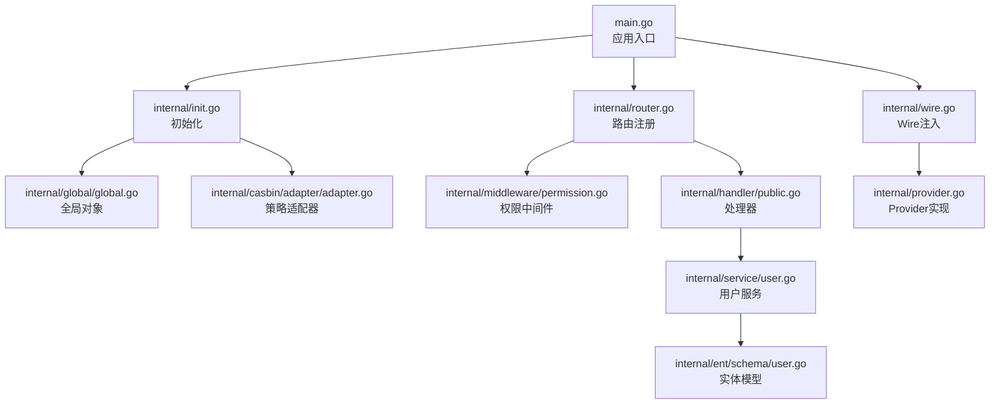
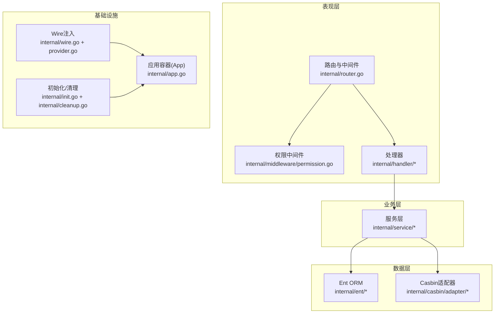
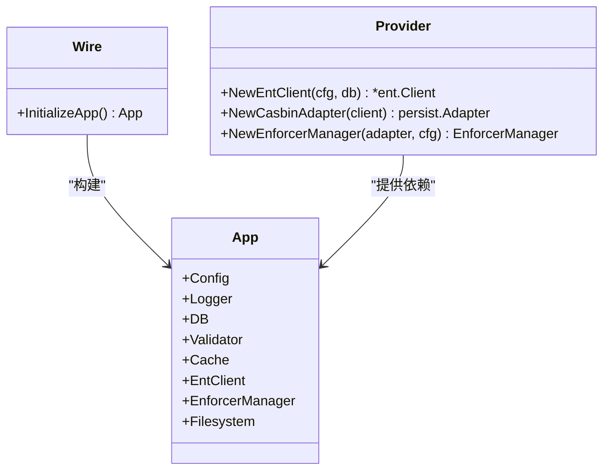
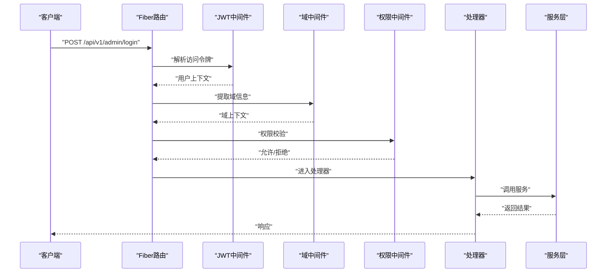
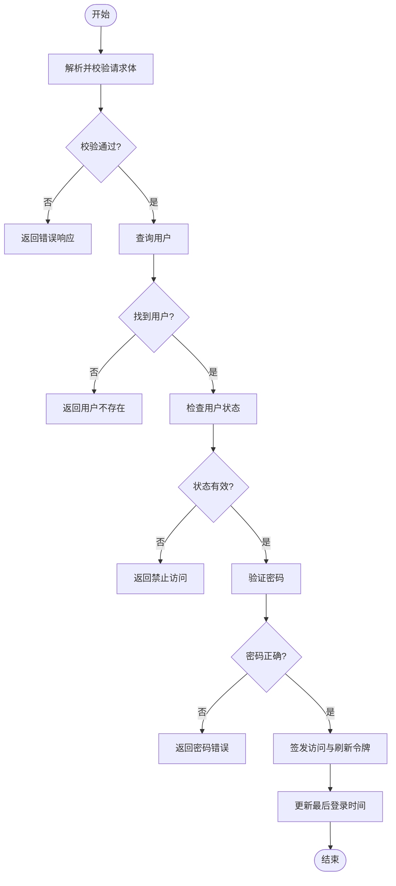
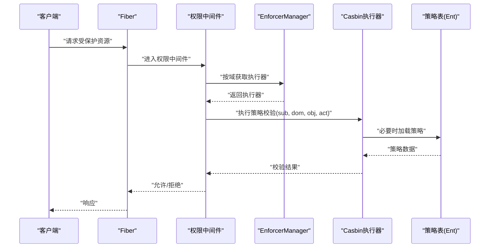
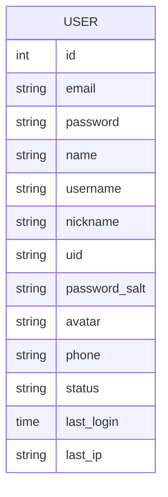
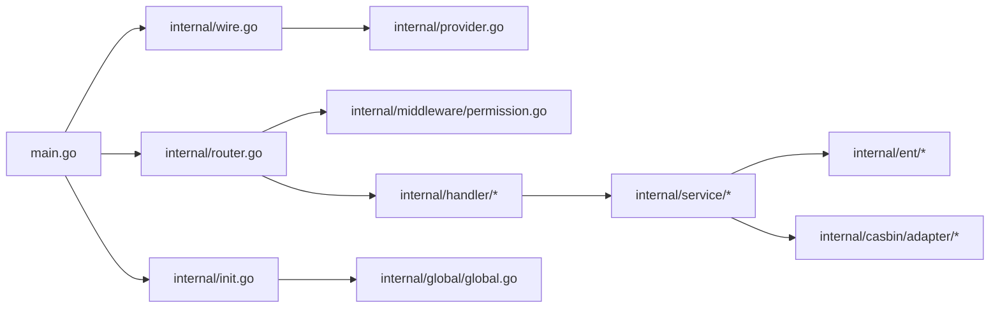

# 系统架构设计

<cite>
**本文引用的文件**
- [main.go](file://main.go)
- [internal/app.go](file://internal/app.go)
- [internal/wire.go](file://internal/wire.go)
- [internal/provider.go](file://internal/provider.go)
- [internal/init.go](file://internal/init.go)
- [internal/cleanup.go](file://internal/cleanup.go)
- [internal/router.go](file://internal/router.go)
- [internal/middleware/permission.go](file://internal/middleware/permission.go)
- [internal/handler/public.go](file://internal/handler/public.go)
- [internal/service/user.go](file://internal/service/user.go)
- [internal/global/global.go](file://internal/global/global.go)
- [internal/ent/schema/user.go](file://internal/ent/schema/user.go)
- [internal/casbin/adapter/adapter.go](file://internal/casbin/adapter/adapter.go)
- [config/config.yml](file://config/config.yml)
- [go.mod](file://go.mod)
</cite>

## 目录
1. [简介](#简介)
2. [项目结构](#项目结构)
3. [核心组件](#核心组件)
4. [架构总览](#架构总览)
5. [详细组件分析](#详细组件分析)
6. [依赖关系分析](#依赖关系分析)
7. [性能考量](#性能考量)
8. [故障排查指南](#故障排查指南)
9. [结论](#结论)
10. [附录](#附录)

## 简介
本文件面向Go Admin管理系统，提供系统架构设计文档。重点阐述系统的高层设计模式：分层架构（应用容器、服务层、数据访问层）、Google Wire依赖注入模式与Fiber Web框架的集成方式，并深入解析中间件架构（认证与权限控制）。文档还覆盖系统边界定义、技术决策权衡、扩展性设计、架构图表与组件交互流程图，帮助开发者快速理解整体设计思路。

## 项目结构
系统采用模块化分层组织，核心目录与职责如下：
- cmd/seed：种子数据入口（非本文重点）
- config：运行时配置（YAML）
- data：日志与存储目录
- docs：Swagger文档
- internal：核心业务代码
  - app.go：应用依赖容器（App）
  - wire.go + provider.go：Wire依赖注入配置与Provider
  - init.go + cleanup.go：应用生命周期初始化与清理
  - router.go：路由注册与中间件装配
  - middleware：中间件（权限控制等）
  - handler：HTTP处理器（业务接口实现）
  - service：业务服务层（领域逻辑）
  - ent：Ent ORM模型与客户端
  - casbin/adapter：Casbin策略适配器
  - global：全局共享对象（ORM、EnforcerManager、CronManager、Bootstrap）
  - utils：工具类（响应封装等）
  - tasks：后台任务注册（触发init）

**图表来源**
- [main.go:47-104](file://main.go#L47-L104)
- [internal/init.go:31-67](file://internal/init.go#L31-L67)
- [internal/router.go:16-150](file://internal/router.go#L16-L150)
- [internal/wire.go:22-37](file://internal/wire.go#L22-L37)
- [internal/provider.go:17-43](file://internal/provider.go#L17-L43)
- [internal/global/global.go:11-16](file://internal/global/global.go#L11-L16)
- [internal/middleware/permission.go:14-94](file://internal/middleware/permission.go#L14-L94)
- [internal/handler/public.go:19-214](file://internal/handler/public.go#L19-L214)
- [internal/service/user.go:27-402](file://internal/service/user.go#L27-L402)
- [internal/ent/schema/user.go:17-104](file://internal/ent/schema/user.go#L17-L104)
- [internal/casbin/adapter/adapter.go:38-113](file://internal/casbin/adapter/adapter.go#L38-L113)

**章节来源**
- [main.go:47-104](file://main.go#L47-L104)
- [internal/router.go:16-150](file://internal/router.go#L16-L150)
- [internal/wire.go:22-37](file://internal/wire.go#L22-L37)
- [internal/provider.go:17-43](file://internal/provider.go#L17-L43)
- [internal/init.go:31-67](file://internal/init.go#L31-L67)
- [internal/global/global.go:11-16](file://internal/global/global.go#L11-L16)

## 核心组件
- 应用容器（App）：集中管理配置、日志、数据库、校验器、缓存、Ent客户端、Casbin执行器、文件系统等依赖。
- 依赖注入（Wire）：通过ProviderSet与构造函数自动装配App所需依赖，支持可插拔与测试替身。
- Fiber Web框架：作为HTTP服务器，配合中间件链路与路由组实现认证、权限、日志等横切关注点。
- 中间件：JWT认证、域设置、权限校验（基于Casbin），统一响应封装。
- 服务层：用户、角色、权限、定时任务、附件等业务逻辑，面向Handler暴露清晰接口。
- 数据访问层：Ent ORM负责实体建模与查询；Casbin适配器持久化策略规则。
- 全局对象：ORM、EnforcerManager、CronManager、Bootstrap贯穿应用生命周期。

**章节来源**
- [internal/app.go:15-26](file://internal/app.go#L15-L26)
- [internal/wire.go:22-37](file://internal/wire.go#L22-L37)
- [internal/provider.go:17-43](file://internal/provider.go#L17-L43)
- [internal/router.go:16-150](file://internal/router.go#L16-L150)
- [internal/middleware/permission.go:14-94](file://internal/middleware/permission.go#L14-L94)
- [internal/service/user.go:27-402](file://internal/service/user.go#L27-L402)
- [internal/global/global.go:11-16](file://internal/global/global.go#L11-L16)

## 架构总览
系统采用“三层+中间件”的分层架构：
- 表现层（Fiber）：路由与中间件，负责请求接入、参数解析、响应封装。
- 业务层（Service）：封装领域逻辑，调用数据访问层，处理业务规则。
- 数据层（Ent/Casbin）：实体建模与持久化、策略规则持久化与执行。

依赖注入通过Wire在编译期生成绑定代码，确保应用容器的可组合性与可测试性。系统边界以内核（App容器）为核心，向外扩展路由、中间件、服务与数据访问。

**图表来源**
- [internal/router.go:16-150](file://internal/router.go#L16-L150)
- [internal/middleware/permission.go:14-94](file://internal/middleware/permission.go#L14-L94)
- [internal/handler/public.go:19-214](file://internal/handler/public.go#L19-L214)
- [internal/service/user.go:27-402](file://internal/service/user.go#L27-L402)
- [internal/ent/schema/user.go:17-104](file://internal/ent/schema/user.go#L17-L104)
- [internal/casbin/adapter/adapter.go:38-113](file://internal/casbin/adapter/adapter.go#L38-L113)
- [internal/app.go:15-26](file://internal/app.go#L15-L26)
- [internal/wire.go:22-37](file://internal/wire.go#L22-L37)
- [internal/provider.go:17-43](file://internal/provider.go#L17-L43)
- [internal/init.go:31-67](file://internal/init.go#L31-L67)
- [internal/cleanup.go:10-38](file://internal/cleanup.go#L10-L38)

## 详细组件分析

### 组件A：应用容器与依赖注入（Wire）
- 设计理念：将所有外部依赖（配置、日志、数据库、缓存、文件系统、Casbin等）聚合到App容器，通过ProviderSet与构造函数自动装配，降低耦合度，提升可测试性。
- 关键点：
  - InitializeApp通过wire.Build组装ProviderSet，返回App实例。
  - NewEntClient、NewCasbinAdapter、NewEnforcerManager分别创建ORM客户端、Casbin适配器与执行器管理器。
  - provider.go中显式依赖config.Config与orm.DBManager，确保配置驱动的可替换性。

**图表来源**
- [internal/app.go:15-26](file://internal/app.go#L15-L26)
- [internal/wire.go:22-37](file://internal/wire.go#L22-L37)
- [internal/provider.go:17-43](file://internal/provider.go#L17-L43)

**章节来源**
- [internal/app.go:15-26](file://internal/app.go#L15-L26)
- [internal/wire.go:22-37](file://internal/wire.go#L22-L37)
- [internal/provider.go:17-43](file://internal/provider.go#L17-L43)

### 组件B：路由与中间件架构
- 路由分组：/api/v1/admin 下按功能拆分公开接口与认证接口；认证接口通过JWT中间件与权限中间件保护。
- 中间件链：
  - 请求日志中间件：统一记录请求信息。
  - JWT中间件：解析访问令牌，注入用户上下文。
  - 域中间件：从JWT中提取域信息，供权限校验使用。
  - 权限中间件：基于Casbin执行器进行策略校验。
- 本地化服务注入：在路由组中为处理器注入UserService、RoleService、PermissionService、OperationLogService等。

**图表来源**
- [internal/router.go:16-150](file://internal/router.go#L16-L150)
- [internal/middleware/permission.go:14-94](file://internal/middleware/permission.go#L14-L94)
- [internal/handler/public.go:19-214](file://internal/handler/public.go#L19-L214)

**章节来源**
- [internal/router.go:16-150](file://internal/router.go#L16-L150)
- [internal/middleware/permission.go:14-94](file://internal/middleware/permission.go#L14-L94)
- [internal/handler/public.go:19-214](file://internal/handler/public.go#L19-L214)

### 组件C：用户服务与登录流程
- 登录流程要点：
  - 参数校验：使用全局校验器对请求体进行结构化校验。
  - 用户查找与状态检查：通过Ent查询用户并校验状态。
  - 密码验证：使用加密库验证明文与哈希。
  - JWT签发：生成访问令牌与刷新令牌，设置过期时间与域。
  - 最后登录时间更新：记录用户最近登录信息。
- 刷新令牌流程：解析并验证刷新令牌，重新签发访问令牌。

**图表来源**
- [internal/handler/public.go:33-60](file://internal/handler/public.go#L33-L60)
- [internal/service/user.go:132-213](file://internal/service/user.go#L132-L213)

**章节来源**
- [internal/handler/public.go:19-214](file://internal/handler/public.go#L19-L214)
- [internal/service/user.go:27-402](file://internal/service/user.go#L27-L402)

### 组件D：权限中间件与Casbin集成
- 权限中间件职责：
  - 从JWT中提取用户ID与域。
  - 从全局EnforcerManager获取对应域的执行器。
  - 使用用户ID、域、请求路径与方法进行策略匹配。
- Casbin适配器：
  - 基于Ent持久化策略规则，支持批量写入、过滤加载、事务保证。
  - 提供LoadPolicy、SavePolicy、AddPolicy、RemovePolicy等策略操作。

**图表来源**
- [internal/middleware/permission.go:14-94](file://internal/middleware/permission.go#L14-L94)
- [internal/casbin/adapter/adapter.go:115-175](file://internal/casbin/adapter/adapter.go#L115-L175)

**章节来源**
- [internal/middleware/permission.go:14-94](file://internal/middleware/permission.go#L14-L94)
- [internal/casbin/adapter/adapter.go:38-113](file://internal/casbin/adapter/adapter.go#L38-L113)

### 组件E：实体模型与数据访问
- 用户实体：包含邮箱、用户名、昵称、头像、电话、状态、最后登录时间等字段，并定义索引与时间混入。
- 数据访问：Ent Client负责实体查询与更新；Casbin适配器负责策略持久化。

**图表来源**
- [internal/ent/schema/user.go:17-104](file://internal/ent/schema/user.go#L17-L104)

**章节来源**
- [internal/ent/schema/user.go:17-104](file://internal/ent/schema/user.go#L17-L104)
- [internal/casbin/adapter/adapter.go:115-175](file://internal/casbin/adapter/adapter.go#L115-L175)

## 依赖关系分析
- 外部依赖：Fiber、Wire、Ent、Casbin、JWT、Zap、CMF生态组件。
- 内部依赖：internal/*模块之间通过App容器解耦，Handler依赖Service，Service依赖Ent与Casbin。
- 生命周期：main通过Wire构建App，再交由Bootstrap管理初始化、中间件注册、路由注册与清理。

**图表来源**
- [main.go:47-104](file://main.go#L47-L104)
- [internal/wire.go:22-37](file://internal/wire.go#L22-L37)
- [internal/provider.go:17-43](file://internal/provider.go#L17-L43)
- [internal/init.go:31-67](file://internal/init.go#L31-L67)
- [internal/router.go:16-150](file://internal/router.go#L16-L150)
- [internal/middleware/permission.go:14-94](file://internal/middleware/permission.go#L14-L94)
- [internal/handler/public.go:19-214](file://internal/handler/public.go#L19-L214)
- [internal/service/user.go:27-402](file://internal/service/user.go#L27-L402)
- [internal/ent/schema/user.go:17-104](file://internal/ent/schema/user.go#L17-L104)
- [internal/casbin/adapter/adapter.go:38-113](file://internal/casbin/adapter/adapter.go#L38-L113)
- [internal/global/global.go:11-16](file://internal/global/global.go#L11-L16)

**章节来源**
- [go.mod:5-21](file://go.mod#L5-L21)
- [main.go:47-104](file://main.go#L47-L104)
- [internal/wire.go:22-37](file://internal/wire.go#L22-L37)
- [internal/provider.go:17-43](file://internal/provider.go#L17-L43)
- [internal/init.go:31-67](file://internal/init.go#L31-L67)
- [internal/router.go:16-150](file://internal/router.go#L16-L150)
- [internal/middleware/permission.go:14-94](file://internal/middleware/permission.go#L14-L94)
- [internal/handler/public.go:19-214](file://internal/handler/public.go#L19-L214)
- [internal/service/user.go:27-402](file://internal/service/user.go#L27-L402)
- [internal/ent/schema/user.go:17-104](file://internal/ent/schema/user.go#L17-L104)
- [internal/casbin/adapter/adapter.go:38-113](file://internal/casbin/adapter/adapter.go#L38-L113)
- [internal/global/global.go:11-16](file://internal/global/global.go#L11-L16)

## 性能考量
- 中间件顺序：将轻量且可快速失败的中间件（如JWT解析）置于前部，减少后续处理成本。
- 缓存策略：路由层根据App.Cache条件注入带缓存的Service实现，降低重复查询开销。
- 日志与监控：统一请求日志中间件便于定位热点与异常；建议结合Zap与指标采集。
- 数据库与事务：Casbin适配器使用批量写入与事务回滚，保障一致性与吞吐。
- 配置优化：数据库连接池、Redis连接池、日志轮转参数在config.yml中可调优。

[本节为通用指导，无需特定文件引用]

## 故障排查指南
- 初始化失败：检查config.yml配置项与数据库连通性；查看init阶段日志输出。
- 权限拒绝：确认JWT中domain与请求路径、方法是否匹配；检查EnforcerManager域配置。
- 登录失败：核对用户状态、密码哈希与盐值；检查JWT签名密钥与过期时间。
- 清理阶段报错：关注数据库连接池关闭与Ent Client关闭顺序，避免并发访问。

**章节来源**
- [internal/init.go:31-67](file://internal/init.go#L31-L67)
- [internal/cleanup.go:10-38](file://internal/cleanup.go#L10-L38)
- [internal/middleware/permission.go:14-94](file://internal/middleware/permission.go#L14-L94)
- [internal/service/user.go:132-213](file://internal/service/user.go#L132-L213)

## 结论
本系统通过分层架构与Wire依赖注入实现了高内聚、低耦合的可维护性；借助Fiber中间件链与Casbin权限模型，提供了清晰的认证与授权边界。配置驱动的可插拔能力与全局对象管理，使系统具备良好的扩展性与可测试性。建议在生产环境中进一步完善监控、限流与审计日志体系。

[本节为总结性内容，无需特定文件引用]

## 附录
- 配置参考：config/config.yml涵盖应用、日志、数据库、缓存、Redis、文件系统与Casbin多域配置。
- 技术栈：Go 1.25、Fiber、Wire、Ent、Casbin、JWT、Zap、CMF生态。

**章节来源**
- [config/config.yml:1-143](file://config/config.yml#L1-L143)
- [go.mod:5-21](file://go.mod#L5-L21)