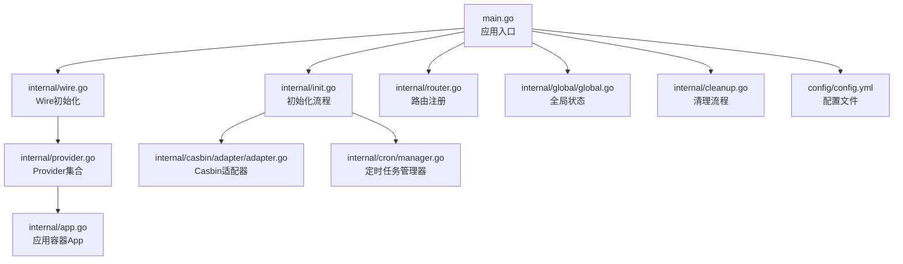
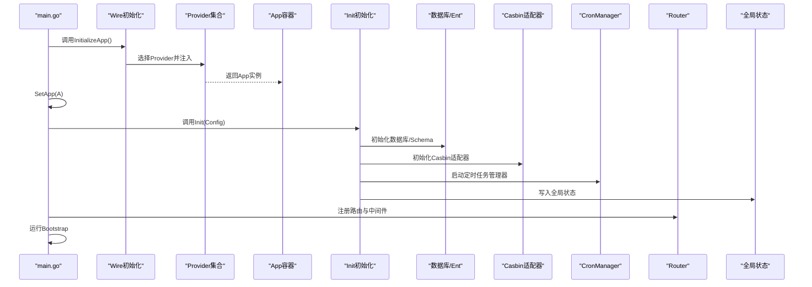
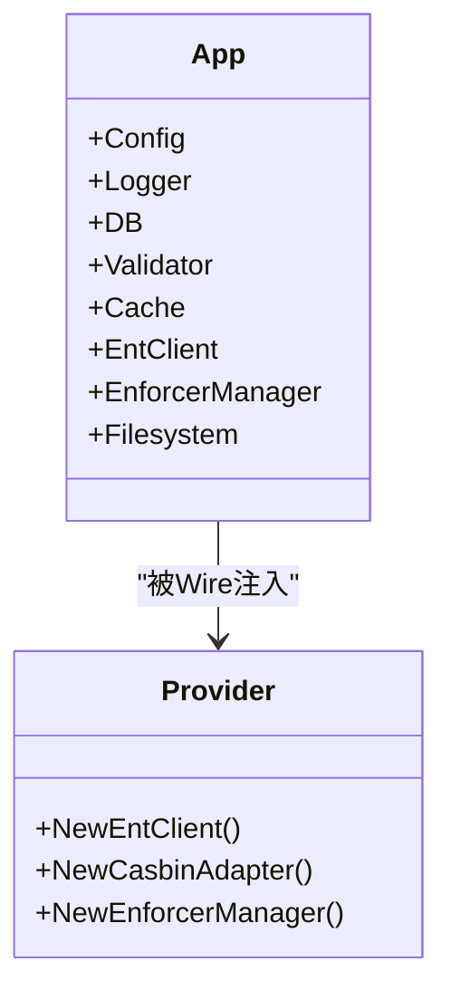
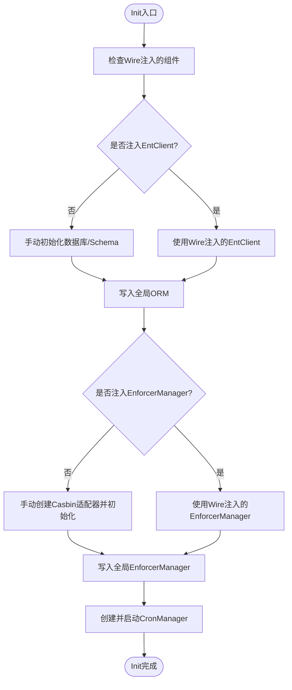
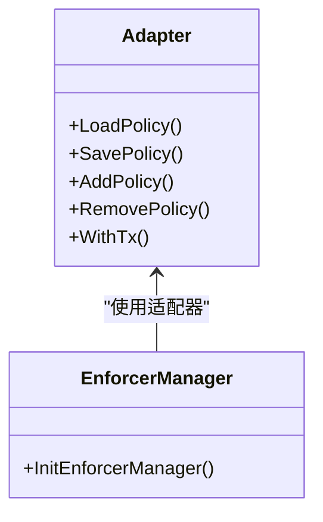
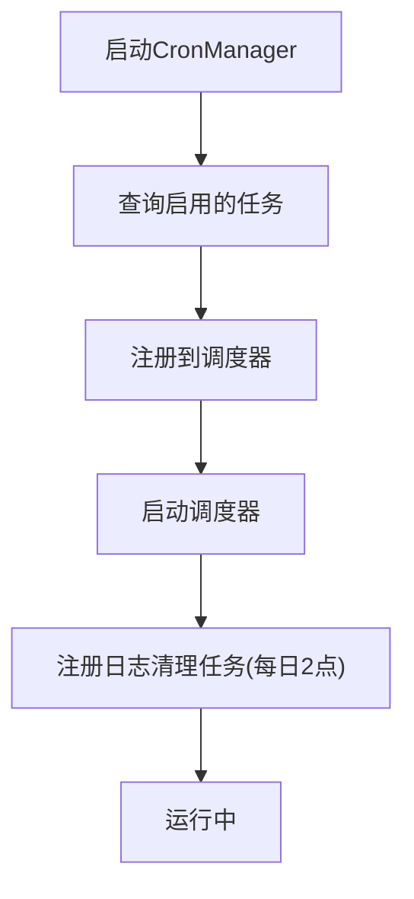
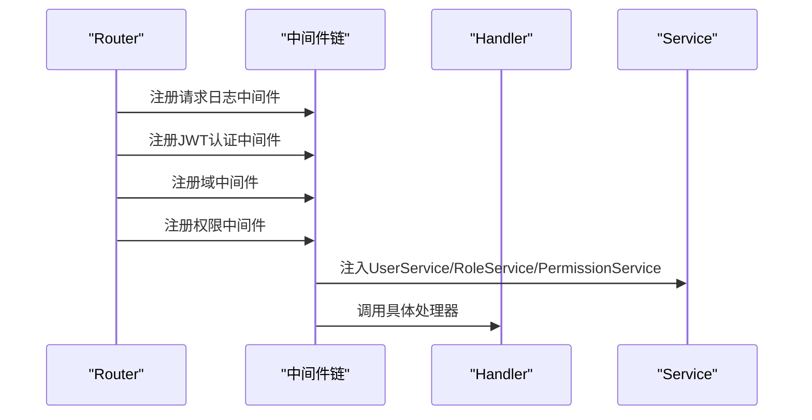
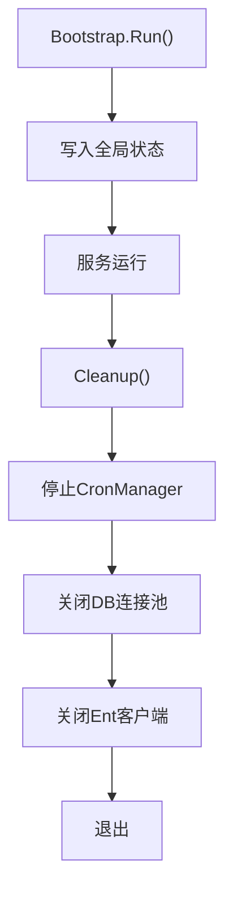
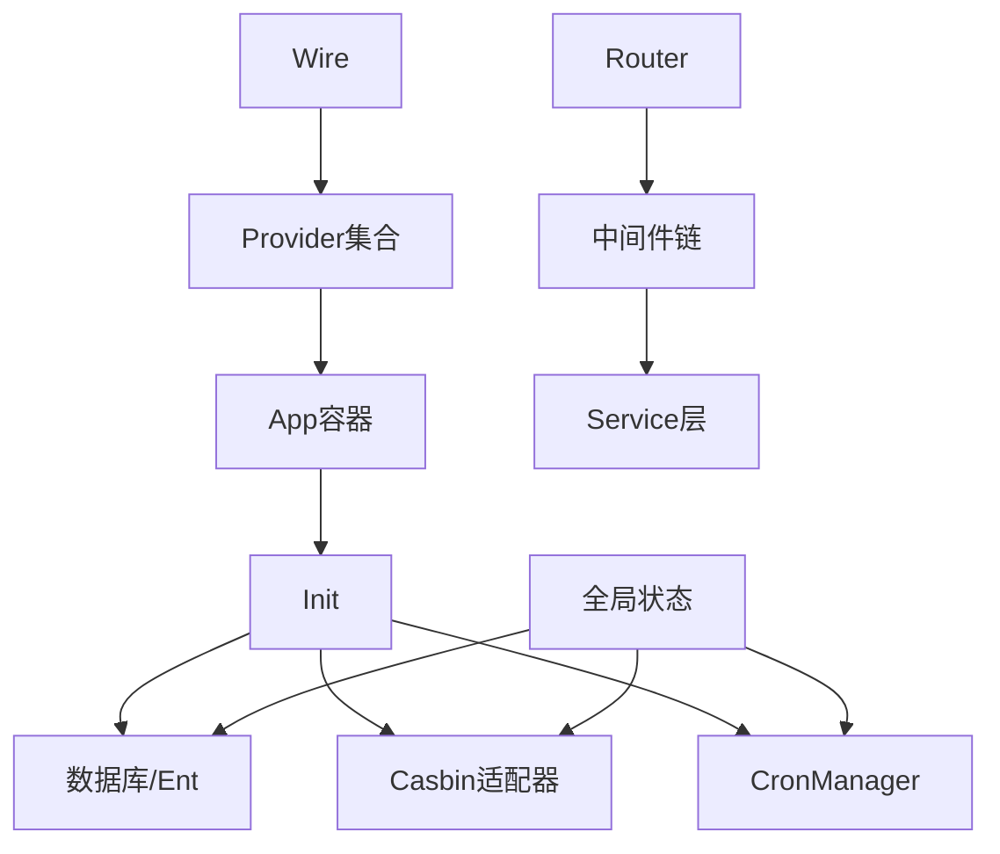

# 组件交互关系

<cite>
**本文引用的文件**
- [main.go](file://main.go)
- [internal/app.go](file://internal/app.go)
- [internal/init.go](file://internal/init.go)
- [internal/provider.go](file://internal/provider.go)
- [internal/wire.go](file://internal/wire.go)
- [internal/casbin/adapter/adapter.go](file://internal/casbin/adapter/adapter.go)
- [internal/cron/manager.go](file://internal/cron/manager.go)
- [internal/router.go](file://internal/router.go)
- [internal/global/global.go](file://internal/global/global.go)
- [internal/cleanup.go](file://internal/cleanup.go)
- [internal/tasks/registry.go](file://internal/tasks/registry.go)
- [config/config.yml](file://config/config.yml)
- [go.mod](file://go.mod)
</cite>

## 目录
1. [简介](#简介)
2. [项目结构](#项目结构)
3. [核心组件](#核心组件)
4. [架构总览](#架构总览)
5. [详细组件分析](#详细组件分析)
6. [依赖关系分析](#依赖关系分析)
7. [性能考虑](#性能考虑)
8. [故障排查指南](#故障排查指南)
9. [结论](#结论)

## 简介
本文件面向Go Admin管理系统，聚焦应用启动流程中的组件初始化顺序与依赖关系，阐述应用容器如何协调数据库、缓存、文件系统与Casbin权限引擎等服务组件的生命周期，并解释路由注册、中间件装配、事件触发与状态同步机制。文档提供系统启动时序图与组件依赖图，帮助开发者快速理解整体运行机制与组件协作模式。

## 项目结构
系统采用模块化组织方式，核心启动入口位于根目录的主程序，依赖注入通过Wire生成，业务组件按功能拆分为路由、处理器、服务层、中间件、定时任务、Casbin适配器等子模块；全局共享状态通过internal/global统一管理；配置文件集中于config目录。

图表来源
- [main.go:47-104](file://main.go#L47-L104)
- [internal/wire.go:22-37](file://internal/wire.go#L22-L37)
- [internal/provider.go:17-43](file://internal/provider.go#L17-L43)
- [internal/app.go:15-25](file://internal/app.go#L15-L25)
- [internal/init.go:31-67](file://internal/init.go#L31-L67)
- [internal/casbin/adapter/adapter.go:97-113](file://internal/casbin/adapter/adapter.go#L97-L113)
- [internal/cron/manager.go:26-77](file://internal/cron/manager.go#L26-L77)
- [internal/router.go:16-149](file://internal/router.go#L16-L149)
- [internal/global/global.go:11-16](file://internal/global/global.go#L11-L16)
- [internal/cleanup.go:10-37](file://internal/cleanup.go#L10-L37)
- [config/config.yml:1-143](file://config/config.yml#L1-L143)

章节来源
- [main.go:47-104](file://main.go#L47-L104)
- [internal/wire.go:22-37](file://internal/wire.go#L22-L37)
- [internal/provider.go:17-43](file://internal/provider.go#L17-L43)
- [internal/app.go:15-25](file://internal/app.go#L15-L25)
- [internal/init.go:31-67](file://internal/init.go#L31-L67)
- [config/config.yml:1-143](file://config/config.yml#L1-L143)

## 核心组件
- 应用容器App：聚合配置、日志、数据库、验证器、缓存、Ent客户端、Casbin管理器、文件系统等核心依赖。
- 初始化流程Init：负责数据库与Casbin的初始化，以及定时任务管理器的启动。
- Provider集合：定义各组件的构造工厂，配合Wire实现依赖注入。
- 路由与中间件：注册API路由、JWT认证、权限校验、请求日志等中间件。
- 全局状态：集中存放ORM、Bootstrap、EnforcerManager、CronManager等跨模块共享对象。
- 清理流程：优雅关闭定时任务、数据库连接池与Ent客户端。

章节来源
- [internal/app.go:15-25](file://internal/app.go#L15-L25)
- [internal/init.go:31-67](file://internal/init.go#L31-L67)
- [internal/provider.go:17-43](file://internal/provider.go#L17-L43)
- [internal/router.go:16-149](file://internal/router.go#L16-L149)
- [internal/global/global.go:11-16](file://internal/global/global.go#L11-L16)
- [internal/cleanup.go:10-37](file://internal/cleanup.go#L10-L37)

## 架构总览
系统启动时，main.go通过Wire构建应用容器，随后调用初始化流程，依次完成数据库、Casbin与定时任务的启动；同时注册中间件与路由，最后进入Bootstrap运行阶段。运行期间，各组件通过全局状态与路由中间件进行协作，权限控制由Casbin适配器驱动，定时任务通过CronManager调度执行。

图表来源
- [main.go:47-104](file://main.go#L47-L104)
- [internal/wire.go:22-37](file://internal/wire.go#L22-L37)
- [internal/provider.go:17-43](file://internal/provider.go#L17-L43)
- [internal/init.go:31-67](file://internal/init.go#L31-L67)
- [internal/cron/manager.go:40-77](file://internal/cron/manager.go#L40-L77)
- [internal/router.go:16-149](file://internal/router.go#L16-L149)
- [internal/global/global.go:11-16](file://internal/global/global.go#L11-L16)

## 详细组件分析

### 应用容器App与依赖注入
- App结构体聚合了配置、日志、数据库、验证器、缓存、Ent客户端、Casbin管理器、文件系统等依赖，作为应用的“依赖容器”。
- Wire通过Provider集合自动解析依赖，支持Ent客户端、Casbin适配器与EnforcerManager的注入，确保初始化流程可兼容Wire注入与手动初始化两种模式。

图表来源
- [internal/app.go:15-25](file://internal/app.go#L15-L25)
- [internal/provider.go:17-43](file://internal/provider.go#L17-L43)
- [internal/wire.go:22-37](file://internal/wire.go#L22-L37)

章节来源
- [internal/app.go:15-25](file://internal/app.go#L15-L25)
- [internal/provider.go:17-43](file://internal/provider.go#L17-L43)
- [internal/wire.go:22-37](file://internal/wire.go#L22-L37)

### 初始化流程与组件启动顺序
- 数据库初始化：优先使用Wire注入的EntClient；若未注入则手动创建数据库连接、执行Schema迁移并写入全局ORM。
- Casbin初始化：优先使用Wire注入的EnforcerManager；若未注入则基于Ent客户端创建适配器并初始化管理器。
- 定时任务管理器：创建CronManager并启动，从数据库加载启用的任务，注册日志清理任务，启动调度器。

图表来源
- [internal/init.go:31-67](file://internal/init.go#L31-L67)
- [internal/init.go:69-84](file://internal/init.go#L69-L84)
- [internal/init.go:86-100](file://internal/init.go#L86-L100)
- [internal/cron/manager.go:26-77](file://internal/cron/manager.go#L26-L77)

章节来源
- [internal/init.go:31-67](file://internal/init.go#L31-L67)
- [internal/init.go:69-84](file://internal/init.go#L69-L84)
- [internal/init.go:86-100](file://internal/init.go#L86-L100)
- [internal/cron/manager.go:26-77](file://internal/cron/manager.go#L26-L77)

### Casbin权限引擎与适配器
- 适配器通过Ent客户端读写casbin_rule表，支持批量保存策略、事务回滚、过滤加载等功能。
- EnforcerManager由Provider创建并注入，Init流程根据配置自动加载多域模型，支持默认域与自定义域配置。

图表来源
- [internal/casbin/adapter/adapter.go:115-214](file://internal/casbin/adapter/adapter.go#L115-L214)
- [internal/casbin/adapter/adapter.go:304-325](file://internal/casbin/adapter/adapter.go#L304-L325)
- [internal/provider.go:35-43](file://internal/provider.go#L35-L43)
- [internal/init.go:86-100](file://internal/init.go#L86-L100)

章节来源
- [internal/casbin/adapter/adapter.go:115-214](file://internal/casbin/adapter/adapter.go#L115-L214)
- [internal/casbin/adapter/adapter.go:304-325](file://internal/casbin/adapter/adapter.go#L304-L325)
- [internal/provider.go:35-43](file://internal/provider.go#L35-L43)
- [internal/init.go:86-100](file://internal/init.go#L86-L100)

### 定时任务管理器
- CronManager基于robfig/cron调度器，支持shell、curl、task三种执行器，从数据库加载启用任务并注册到调度器。
- 提供立即执行、移除任务、计算并更新下次执行时间等能力，并内置每日清理过期日志的任务。

图表来源
- [internal/cron/manager.go:40-77](file://internal/cron/manager.go#L40-L77)
- [internal/cron/manager.go:85-116](file://internal/cron/manager.go#L85-L116)
- [internal/cron/manager.go:154-221](file://internal/cron/manager.go#L154-L221)

章节来源
- [internal/cron/manager.go:40-77](file://internal/cron/manager.go#L40-L77)
- [internal/cron/manager.go:85-116](file://internal/cron/manager.go#L85-L116)
- [internal/cron/manager.go:154-221](file://internal/cron/manager.go#L154-L221)

### 路由注册与中间件装配
- 路由注册在Bootstrap阶段完成，按API版本分组，公开接口与认证接口分离。
- 中间件包括请求日志、JWT认证、域中间件、权限中间件，均在路由组上按需装配。
- 服务层通过Locals注入，结合缓存与文件系统组件实现功能扩展。

图表来源
- [internal/router.go:16-149](file://internal/router.go#L16-L149)

章节来源
- [internal/router.go:16-149](file://internal/router.go#L16-L149)

### 全局状态与生命周期管理
- 全局状态集中存放ORM、Bootstrap、EnforcerManager、CronManager，便于跨模块共享。
- 清理流程在应用退出前执行，先停止定时任务，再关闭数据库连接池与Ent客户端，确保资源有序释放。

图表来源
- [internal/global/global.go:11-16](file://internal/global/global.go#L11-L16)
- [internal/cleanup.go:10-37](file://internal/cleanup.go#L10-L37)
- [main.go:95-103](file://main.go#L95-L103)

章节来源
- [internal/global/global.go:11-16](file://internal/global/global.go#L11-L16)
- [internal/cleanup.go:10-37](file://internal/cleanup.go#L10-L37)
- [main.go:95-103](file://main.go#L95-L103)

## 依赖关系分析
- Wire依赖注入：通过Provider集合自动解析App所需依赖，支持Ent客户端、Casbin适配器与EnforcerManager的注入。
- 组件耦合：Init流程对数据库、Casbin与CronManager有直接依赖；Router依赖JWT中间件、权限中间件与服务层；全局状态为跨模块共享提供桥梁。
- 外部依赖：Fiber用于Web框架，robfig/cron用于定时任务，Casbin用于权限控制，Ent用于ORM与Schema迁移。

图表来源
- [internal/wire.go:22-37](file://internal/wire.go#L22-L37)
- [internal/provider.go:17-43](file://internal/provider.go#L17-L43)
- [internal/app.go:15-25](file://internal/app.go#L15-L25)
- [internal/init.go:31-67](file://internal/init.go#L31-L67)
- [internal/router.go:16-149](file://internal/router.go#L16-L149)
- [internal/global/global.go:11-16](file://internal/global/global.go#L11-L16)

章节来源
- [internal/wire.go:22-37](file://internal/wire.go#L22-L37)
- [internal/provider.go:17-43](file://internal/provider.go#L17-L43)
- [internal/app.go:15-25](file://internal/app.go#L15-L25)
- [internal/init.go:31-67](file://internal/init.go#L31-L67)
- [internal/router.go:16-149](file://internal/router.go#L16-L149)
- [internal/global/global.go:11-16](file://internal/global/global.go#L11-L16)

## 性能考虑
- 数据库连接池：通过Wire注入的DBManager管理连接池，建议在配置中合理设置最大连接数与空闲连接数，避免高并发下的连接争用。
- 缓存策略：路由中根据是否存在缓存实例动态注入带缓存或无缓存的服务实现，建议在高并发场景下启用Redis缓存以降低数据库压力。
- 定时任务批处理：Casbin适配器在保存策略时采用批量插入，减少事务提交次数，提高写入效率。
- 日志轮转：CronManager内置日志清理任务，建议结合配置文件的日志轮转参数，避免磁盘空间占用过高。

## 故障排查指南
- 数据库初始化失败：检查配置文件中的数据库连接信息与驱动类型，确认Schema迁移是否成功。
- Casbin初始化异常：确认Ent客户端可用且casbin_rule表存在，检查模型配置与自动加载设置。
- 定时任务无法启动：检查Cron表达式合法性与任务类型是否受支持，查看日志清理任务是否正常注册。
- 路由鉴权失败：核对JWT密钥、权限中间件配置与用户角色/权限映射。
- 优雅关闭失败：确认Cleanup流程是否正确执行，关注CronManager停止与数据库连接池关闭的顺序。

章节来源
- [internal/init.go:69-84](file://internal/init.go#L69-L84)
- [internal/init.go:86-100](file://internal/init.go#L86-L100)
- [internal/cron/manager.go:40-77](file://internal/cron/manager.go#L40-L77)
- [internal/cleanup.go:10-37](file://internal/cleanup.go#L10-L37)

## 结论
本系统通过Wire实现依赖注入，Init流程串联数据库、Casbin与定时任务的启动，Router与中间件提供清晰的请求处理链路，全局状态保障跨模块协作。启动时序与依赖关系清晰，组件间通过App容器与全局状态实现低耦合高内聚的协作模式。建议在生产环境中结合配置文件参数与监控告警，持续优化数据库、缓存与定时任务的性能表现。