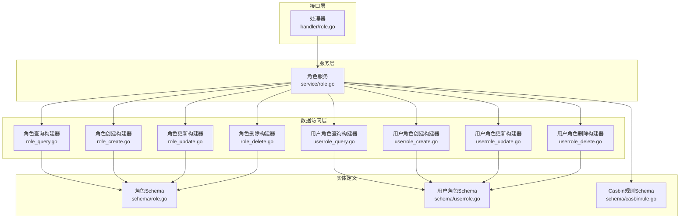
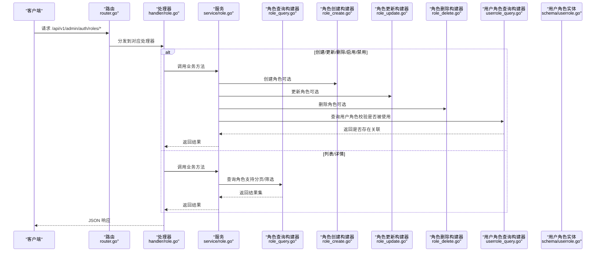
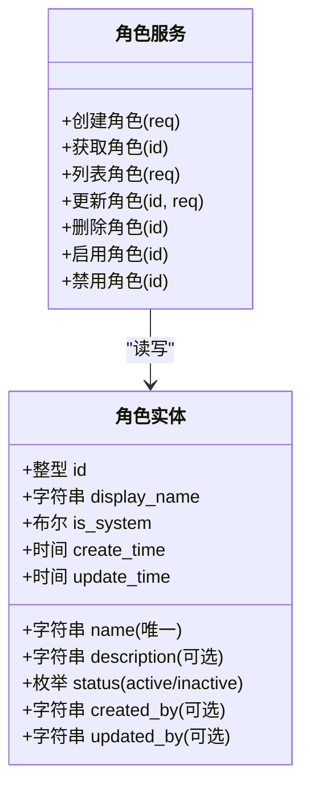
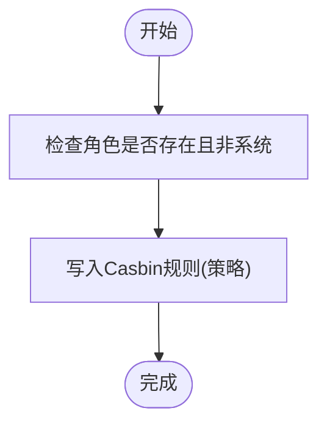
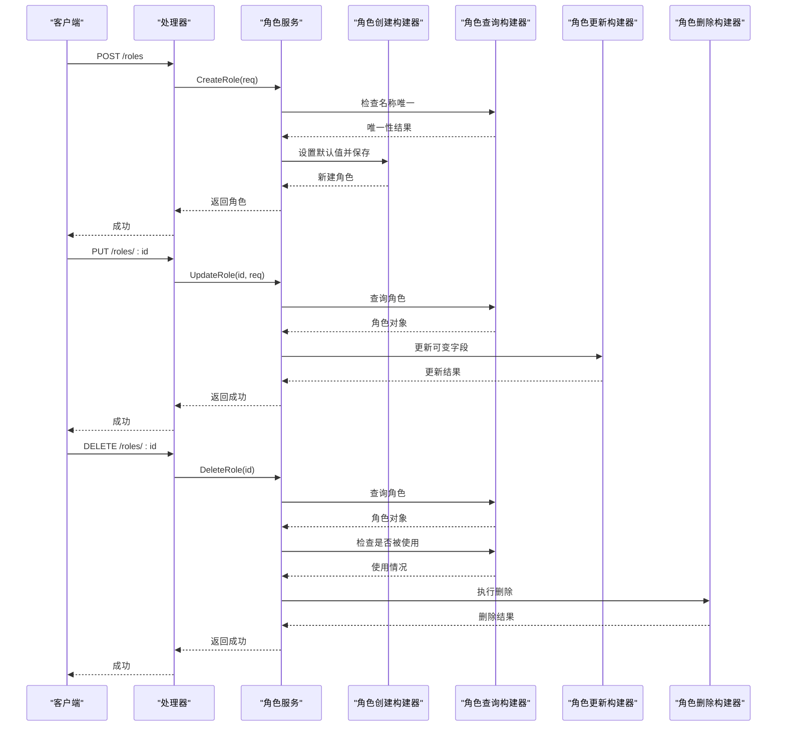
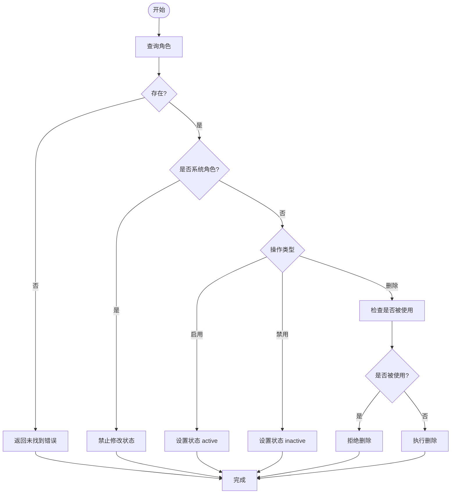
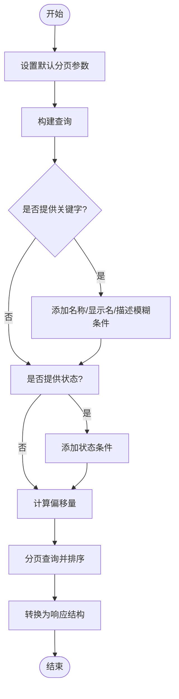
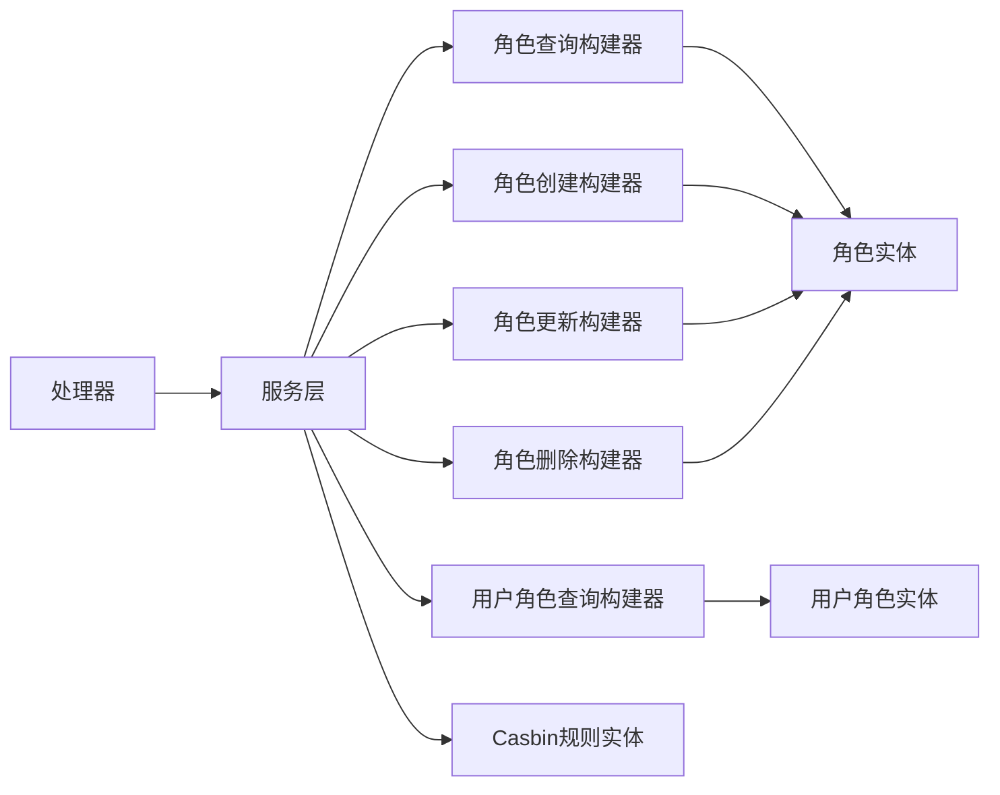

# 角色管理

<cite>
**本文引用的文件**
- [role.go](file://internal/ent/schema/role.go)
- [role.go](file://internal/ent/role/role.go)
- [role_create.go](file://internal/ent/role_create.go)
- [role_query.go](file://internal/ent/role_query.go)
- [role_update.go](file://internal/ent/role_update.go)
- [role_delete.go](file://internal/ent/role_delete.go)
- [userrole.go](file://internal/ent/schema/userrole.go)
- [userrole_query.go](file://internal/ent/userrole_query.go)
- [userrole_create.go](file://internal/ent/userrole_create.go)
- [userrole_update.go](file://internal/ent/userrole_update.go)
- [userrole_delete.go](file://internal/ent/userrole_delete.go)
- [casbinrule.go](file://internal/ent/schema/casbinrule.go)
- [role.go](file://internal/service/role.go)
- [role.go](file://internal/handler/role.go)
- [router.go](file://internal/router.go)
</cite>

## 目录
1. [简介](#简介)
2. [项目结构](#项目结构)
3. [核心组件](#核心组件)
4. [架构总览](#架构总览)
5. [详细组件分析](#详细组件分析)
6. [依赖分析](#依赖分析)
7. [性能考虑](#性能考虑)
8. [故障排查指南](#故障排查指南)
9. [结论](#结论)
10. [附录](#附录)

## 简介
本章节概述 Go Admin 管理系统中的“角色管理”能力，重点覆盖角色实体设计、CRUD 实现、状态管理（启用/禁用/删除）、角色与用户的多对多关联、权限分配与继承机制、查询与筛选、批量操作以及安全策略与最佳实践。文档以代码为依据，结合可视化图示帮助读者快速理解与落地。

## 项目结构
围绕角色管理的关键目录与文件如下：
- 数据模型层：ent/schema 定义实体与索引；ent/*_query.go/*_create.go/*_update.go/*_delete.go 提供查询、创建、更新、删除构建器
- 服务层：service/role.go 提供角色业务逻辑与校验
- 接口层：handler/role.go 提供 HTTP 处理器
- 路由层：internal/router.go 注册角色相关路由
- 权限与关联：通过中间表 user_role 实现用户与角色的多对多；权限通过 casbinrule 表存储策略



图表来源
- [role.go:18-528](file://internal/ent/role_query.go#L18-L528)
- [role.go:16-400](file://internal/ent/role_create.go#L16-L400)
- [role.go:18-581](file://internal/ent/role_update.go#L18-L581)
- [role.go:15-89](file://internal/ent/role_delete.go#L15-L89)
- [userrole_query.go:20-682](file://internal/ent/userrole_query.go#L20-L682)
- [userrole_create.go:18-333](file://internal/ent/userrole_create.go#L18-L333)
- [userrole_update.go:20-521](file://internal/ent/userrole_update.go#L20-L521)
- [userrole_delete.go:15-89](file://internal/ent/userrole_delete.go#L15-L89)
- [role.go:10-73](file://internal/ent/schema/role.go#L10-L73)
- [userrole.go:11-56](file://internal/ent/schema/userrole.go#L11-L56)
- [casbinrule.go:9-37](file://internal/ent/schema/casbinrule.go#L9-L37)

章节来源
- [router.go:42-51](file://internal/router.go#L42-L51)
- [role.go:10-73](file://internal/ent/schema/role.go#L10-L73)
- [userrole.go:11-56](file://internal/ent/schema/userrole.go#L11-L56)
- [casbinrule.go:9-37](file://internal/ent/schema/casbinrule.go#L9-L37)

## 核心组件
- 角色实体（Role）：包含标识、名称、显示名、描述、系统内置标记、状态、创建/更新信息等字段，具备唯一索引与状态索引
- 用户角色关联（UserRole）：作为中间表，维护用户与角色的多对多关系，支持唯一索引与查询优化
- Casbin 规则（CasbinRule）：用于持久化 RBAC 策略，支撑权限分配与继承
- 角色服务（RoleService）：封装角色 CRUD、状态变更、查询与筛选、批量创建占位等业务逻辑
- 处理器（Handler）：绑定 Fiber 路由，解析请求参数并调用服务层
- 路由注册：在统一的路由组下暴露角色管理接口

章节来源
- [role.go:16-66](file://internal/ent/schema/role.go#L16-L66)
- [role.go:89-113](file://internal/ent/role/role.go#L89-L113)
- [userrole.go:17-49](file://internal/ent/schema/userrole.go#L17-L49)
- [casbinrule.go:15-36](file://internal/ent/schema/casbinrule.go#L15-L36)
- [role.go:25-37](file://internal/service/role.go#L25-L37)
- [role.go:13-152](file://internal/handler/role.go#L13-L152)
- [router.go:42-51](file://internal/router.go#L42-L51)

## 架构总览
角色管理采用典型的分层架构：HTTP 层（Fiber）-> 处理器层 -> 服务层 -> 数据访问层（ent 查询/创建/更新/删除构建器）-> 数据库。权限分配通过 Casbin 规则表进行持久化，角色与用户通过中间表建立多对多关系。



图表来源
- [router.go:42-51](file://internal/router.go#L42-L51)
- [role.go:13-152](file://internal/handler/role.go#L13-L152)
- [role.go:94-395](file://internal/service/role.go#L94-L395)
- [role_query.go:16-221](file://internal/ent/role_query.go#L16-L221)
- [role_create.go:144-190](file://internal/ent/role_create.go#L144-L190)
- [role_update.go:158-184](file://internal/ent/role_update.go#L158-L184)
- [role_delete.go:28-57](file://internal/ent/role_delete.go#L28-L57)
- [userrole_query.go:209-226](file://internal/ent/userrole_query.go#L209-L226)

## 详细组件分析

### 角色实体与状态管理
- 字段设计
  - 标识：自增主键，唯一
  - 名称：唯一、必填、最大长度限制
  - 显示名：必填、最大长度限制
  - 描述：可选、最大长度限制
  - 系统内置：布尔标记，用于保护系统角色
  - 状态：枚举 active/inactive，默认 active
  - 创建/更新：字符串类型（创建于服务层设置），支持排序与筛选
- 索引
  - 名称唯一索引
  - 状态普通索引
- 状态变更
  - 启用/禁用：仅非系统角色可变更；重复状态无需报错
  - 删除：系统角色不可删；若已被用户使用则拒绝删除



图表来源
- [role.go:16-66](file://internal/ent/schema/role.go#L16-L66)
- [role.go:89-113](file://internal/ent/role/role.go#L89-L113)
- [role.go:94-395](file://internal/service/role.go#L94-L395)

章节来源
- [role.go:16-66](file://internal/ent/schema/role.go#L16-L66)
- [role.go:89-113](file://internal/ent/role/role.go#L89-L113)
- [role.go:94-395](file://internal/service/role.go#L94-L395)

### 角色与用户的多对多关联
- 中间表：user_role，包含 user_id、role_id、created_by 等字段
- 约束与索引：联合唯一索引（user_id, role_id），单列索引分别覆盖 user_id 与 role_id
- 查询能力：支持按用户/角色过滤、计数、存在性检查；支持预加载关联实体

```mermaid
erDiagram
用户 {
整型 id PK
文本 其他字段...
}
角色 {
整型 id PK
文本 角色相关字段...
}
用户角色 {
整型 id PK
整型 user_id FK
整型 role_id FK
文本 created_by(可选)
时间 create_time
时间 update_time
}
用户 ||--o{ 用户角色 : "拥有"
角色 ||--o{ 用户角色 : "被拥有"
```

图表来源
- [userrole.go:17-49](file://internal/ent/schema/userrole.go#L17-L49)
- [userrole_query.go:515-559](file://internal/ent/userrole_query.go#L515-L559)

章节来源
- [userrole.go:17-49](file://internal/ent/schema/userrole.go#L17-L49)
- [userrole_query.go:209-226](file://internal/ent/userrole_query.go#L209-L226)

### 权限分配与继承机制
- 权限存储：CasbinRule 表，字段 Ptype、V0-V5 组合唯一索引，用于表达策略
- 分配流程：为角色分配权限时，建议在服务层将权限规则写入 CasbinRule；从角色移除权限时，建议清理对应规则
- 继承规则：当前代码未显式实现“角色层级结构”，权限继承通常通过策略前缀、通配符或层级策略在 Casbin 中实现；具体策略需结合业务与配置文件



图表来源
- [casbinrule.go:15-36](file://internal/ent/schema/casbinrule.go#L15-L36)
- [role.go:299-308](file://internal/service/role.go#L299-L308)

章节来源
- [casbinrule.go:15-36](file://internal/ent/schema/casbinrule.go#L15-L36)
- [role.go:299-308](file://internal/service/role.go#L299-L308)

### 角色 CRUD 流程
- 创建
  - 参数校验：名称/显示名长度与必填校验
  - 唯一性校验：名称唯一
  - 默认值：状态 active、系统内置 false、时间戳
  - 返回实体转换
- 读取
  - 单条：根据 id 查询，不存在返回错误
  - 列表：支持关键字（名称/显示名/描述）与状态筛选、分页、排序
- 更新
  - 存在性校验
  - 系统内置角色限制：仅允许修改描述
  - 可选字段更新
- 删除
  - 存在性校验
  - 系统内置角色保护
  - 使用检查：若被用户使用则拒绝删除
  - 执行删除



图表来源
- [role.go:13-115](file://internal/handler/role.go#L13-L115)
- [role.go:94-309](file://internal/service/role.go#L94-L309)
- [role_create.go:144-190](file://internal/ent/role_create.go#L144-L190)
- [role_query.go:161-221](file://internal/ent/role_query.go#L161-L221)
- [role_update.go:158-184](file://internal/ent/role_update.go#L158-L184)
- [role_delete.go:28-57](file://internal/ent/role_delete.go#L28-L57)

章节来源
- [role.go:13-115](file://internal/handler/role.go#L13-L115)
- [role.go:94-309](file://internal/service/role.go#L94-L309)

### 角色状态管理（启用/禁用/删除）
- 启用：非系统角色可启用；重复启用无副作用
- 禁用：非系统角色可禁用；重复禁用无副作用
- 删除：系统角色不可删；被用户使用时不可删；删除后预留清理权限规则位置



图表来源
- [role.go:311-379](file://internal/service/role.go#L311-L379)
- [role.go:269-309](file://internal/service/role.go#L269-L309)

章节来源
- [role.go:311-379](file://internal/service/role.go#L311-L379)
- [role.go:269-309](file://internal/service/role.go#L269-L309)

### 角色查询与筛选
- 支持字段
  - 分页：page/page_size（最小1，最大100）
  - 关键字：名称/显示名/描述模糊匹配
  - 状态：精确筛选
- 排序：默认按创建时间倒序
- 计数：先统计总数再分页查询



图表来源
- [role.go:161-222](file://internal/service/role.go#L161-L222)
- [role_query.go:161-221](file://internal/ent/role_query.go#L161-L221)

章节来源
- [role.go:161-222](file://internal/service/role.go#L161-L222)

### 批量操作与权限批量分配
- 角色批量创建：ent 已生成批量创建构建器，可在服务层组合使用
- 权限批量分配：预留位置（注释提示在权限服务实现时处理），建议在服务层统一写入 CasbinRule

章节来源
- [role_create.go:313-400](file://internal/ent/role_create.go#L313-L400)
- [role.go:299-308](file://internal/service/role.go#L299-L308)

### 角色层级结构与嵌套权限
- 当前代码未实现“角色层级结构”（如父子角色关系）
- 若需要嵌套权限，建议在业务层扩展“角色层级”字段并在权限查询时递归叠加；权限继承可通过 Casbin 的策略前缀/通配符实现

章节来源
- [role.go:299-308](file://internal/service/role.go#L299-L308)

### 日志记录与审计
- 代码中未发现显式的审计日志记录
- 建议在以下环节增加审计：
  - 角色创建/更新/删除
  - 角色启用/禁用
  - 用户角色分配/移除
  - 权限批量分配/移除
- 建议字段：操作人、操作类型、目标对象、变更前后快照、时间戳

章节来源
- [role.go:94-395](file://internal/service/role.go#L94-L395)

### 安全策略与最佳实践
- 输入校验：严格限制字段长度与必填项
- 唯一性约束：名称唯一，避免歧义
- 系统角色保护：禁止删除与状态变更
- 使用检查：删除前检查是否被用户使用
- 权限最小化：仅授予必要权限，定期清理无效规则
- 审计留痕：建议在关键操作处增加审计日志
- 批量操作幂等：批量创建/分配时注意去重与回滚

章节来源
- [role.go:16-66](file://internal/ent/schema/role.go#L16-L66)
- [role.go:94-395](file://internal/service/role.go#L94-L395)

## 依赖分析
- 处理器依赖服务层
- 服务层依赖 ent 查询/创建/更新/删除构建器
- 查询/创建/更新/删除构建器依赖实体定义与索引
- 用户角色查询依赖用户与角色实体
- 权限分配依赖 Casbin 规则表



图表来源
- [role.go:13-152](file://internal/handler/role.go#L13-L152)
- [role.go:94-395](file://internal/service/role.go#L94-L395)
- [role_query.go:16-221](file://internal/ent/role_query.go#L16-L221)
- [role_create.go:144-190](file://internal/ent/role_create.go#L144-L190)
- [role_update.go:158-184](file://internal/ent/role_update.go#L158-L184)
- [role_delete.go:28-57](file://internal/ent/role_delete.go#L28-L57)
- [userrole_query.go:209-226](file://internal/ent/userrole_query.go#L209-L226)
- [casbinrule.go:15-36](file://internal/ent/schema/casbinrule.go#L15-L36)

章节来源
- [role.go:13-152](file://internal/handler/role.go#L13-L152)
- [role.go:94-395](file://internal/service/role.go#L94-L395)

## 性能考虑
- 查询优化
  - 使用索引：名称唯一索引、状态普通索引
  - 分页与排序：避免大偏移量，优先使用游标或基于时间的分页
- 写入优化
  - 批量创建：利用 ent 的批量创建构建器减少往返
  - 权限写入：批量写入 Casbin 规则时合并事务
- 关联查询
  - 使用 WithUser/WithRole 预加载，减少 N+1 查询
- 缓存
  - 对热点角色与权限进行缓存，降低数据库压力

章节来源
- [role.go:61-66](file://internal/ent/schema/role.go#L61-L66)
- [userrole_query.go:309-329](file://internal/ent/userrole_query.go#L309-L329)
- [role_create.go:313-400](file://internal/ent/role_create.go#L313-L400)

## 故障排查指南
- 常见错误
  - 角色不存在：查询失败返回未找到
  - 角色名称已存在：创建失败
  - 角色正在使用中：删除失败
  - 系统内置角色不可删除/状态变更：返回受保护错误
  - 参数无效：请求体解析失败
- 排查步骤
  - 确认请求参数与字段长度限制
  - 检查角色是否存在与状态
  - 检查是否被用户使用
  - 查看服务层返回的具体错误码与消息

章节来源
- [role.go:14-23](file://internal/service/role.go#L14-L23)
- [role.go:18-28](file://internal/handler/role.go#L18-L28)
- [role.go:94-395](file://internal/service/role.go#L94-L395)

## 结论
本角色管理模块以 ent 为核心，提供了完整的角色 CRUD、状态管理、用户角色关联与权限分配基础。通过中间表实现多对多关系，通过 Casbin 规则表承载权限策略。建议在后续迭代中补充角色层级、权限继承、审计日志与更完善的批量操作能力，以满足复杂场景下的权限治理需求。

## 附录
- 路由注册
  - 角色管理：POST/GET/PUT/DELETE /api/v1/admin/auth/roles/*
  - 角色状态：PUT /api/v1/admin/auth/roles/:id/enable|disable
- 建议扩展
  - 角色层级：新增 parent_id 或层级路径字段
  - 权限继承：在 Casbin 策略中引入前缀/通配符
  - 审计：在关键操作处记录审计日志
  - 批量：完善批量创建与权限批量分配

章节来源
- [router.go:42-51](file://internal/router.go#L42-L51)