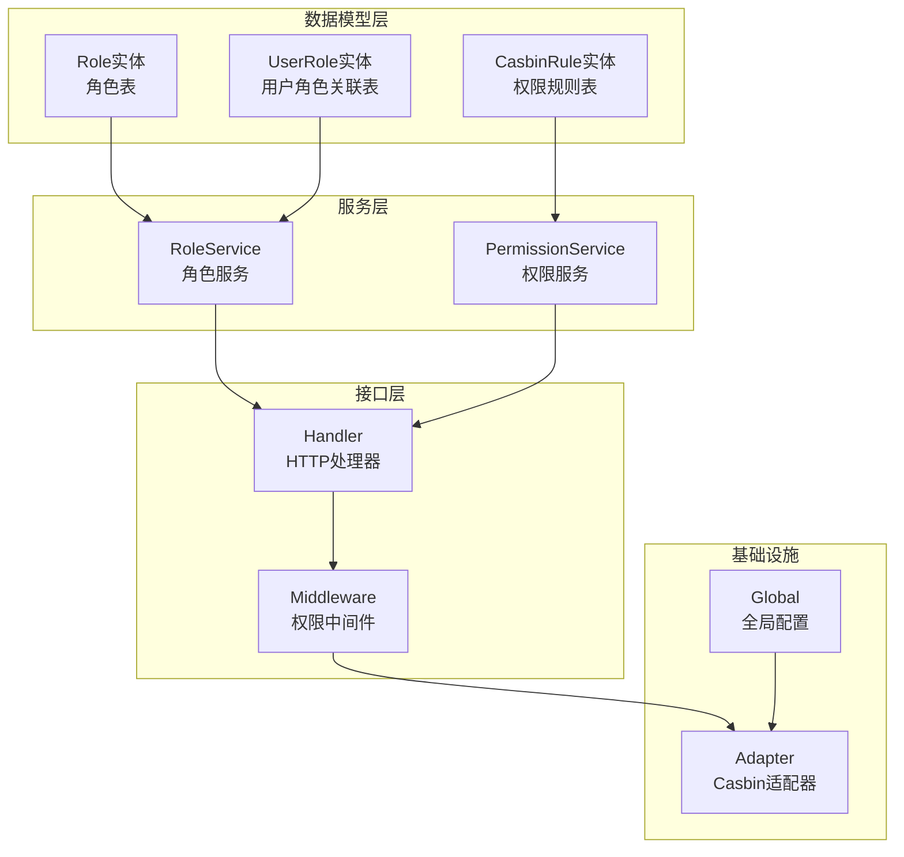
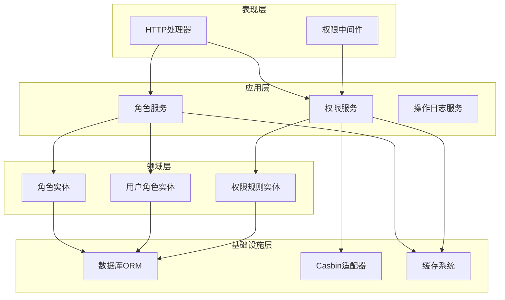
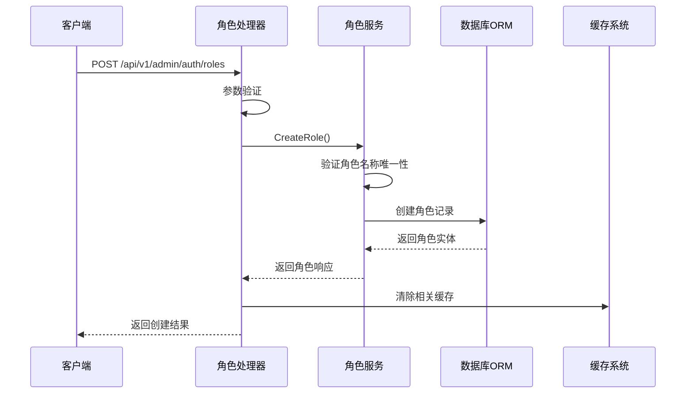
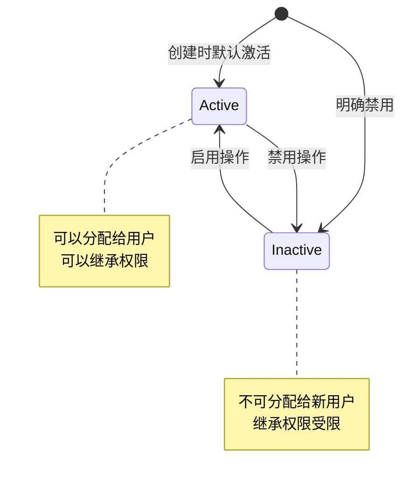
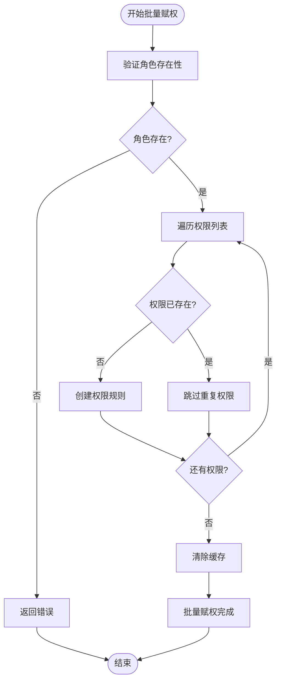
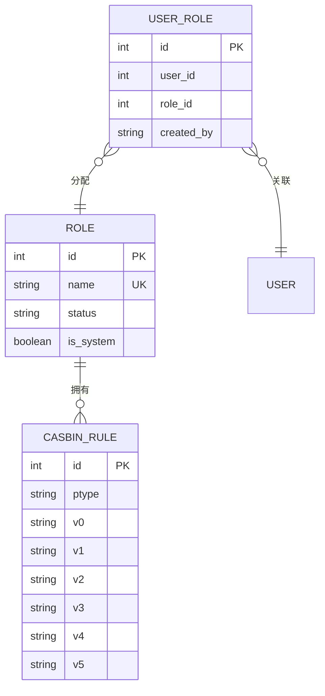
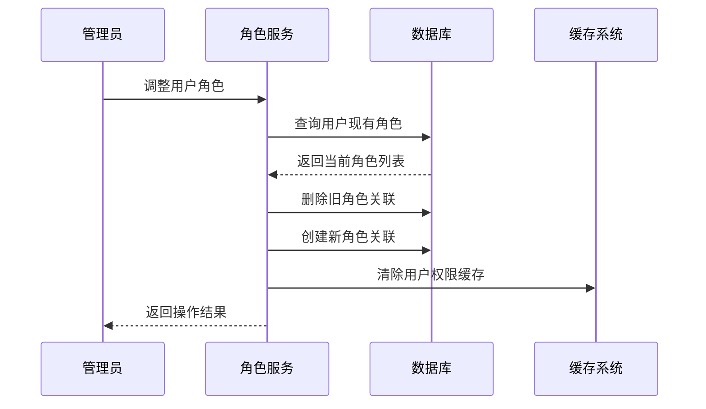
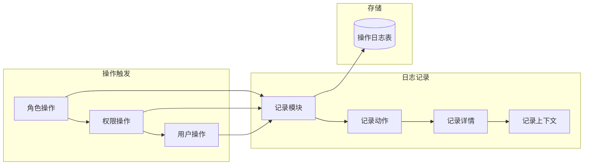
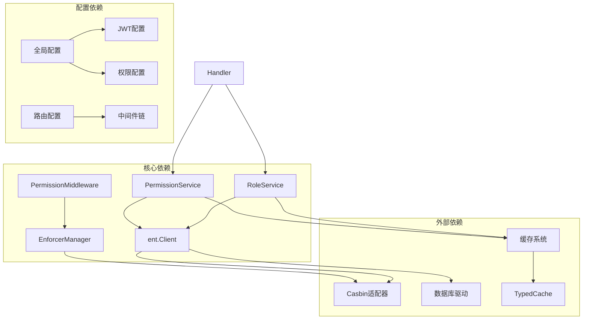
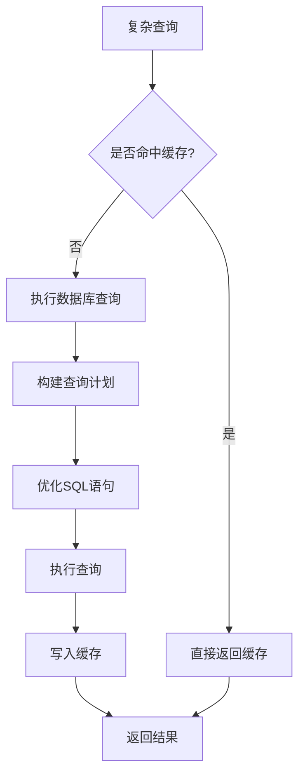

# 角色管理系统

<cite>
**本文档引用的文件**
- [role.go](file://internal/ent/schema/role.go)
- [role.go](file://internal/ent/role/role.go)
- [role_create.go](file://internal/ent/role_create.go)
- [role_update.go](file://internal/ent/role_update.go)
- [role_delete.go](file://internal/ent/role_delete.go)
- [userrole.go](file://internal/ent/schema/userrole.go)
- [userrole.go](file://internal/ent/userrole/userrole.go)
- [casbinrule.go](file://internal/ent/casbinrule/casbinrule.go)
- [role.go](file://internal/handler/role.go)
- [role.go](file://internal/service/role.go)
- [permission.go](file://internal/service/permission.go)
- [permission.go](file://internal/middleware/permission.go)
- [adapter.go](file://internal/casbin/adapter/adapter.go)
- [router.go](file://internal/router.go)
- [global.go](file://internal/global/global.go)
- [operationlog.go](file://internal/ent/operationlog/operationlog.go)
</cite>

## 目录
1. [简介](#简介)
2. [项目结构](#项目结构)
3. [核心组件](#核心组件)
4. [架构概览](#架构概览)
5. [详细组件分析](#详细组件分析)
6. [依赖关系分析](#依赖关系分析)
7. [性能考虑](#性能考虑)
8. [故障排除指南](#故障排除指南)
9. [结论](#结论)

## 简介

Go Admin管理系统的角色管理系统是一个完整的RBAC（基于角色的访问控制）解决方案，提供了角色的全生命周期管理、权限分配、状态控制和审计追踪功能。该系统基于Casbin开源权限引擎，实现了细粒度的权限控制和高效的权限验证。

系统支持角色的创建、更新、删除和查询操作，具备完善的权限分配机制，包括批量权限赋权、权限继承关系和权限冲突处理。同时，系统还提供了角色与用户的关联管理，支持多对多关系的维护和用户角色的动态调整。

## 项目结构

角色管理系统在Go Admin项目中的组织结构如下：

**图表来源**
- [role.go:10-73](file://internal/ent/schema/role.go#L10-L73)
- [userrole.go:11-56](file://internal/ent/schema/userrole.go#L11-L56)
- [casbinrule.go:11-118](file://internal/ent/casbinrule/casbinrule.go#L11-L118)

**章节来源**
- [role.go:1-73](file://internal/ent/schema/role.go#L1-L73)
- [userrole.go:1-56](file://internal/ent/schema/userrole.go#L1-L56)
- [casbinrule.go:1-118](file://internal/ent/casbinrule/casbinrule.go#L1-L118)

## 核心组件

### 数据模型设计

系统采用三层数据模型设计，确保了角色管理的完整性和一致性：

#### 角色实体（Role）
- **主键**: 自增ID
- **唯一索引**: name字段
- **状态字段**: active/inactive枚举值
- **系统标识**: is_system布尔值
- **元数据**: 创建时间、更新时间、创建者、更新者

#### 用户角色关联（UserRole）
- **复合唯一索引**: (user_id, role_id)
- **外键约束**: 引用users和roles表
- **时间戳**: 支持软删除和审计追踪

#### 权限规则（CasbinRule）
- **策略类型**: ptype固定为"p"
- **权限维度**: v0(角色名)、v1(域)、v2(对象)、v3(动作)
- **权限类型**: v4(api/menu/button)
- **描述信息**: v5描述字段

**章节来源**
- [role.go:16-66](file://internal/ent/schema/role.go#L16-L66)
- [userrole.go:17-49](file://internal/ent/schema/userrole.go#L17-L49)
- [casbinrule.go:38-74](file://internal/ent/casbinrule/casbinrule.go#L38-L74)

### 服务层架构

#### RoleService
负责角色的CRUD操作和状态管理：
- 角色创建：验证唯一性、设置默认状态
- 角色查询：支持分页、搜索、状态过滤
- 角色更新：系统角色保护、字段限制
- 角色删除：依赖检查、级联清理
- 状态管理：启用/禁用操作

#### PermissionService  
负责权限分配和验证：
- 权限创建：基于Casbin规则引擎
- 权限查询：支持多种过滤条件
- 权限验证：实时权限检查
- 缓存管理：提升查询性能

**章节来源**
- [role.go:27-56](file://internal/service/role.go#L27-L56)
- [permission.go:95-134](file://internal/service/permission.go#L95-L134)

## 架构概览

角色管理系统采用分层架构设计，确保了各层职责清晰和代码可维护性：

**图表来源**
- [router.go:16-150](file://internal/router.go#L16-L150)
- [role.go:41-56](file://internal/service/role.go#L41-L56)
- [permission.go:118-134](file://internal/service/permission.go#L118-L134)

系统的核心特性包括：

1. **权限引擎集成**: 基于Casbin的RBAC模型
2. **缓存优化**: 多级缓存提升性能
3. **审计追踪**: 完整的操作日志记录
4. **状态管理**: 角色状态的严格控制
5. **安全防护**: 系统角色保护机制

## 详细组件分析

### 角色CRUD操作实现

#### 角色创建流程

**图表来源**
- [role.go:30-58](file://internal/handler/role.go#L30-L58)
- [role.go:118-167](file://internal/service/role.go#L118-L167)

#### 角色状态管理机制

系统实现了严格的角**状态控制**：

- **启用状态**: 角色可以正常分配给用户
- **禁用状态**: 角色无法分配给新用户，但不影响现有用户
- **系统保护**: 系统内置角色不允许修改状态

**图表来源**
- [role.go:89-113](file://internal/ent/role/role.go#L89-L113)
- [role.go:338-412](file://internal/service/role.go#L338-L412)

**章节来源**
- [role_create.go:144-263](file://internal/ent/role_create.go#L144-L263)
- [role_update.go:158-284](file://internal/ent/role_update.go#L158-L284)
- [role_delete.go:28-57](file://internal/ent/role_delete.go#L28-L57)

### 权限分配实现原理

#### 批量权限赋权机制

系统支持批量权限分配，通过以下流程实现：

**图表来源**
- [permission.go:427-477](file://internal/service/permission.go#L427-L477)

#### 权限继承关系

系统通过用户角色关联实现权限继承：

**图表来源**
- [userrole.go:34-40](file://internal/ent/schema/userrole.go#L34-L40)
- [casbinrule.go:11-30](file://internal/ent/casbinrule/casbinrule.go#L11-L30)

**章节来源**
- [permission.go:427-510](file://internal/service/permission.go#L427-L510)
- [adapter.go:115-175](file://internal/casbin/adapter/adapter.go#L115-L175)

### 角色与用户关联管理

#### 多对多关系维护

系统通过UserRole实体维护角色与用户的多对多关系：

- **唯一约束**: (user_id, role_id)确保关系唯一性
- **级联删除**: 删除用户时自动清理关联关系
- **批量操作**: 支持批量添加、删除用户角色

#### 用户角色动态调整

**图表来源**
- [userrole.go:14-83](file://internal/ent/userrole/userrole.go#L14-L83)

**章节来源**
- [userrole.go:17-49](file://internal/ent/schema/userrole.go#L17-L49)
- [userrole.go:131-145](file://internal/ent/userrole/userrole.go#L131-L145)

### API接口文档

#### 角色管理接口

| 接口 | 方法 | 路径 | 功能 | 权限 |
|------|------|------|------|------|
| 创建角色 | POST | `/api/v1/admin/auth/roles` | 创建新角色 | 角色管理-创建 |
| 获取角色 | GET | `/api/v1/admin/auth/roles/:id` | 获取角色详情 | 角色管理-查看 |
| 列表角色 | GET | `/api/v1/admin/auth/roles` | 获取角色列表 | 角色管理-查看 |
| 更新角色 | PUT | `/api/v1/admin/auth/roles/:id` | 更新角色信息 | 角色管理-编辑 |
| 删除角色 | DELETE | `/api/v1/admin/auth/roles/:id` | 删除角色 | 角色管理-删除 |
| 启用角色 | PUT | `/api/v1/admin/auth/roles/:id/enable` | 启用角色 | 角色管理-编辑 |
| 禁用角色 | PUT | `/api/v1/admin/auth/roles/:id/disable` | 禁用角色 | 角色管理-编辑 |

#### 权限管理接口

| 接口 | 方法 | 路径 | 功能 | 权限 |
|------|------|------|------|------|
| 创建权限 | POST | `/api/v1/admin/auth/permissions` | 创建权限规则 | 权限管理-创建 |
| 更新权限 | PUT | `/api/v1/admin/auth/permissions` | 更新权限规则 | 权限管理-编辑 |
| 删除权限 | DELETE | `/api/v1/admin/auth/permissions` | 删除权限规则 | 权限管理-删除 |
| 权限详情 | GET | `/api/v1/admin/auth/permissions/detail` | 获取权限详情 | 权限管理-查看 |
| 权限列表 | GET | `/api/v1/admin/auth/permissions` | 获取权限列表 | 权限管理-查看 |
| 分配权限 | POST | `/api/v1/admin/auth/roles/permissions/assign` | 为角色分配权限 | 权限管理-编辑 |
| 移除权限 | POST | `/api/v1/admin/auth/roles/permissions/remove` | 从角色移除权限 | 权限管理-编辑 |
| 角色权限 | GET | `/api/v1/admin/auth/roles/permissions` | 获取角色权限 | 权限管理-查看 |

**章节来源**
- [role.go:15-303](file://internal/handler/role.go#L15-L303)
- [router.go:64-94](file://internal/router.go#L64-L94)

### 业务规则约束

#### 角色管理规则

1. **名称唯一性**: 角色名称必须唯一，防止冲突
2. **系统保护**: 系统内置角色不允许删除和状态修改
3. **使用检查**: 正在使用的角色不允许删除
4. **字段限制**: 系统角色只允许修改描述字段
5. **状态控制**: 禁用状态的角色无法分配给新用户

#### 权限管理规则

1. **权限类型**: 支持API、菜单、按钮三种权限类型
2. **域隔离**: 权限按域进行隔离管理
3. **重复检查**: 相同权限规则不允许重复创建
4. **缓存一致性**: 权限变更后自动清除相关缓存

**章节来源**
- [role.go:16-25](file://internal/service/role.go#L16-L25)
- [permission.go:19-25](file://internal/service/permission.go#L19-L25)

### 审计日志和变更追踪

#### 操作日志记录

系统实现了完整的操作审计功能：

**图表来源**
- [operationlog.go:13-67](file://internal/ent/operationlog/operationlog.go#L13-L67)

#### 日志字段设计

| 字段 | 类型 | 描述 |
|------|------|------|
| user_id | int | 操作用户ID |
| username | string | 操作用户名 |
| module | string | 模块名称 |
| action | string | 操作类型 |
| description | string | 操作描述 |
| method | string | HTTP方法 |
| path | string | 请求路径 |
| ip | string | 客户端IP |
| user_agent | string | 用户代理 |
| request_body | text | 请求体 |
| status_code | int | 响应状态码 |
| duration_ms | int | 请求耗时(ms) |
| created_at | datetime | 创建时间 |

**章节来源**
- [operationlog.go:52-98](file://internal/ent/operationlog/operationlog.go#L52-L98)

## 依赖关系分析

### 组件耦合度分析

**图表来源**
- [global.go:11-16](file://internal/global/global.go#L11-L16)
- [router.go:53-59](file://internal/router.go#L53-L59)

### 循环依赖检测

系统通过以下方式避免循环依赖：

1. **接口分离**: 使用接口定义抽象，避免直接依赖具体实现
2. **依赖注入**: 通过构造函数注入依赖，减少编译时依赖
3. **分层设计**: 明确的层次边界，防止跨层引用
4. **工具类分离**: 将通用逻辑提取到独立的工具包

**章节来源**
- [global.go:1-17](file://internal/global/global.go#L1-L17)
- [router.go:1-150](file://internal/router.go#L1-L150)

## 性能考虑

### 缓存策略

系统采用了多级缓存机制：

1. **角色权限缓存**: 缓存角色拥有的权限列表
2. **用户权限缓存**: 缓存用户的具体权限
3. **权限验证缓存**: 缓存权限检查结果
4. **默认TTL**: 5分钟缓存过期时间

### 查询优化

**图表来源**
- [permission.go:513-556](file://internal/service/permission.go#L513-L556)

### 并发控制

系统通过以下机制保证并发安全：

1. **事务隔离**: 关键操作使用数据库事务
2. **锁机制**: 对热点数据使用分布式锁
3. **幂等设计**: 接口设计支持重复调用
4. **重试机制**: 网络异常时自动重试

## 故障排除指南

### 常见错误及解决方案

#### 角色相关错误

| 错误类型 | 错误码 | 描述 | 解决方案 |
|----------|--------|------|----------|
| 角色不存在 | 404 | 角色ID无效或已被删除 | 验证角色ID有效性 |
| 角色名称已存在 | 409 | 角色名称重复 | 修改角色名称 |
| 系统角色保护 | 403 | 系统内置角色不可操作 | 检查角色属性 |
| 角色正在使用 | 409 | 存在用户使用该角色 | 先移除用户关联 |

#### 权限相关错误

| 错误类型 | 错误码 | 描述 | 解决方案 |
|----------|--------|------|----------|
| 权限不存在 | 404 | 权限规则不存在 | 检查权限参数 |
| 权限类型无效 | 400 | 权限类型不在允许范围内 | 验证权限类型 |
| 权限已存在 | 409 | 相同权限规则重复 | 修改权限参数 |
| 权限检查失败 | 500 | 权限引擎异常 | 检查Casbin配置 |

#### 状态管理错误

| 错误类型 | 错误码 | 描述 | 解决方案 |
|----------|--------|------|----------|
| 角色已禁用 | 403 | 禁用状态的角色无法使用 | 启用角色后再操作 |
| 状态无效 | 400 | 状态值不在允许范围内 | 验证状态参数 |
| 系统角色状态修改 | 403 | 系统内置角色状态不可修改 | 检查角色属性 |

**章节来源**
- [role.go:16-25](file://internal/service/role.go#L16-L25)
- [permission.go:19-25](file://internal/service/permission.go#L19-L25)

### 调试技巧

1. **启用详细日志**: 在开发环境开启详细日志输出
2. **监控指标**: 使用Prometheus监控关键指标
3. **性能分析**: 使用pprof分析性能瓶颈
4. **数据库监控**: 监控慢查询和连接数

## 结论

Go Admin角色管理系统是一个设计完善的RBAC解决方案，具有以下特点：

1. **完整性**: 覆盖角色管理的全生命周期
2. **安全性**: 严格的权限控制和状态管理
3. **可扩展性**: 基于Casbin的灵活权限模型
4. **高性能**: 多级缓存和优化的查询策略
5. **可观测性**: 完整的审计日志和监控支持

系统通过清晰的分层架构、严格的业务规则和完善的错误处理机制，为企业级应用提供了可靠的权限管理基础。未来可以在以下方面进一步优化：

- 增加权限继承的层级支持
- 实现权限模板和批量导入功能
- 加强权限变更的审批流程
- 提供更丰富的权限报表和分析功能