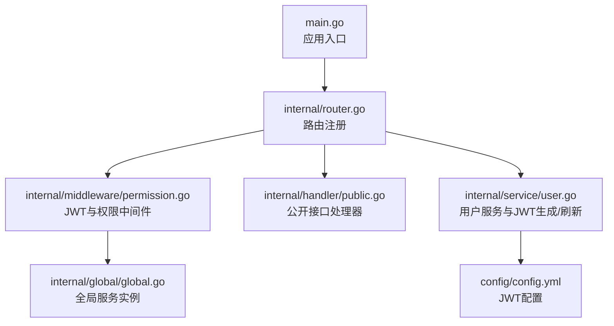
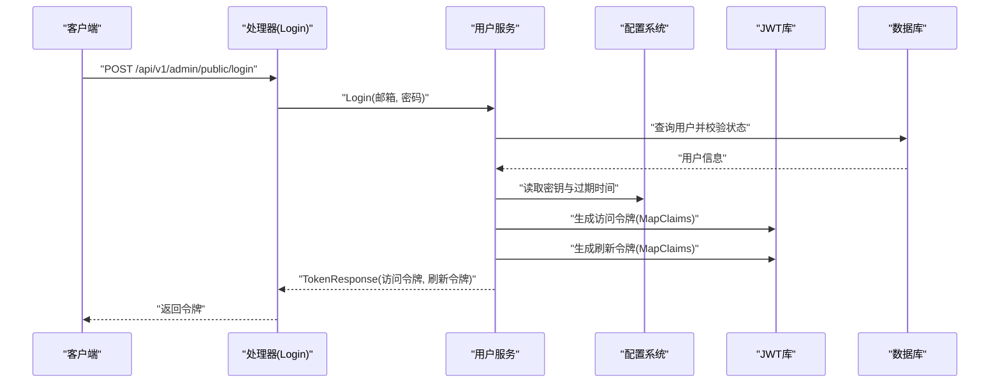
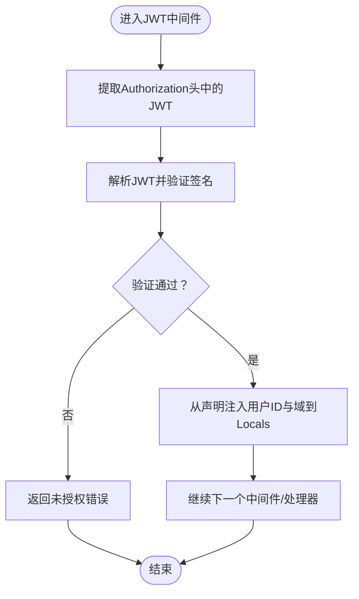
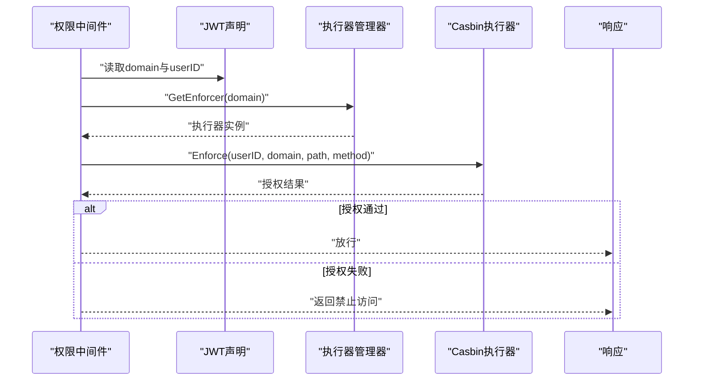
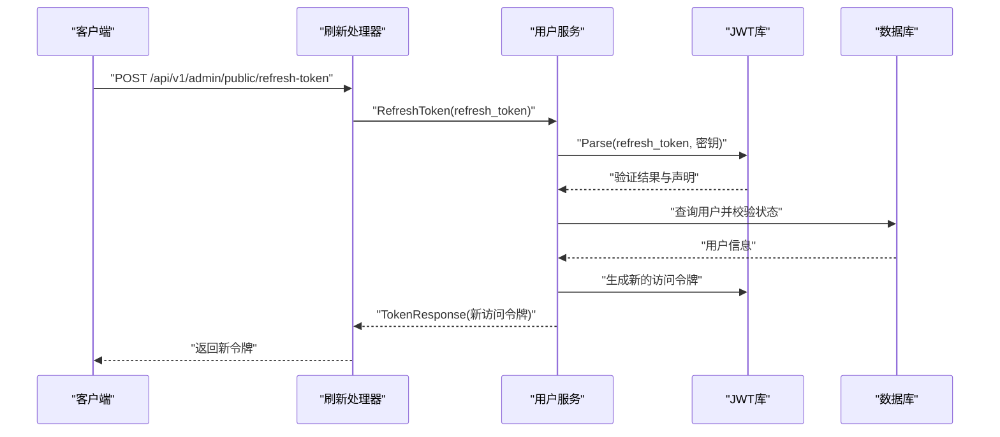
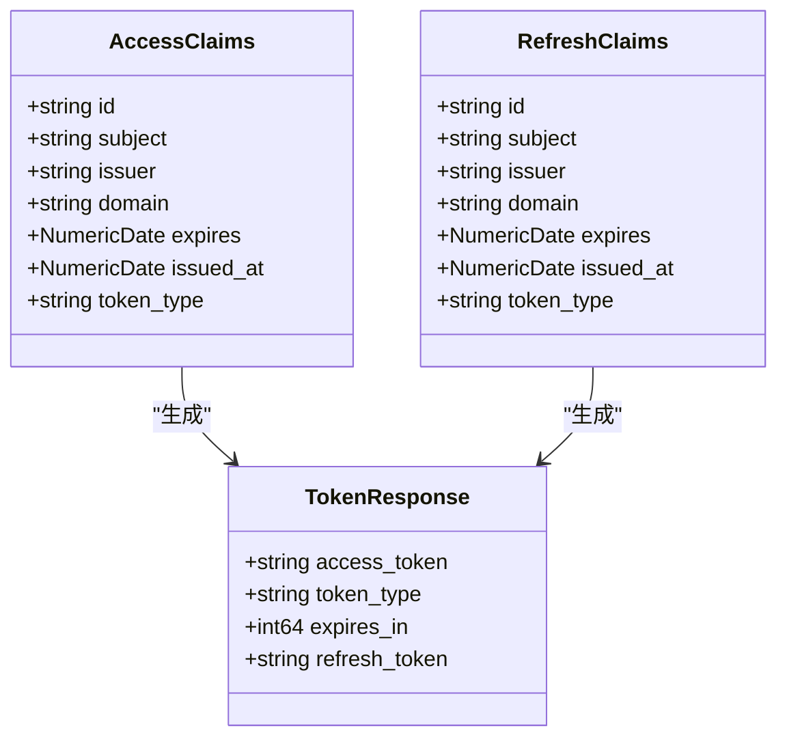
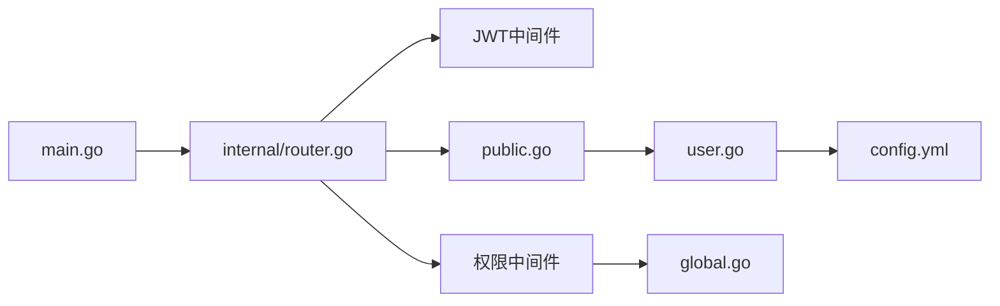

# JWT认证机制

<cite>
**本文档引用的文件**
- [main.go](file://main.go)
- [router.go](file://internal/router.go)
- [permission.go](file://internal/middleware/permission.go)
- [user.go](file://internal/service/user.go)
- [public.go](file://internal/handler/public.go)
- [global.go](file://internal/global/global.go)
- [config.yml](file://config/config.yml)
- [go.mod](file://go.mod)
</cite>

## 目录
1. [简介](#简介)
2. [项目结构](#项目结构)
3. [核心组件](#核心组件)
4. [架构总览](#架构总览)
5. [详细组件分析](#详细组件分析)
6. [依赖关系分析](#依赖关系分析)
7. [性能考虑](#性能考虑)
8. [故障排除指南](#故障排除指南)
9. [结论](#结论)
10. [附录](#附录)

## 简介
本文件系统性阐述本项目的JWT认证机制，覆盖令牌生成算法、结构组成与生命周期管理；访问令牌与刷新令牌的区别、用途与安全策略；JWT中间件的工作原理（令牌提取、解析、验证与用户信息注入）；JWT声明结构与包含信息（用户ID、角色、权限等）；令牌过期机制与自动续期策略；并提供完整的认证流程图与最佳实践建议。

## 项目结构
项目采用分层架构与模块化组织，JWT认证涉及以下关键模块：
- 应用入口与路由注册：负责初始化应用、注册中间件与路由
- 中间件层：提供JWT解析与权限校验
- 服务层：实现登录、刷新令牌、用户信息查询与更新
- 配置层：提供JWT密钥、过期时间等配置项
- 全局共享：提供ORM、配置与Casbin执行器管理器

图表来源
- [main.go:44-89](file://main.go#L44-L89)
- [router.go:14-72](file://internal/router.go#L14-L72)
- [permission.go:11-68](file://internal/middleware/permission.go#L11-L68)
- [user.go:274-356](file://internal/service/user.go#L274-L356)
- [config.yml:1-143](file://config/config.yml#L1-L143)
- [global.go:10-14](file://internal/global/global.go#L10-L14)

章节来源
- [main.go:44-89](file://main.go#L44-L89)
- [router.go:14-72](file://internal/router.go#L14-L72)

## 核心组件
- JWT中间件：基于配置的密钥对请求头中的JWT进行解析与验证，并将用户信息注入到上下文
- 用户服务：负责用户登录、生成访问令牌与刷新令牌、刷新访问令牌
- 权限中间件：从JWT中读取域信息，结合Casbin执行器进行细粒度权限校验
- 配置系统：提供JWT密钥、登录过期时间、刷新过期时间等参数

章节来源
- [permission.go:11-68](file://internal/middleware/permission.go#L11-L68)
- [user.go:127-206](file://internal/service/user.go#L127-L206)
- [user.go:274-356](file://internal/service/user.go#L274-L356)
- [config.yml:1-143](file://config/config.yml#L1-L143)

## 架构总览
JWT认证在本项目中的整体工作流如下：
- 客户端通过公开接口登录，服务端验证凭据后签发访问令牌与刷新令牌
- 访问令牌用于受保护接口调用，权限中间件解析JWT并进行RBAC校验
- 当访问令牌过期时，客户端使用刷新令牌换取新的访问令牌

图表来源
- [public.go:22-45](file://internal/handler/public.go#L22-L45)
- [user.go:127-206](file://internal/service/user.go#L127-L206)
- [config.yml:1-143](file://config/config.yml#L1-L143)

## 详细组件分析

### JWT声明结构与包含信息
- 关键声明字段
  - id：用户唯一标识
  - subject：用户名
  - issuer：签发方标识
  - domain：域标识（多域支持）
  - expires：过期时间（数值日期）
  - issued_at：签发时间（数值日期）
  - token_type：令牌类型（access 或 refresh）

- 声明生成位置
  - 登录时生成访问令牌与刷新令牌的声明
  - 刷新令牌时复用域信息并生成新的访问令牌声明

章节来源
- [user.go:160-185](file://internal/service/user.go#L160-L185)
- [user.go:335-343](file://internal/service/user.go#L335-L343)

### 访问令牌与刷新令牌
- 访问令牌（Access Token）
  - 用途：访问受保护接口
  - 生命周期：由配置的登录过期时间决定
  - 结构：包含用户标识、域、签发方、过期时间等
- 刷新令牌（Refresh Token）
  - 用途：在访问令牌过期后换取新的访问令牌
  - 生命周期：由配置的刷新过期时间决定
  - 结构：与访问令牌类似，但过期时间更长

章节来源
- [user.go:155-206](file://internal/service/user.go#L155-L206)
- [user.go:274-356](file://internal/service/user.go#L274-L356)
- [config.yml:1-143](file://config/config.yml#L1-L143)

### JWT中间件工作原理
- 令牌提取：从HTTP请求头中提取Authorization头中的JWT字符串
- 解析与验证：使用配置的密钥对JWT进行签名验证与过期检查
- 用户信息注入：将声明中的用户ID、域等信息注入到上下文locals，供后续中间件与处理器使用

图表来源
- [router.go:31-37](file://internal/router.go#L31-L37)
- [permission.go:55-68](file://internal/middleware/permission.go#L55-L68)

章节来源
- [router.go:31-37](file://internal/router.go#L31-L37)
- [permission.go:55-68](file://internal/middleware/permission.go#L55-L68)

### 权限中间件与RBAC集成
- 域中间件：从JWT声明中读取domain并注入到locals
- 权限中间件：从locals获取用户ID与域，结合Casbin执行器进行策略匹配
- 执行器管理：通过全局管理器按域获取对应的执行器实例

图表来源
- [permission.go:11-52](file://internal/middleware/permission.go#L11-L52)
- [global.go:10-14](file://internal/global/global.go#L10-L14)

章节来源
- [permission.go:11-52](file://internal/middleware/permission.go#L11-L52)
- [global.go:10-14](file://internal/global/global.go#L10-L14)

### 令牌过期机制与自动续期
- 过期检查：JWT库会在解析时验证过期时间
- 自动续期：当访问令牌过期时，客户端使用刷新令牌调用刷新接口获取新的访问令牌
- 续期流程：服务端解析刷新令牌，验证类型与用户状态，生成新的访问令牌并返回

图表来源
- [public.go:158-179](file://internal/handler/public.go#L158-L179)
- [user.go:274-356](file://internal/service/user.go#L274-L356)

章节来源
- [public.go:158-179](file://internal/handler/public.go#L158-L179)
- [user.go:274-356](file://internal/service/user.go#L274-L356)

### JWT声明类图

图表来源
- [user.go:160-185](file://internal/service/user.go#L160-L185)
- [user.go:335-343](file://internal/service/user.go#L335-L343)
- [user.go:200-205](file://internal/service/user.go#L200-L205)

## 依赖关系分析
- 应用入口依赖路由注册模块，路由注册模块依赖JWT中间件、权限中间件与处理器
- 用户服务依赖配置系统与JWT库，同时访问数据库进行用户状态校验
- 权限中间件依赖全局执行器管理器与Casbin库

图表来源
- [main.go:44-89](file://main.go#L44-L89)
- [router.go:14-72](file://internal/router.go#L14-L72)
- [permission.go:11-68](file://internal/middleware/permission.go#L11-L68)
- [user.go:127-206](file://internal/service/user.go#L127-L206)
- [config.yml:1-143](file://config/config.yml#L1-L143)
- [global.go:10-14](file://internal/global/global.go#L10-L14)

章节来源
- [go.mod:5-13](file://go.mod#L5-L13)
- [router.go:14-72](file://internal/router.go#L14-L72)

## 性能考虑
- JWT中间件应尽量避免重复解析：在路由层统一挂载一次JWT中间件，减少重复计算
- 刷新令牌流程应快速返回：仅进行必要的声明解析与用户状态校验，避免复杂业务逻辑
- Casbin执行器缓存：通过执行器管理器按域缓存执行器实例，减少重复初始化成本
- 配置读取：将密钥与过期时间读入内存后复用，避免频繁I/O

## 故障排除指南
- 未授权访问
  - 检查Authorization头格式是否为Bearer {token}
  - 确认JWT中间件是否正确挂载到受保护路由
- 缺少域信息
  - 确认JWT声明中包含domain字段
  - 检查域中间件是否正确从JWT读取并注入到locals
- 权限不足
  - 检查Casbin策略配置与执行器管理器是否正确初始化
  - 确认请求路径与方法与策略匹配
- 刷新令牌无效
  - 确认刷新令牌类型为refresh且未过期
  - 检查用户状态是否为活跃

章节来源
- [permission.go:11-68](file://internal/middleware/permission.go#L11-L68)
- [user.go:274-356](file://internal/service/user.go#L274-L356)

## 结论
本项目采用标准JWT方案实现认证与授权，通过访问令牌与刷新令牌配合实现安全的会话管理，并结合Casbin实现灵活的多域RBAC控制。JWT中间件负责令牌解析与用户信息注入，权限中间件完成细粒度授权校验。配置系统提供密钥与过期时间管理，确保安全性与可用性的平衡。

## 附录

### JWT声明字段定义
- id：用户唯一标识
- subject：用户名
- issuer：签发方标识
- domain：域标识
- expires：过期时间（数值日期）
- issued_at：签发时间（数值日期）
- token_type：令牌类型（access 或 refresh）

章节来源
- [user.go:160-185](file://internal/service/user.go#L160-L185)
- [user.go:335-343](file://internal/service/user.go#L335-L343)

### 配置项说明
- app.secret：JWT签名密钥
- app.login_expires：访问令牌过期秒数
- app.refresh_expires：刷新令牌过期秒数
- casbin.domains_default：默认域名称
- casbin.domains：多域配置列表

章节来源
- [config.yml:1-143](file://config/config.yml#L1-L143)