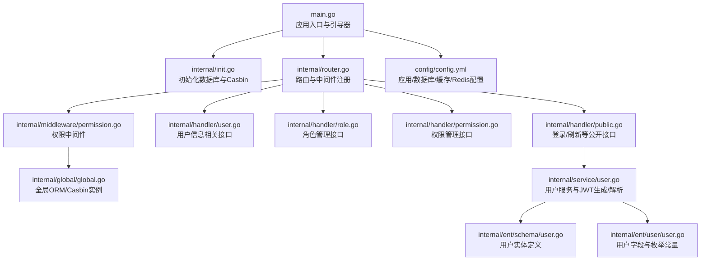
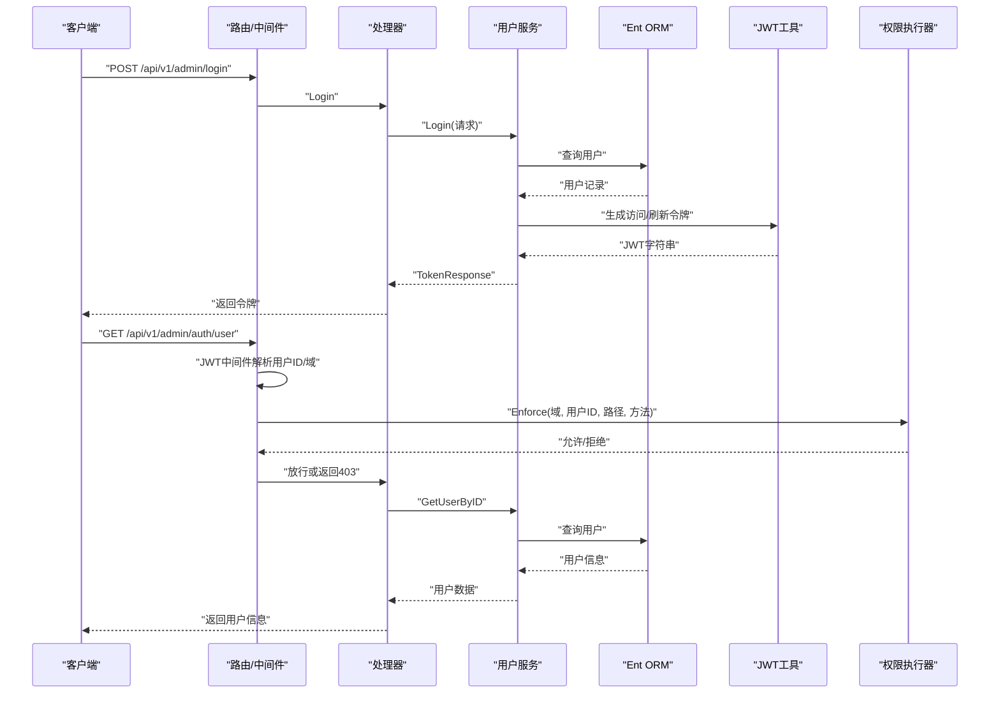
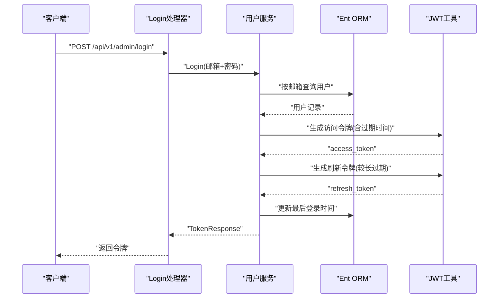
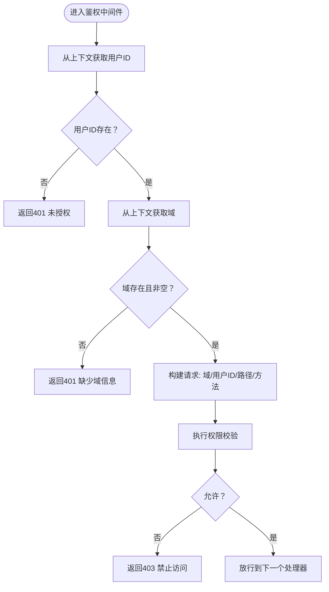
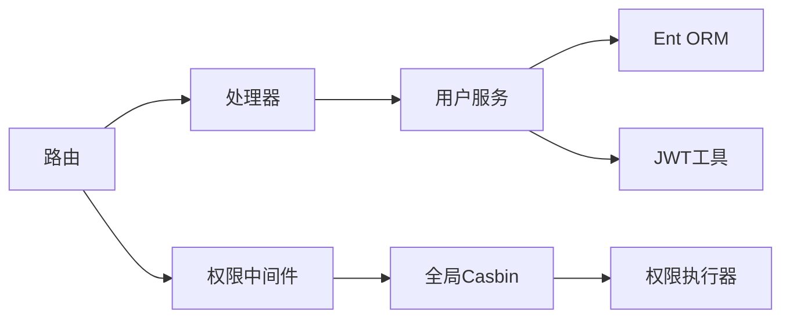

# 会话管理

<cite>
**本文引用的文件**
- [main.go](file://main.go)
- [init.go](file://internal/init.go)
- [cleanup.go](file://internal/cleanup.go)
- [config.yml](file://config/config.yml)
- [router.go](file://internal/router.go)
- [permission.go](file://internal/middleware/permission.go)
- [public.go](file://internal/handler/public.go)
- [user.go](file://internal/handler/user.go)
- [role.go](file://internal/handler/role.go)
- [permission.go](file://internal/handler/permission.go)
- [user.go](file://internal/service/user.go)
- [user.go](file://internal/ent/schema/user.go)
- [user.go](file://internal/ent/user/user.go)
- [global.go](file://internal/global/global.go)
- [utils.go](file://internal/utils/utils.go)
</cite>

## 目录
1. [简介](#简介)
2. [项目结构](#项目结构)
3. [核心组件](#核心组件)
4. [架构总览](#架构总览)
5. [详细组件分析](#详细组件分析)
6. [依赖分析](#依赖分析)
7. [性能考虑](#性能考虑)
8. [故障排查指南](#故障排查指南)
9. [结论](#结论)
10. [附录](#附录)

## 简介
本文件面向“会话管理系统”的设计与实现，围绕以下主题展开：会话创建、维护与销毁；多设备登录与并发控制策略；会话超时与自动登出；会话状态跟踪与在线状态管理；会话劫持防护与安全策略；会话数据的存储与缓存；配置项与参数调优；安全审计与异常检测。本文档基于仓库中的实际代码与配置进行分析，并提供可视化图示帮助理解。

## 项目结构
系统采用 Fiber 应用框架，通过引导器完成初始化、中间件注册、路由注册与清理工作。JWT 作为认证载体贯穿登录、鉴权与刷新流程；Ent ORM 提供用户数据持久化；Casbin 权限引擎负责细粒度权限校验；配置文件集中管理应用、日志、数据库、缓存、Redis 等参数。

图表来源
- [main.go:43-89](file://main.go#L43-L89)
- [init.go:17-65](file://internal/init.go#L17-L65)
- [router.go:14-72](file://internal/router.go#L14-L72)
- [permission.go:11-68](file://internal/middleware/permission.go#L11-L68)
- [public.go:22-45](file://internal/handler/public.go#L22-L45)
- [user.go:128-206](file://internal/service/user.go#L128-L206)
- [user.go:17-80](file://internal/ent/schema/user.go#L17-L80)
- [user.go:14-47](file://internal/ent/user/user.go#L14-L47)
- [config.yml:1-143](file://config/config.yml#L1-L143)

章节来源
- [main.go:43-89](file://main.go#L43-L89)
- [init.go:17-65](file://internal/init.go#L17-L65)
- [router.go:14-72](file://internal/router.go#L14-L72)
- [config.yml:1-143](file://config/config.yml#L1-L143)

## 核心组件
- 引导器与生命周期
  - 应用入口负责注册中间件（静态资源与SPA回退）、路由、清理函数，确保优雅启停与资源回收。
- 认证与会话
  - 登录接口生成访问令牌与刷新令牌；刷新接口基于刷新令牌签发新的访问令牌；鉴权中间件从 JWT 中提取用户域与用户ID，结合 Casbin 执行权限校验。
- 数据持久化
  - 用户实体包含邮箱、用户名、状态、最后登录时间与IP等字段；状态枚举支持活跃、非活跃、挂起。
- 权限控制
  - 域中间件从 JWT 中读取域信息；权限中间件根据域、用户ID、请求路径与方法进行策略匹配。
- 配置中心
  - 应用名、端口、调试模式、空闲超时、Swagger 开关、密钥、登录过期时间等；数据库、缓存、Redis、文件系统、Casbin 多域模型等。

章节来源
- [main.go:43-89](file://main.go#L43-L89)
- [public.go:22-45](file://internal/handler/public.go#L22-L45)
- [public.go:158-179](file://internal/handler/public.go#L158-L179)
- [permission.go:11-68](file://internal/middleware/permission.go#L11-L68)
- [user.go:128-206](file://internal/service/user.go#L128-L206)
- [user.go:17-80](file://internal/ent/schema/user.go#L17-L80)
- [user.go:112-137](file://internal/ent/user/user.go#L112-L137)
- [config.yml:1-143](file://config/config.yml#L1-L143)

## 架构总览
下图展示从请求到鉴权与权限决策的关键交互：

图表来源
- [router.go:28-37](file://internal/router.go#L28-L37)
- [public.go:22-45](file://internal/handler/public.go#L22-L45)
- [user.go:128-206](file://internal/service/user.go#L128-L206)
- [permission.go:11-68](file://internal/middleware/permission.go#L11-L68)

## 详细组件分析

### 会话创建与令牌发放
- 登录流程
  - 解析请求体，查询用户并校验状态与密码；
  - 基于配置计算访问令牌过期时间，生成访问令牌与刷新令牌；
  - 更新用户最后登录时间；
  - 返回包含访问令牌、类型与过期秒数的响应。
- 刷新流程
  - 解析并验证刷新令牌签名与类型；
  - 从令牌声明中读取用户ID与域；
  - 查询用户并校验状态；
  - 重新生成访问令牌并返回。

图表来源
- [public.go:22-45](file://internal/handler/public.go#L22-L45)
- [user.go:128-206](file://internal/service/user.go#L128-L206)

章节来源
- [public.go:22-45](file://internal/handler/public.go#L22-L45)
- [user.go:128-206](file://internal/service/user.go#L128-L206)

### 会话维护与鉴权中间件
- 域中间件
  - 从 JWT 中提取域信息并写入上下文，后续权限中间件使用该域进行策略匹配。
- 权限中间件
  - 从上下文获取用户ID与域；
  - 从请求路径与方法构造策略参数；
  - 通过全局 Casbin 执行器进行授权判断；
  - 未授权或缺少域信息时返回相应错误。

图表来源
- [permission.go:11-68](file://internal/middleware/permission.go#L11-L68)

章节来源
- [permission.go:11-68](file://internal/middleware/permission.go#L11-L68)

### 会话超时与自动登出
- 访问令牌过期
  - 登录时依据配置的登录过期时间生成访问令牌；到期后需使用刷新令牌换取新的访问令牌。
- 刷新令牌过期
  - 刷新流程中对刷新令牌进行签名与类型校验；若无效则无法续签。
- 自动登出
  - 当前实现未见服务端主动撤销会话或强制登出逻辑；如需实现，可在刷新流程中引入黑名单或状态校验。

章节来源
- [user.go:154-206](file://internal/service/user.go#L154-L206)
- [user.go:274-356](file://internal/service/user.go#L274-L356)
- [config.yml:9](file://config/config.yml#L9)

### 会话状态跟踪与在线状态管理
- 用户实体字段
  - 包含状态枚举（活跃/非活跃/挂起）与最后登录时间、IP 字段，可用于状态跟踪与审计。
- 在线状态
  - 代码未实现实时在线状态表；可通过最后登录时间与IP进行粗粒度追踪。

章节来源
- [user.go:69-79](file://internal/ent/schema/user.go#L69-L79)
- [user.go:112-137](file://internal/ent/user/user.go#L112-L137)

### 多设备登录与并发控制
- 多设备登录
  - 登录流程为一次性签发访问与刷新令牌；未见针对同一账号多设备并发的限制或会话隔离策略。
- 并发控制
  - 未发现服务端层面的并发会话上限或互斥机制；如需支持，可在刷新流程中引入会话计数或设备指纹校验。

章节来源
- [public.go:22-45](file://internal/handler/public.go#L22-L45)
- [user.go:128-206](file://internal/service/user.go#L128-L206)

### 会话劫持防护与安全策略
- 密钥与签名
  - 使用配置中的密钥生成与验证 JWT；应定期轮换密钥并限制其泄露范围。
- 令牌类型校验
  - 刷新流程严格校验令牌类型为“refresh”，避免误用访问令牌。
- 请求头规范
  - Swagger 注释中明确使用 Bearer 令牌格式，有助于统一客户端行为。
- 建议增强
  - 引入刷新令牌黑名单、IP/UA 绑定、滑动过期、设备指纹与风险评分等策略。

章节来源
- [user.go:170-190](file://internal/service/user.go#L170-L190)
- [user.go:279-307](file://internal/service/user.go#L279-L307)
- [config.yml:8](file://config/config.yml#L8)

### 会话数据的存储与缓存
- 数据库存储
  - 用户信息由 Ent ORM 管理，支持邮箱、用户名、状态、最后登录时间与IP等字段。
- 缓存与Redis
  - 配置中提供内存与 Redis 缓存驱动，但当前代码未直接使用；可扩展用于缓存热点用户信息、权限策略或会话元数据。

章节来源
- [user.go:24-80](file://internal/ent/schema/user.go#L24-L80)
- [config.yml:32-58](file://config/config.yml#L32-L58)

### 配置选项与参数调优建议
- 应用与安全
  - 名称、端口、调试、空闲超时、Swagger 开关、密钥、登录过期时间等。
- 数据库与Casbin
  - 默认连接、驱动、表前缀；Casbin 多域模型与自动加载。
- 缓存与Redis
  - 内存与 Redis 驱动、TTL、连接池参数等。
- 调优建议
  - 登录过期时间与刷新过期时间应平衡用户体验与安全强度；
  - Redis 连接池大小与超时应结合并发与延迟目标调整；
  - 对高频域启用自动加载以降低运行时开销。

章节来源
- [config.yml:1-143](file://config/config.yml#L1-L143)

### 安全审计与异常检测
- 审计点
  - 登录时间与IP变更、状态变更、密码修改、权限策略变更等。
- 异常检测
  - 结合最后登录时间与IP进行异常登录检测；
  - 对频繁刷新、无效令牌尝试、403 次数激增进行告警。

章节来源
- [user.go:73-79](file://internal/ent/schema/user.go#L73-L79)
- [permission.go:11-68](file://internal/middleware/permission.go#L11-L68)

## 依赖分析
- 组件耦合
  - 路由依赖处理器与服务层；处理器依赖服务层与响应工具；服务层依赖 ORM 与 JWT 工具；中间件依赖全局 Casbin 执行器。
- 外部依赖
  - Fiber、Ent、Casbin、JWT、MySQL/Redis 等。

图表来源
- [router.go:14-72](file://internal/router.go#L14-L72)
- [permission.go:11-68](file://internal/middleware/permission.go#L11-L68)
- [user.go:128-206](file://internal/service/user.go#L128-L206)
- [global.go:10-14](file://internal/global/global.go#L10-L14)

章节来源
- [router.go:14-72](file://internal/router.go#L14-L72)
- [permission.go:11-68](file://internal/middleware/permission.go#L11-L68)
- [global.go:10-14](file://internal/global/global.go#L10-L14)

## 性能考虑
- 路由与中间件
  - 将权限中间件置于认证中间件之后，减少无效请求穿透成本。
- Casbin
  - 对高频域启用自动加载，避免运行时动态加载带来的抖动。
- 数据库
  - 用户索引覆盖邮箱/用户名/手机号，降低查询成本。
- 缓存
  - 对热点用户信息与权限策略进行缓存，缩短鉴权路径。

章节来源
- [config.yml:77-143](file://config/config.yml#L77-L143)
- [user.go:91-97](file://internal/ent/schema/user.go#L91-L97)

## 故障排查指南
- 登录失败
  - 用户不存在、密码错误、账户未激活；检查处理器对错误类型的映射与返回码。
- 未授权/禁止访问
  - JWT 中缺少域信息、权限中间件校验失败；确认前端携带正确的 Bearer 令牌与后端中间件链路。
- 刷新失败
  - 刷新令牌签名无效或类型不正确；核对令牌生成与解析流程。
- 资源清理
  - 应用退出时确保 ORM 连接关闭，避免资源泄漏。

章节来源
- [public.go:32-42](file://internal/handler/public.go#L32-L42)
- [permission.go:16-26](file://internal/middleware/permission.go#L16-L26)
- [user.go:288-307](file://internal/service/user.go#L288-L307)
- [cleanup.go:7-19](file://internal/cleanup.go#L7-L19)

## 结论
本系统以 JWT 为核心实现会话管理，配合中间件与 Casbin 实现细粒度权限控制。登录与刷新流程清晰，具备基础的会话超时与自动登出能力。当前未实现多设备并发控制、会话黑名单与实时在线状态等高级特性。建议在保持现有架构稳定的基础上，逐步引入设备绑定、滑动过期、会话计数与审计告警等机制，以进一步提升安全性与可观测性。

## 附录
- 关键流程路径参考
  - 登录流程：[internal/handler/public.go:22-45](file://internal/handler/public.go#L22-L45) → [internal/service/user.go:128-206](file://internal/service/user.go#L128-L206)
  - 刷新流程：[internal/handler/public.go:158-179](file://internal/handler/public.go#L158-L179) → [internal/service/user.go:274-356](file://internal/service/user.go#L274-L356)
  - 鉴权流程：[internal/middleware/permission.go:11-68](file://internal/middleware/permission.go#L11-L68)
  - 用户实体：[internal/ent/schema/user.go:17-80](file://internal/ent/schema/user.go#L17-L80)、[internal/ent/user/user.go:14-47](file://internal/ent/user/user.go#L14-L47)
  - 全局配置：[config/config.yml:1-143](file://config/config.yml#L1-L143)