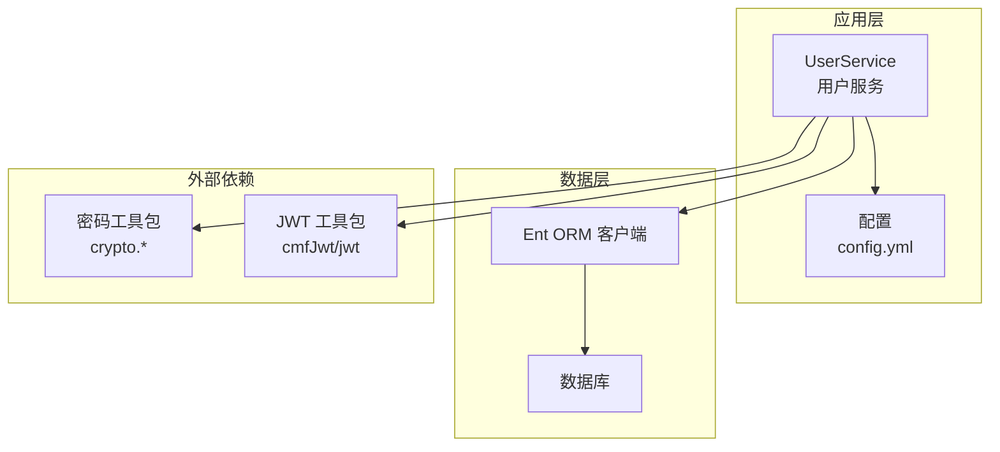
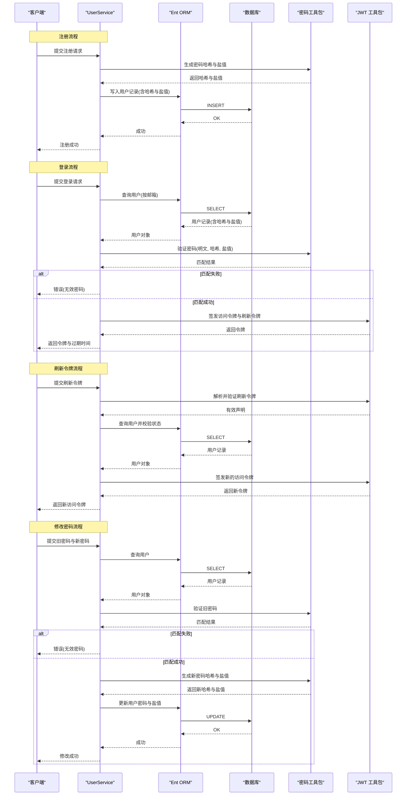
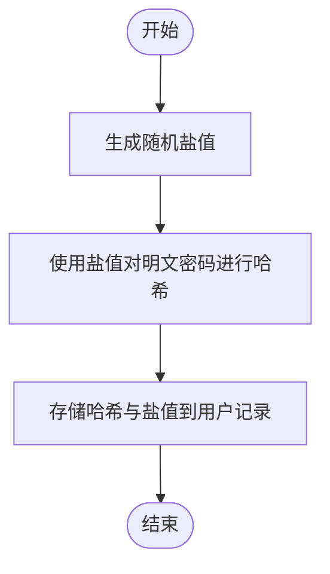
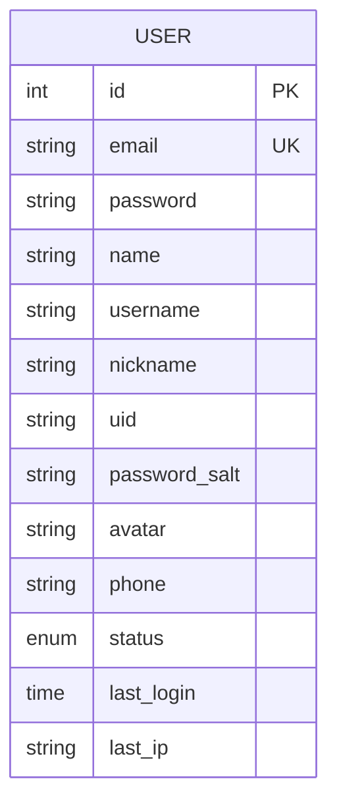
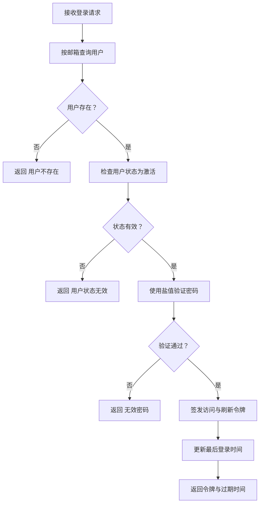
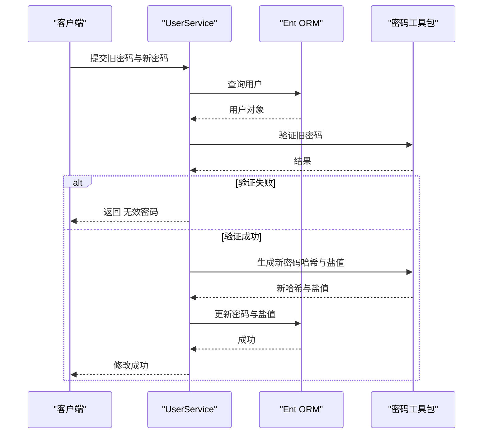
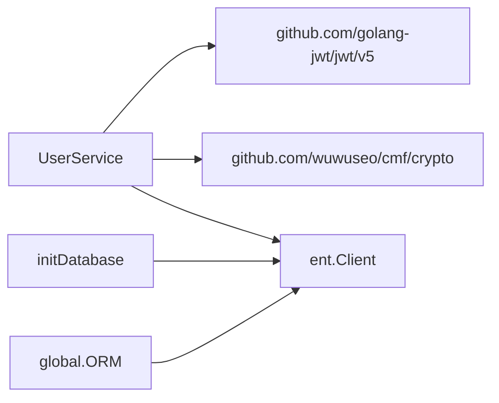

# 密码安全机制

<cite>
**本文引用的文件**
- [internal/service/user.go](file://internal/service/user.go)
- [internal/ent/schema/user.go](file://internal/ent/schema/user.go)
- [config/config.yml](file://config/config.yml)
- [internal/init.go](file://internal/init.go)
- [internal/global/global.go](file://internal/global/global.go)
- [go.mod](file://go.mod)
- [docs/docs.go](file://docs/docs.go)
- [docs/swagger.json](file://docs/swagger.json)
</cite>

## 目录
1. [引言](#引言)
2. [项目结构](#项目结构)
3. [核心组件](#核心组件)
4. [架构总览](#架构总览)
5. [详细组件分析](#详细组件分析)
6. [依赖分析](#依赖分析)
7. [性能考虑](#性能考虑)
8. [故障排查指南](#故障排查指南)
9. [结论](#结论)
10. [附录](#附录)

## 引言
本技术文档聚焦于系统中的密码安全机制，围绕密码加密算法选择与实现、盐值生成与存储、密码验证流程、密码修改与重置（含安全令牌）、数据库字段设计、性能优化与最佳实践展开。文档基于仓库中实际实现进行分析，并提供可操作的改进建议与合规性指引。

## 项目结构
密码相关能力主要分布在以下模块：
- 服务层：用户服务负责注册、登录、刷新令牌、修改密码等流程
- 数据模型：Ent Schema 定义用户表结构及敏感字段标注
- 配置：应用密钥、登录过期时间等参数
- 初始化：ORM 初始化与全局对象注入
- 文档：Swagger 对外暴露的登录与令牌响应结构定义

图表来源
- [internal/service/user.go:1-394](file://internal/service/user.go#L1-L394)
- [internal/ent/schema/user.go:1-104](file://internal/ent/schema/user.go#L1-L104)
- [config/config.yml:1-143](file://config/config.yml#L1-L143)
- [internal/init.go:1-66](file://internal/init.go#L1-L66)
- [go.mod:1-120](file://go.mod#L1-L120)

章节来源
- [internal/service/user.go:1-394](file://internal/service/user.go#L1-L394)
- [internal/ent/schema/user.go:1-104](file://internal/ent/schema/user.go#L1-L104)
- [config/config.yml:1-143](file://config/config.yml#L1-L143)
- [internal/init.go:1-66](file://internal/init.go#L1-L66)
- [go.mod:1-120](file://go.mod#L1-L120)

## 核心组件
- 密码加密与校验：通过密码工具包对明文密码进行加盐哈希处理，并在登录与修改密码时进行匹配验证
- 令牌签发与刷新：使用对称签名算法签发访问令牌与刷新令牌，支持刷新令牌换取新的访问令牌
- 数据持久化：用户实体包含密码哈希与盐值字段，均标记为敏感信息
- 配置驱动：应用密钥、登录过期时间等由配置文件提供

章节来源
- [internal/service/user.go:82-125](file://internal/service/user.go#L82-L125)
- [internal/service/user.go:127-206](file://internal/service/user.go#L127-L206)
- [internal/service/user.go:274-356](file://internal/service/user.go#L274-L356)
- [internal/service/user.go:358-393](file://internal/service/user.go#L358-L393)
- [internal/ent/schema/user.go:34-59](file://internal/ent/schema/user.go#L34-L59)
- [config/config.yml:8-9](file://config/config.yml#L8-L9)

## 架构总览
下图展示密码相关的关键交互：注册时生成盐值与哈希并入库；登录时读取用户记录并验证；刷新令牌时解析并签发新访问令牌；修改密码时先验证旧密码再更新新哈希与盐值。

图表来源
- [internal/service/user.go:82-125](file://internal/service/user.go#L82-L125)
- [internal/service/user.go:127-206](file://internal/service/user.go#L127-L206)
- [internal/service/user.go:274-356](file://internal/service/user.go#L274-L356)
- [internal/service/user.go:358-393](file://internal/service/user.go#L358-L393)

## 详细组件分析

### 密码加密与盐值生成
- 实现方式
  - 注册时调用密码工具包生成“密码哈希”和“盐值”，并将两者分别存入用户记录
  - 登录与修改密码时均使用“明文密码 + 存储的盐值”进行验证
- 字段设计
  - 密码字段与盐值字段均为敏感字段，长度限制合理，满足安全与性能平衡
- 迭代次数
  - 当前实现未显式暴露迭代次数配置项；如需调整，请在密码工具包层面增加配置入口并在服务层传递

图表来源
- [internal/service/user.go:107-111](file://internal/service/user.go#L107-L111)
- [internal/ent/schema/user.go:34-59](file://internal/ent/schema/user.go#L34-L59)

章节来源
- [internal/service/user.go:82-125](file://internal/service/user.go#L82-L125)
- [internal/ent/schema/user.go:34-59](file://internal/ent/schema/user.go#L34-L59)

### 密码存储策略与数据库字段设计
- 字段定义
  - 密码字段：最大长度限制、非空、敏感标注
  - 盐值字段：最大长度限制、敏感标注、可选（兼容历史数据）
- 索引与约束
  - 邮箱、电话、用户名建立索引，便于查询与去重
  - 邮箱唯一约束，避免重复注册
- 敏感信息保护
  - 密码与盐值字段均标记为敏感，降低日志与序列化泄露风险

图表来源
- [internal/ent/schema/user.go:24-80](file://internal/ent/schema/user.go#L24-L80)

章节来源
- [internal/ent/schema/user.go:24-80](file://internal/ent/schema/user.go#L24-L80)

### 密码验证流程
- 登录验证
  - 依据邮箱查询用户，若不存在则返回“用户不存在”
  - 校验用户状态为“激活”，否则返回“用户状态无效”
  - 使用“明文密码 + 存储盐值”进行哈希比对，失败则返回“无效密码”
  - 成功后签发访问令牌与刷新令牌，并更新最后登录时间
- 刷新令牌
  - 解析并验证刷新令牌签名与类型
  - 根据声明中的用户ID查询用户并校验状态
  - 成功后签发新的访问令牌

图表来源
- [internal/service/user.go:127-206](file://internal/service/user.go#L127-L206)

章节来源
- [internal/service/user.go:127-206](file://internal/service/user.go#L127-L206)

### 密码修改机制
- 旧密码验证
  - 读取用户记录，使用“旧明文密码 + 存储盐值”进行验证
  - 验证失败则拒绝修改
- 新密码处理
  - 生成新哈希与新盐值，更新用户记录
- 安全要点
  - 修改前后均应进行强校验与错误处理
  - 建议在修改密码后使旧令牌失效（如引入令牌黑名单）

图表来源
- [internal/service/user.go:358-393](file://internal/service/user.go#L358-L393)

章节来源
- [internal/service/user.go:358-393](file://internal/service/user.go#L358-L393)

### 密码重置与安全令牌机制
- 当前实现
  - 代码库未发现显式的“密码重置”接口与“安全令牌”发放/验证逻辑
- 建议方案
  - 发放策略：生成一次性、带过期时间的重置令牌（建议短有效期），绑定邮箱或用户ID
  - 校验策略：重置接口仅接受有效且未使用的令牌，校验通过后允许设置新密码
  - 安全措施：令牌发送采用安全通道（如邮件），防止中间人截获；令牌一旦使用即作废
  - 与现有登录流程对比：重置流程不依赖旧密码，但同样需要强校验与日志审计

章节来源
- [internal/service/user.go:127-206](file://internal/service/user.go#L127-L206)

### 密码强度与合规性
- 强度规则（建议）
  - 长度：至少8位，推荐≥12位
  - 复杂度：大小写字母、数字、特殊字符组合
  - 风险规避：避免常见弱口令、键盘序、生日、连续字符
- 合规要求（建议）
  - 符合行业标准（如等级保护、ISO 27001）对身份鉴别与访问控制的要求
  - 记录登录与密码变更审计事件，保留足够日志以便追溯
  - 定期轮换密钥与令牌，限制令牌有效期

章节来源
- [config/config.yml:8-9](file://config/config.yml#L8-L9)

## 依赖分析
- 外部库
  - JWT：用于签发与解析访问令牌与刷新令牌
  - 密码工具包：提供密码哈希与校验能力
- 内部依赖
  - UserService 依赖 Ent ORM 进行用户查询与更新
  - 初始化阶段完成 ORM 客户端创建与全局注入

图表来源
- [go.mod:10-12](file://go.mod#L10-L12)
- [internal/service/user.go:36-44](file://internal/service/user.go#L36-L44)
- [internal/init.go:33-47](file://internal/init.go#L33-L47)
- [internal/global/global.go:10-14](file://internal/global/global.go#L10-L14)

章节来源
- [go.mod:10-12](file://go.mod#L10-L12)
- [internal/service/user.go:36-44](file://internal/service/user.go#L36-L44)
- [internal/init.go:33-47](file://internal/init.go#L33-L47)
- [internal/global/global.go:10-14](file://internal/global/global.go#L10-L14)

## 性能考虑
- 哈希成本
  - 若未来引入更高成本的哈希算法（如 PBKDF2、scrypt、Argon2），建议通过配置项控制迭代次数与内存成本
- 查询优化
  - 登录与修改密码均基于邮箱或用户ID查询，确保对应索引已建立
- 令牌签发
  - 令牌签发为纯内存计算，开销极低；注意避免频繁签发导致的令牌膨胀
- 缓存策略
  - 可考虑缓存热点用户信息（如最近活跃用户）以减少数据库压力（需配合失效策略）

章节来源
- [internal/ent/schema/user.go:91-97](file://internal/ent/schema/user.go#L91-L97)
- [config/config.yml:8-9](file://config/config.yml#L8-L9)

## 故障排查指南
- 常见错误
  - 用户不存在：登录时邮箱不正确或未注册
  - 用户状态无效：账户未激活或被冻结
  - 无效密码：旧密码错误或盐值不匹配
  - 令牌无效：刷新令牌签名不正确或类型不符
- 排查步骤
  - 确认配置中的应用密钥一致
  - 检查用户状态与最后登录时间是否异常
  - 核对密码哈希与盐值是否正确写入
  - 验证刷新令牌是否过期或被篡改
- 日志与监控
  - 建议记录登录、修改密码、刷新令牌等关键事件，便于追踪与审计

章节来源
- [internal/service/user.go:134-152](file://internal/service/user.go#L134-L152)
- [internal/service/user.go:279-307](file://internal/service/user.go#L279-L307)
- [internal/service/user.go:371-378](file://internal/service/user.go#L371-L378)

## 结论
当前实现提供了基础而稳健的密码安全能力：注册时对密码进行加盐哈希存储，登录与修改密码时使用盐值进行验证，结合JWT实现短期访问令牌与长期刷新令牌。建议后续完善密码重置流程与安全令牌机制，并在配置层引入哈希成本与迭代次数的可控参数，以进一步提升安全性与可维护性。

## 附录
- 对外接口定义参考
  - 登录请求与令牌响应结构在 Swagger 中有定义，便于前端对接与测试

章节来源
- [docs/docs.go:180-205](file://docs/docs.go#L180-L205)
- [docs/swagger.json:174-203](file://docs/swagger.json#L174-L203)