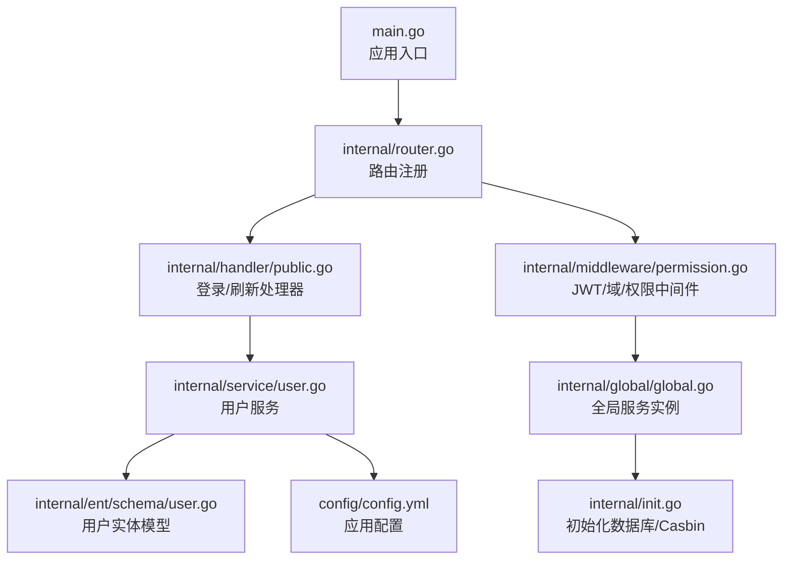
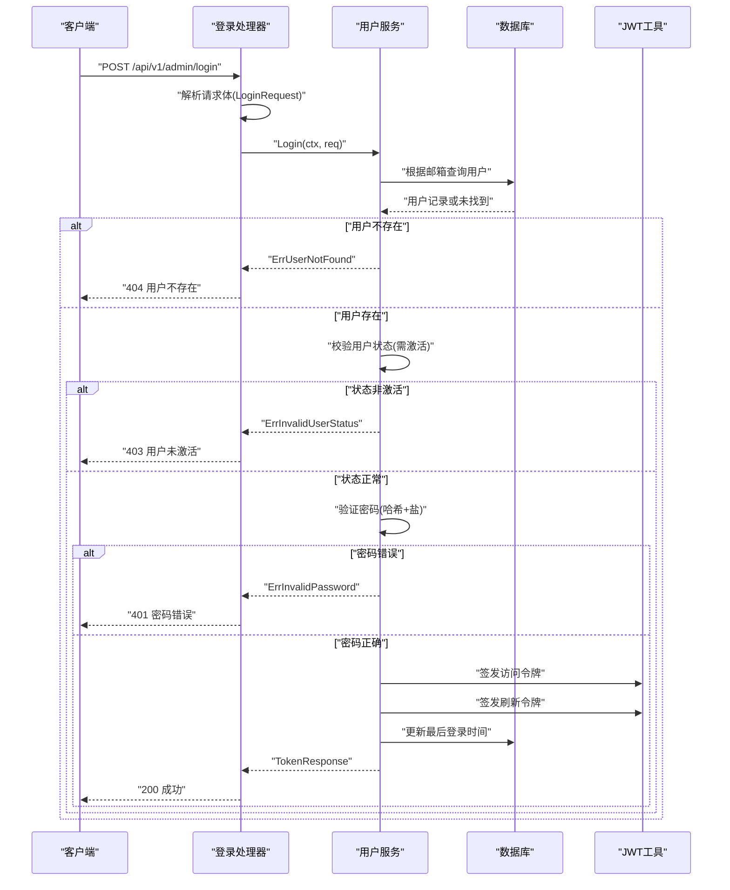
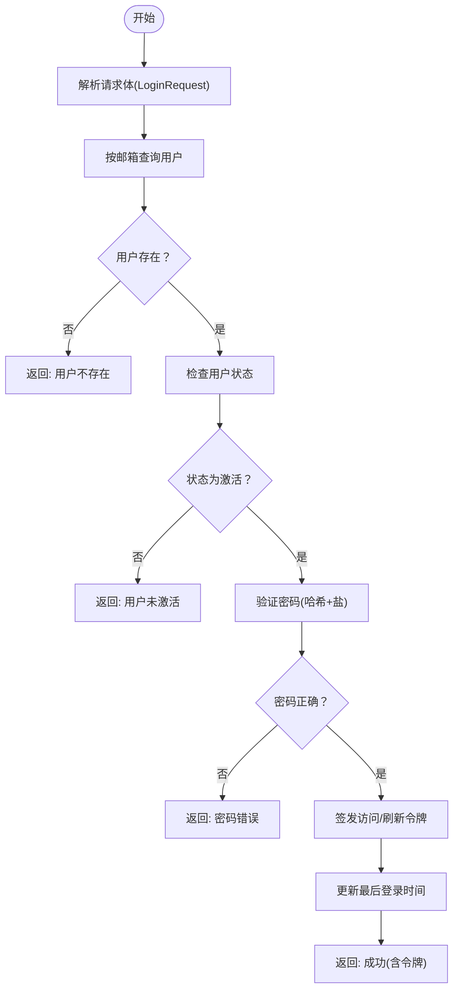
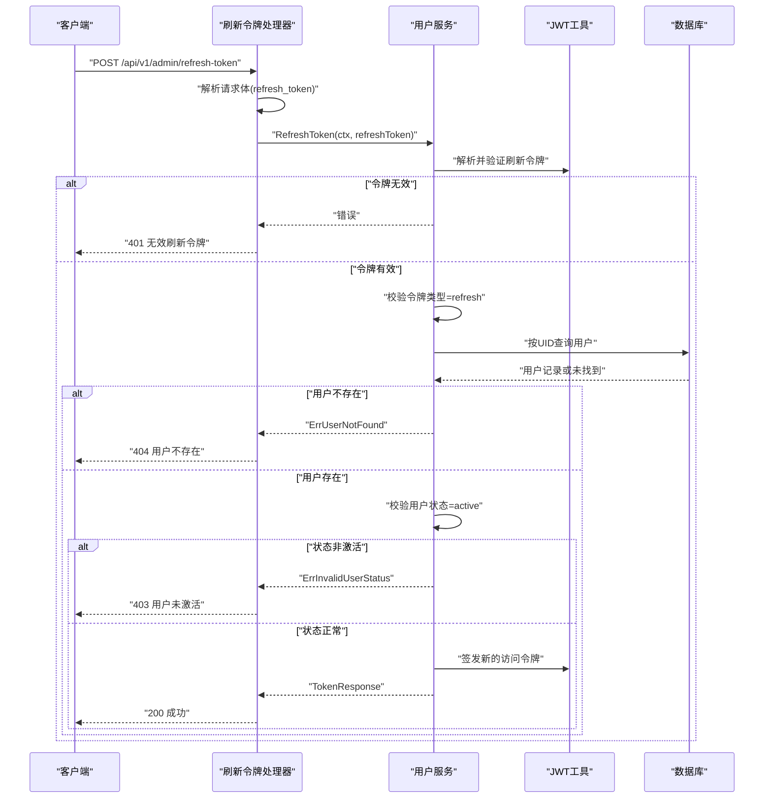
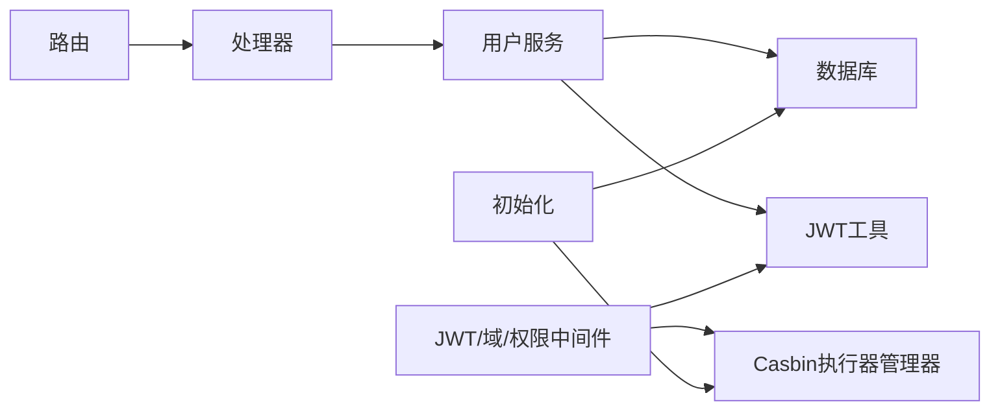
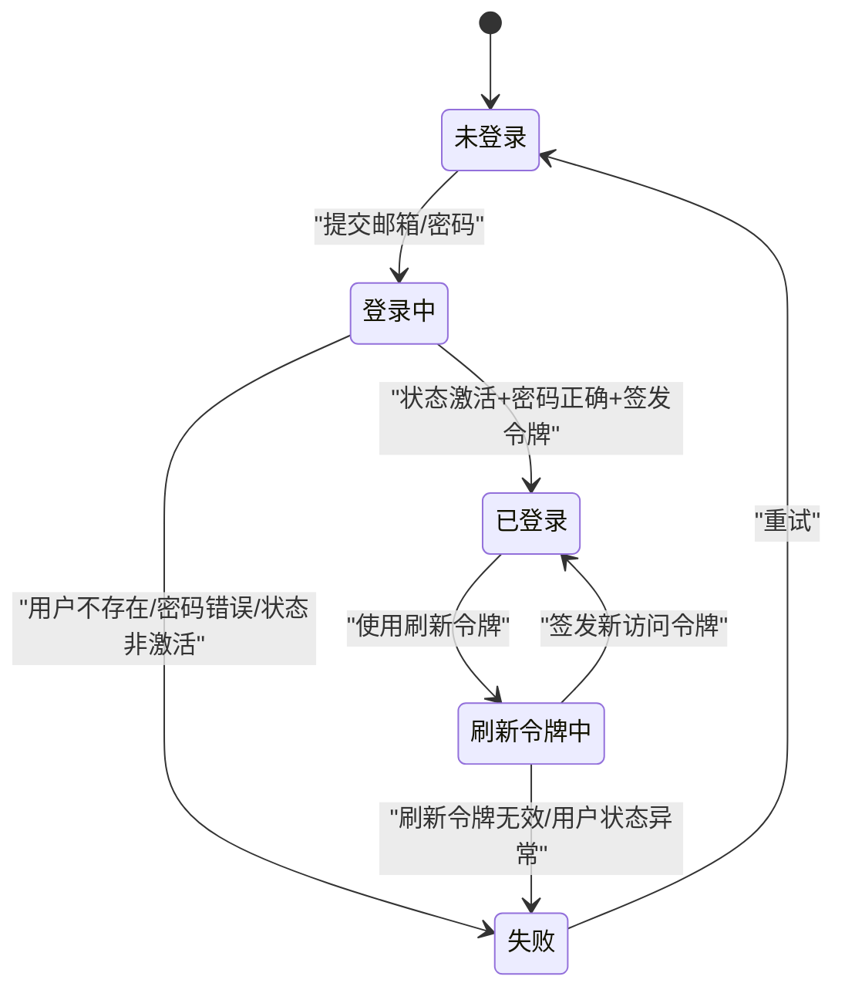

# 用户认证流程

<cite>
**本文档引用的文件**
- [main.go](file://main.go)
- [router.go](file://internal/router.go)
- [user.go](file://internal/service/user.go)
- [public.go](file://internal/handler/public.go)
- [permission.go](file://internal/middleware/permission.go)
- [user.go](file://internal/ent/schema/user.go)
- [config.yml](file://config/config.yml)
- [response.go](file://internal/utils/response.go)
- [msg.go](file://internal/global/msg.go)
- [init.go](file://internal/init.go)
- [global.go](file://internal/global/global.go)
</cite>

## 目录
1. [简介](#简介)
2. [项目结构](#项目结构)
3. [核心组件](#核心组件)
4. [架构总览](#架构总览)
5. [详细组件分析](#详细组件分析)
6. [依赖关系分析](#依赖关系分析)
7. [性能考虑](#性能考虑)
8. [故障排除指南](#故障排除指南)
9. [结论](#结论)
10. [附录](#附录)

## 简介
本文件面向开发者与运维人员，系统性梳理用户认证流程，覆盖从凭据提交到令牌发放的完整链路；解释凭据校验（邮箱/用户名）、密码比对、用户状态与激活验证；明确认证失败的错误处理与错误码；阐述用户信息过滤与敏感数据保护策略；并提供状态转换与时序图，以及账户锁定、多次失败等常见场景的处理建议。

## 项目结构
项目采用分层架构：入口应用负责引导与路由注册；路由层定义公开与受保护接口；处理器层承接HTTP请求并调用服务层；服务层完成业务逻辑与数据访问；中间件层负责鉴权与权限控制；实体层定义用户模型与字段约束；配置层提供运行参数与多域RBAC模型。

图表来源
- [main.go:43-89](file://main.go#L43-L89)
- [router.go:14-72](file://internal/router.go#L14-L72)
- [public.go:22-45](file://internal/handler/public.go#L22-L45)
- [permission.go:12-68](file://internal/middleware/permission.go#L12-L68)
- [user.go:127-206](file://internal/service/user.go#L127-L206)
- [user.go:17-79](file://internal/ent/schema/user.go#L17-L79)
- [config.yml:1-143](file://config/config.yml#L1-L143)
- [global.go:10-14](file://internal/global/global.go#L10-L14)
- [init.go:17-65](file://internal/init.go#L17-L65)

章节来源
- [main.go:43-89](file://main.go#L43-L89)
- [router.go:14-72](file://internal/router.go#L14-L72)

## 核心组件
- 路由与中间件
  - 公开接口：登录、刷新令牌
  - 受保护接口：用户信息、修改密码等，均通过JWT中间件与权限中间件保护
- 处理器
  - 登录处理器解析请求体，调用用户服务执行登录，按错误类型返回对应状态码
  - 刷新令牌处理器解析请求体，调用用户服务刷新访问令牌
- 服务层
  - 登录：查询用户、校验状态、验证密码、签发访问/刷新令牌、更新最后登录时间
  - 刷新：解析并验证刷新令牌、校验用户状态、签发新访问令牌
  - 密码修改：验证旧密码、加密新密码并更新
- 实体模型
  - 用户字段含邮箱、密码、用户名、状态、最后登录时间等，并对敏感字段标记
- 配置
  - 应用密钥、登录过期时间、刷新过期时间、日志、数据库、缓存、Redis、Casbin多域模型等

章节来源
- [router.go:28-39](file://internal/router.go#L28-L39)
- [public.go:22-45](file://internal/handler/public.go#L22-L45)
- [user.go:127-206](file://internal/service/user.go#L127-L206)
- [user.go:274-356](file://internal/service/user.go#L274-L356)
- [user.go:358-393](file://internal/service/user.go#L358-L393)
- [user.go:17-80](file://internal/ent/schema/user.go#L17-L80)
- [config.yml:1-143](file://config/config.yml#L1-L143)

## 架构总览
下图展示认证主流程：客户端发起登录请求，处理器解析参数，服务层执行校验与令牌签发，最终返回统一响应结构。

图表来源
- [public.go:22-45](file://internal/handler/public.go#L22-L45)
- [user.go:127-206](file://internal/service/user.go#L127-L206)

## 详细组件分析

### 登录流程（含凭据校验、状态检查、令牌发放）
- 输入参数
  - 邮箱与密码（邮箱格式校验由实体模型约束）
- 核心步骤
  - 查询用户：按邮箱精确匹配
  - 用户状态检查：仅激活状态允许登录
  - 密码验证：使用哈希+盐进行比对
  - 令牌签发：生成访问令牌与刷新令牌，设置过期时间
  - 最后登录时间更新
- 错误处理
  - 用户不存在：返回未找到
  - 密码错误：返回未授权
  - 用户状态非激活：返回拒绝访问
  - 其他异常：返回内部错误
- 响应结构
  - 统一响应包装，包含状态码、消息与数据

图表来源
- [public.go:22-45](file://internal/handler/public.go#L22-L45)
- [user.go:127-206](file://internal/service/user.go#L127-L206)

章节来源
- [public.go:22-45](file://internal/handler/public.go#L22-L45)
- [user.go:127-206](file://internal/service/user.go#L127-L206)
- [user.go:17-80](file://internal/ent/schema/user.go#L17-L80)
- [response.go:9-49](file://internal/utils/response.go#L9-L49)
- [msg.go:4-45](file://internal/global/msg.go#L4-L45)

### 刷新令牌流程
- 输入参数
  - 刷新令牌字符串
- 核心步骤
  - 解析并验证刷新令牌签名与有效性
  - 校验令牌类型为“refresh”
  - 提取用户ID并查询用户
  - 校验用户状态为激活
  - 重新签发新的访问令牌
- 错误处理
  - 令牌无效/过期：返回未授权
  - 用户不存在/状态异常：返回未找到或拒绝访问
  - 其他异常：返回内部错误

图表来源
- [public.go:158-179](file://internal/handler/public.go#L158-L179)
- [user.go:274-356](file://internal/service/user.go#L274-L356)

章节来源
- [public.go:158-179](file://internal/handler/public.go#L158-L179)
- [user.go:274-356](file://internal/service/user.go#L274-L356)

### 用户状态与激活验证
- 用户状态枚举：active、inactive、suspended
- 登录前必须为active；刷新令牌同样要求active
- 注册默认状态为inactive，需后续激活流程（本仓库未提供具体激活接口）

章节来源
- [user.go:69-72](file://internal/ent/schema/user.go#L69-L72)
- [user.go:140-143](file://internal/service/user.go#L140-L143)
- [user.go:326-329](file://internal/service/user.go#L326-L329)

### 凭据验证机制
- 邮箱/用户名
  - 邮箱：实体模型限制唯一、长度与正则匹配
  - 用户名：可选，唯一性校验
- 密码
  - 存储采用哈希+盐；登录与修改密码均使用相同验证流程

章节来源
- [user.go:29-38](file://internal/ent/schema/user.go#L29-L38)
- [user.go:43-46](file://internal/ent/schema/user.go#L43-L46)
- [user.go:145-152](file://internal/service/user.go#L145-L152)
- [user.go:371-378](file://internal/service/user.go#L371-L378)

### 认证失败的错误处理与错误码
- 处理器侧按错误类型映射HTTP状态码与消息
- 统一响应结构包含状态码、消息与数据
- 错误码定义参考全局常量与消息映射

章节来源
- [public.go:32-41](file://internal/handler/public.go#L32-L41)
- [public.go:174-176](file://internal/handler/public.go#L174-L176)
- [response.go:9-49](file://internal/utils/response.go#L9-L49)
- [msg.go:4-45](file://internal/global/msg.go#L4-L45)

### 用户信息过滤与敏感数据保护
- 敏感字段标记：密码、盐值等字段在实体模型中标记为敏感
- 响应过滤：处理器在返回用户信息时仅包含必要字段，避免泄露敏感数据
- 令牌安全：JWT使用应用密钥签名，访问令牌与刷新令牌区分用途与有效期

章节来源
- [user.go:36-58](file://internal/ent/schema/user.go#L36-L58)
- [public.go:69-80](file://internal/handler/public.go#L69-L80)
- [user.go:154-205](file://internal/service/user.go#L154-L205)
- [user.go:331-355](file://internal/service/user.go#L331-L355)

### 权限控制与域隔离
- JWT中间件：从Authorization头解析并验证令牌
- 域中间件：从JWT提取域信息，作为权限检查上下文
- 权限中间件：基于Casbin执行器进行策略匹配（sub, dom, obj, act）
- 多域支持：配置文件支持默认域与多域模型

章节来源
- [router.go:32-37](file://internal/router.go#L32-L37)
- [permission.go:12-68](file://internal/middleware/permission.go#L12-L68)
- [config.yml:77-143](file://config/config.yml#L77-L143)

## 依赖关系分析
- 组件耦合
  - 路由依赖处理器与服务；处理器依赖服务；服务依赖ORM与JWT工具
  - 中间件依赖JWT工具与全局Casbin执行器管理器
- 外部依赖
  - 数据库驱动、Redis缓存、Casbin策略存储（Ent适配器）
- 初始化流程
  - 应用启动时初始化数据库与Casbin执行器管理器

图表来源
- [router.go:14-72](file://internal/router.go#L14-L72)
- [permission.go:12-68](file://internal/middleware/permission.go#L12-L68)
- [init.go:17-65](file://internal/init.go#L17-L65)
- [global.go:10-14](file://internal/global/global.go#L10-L14)

章节来源
- [router.go:14-72](file://internal/router.go#L14-L72)
- [permission.go:12-68](file://internal/middleware/permission.go#L12-L68)
- [init.go:17-65](file://internal/init.go#L17-L65)
- [global.go:10-14](file://internal/global/global.go#L10-L14)

## 性能考虑
- 令牌有效期
  - 登录令牌与刷新令牌分别配置过期时间，建议结合业务场景调整
- 缓存与连接池
  - Redis与内存缓存配置可用于热点数据加速
- 并发与超时
  - 应用层具备空闲超时等配置项，建议结合压测结果优化

章节来源
- [config.yml:9-10](file://config/config.yml#L9-L10)
- [config.yml:35-40](file://config/config.yml#L35-L40)
- [config.yml:53-58](file://config/config.yml#L53-L58)

## 故障排除指南
- 常见错误与定位
  - 404 用户不存在：确认邮箱是否正确、用户是否已创建
  - 401 密码错误：检查密码输入、确认哈希算法一致
  - 403 用户未激活：检查用户状态字段、确认激活流程
  - 401 无效刷新令牌：检查令牌签名、类型与过期时间
- 日志与监控
  - 应用日志输出至文件与控制台，便于排查
- 响应结构
  - 统一响应便于前端处理与调试

章节来源
- [public.go:32-41](file://internal/handler/public.go#L32-L41)
- [public.go:174-176](file://internal/handler/public.go#L174-L176)
- [config.yml:11-18](file://config/config.yml#L11-L18)

## 结论
本认证体系以JWT为核心，结合实体模型约束、服务层校验与中间件权限控制，形成从登录到权限的完整闭环。通过统一响应与错误码映射，提升了可观测性与可维护性。建议在生产环境完善账户锁定、防暴力破解与激活流程，并持续优化令牌有效期与缓存策略。

## 附录

### 认证流程状态转换图

图表来源
- [user.go:127-206](file://internal/service/user.go#L127-L206)
- [user.go:274-356](file://internal/service/user.go#L274-L356)

### API定义与错误码
- 登录
  - 方法与路径：POST /api/v1/admin/login
  - 请求体：邮箱、密码
  - 成功：200，返回访问令牌、刷新令牌与过期时间
  - 失败：404（用户不存在）、401（密码错误）、403（用户未激活）、500（内部错误）
- 刷新令牌
  - 方法与路径：POST /api/v1/admin/refresh-token
  - 请求体：刷新令牌
  - 成功：200，返回新的访问令牌
  - 失败：401（无效刷新令牌）、404（用户不存在）、403（用户未激活）、500（内部错误）

章节来源
- [router.go:28-29](file://internal/router.go#L28-L29)
- [public.go:22-45](file://internal/handler/public.go#L22-L45)
- [public.go:158-179](file://internal/handler/public.go#L158-L179)
- [msg.go:4-45](file://internal/global/msg.go#L4-L45)