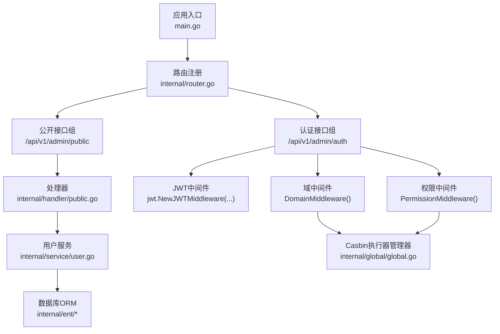
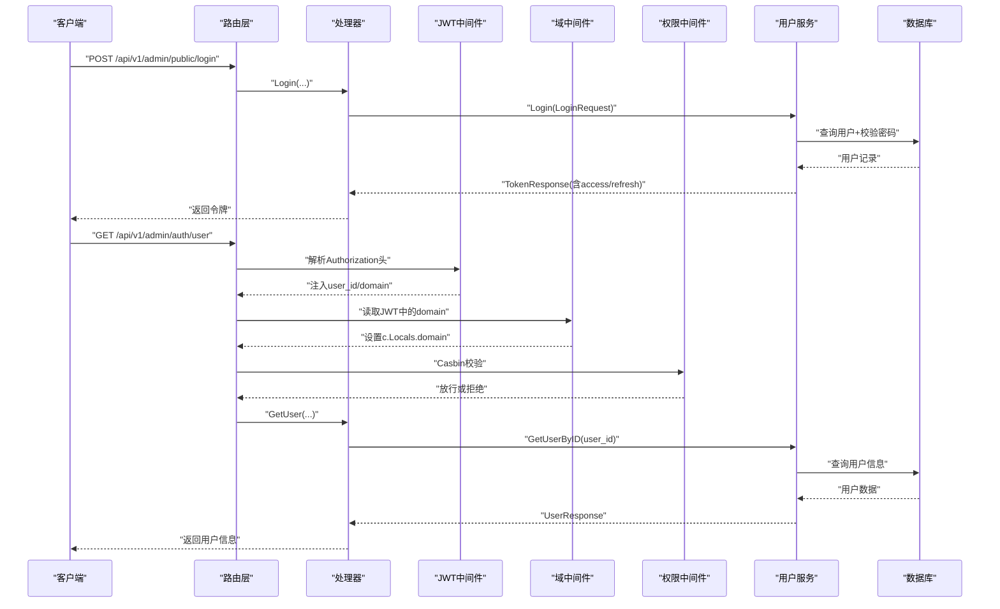
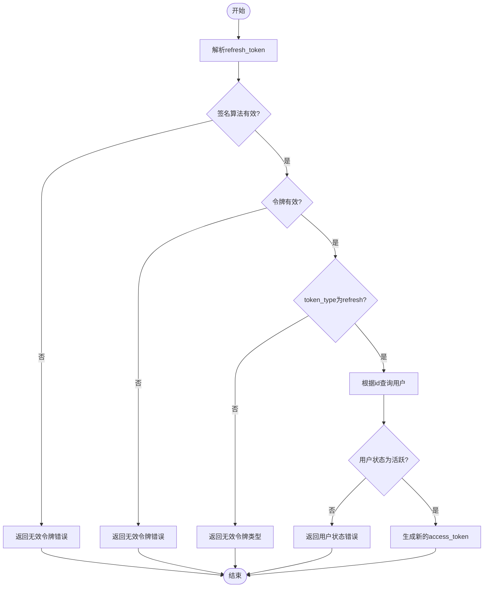
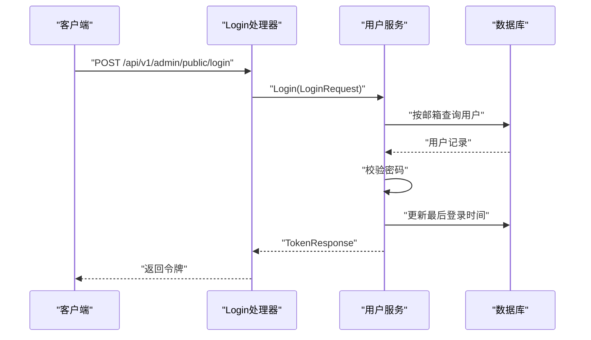
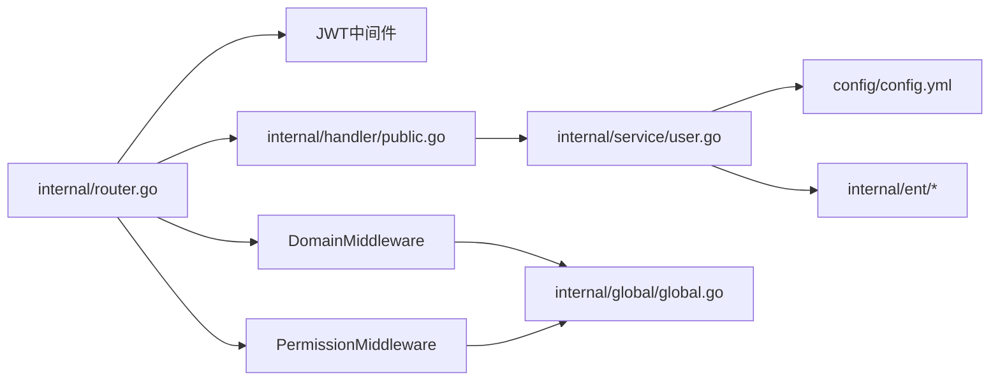

# 认证系统

<cite>
**本文引用的文件**
- [main.go](file://main.go)
- [internal/router.go](file://internal/router.go)
- [internal/init.go](file://internal/init.go)
- [internal/global/global.go](file://internal/global/global.go)
- [internal/global/msg.go](file://internal/global/msg.go)
- [internal/service/user.go](file://internal/service/user.go)
- [internal/handler/public.go](file://internal/handler/public.go)
- [internal/middleware/permission.go](file://internal/middleware/permission.go)
- [config/config.yml](file://config/config.yml)
</cite>

## 目录
1. [简介](#简介)
2. [项目结构](#项目结构)
3. [核心组件](#核心组件)
4. [架构总览](#架构总览)
5. [详细组件分析](#详细组件分析)
6. [依赖关系分析](#依赖关系分析)
7. [性能考量](#性能考量)
8. [故障排查指南](#故障排查指南)
9. [结论](#结论)
10. [附录](#附录)

## 简介
本文件面向Go Admin管理系统中的认证与授权体系，聚焦以下目标：
- 深入解释基于JWT的认证机制，覆盖令牌生成、验证与刷新流程
- 描述用户登录流程：从凭据校验到令牌发放的完整链路
- 说明密码加密与安全存储机制
- 解释JWT中间件工作原理：令牌提取、解析与用户信息注入
- 说明刷新令牌机制与安全策略
- 提供认证相关API接口文档与使用示例
- 给出常见认证场景处理方案与安全最佳实践
- 解释多域（多租户）权限模型与会话管理策略

## 项目结构
认证系统围绕“路由 -> 处理器 -> 服务层 -> 数据库”展开，配合JWT中间件与Casbin权限引擎实现细粒度的API权限控制。

图表来源
- [main.go:43-89](file://main.go#L43-L89)
- [internal/router.go:14-72](file://internal/router.go#L14-L72)
- [internal/handler/public.go:13-45](file://internal/handler/public.go#L13-L45)
- [internal/service/user.go:127-206](file://internal/service/user.go#L127-L206)
- [internal/middleware/permission.go:11-68](file://internal/middleware/permission.go#L11-L68)
- [internal/global/global.go:10-14](file://internal/global/global.go#L10-L14)

章节来源
- [main.go:43-89](file://main.go#L43-L89)
- [internal/router.go:14-72](file://internal/router.go#L14-L72)

## 核心组件
- 应用入口与中间件挂载：负责静态资源、SPA回退、以及统一中间件注册
- 路由与分组：公开接口（登录/刷新）与认证接口（受JWT/Casbin保护）
- JWT中间件：从HTTP头提取并解析JWT，注入用户ID与域信息
- 权限中间件：基于Casbin执行器按域进行RBAC校验
- 用户服务：登录、刷新令牌、密码变更、用户信息查询
- 配置：应用密钥、令牌过期时间、多域权限模型等

章节来源
- [internal/router.go:14-72](file://internal/router.go#L14-L72)
- [internal/middleware/permission.go:11-68](file://internal/middleware/permission.go#L11-L68)
- [internal/service/user.go:27-44](file://internal/service/user.go#L27-L44)
- [config/config.yml:1-143](file://config/config.yml#L1-L143)

## 架构总览
下图展示认证与授权的整体交互：客户端通过公开接口登录获取令牌；后续请求携带令牌进入JWT中间件，解析出用户ID与域；再经域中间件与权限中间件完成权限校验；最终到达业务处理器。

图表来源
- [internal/router.go:22-40](file://internal/router.go#L22-L40)
- [internal/handler/public.go:13-45](file://internal/handler/public.go#L13-L45)
- [internal/service/user.go:127-206](file://internal/service/user.go#L127-L206)
- [internal/middleware/permission.go:11-68](file://internal/middleware/permission.go#L11-L68)

## 详细组件分析

### JWT认证机制与令牌生命周期
- 令牌类型
  - 访问令牌（Access Token）：短期有效，用于日常API访问
  - 刷新令牌（Refresh Token）：长期有效，用于换取新的访问令牌
- 令牌生成
  - 访问令牌与刷新令牌均采用HMAC签名，使用配置中的密钥
  - 访问令牌过期时间来自配置项，刷新令牌过期时间另行配置
- 令牌验证
  - 解析阶段：验证签名算法与密钥
  - 有效性：检查令牌未过期、声明结构正确
  - 类型校验：区分access/refresh两类令牌
- 令牌刷新
  - 使用refresh_token解析出用户ID与域
  - 校验用户状态为活跃
  - 生成新的访问令牌，保留或复用刷新令牌

图表来源
- [internal/service/user.go:274-356](file://internal/service/user.go#L274-L356)

章节来源
- [internal/service/user.go:153-206](file://internal/service/user.go#L153-L206)
- [internal/service/user.go:274-356](file://internal/service/user.go#L274-L356)
- [config/config.yml:8-10](file://config/config.yml#L8-L10)

### 用户登录流程
- 请求到达公开接口：POST /api/v1/admin/public/login
- 处理器解析请求体，调用用户服务进行登录
- 服务层查询用户并校验密码
- 生成访问令牌与刷新令牌，更新用户最后登录时间
- 返回TokenResponse给客户端

图表来源
- [internal/handler/public.go:13-45](file://internal/handler/public.go#L13-L45)
- [internal/service/user.go:127-206](file://internal/service/user.go#L127-L206)

章节来源
- [internal/handler/public.go:13-45](file://internal/handler/public.go#L13-L45)
- [internal/service/user.go:127-206](file://internal/service/user.go#L127-L206)

### 密码加密与安全存储
- 存储策略
  - 密码采用带盐哈希存储，盐值与哈希值分别保存
- 校验流程
  - 登录时使用输入密码与存储的盐值进行哈希比对
- 变更流程
  - 修改密码前先验证旧密码，通过后再进行新密码的哈希与盐值更新

章节来源
- [internal/service/user.go:82-125](file://internal/service/user.go#L82-L125)
- [internal/service/user.go:358-393](file://internal/service/user.go#L358-L393)

### JWT中间件与用户信息注入
- 令牌提取
  - 从Authorization头解析Bearer令牌
- 令牌解析
  - 验证签名算法与密钥，解析MapClaims
- 用户信息注入
  - 将用户ID、域等信息注入到上下文locals，供后续中间件与处理器使用

章节来源
- [internal/router.go:32-37](file://internal/router.go#L32-L37)
- [internal/middleware/permission.go:55-68](file://internal/middleware/permission.go#L55-L68)

### 权限中间件与多域策略
- 域中间件
  - 从JWT中读取域信息并注入到locals
- 权限中间件
  - 从locals读取user_id与domain
  - 通过全局的Casbin执行器管理器按域获取对应enforcer
  - 使用enforcer.Enforce进行权限校验（主体、域、对象、动作）

章节来源
- [internal/middleware/permission.go:11-68](file://internal/middleware/permission.go#L11-L68)
- [internal/global/global.go:10-14](file://internal/global/global.go#L10-L14)

### 刷新令牌机制与安全策略
- 令牌刷新接口：POST /api/v1/admin/public/refresh-token
- 安全要点
  - 仅允许token_type为refresh的令牌参与刷新
  - 刷新前校验用户状态为活跃
  - 成功后返回新的access_token，可选择复用原refresh_token
- 建议
  - 在生产环境为refresh_token增加额外的安全措施（如绑定设备指纹、IP白名单、滑动窗口等），当前仓库未实现这些扩展

章节来源
- [internal/handler/public.go:149-179](file://internal/handler/public.go#L149-L179)
- [internal/service/user.go:274-356](file://internal/service/user.go#L274-L356)

### 认证相关API接口文档
- 登录
  - 方法：POST
  - 路径：/api/v1/admin/public/login
  - 请求体：LoginRequest（邮箱、密码）
  - 响应：TokenResponse（access_token、token_type、expires_in、refresh_token）
- 刷新令牌
  - 方法：POST
  - 路径：/api/v1/admin/public/refresh-token
  - 请求体：{ refresh_token: string }
  - 响应：TokenResponse（新的access_token）
- 获取当前用户信息
  - 方法：GET
  - 路径：/api/v1/admin/auth/user
  - 安全：Bearer Token
  - 响应：UserResponse（过滤后的用户信息）
- 更新用户信息
  - 方法：PUT
  - 路径：/api/v1/admin/auth/user
  - 安全：Bearer Token
  - 请求体：键值对（昵称、电话、头像、状态等）
- 修改密码
  - 方法：PUT
  - 路径：/api/v1/admin/auth/password
  - 安全：Bearer Token
  - 请求体：{ old_password, new_password }

章节来源
- [internal/handler/public.go:13-45](file://internal/handler/public.go#L13-L45)
- [internal/handler/public.go:149-179](file://internal/handler/public.go#L149-L179)
- [internal/router.go:28-40](file://internal/router.go#L28-L40)

### 常见认证场景与处理方案
- 场景一：访问令牌过期
  - 方案：前端轮询刷新接口，使用refresh_token换取新的access_token
- 场景二：用户被禁用
  - 方案：刷新时校验用户状态，若非活跃则拒绝刷新并提示用户状态异常
- 场景三：跨域/多域访问
  - 方案：JWT中携带domain，域中间件与权限中间件按域隔离执行器，确保权限模型隔离
- 场景四：并发刷新
  - 方案：建议在服务层引入幂等性设计（如基于refresh_token的去重表），避免并发重复发放

章节来源
- [internal/service/user.go:274-356](file://internal/service/user.go#L274-L356)
- [internal/middleware/permission.go:11-68](file://internal/middleware/permission.go#L11-L68)

### 安全最佳实践
- 密钥管理
  - 使用强随机密钥，定期轮换；避免硬编码在配置文件中
- 传输安全
  - 仅在HTTPS环境下传输令牌；启用HSTS
- 令牌存储
  - 前端避免将refresh_token持久化到localStorage；可考虑HttpOnly Cookie存储refresh_token
- 过期与刷新
  - 缩短access_token过期时间，合理延长refresh_token过期时间
  - 引入刷新令牌吊销与黑名单机制（建议扩展）
- 日志与监控
  - 记录认证事件与异常，但避免泄露敏感信息

## 依赖关系分析
- 路由层依赖JWT中间件、域中间件、权限中间件与处理器
- 处理器依赖用户服务
- 用户服务依赖数据库ORM与配置
- 权限中间件依赖全局Casbin执行器管理器

图表来源
- [internal/router.go:14-72](file://internal/router.go#L14-L72)
- [internal/handler/public.go:13-45](file://internal/handler/public.go#L13-L45)
- [internal/service/user.go:127-206](file://internal/service/user.go#L127-L206)
- [internal/middleware/permission.go:11-68](file://internal/middleware/permission.go#L11-L68)
- [internal/global/global.go:10-14](file://internal/global/global.go#L10-L14)
- [config/config.yml:1-143](file://config/config.yml#L1-143)

章节来源
- [internal/router.go:14-72](file://internal/router.go#L14-L72)
- [internal/service/user.go:127-206](file://internal/service/user.go#L127-L206)
- [internal/middleware/permission.go:11-68](file://internal/middleware/permission.go#L11-L68)
- [internal/global/global.go:10-14](file://internal/global/global.go#L10-L14)
- [config/config.yml:1-143](file://config/config.yml#L1-143)

## 性能考量
- 中间件链路短、无阻塞I/O：JWT解析与Casbin校验均为内存计算
- 建议
  - 对高频域启用自动加载，减少首次加载开销
  - 对refresh_token刷新接口增加缓存与限流，防止滥用

## 故障排查指南
- 未授权访问
  - 检查Authorization头是否正确携带Bearer Token
  - 确认JWT中间件已正确注入user_id与domain
- 缺少域信息
  - 确认JWT中包含domain字段，域中间件需能从JWT中读取
- 权限不足
  - 检查Casbin策略是否正确配置，确认当前域下的策略匹配
- 用户状态异常
  - 刷新令牌时若用户状态非活跃，将返回状态错误
- 响应码参考
  - 未授权：401，拒绝访问：403，资源不存在：404，内部错误：500

章节来源
- [internal/middleware/permission.go:11-68](file://internal/middleware/permission.go#L11-L68)
- [internal/global/msg.go:3-45](file://internal/global/msg.go#L3-L45)
- [internal/service/user.go:274-356](file://internal/service/user.go#L274-L356)

## 结论
本认证系统以JWT为核心，结合Casbin多域RBAC模型，提供了完整的登录、令牌刷新与权限控制能力。通过明确的中间件职责划分与清晰的路由组织，系统具备良好的可维护性与扩展性。建议在生产环境中进一步强化令牌安全（如绑定设备/IP、引入吊销机制）与日志审计能力。

## 附录
- 配置项说明（节选）
  - app.secret：JWT签名密钥
  - app.login_expires：访问令牌过期秒数
  - casbin.domains：多域权限模型配置

章节来源
- [config/config.yml:1-143](file://config/config.yml#L1-L143)