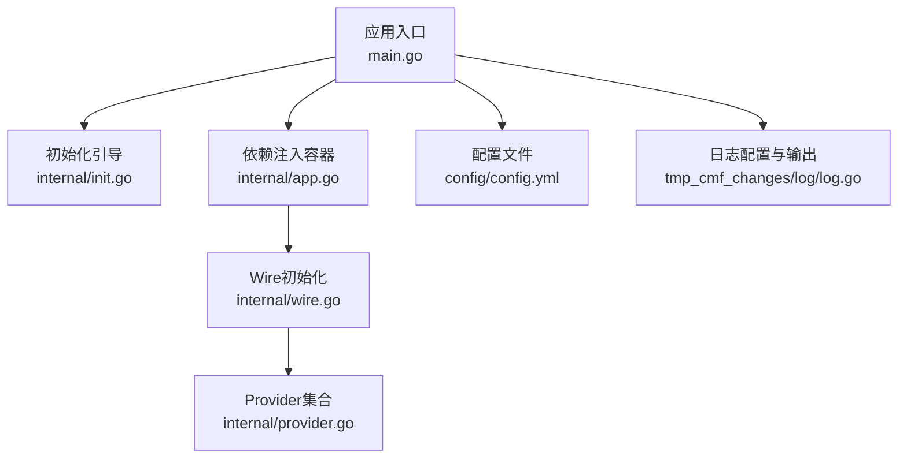
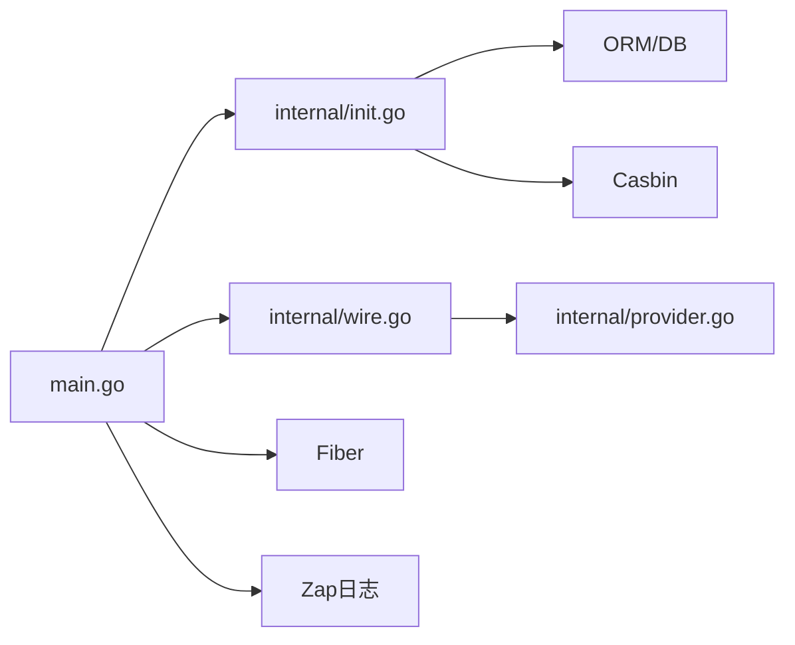

# 容器化部署

<cite>
**本文引用的文件**
- [main.go](file://main.go)
- [go.mod](file://go.mod)
- [config.yml](file://config/config.yml)
- [init.go](file://internal/init.go)
- [app.go](file://internal/app.go)
- [wire.go](file://internal/wire.go)
- [provider.go](file://internal/provider.go)
- [.gitignore](file://.gitignore)
- [log.go](file://tmp_cmf_changes/log/log.go)
</cite>

## 目录
1. [简介](#简介)
2. [项目结构](#项目结构)
3. [核心组件](#核心组件)
4. [架构总览](#架构总览)
5. [详细组件分析](#详细组件分析)
6. [依赖分析](#依赖分析)
7. [性能考虑](#性能考虑)
8. [故障排查指南](#故障排查指南)
9. [结论](#结论)
10. [附录](#附录)

## 简介
本文件面向Go Admin管理系统，提供从Dockerfile编写到Kubernetes部署的全栈容器化方案。内容覆盖：
- Dockerfile编写规范与多阶段构建优化
- 镜像大小优化、安全配置与运行时参数
- docker-compose编排与网络配置
- Kubernetes Deployment/Service/ConfigMap/Secret资源配置
- 健康检查、资源限制与滚动更新策略
- 日志管理与调试方法

## 项目结构
该系统基于Go语言与Fiber框架，采用Wire依赖注入，内置配置中心、ORM、缓存、文件系统与Casbin权限控制。前端静态资源通过embed嵌入，运行时由Fiber提供SPA路由支持。



**图表来源**
- [main.go:47-104](file://main.go#L47-L104)
- [init.go:31-67](file://internal/init.go#L31-L67)
- [app.go:15-26](file://internal/app.go#L15-L26)
- [wire.go:22-37](file://internal/wire.go#L22-L37)
- [provider.go:17-43](file://internal/provider.go#L17-L43)
- [config.yml:1-143](file://config/config.yml#L1-L143)
- [log.go:158-207](file://tmp_cmf_changes/log/log.go#L158-L207)

**章节来源**
- [main.go:47-104](file://main.go#L47-L104)
- [config.yml:1-143](file://config/config.yml#L1-L143)
- [init.go:31-67](file://internal/init.go#L31-L67)
- [app.go:15-26](file://internal/app.go#L15-L26)
- [wire.go:22-37](file://internal/wire.go#L22-L37)
- [provider.go:17-43](file://internal/provider.go#L17-L43)
- [log.go:158-207](file://tmp_cmf_changes/log/log.go#L158-L207)

## 核心组件
- 应用入口与引导：负责初始化依赖、注册中间件与路由、挂载SPA静态资源。
- 配置中心：集中管理应用、日志、数据库、缓存、Redis、文件系统与Casbin等配置。
- ORM与Casbin：通过Wire注入Ent客户端与Casbin适配器，自动迁移数据库Schema。
- 日志系统：支持控制台与文件双输出，按天轮转与保留上限。
- 定时任务：启动Cron管理器，支持shell/curl/task类型作业。

**章节来源**
- [main.go:47-104](file://main.go#L47-L104)
- [config.yml:1-143](file://config/config.yml#L1-L143)
- [init.go:31-67](file://internal/init.go#L31-L67)
- [provider.go:17-43](file://internal/provider.go#L17-L43)
- [log.go:158-207](file://tmp_cmf_changes/log/log.go#L158-L207)

## 架构总览
下图展示容器化部署的整体架构：应用容器承载Go Admin服务，依赖MySQL与Redis；通过反向代理对外暴露；日志与存储目录映射至宿主机持久化。

```mermaid
graph TB
subgraph "宿主机"
U["用户浏览器"]
P["反向代理/Nginx"]
V["持久化卷<br/>logs/storage"]
end
subgraph "容器网络"
A["应用容器<br/>Go Admin"]
DB["数据库容器<br/>MySQL"]
R["缓存容器<br/>Redis"]
end
U --> P --> A
A <- --> DB
A <- --> R
A --- V
```

[本图为概念性架构示意，无需图表来源]

## 详细组件分析

### Dockerfile编写规范与多阶段构建
- 基础镜像选择
  - 构建阶段：使用官方Go镜像，启用Go模块与缓存优化，避免重复下载依赖。
  - 运行阶段：使用精简的基础镜像（如distroless或alpine），仅包含运行时所需库，降低攻击面。
- 多阶段构建优化
  - 第一阶段：下载依赖、编译二进制，产物仅包含最终可执行文件。
  - 第二阶段：复制二进制与必要资源（如嵌入的前端静态文件），剥离开发工具链。
- 依赖安装与应用打包
  - 在构建阶段使用Go Modules缓存vendor或使用proxy加速。
  - 打包时仅包含运行必需文件，移除测试与构建脚本。
- 运行时参数
  - 暴露端口与环境变量分离，通过ConfigMap/Secret注入配置。
  - 使用非root用户运行，限制权限。
- 安全配置
  - 启用只读根文件系统，禁用不必要的capabilities。
  - 对敏感配置使用Secret，避免硬编码在镜像中。
- 镜像大小优化
  - 使用最小基础镜像，合并apt/yum操作减少层数。
  - 清理构建缓存与临时文件，使用.dockerignore排除无关文件。

[本节为通用最佳实践说明，无需章节来源]

### docker-compose编排与网络配置
- 服务定义
  - 应用服务：映射端口、挂载日志与存储卷、注入环境变量与密钥。
  - 数据库服务：持久化数据卷，设置初始化脚本与账号。
  - 缓存服务：Redis持久化与连接池参数调优。
- 网络配置
  - 自定义桥接网络，隔离应用与外部流量。
  - 通过服务名进行内部DNS解析，避免硬编码IP。
- 健康检查与重启策略
  - 应用容器：HTTP/GET健康检查，失败自动重启。
  - 数据库与缓存：TCP/端口探测，确保可用性。
- 日志与存储
  - 将日志输出到stdout/stderr，交由Compose统一收集。
  - 映射本地目录到容器内data/logs与data/storage，便于运维。

[本节为通用编排说明，无需章节来源]

### Kubernetes部署方案
- Deployment
  - 使用副本集保证高可用，设置滚动更新策略（maxUnavailable与maxSurge）。
  - Pod模板中声明资源requests/limits，结合HPA实现弹性伸缩。
- Service
  - ClusterIP/NodePort/LoadBalancer按需选择，暴露应用端口。
  - Headless Service用于StatefulSet场景。
- ConfigMap
  - 存放非敏感配置（如应用端口、日志级别、Swagger开关）。
- Secret
  - 存放敏感配置（如数据库密码、Redis认证、JWT密钥）。
- 健康检查
  - livenessProbe/readinessProbe基于HTTP GET或TCP端口探测。
- 资源限制与滚动更新
  - requests/limits明确CPU与内存边界，避免资源争抢。
  - RollingUpdate策略确保零停机升级。
- 存储与持久化
  - 使用PersistentVolume与PersistentVolumeClaim挂载日志与上传目录。
- Ingress与TLS
  - 通过Ingress暴露服务，配置证书与重写规则。

[本节为通用Kubernetes说明，无需章节来源]

### 健康检查、资源限制与滚动更新
- 健康检查
  - 应用容器：提供/health或/ready接口，返回200表示健康。
  - 数据库与缓存：TCP端口探测，确认连通性。
- 资源限制
  - CPU：根据峰值与平均负载设定requests/limits。
  - 内存：预留足够堆空间，避免OOMKilled。
- 滚动更新
  - maxUnavailable=25%，maxSurge=25%，确保平滑切换。
  - preStop钩子用于优雅关闭，释放连接与缓存。

[本节为通用运维说明，无需章节来源]

### 日志管理与调试
- 日志输出
  - 控制台输出：开发环境建议console格式，便于快速定位问题。
  - 文件输出：生产环境使用JSON格式，配合集中式日志收集。
  - 日志轮转：按大小与时间轮转，限制备份数量与保留天数。
- 调试方法
  - 开启debug模式（若配置允许），观察详细日志。
  - 使用kubectl exec进入Pod，查看进程状态与端口占用。
  - 结合Prometheus/Grafana监控关键指标（QPS、响应时间、错误率）。

**章节来源**
- [config.yml:11-17](file://config/config.yml#L11-L17)
- [log.go:158-207](file://tmp_cmf_changes/log/log.go#L158-L207)

## 依赖分析
- 应用入口依赖
  - Fiber框架提供Web服务与中间件能力。
  - CMF框架提供配置、日志、ORM、缓存、文件系统与校验等基础设施。
  - Wire用于依赖注入，简化初始化流程。
- 数据层依赖
  - Ent ORM负责数据库Schema与查询。
  - MySQL驱动与Casbin适配器用于权限控制。
- 外部集成
  - Redis用于缓存与会话存储。
  - S3对象存储作为可选文件后端。



**图表来源**
- [main.go:47-104](file://main.go#L47-L104)
- [init.go:31-67](file://internal/init.go#L31-L67)
- [wire.go:22-37](file://internal/wire.go#L22-L37)
- [provider.go:17-43](file://internal/provider.go#L17-L43)

**章节来源**
- [go.mod:5-21](file://go.mod#L5-L21)
- [main.go:3-22](file://main.go#L3-L22)
- [init.go:31-67](file://internal/init.go#L31-L67)
- [provider.go:17-43](file://internal/provider.go#L17-L43)

## 性能考虑
- 启动与初始化
  - 使用Wire减少初始化开销，避免重复创建对象。
  - 数据库Schema自动迁移仅在首次或变更时执行。
- 并发与超时
  - 合理设置连接池大小与超时时间，避免阻塞。
- 缓存策略
  - Redis连接池参数与TTL需结合业务热点调整。
- 日志性能
  - 生产环境使用异步日志与文件轮转，避免阻塞IO。

[本节为通用性能建议，无需章节来源]

## 故障排查指南
- 启动失败
  - 检查配置文件路径与权限，确认端口未被占用。
  - 查看日志输出，定位初始化阶段错误。
- 数据库连接异常
  - 核对主机、端口、用户名与密码，确认网络连通。
  - 检查表前缀与Schema是否匹配。
- 权限与鉴权问题
  - 核对JWT密钥与过期时间，确认Casbin策略已加载。
- 日志与存储
  - 检查日志文件是否存在与权限，确认轮转策略生效。
  - 确认存储目录映射正确，避免权限不足导致写入失败。

**章节来源**
- [config.yml:19-31](file://config/config.yml#L19-L31)
- [config.yml:42-58](file://config/config.yml#L42-L58)
- [config.yml:60-76](file://config/config.yml#L60-L76)
- [config.yml:77-143](file://config/config.yml#L77-L143)
- [.gitignore:1-3](file://.gitignore#L1-L3)

## 结论
通过合理的Dockerfile设计、多阶段构建与运行时安全加固，结合docker-compose与Kubernetes的编排能力，可以实现Go Admin管理系统的高效、稳定与可观测部署。建议在生产环境中严格区分ConfigMap与Secret，完善健康检查与资源限制，并建立完善的日志与监控体系。

## 附录
- 关键配置项参考
  - 应用端口与调试模式：参见应用配置段落。
  - 日志文件路径与轮转参数：参见日志配置段落。
  - 数据库连接参数与表前缀：参见数据库配置段落。
  - Redis连接参数与池大小：参见Redis配置段落。
  - 文件系统驱动与本地根目录：参见文件系统配置段落。
  - Casbin模型与域配置：参见Casbin配置段落。

**章节来源**
- [config.yml:1-143](file://config/config.yml#L1-L143)