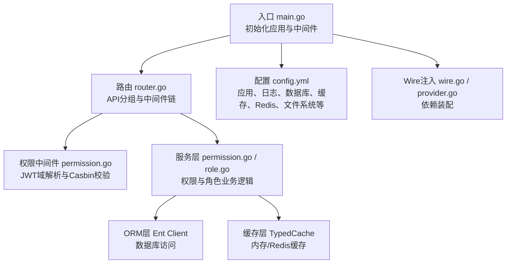
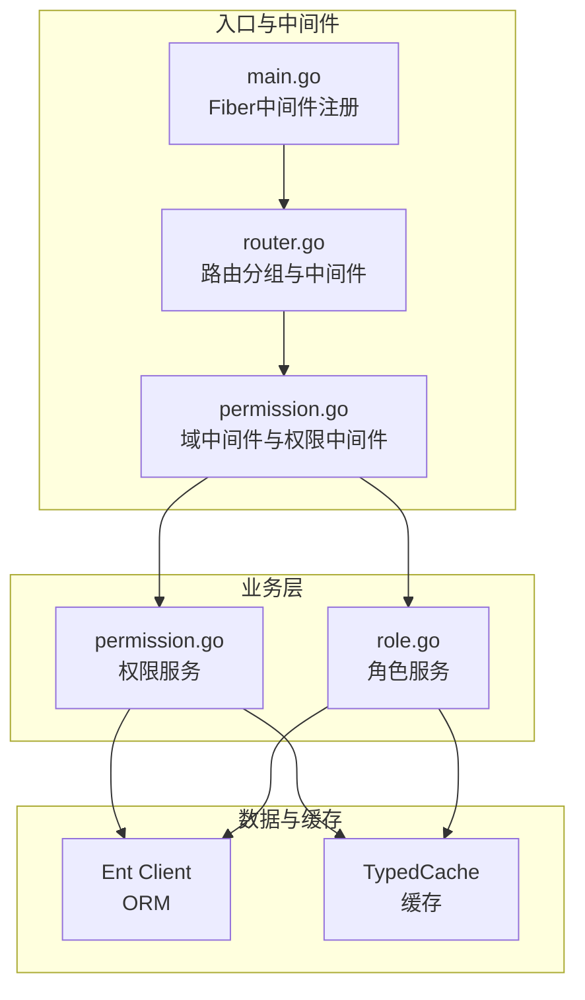
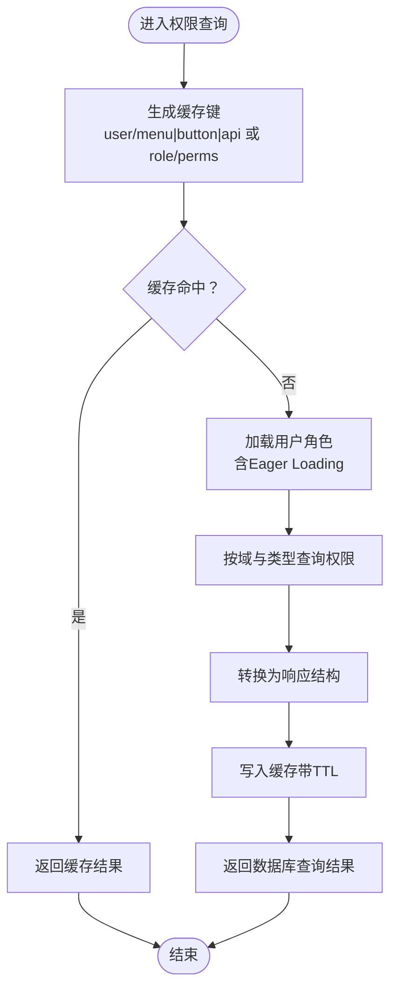
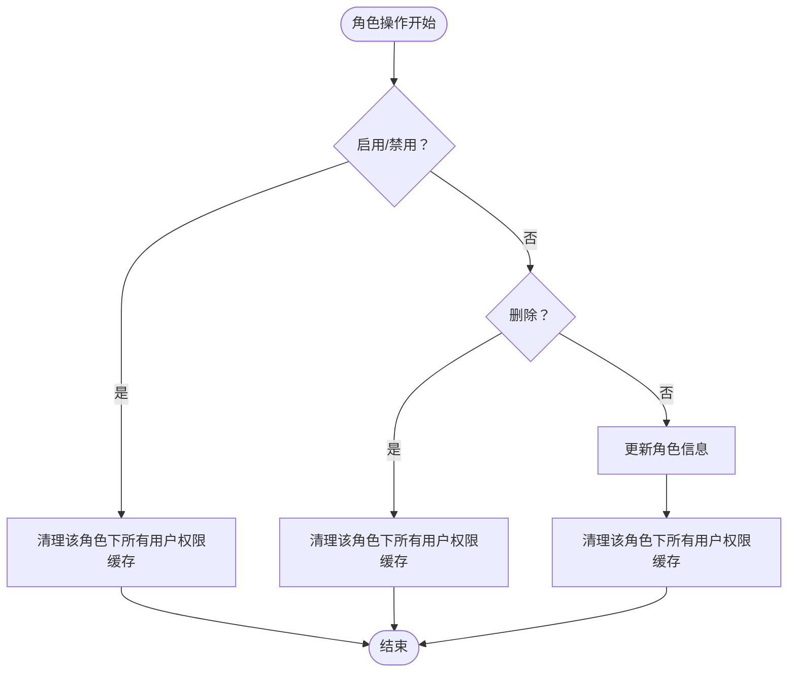
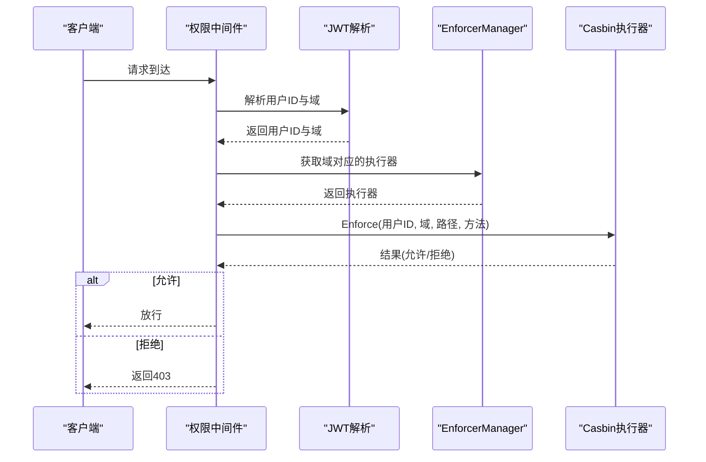
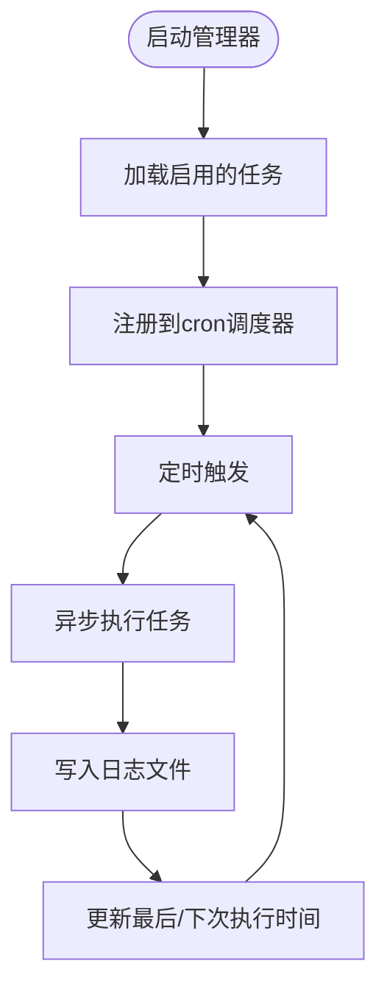
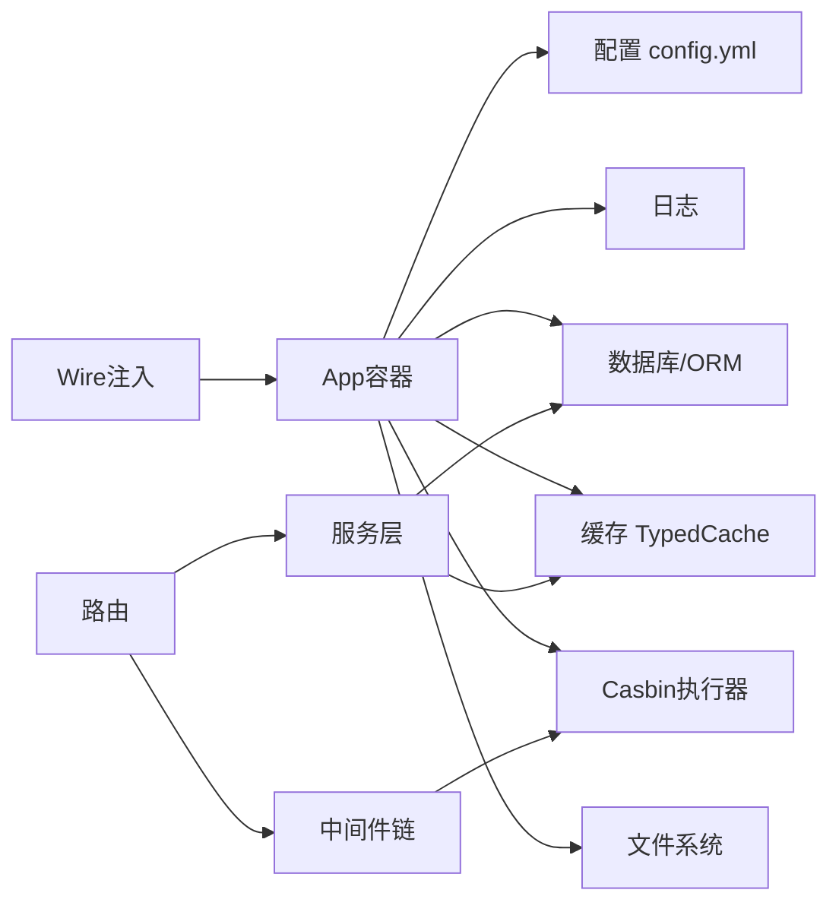

# 性能优化

<cite>
**本文引用的文件**
- [main.go](file://main.go)
- [config.yml](file://config/config.yml)
- [app.go](file://internal/app.go)
- [init.go](file://internal/init.go)
- [wire.go](file://internal/wire.go)
- [provider.go](file://internal/provider.go)
- [router.go](file://internal/router.go)
- [permission.go](file://internal/service/permission.go)
- [role.go](file://internal/service/role.go)
- [permission.go](file://internal/middleware/permission.go)
- [manager.go](file://internal/cron/manager.go)
- [go.mod](file://go.mod)
</cite>

## 目录
1. [简介](#简介)
2. [项目结构](#项目结构)
3. [核心组件](#核心组件)
4. [架构总览](#架构总览)
5. [详细组件分析](#详细组件分析)
6. [依赖分析](#依赖分析)
7. [性能考虑](#性能考虑)
8. [故障排查指南](#故障排查指南)
9. [结论](#结论)
10. [附录](#附录)

## 简介
本文件面向Go Admin管理系统，聚焦于性能优化与工程实践，覆盖以下方面：
- 内存管理优化：Goroutine池管理、内存回收调优、垃圾回收器配置
- 并发处理优化：goroutine数量控制、channel使用优化、锁竞争减少
- 数据库连接池优化：连接数配置、查询性能调优、索引优化策略
- 缓存策略：Redis配置、缓存命中率优化、缓存失效策略
- 网络I/O优化：HTTP连接复用、超时配置、负载均衡设置
- 性能监控指标与基准测试方法

## 项目结构
系统采用模块化组织，入口通过Wire依赖注入装配应用组件；路由层基于Fiber框架；权限校验通过Casbin中间件；数据访问使用Ent ORM；缓存与数据库连接池通过配置文件集中管理。

图示来源
- [main.go:47-104](file://main.go#L47-L104)
- [router.go:16-149](file://internal/router.go#L16-L149)
- [permission.go:118-134](file://internal/service/permission.go#L118-L134)
- [role.go:41-56](file://internal/service/role.go#L41-L56)
- [config.yml:1-143](file://config/config.yml#L1-L143)
- [wire.go:22-37](file://internal/wire.go#L22-L37)
- [provider.go:17-43](file://internal/provider.go#L17-L43)

章节来源
- [main.go:47-104](file://main.go#L47-L104)
- [router.go:16-149](file://internal/router.go#L16-L149)
- [config.yml:1-143](file://config/config.yml#L1-L143)
- [wire.go:22-37](file://internal/wire.go#L22-L37)
- [provider.go:17-43](file://internal/provider.go#L17-L43)

## 核心组件
- 应用容器 App：聚合配置、日志、数据库、校验器、缓存、Ent客户端、Casbin执行器、文件系统等。
- 依赖注入：通过Wire按需注入各组件，支持可替换的Provider（如Ent Client、Casbin适配器）。
- 路由与中间件：统一请求日志、JWT鉴权、域解析、权限校验。
- 服务层：权限与角色服务，结合缓存实现热点数据快速读取与失效策略。
- 定时任务：基于robfig/cron调度，异步执行任务并记录日志。

章节来源
- [app.go:15-25](file://internal/app.go#L15-L25)
- [wire.go:22-37](file://internal/wire.go#L22-L37)
- [provider.go:17-43](file://internal/provider.go#L17-L43)
- [router.go:16-149](file://internal/router.go#L16-L149)
- [permission.go:118-134](file://internal/service/permission.go#L118-L134)
- [role.go:41-56](file://internal/service/role.go#L41-L56)
- [manager.go:17-38](file://internal/cron/manager.go#L17-L38)

## 架构总览
系统采用“入口初始化 → 中间件链 → 路由分组 → 服务层 → ORM/缓存”的清晰分层。权限校验在中间件阶段完成，避免重复查询；服务层对热点数据进行缓存，降低数据库压力；定时任务独立调度，不影响主请求路径。

图示来源
- [main.go:62-93](file://main.go#L62-L93)
- [router.go:16-149](file://internal/router.go#L16-L149)
- [permission.go:118-134](file://internal/service/permission.go#L118-L134)
- [role.go:41-56](file://internal/service/role.go#L41-L56)

## 详细组件分析

### 组件A：权限服务与缓存策略
- 缓存键设计：按用户/角色维度区分菜单、按钮、API三类权限，便于精细化失效。
- 缓存写入：查询成功后写入默认TTL，降低重复查询成本。
- 失效策略：新增/更新/删除权限、角色状态变更、角色赋权/解权均触发相关缓存清理，确保一致性。
- 查询优化：使用Eager Loading预加载关联角色，减少N+1查询；按域与类型过滤，缩小查询范围。

图示来源
- [permission.go:513-556](file://internal/service/permission.go#L513-L556)
- [permission.go:558-615](file://internal/service/permission.go#L558-L615)
- [permission.go:617-674](file://internal/service/permission.go#L617-L674)
- [permission.go:676-734](file://internal/service/permission.go#L676-L734)
- [permission.go:146-187](file://internal/service/permission.go#L146-L187)

章节来源
- [permission.go:118-134](file://internal/service/permission.go#L118-L134)
- [permission.go:136-144](file://internal/service/permission.go#L136-L144)
- [permission.go:146-187](file://internal/service/permission.go#L146-L187)
- [permission.go:513-556](file://internal/service/permission.go#L513-L556)
- [permission.go:558-615](file://internal/service/permission.go#L558-L615)
- [permission.go:617-674](file://internal/service/permission.go#L617-L674)
- [permission.go:676-734](file://internal/service/permission.go#L676-L734)

### 组件B：角色服务与缓存失效
- 角色状态变更（启用/禁用）与角色删除均触发对应用户权限缓存清理。
- 更新角色信息时，清理拥有该角色的全部用户权限缓存，保证一致性。

图示来源
- [role.go:290-292](file://internal/service/role.go#L290-L292)
- [role.go:370-372](file://internal/service/role.go#L370-L372)
- [role.go:408-410](file://internal/service/role.go#L408-L410)

章节来源
- [role.go:290-292](file://internal/service/role.go#L290-L292)
- [role.go:370-372](file://internal/service/role.go#L370-L372)
- [role.go:408-410](file://internal/service/role.go#L408-L410)

### 组件C：权限中间件与Casbin校验
- 从JWT提取用户ID与域，校验失败直接返回未授权/禁止访问。
- 通过EnforcerManager按域获取执行器，执行权限判断，避免跨域误判。

图示来源
- [permission.go:14-78](file://internal/middleware/permission.go#L14-L78)

章节来源
- [permission.go:14-78](file://internal/middleware/permission.go#L14-L78)

### 组件D：定时任务管理器
- 使用robfig/cron调度，支持秒级表达式与时钟驱动。
- 异步执行任务，避免阻塞主请求；执行前后记录日志并更新数据库中的运行时间。
- 提供立即执行、启停、日志清理等能力。

图示来源
- [manager.go:40-77](file://internal/cron/manager.go#L40-L77)
- [manager.go:154-221](file://internal/cron/manager.go#L154-L221)

章节来源
- [manager.go:17-38](file://internal/cron/manager.go#L17-L38)
- [manager.go:40-77](file://internal/cron/manager.go#L40-L77)
- [manager.go:154-221](file://internal/cron/manager.go#L154-L221)

## 依赖分析
- Fiber作为Web框架，提供高性能HTTP处理与中间件生态。
- Ent ORM负责Schema迁移与查询构建，支持事务与Eager Loading。
- Casbin用于权限模型校验，中间件在请求链路早期拦截。
- Wire负责依赖注入，提供可替换Provider（如Ent Client、Casbin适配器）。
- Redis作为可选缓存后端，配合TypedCache实现统一缓存抽象。

图示来源
- [wire.go:22-37](file://internal/wire.go#L22-L37)
- [app.go:15-25](file://internal/app.go#L15-L25)
- [config.yml:19-58](file://config/config.yml#L19-L58)

章节来源
- [wire.go:22-37](file://internal/wire.go#L22-L37)
- [provider.go:17-43](file://internal/provider.go#L17-L43)
- [app.go:15-25](file://internal/app.go#L15-L25)
- [config.yml:19-58](file://config/config.yml#L19-L58)

## 性能考虑

### 内存管理优化
- Goroutine池管理
  - 当前系统通过Fiber与robfig/cron调度任务，未显式自定义Goroutine池。建议在高并发场景引入工作池模式，限制同时执行的任务数量，避免资源争抢与上下文切换开销过大。
  - 对于IO密集型任务（如定时任务执行），可结合异步执行与背压机制，防止瞬时峰值导致内存抖动。
- 内存回收调优
  - 使用pprof与trace定位热点函数与内存分配点，关注大对象与逃逸分配。
  - 合理设置GOGC与GOMAXPROCS，结合业务QPS与延迟目标进行A/B调优。
- 垃圾回收器配置
  - 在容器化部署中，可通过GC参数与CPU限额协同，避免频繁Full GC。
  - 对于长生命周期对象（如连接池、缓存容器），尽量复用并避免频繁扩容缩容。

### 并发处理优化
- goroutine数量控制
  - 限制并发执行的任务数，避免过多goroutine导致调度开销上升。
  - 对高频接口采用限流与队列缓冲，平滑突发流量。
- channel使用优化
  - 使用有缓冲channel承载任务队列，避免无缓冲channel造成发送方阻塞。
  - 明确关闭策略，防止泄漏。
- 锁竞争减少
  - 优先使用无锁数据结构或读写分离，降低共享状态竞争。
  - 将热点数据拆分到不同命名空间，减少全局锁粒度。

### 数据库连接池优化
- 连接数配置
  - 根据CPU核数、数据库最大连接数与平均查询时延估算最优连接池大小。
  - 开启连接池健康检查与空闲回收，避免长时间占用连接。
- 查询性能调优
  - 使用Eager Loading减少N+1查询；对高频查询建立复合索引；避免SELECT *，仅取必要字段。
  - 对分页查询使用覆盖索引与游标分页，降低offset扫描成本。
- 索引优化策略
  - 基于查询条件建立联合索引；定期分析慢查询日志，剔除冗余索引。
  - 对权限查询（域、角色、类型）建立合适索引，缩短Casbin规则查询时间。

### 缓存策略实施指南
- Redis配置
  - 根据业务QPS与延迟目标调整连接池大小、超时与重连策略。
  - 启用持久化与备份，结合哨兵/集群保障可用性。
- 缓存命中率优化
  - 对热点数据设置合理TTL；对冷数据采用LRU淘汰策略。
  - 使用多级缓存（本地内存+Redis）降低跨网访问延迟。
- 缓存失效策略
  - 采用写后失效或写后广播，确保多副本一致性。
  - 对批量更新采用批量失效，避免逐条删除带来的抖动。

### 网络I/O优化
- HTTP连接复用
  - 使用Keep-Alive与连接池，减少握手开销；对静态资源启用压缩与缓存头。
- 超时配置
  - 明确请求超时、读写超时与Idle超时，避免线程长期占用。
- 负载均衡设置
  - 前置LB采用轮询/最少连接/健康检查；后端节点水平扩展，避免单点瓶颈。

### 性能监控指标与基准测试
- 指标定义
  - QPS、P95/P99延迟、错误率、连接池利用率、缓存命中率、GC暂停时间、goroutine数量。
- 基准测试方法
  - 使用go test -bench与pprof进行CPU/内存剖析；对关键路径（权限校验、权限查询、定时任务执行）编写基准测试。
  - 搭建压测环境，逐步提升并发与数据规模，观察系统拐点并定位瓶颈。

## 故障排查指南
- 权限校验失败
  - 检查JWT中域与用户ID是否正确；确认Casbin策略是否匹配；查看中间件日志。
- 缓存命中异常
  - 核对缓存键拼接规则与TTL设置；确认失效策略是否覆盖到相关场景。
- 定时任务执行异常
  - 查看任务日志文件与数据库运行时间更新；检查执行器类型与命令参数。
- 数据库连接问题
  - 检查连接池配置与慢查询；确认索引与查询计划；评估并发与事务隔离级别。

章节来源
- [permission.go:14-78](file://internal/middleware/permission.go#L14-L78)
- [permission.go:146-187](file://internal/service/permission.go#L146-L187)
- [manager.go:154-221](file://internal/cron/manager.go#L154-L221)

## 结论
通过合理的依赖注入、中间件链与服务层缓存策略，Go Admin系统在权限校验与数据访问层面具备良好的可扩展性。建议在高并发场景引入工作池与限流、完善索引与查询优化、强化缓存一致性与失效策略，并结合监控与基准测试持续迭代性能表现。

## 附录
- 配置参考
  - 应用与日志：见配置文件中app与log段落。
  - 数据库：见配置文件中database段落。
  - 缓存与Redis：见配置文件中cache与redis段落。
- 依赖版本
  - Fiber、Ent、Casbin、robfig/cron、Redis等版本信息见go.mod。

章节来源
- [config.yml:1-143](file://config/config.yml#L1-L143)
- [go.mod:1-127](file://go.mod#L1-L127)