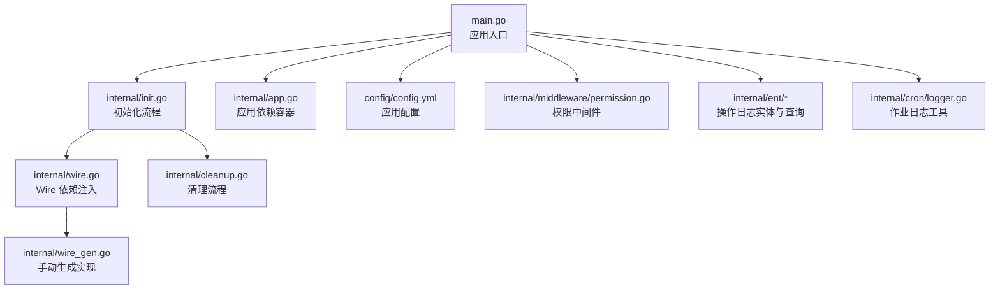
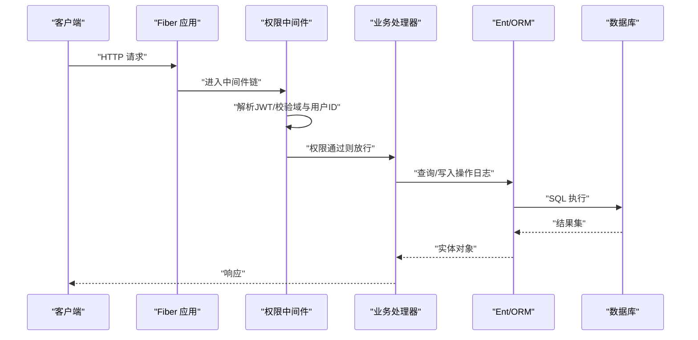
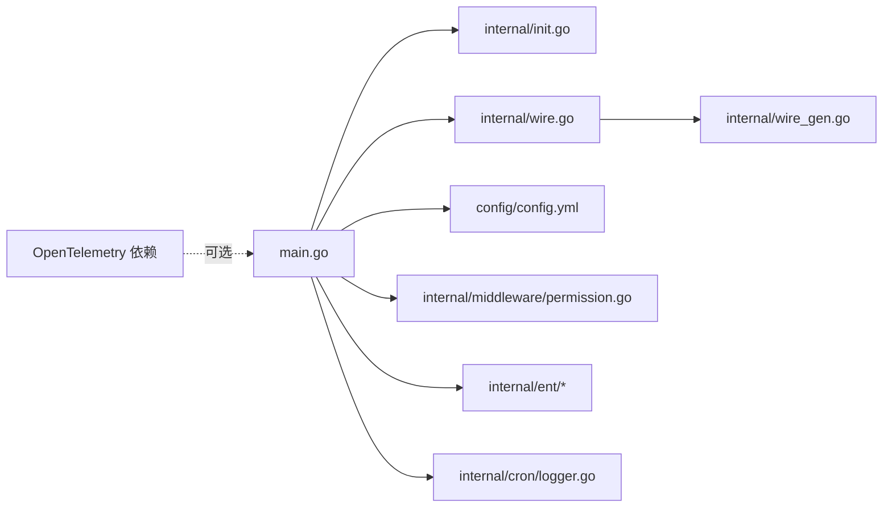

# 监控告警

<cite>
**本文引用的文件**
- [main.go](file://main.go)
- [config.yml](file://config/config.yml)
- [app.go](file://internal/app.go)
- [init.go](file://internal/init.go)
- [cleanup.go](file://internal/cleanup.go)
- [wire.go](file://internal/wire.go)
- [wire_gen.go](file://internal/wire_gen.go)
- [permission.go](file://internal/middleware/permission.go)
- [operationlog.go](file://internal/ent/operationlog.go)
- [operationlog_query.go](file://internal/ent/operationlog_query.go)
- [where.go](file://internal/ent/operationlog/where.go)
- [logger.go](file://internal/cron/logger.go)
- [logger_test.go](file://internal/cron/logger_test.go)
- [go.sum](file://go.sum)
</cite>

## 目录
1. [简介](#简介)
2. [项目结构](#项目结构)
3. [核心组件](#核心组件)
4. [架构总览](#架构总览)
5. [详细组件分析](#详细组件分析)
6. [依赖分析](#依赖分析)
7. [性能考虑](#性能考虑)
8. [故障排查指南](#故障排查指南)
9. [结论](#结论)
10. [附录](#附录)

## 简介
本文件面向 Go Admin 管理系统的监控与告警实践，聚焦以下方面：
- 应用健康检查：Liveness/Readiness 探针配置建议、自定义健康检查端点与故障检测机制
- 性能指标：Prometheus 集成建议、自定义指标定义与指标可视化配置
- 日志监控：结构化日志格式、日志聚合与异常日志告警策略
- 告警规则：阈值设定、告警级别与通知渠道配置指南
- 分布式追踪：OpenTelemetry 集成配置与使用建议
- 监控仪表板：关键指标监控方案与仪表板设计思路

说明：当前仓库未内置健康检查端点、Prometheus 指标导出器、分布式追踪中间件或告警规则配置。本文基于现有代码结构与依赖，提供可落地的扩展方案与最佳实践。

## 项目结构
系统采用 Fiber 应用框架，通过 CMF 组件提供配置、日志、ORM、缓存、文件系统等能力，并使用 Ent 作为 ORM/Schema 管理。应用启动流程通过 Wire 进行依赖注入，初始化数据库、Casbin 权限引擎与定时任务管理器。

图表来源
- [main.go:47-104](file://main.go#L47-L104)
- [init.go:31-67](file://internal/init.go#L31-L67)
- [app.go:15-26](file://internal/app.go#L15-L26)
- [wire.go:22-37](file://internal/wire.go#L22-L37)
- [wire_gen.go:17-62](file://internal/wire_gen.go#L17-L62)
- [cleanup.go:10-37](file://internal/cleanup.go#L10-L37)
- [config.yml:1-143](file://config/config.yml#L1-L143)
- [permission.go:14-94](file://internal/middleware/permission.go#L14-L94)
- [operationlog.go:190-237](file://internal/ent/operationlog.go#L190-L237)
- [logger.go:46-94](file://internal/cron/logger.go#L46-L94)

章节来源
- [main.go:47-104](file://main.go#L47-L104)
- [config.yml:1-143](file://config/config.yml#L1-L143)

## 核心组件
- 应用依赖容器：封装配置、日志、数据库、校验器、缓存、Ent 客户端、Casbin 执行器、文件系统等。
- 初始化与清理：统一初始化数据库、Casbin、定时任务；优雅关闭时先停任务再关闭数据库连接池。
- 权限中间件：从 JWT 提取用户域与用户 ID，结合 Casbin 执行权限校验。
- 操作日志实体：记录请求路径、方法、状态码、耗时、客户端信息等，支持查询与聚合。
- 作业日志工具：提供作业日志文件的创建、列举、读取与尾读功能，具备安全校验与排序。

章节来源
- [app.go:15-26](file://internal/app.go#L15-L26)
- [init.go:31-67](file://internal/init.go#L31-L67)
- [cleanup.go:10-37](file://internal/cleanup.go#L10-L37)
- [permission.go:14-94](file://internal/middleware/permission.go#L14-L94)
- [operationlog.go:190-237](file://internal/ent/operationlog.go#L190-L237)
- [logger.go:46-94](file://internal/cron/logger.go#L46-L94)

## 架构总览
下图展示应用启动、中间件链路、权限校验与数据访问的整体交互。

图表来源
- [main.go:62-93](file://main.go#L62-L93)
- [permission.go:14-94](file://internal/middleware/permission.go#L14-L94)
- [operationlog_query.go:407-449](file://internal/ent/operationlog_query.go#L407-L449)

## 详细组件分析

### 健康检查与故障检测
- Liveness 探针：用于判断进程是否存活。建议在应用启动完成后返回成功，若发现致命错误（如数据库不可用、关键依赖异常），返回失败以触发重启。
- Readiness 探针：用于判断服务是否准备好接收流量。可在初始化阶段对数据库、缓存、外部依赖进行探测；若未就绪，返回失败避免被加入负载均衡。
- 自定义健康检查端点：可新增 /health/live 与 /health/ready 两个端点，分别对应存活与就绪状态。
- 故障检测机制：结合日志与指标，对异常峰值、超时率、错误率进行阈值告警；对数据库连接池耗尽、Redis 连接失败等关键事件进行即时告警。

说明：当前仓库未内置健康检查端点与故障检测逻辑，以上为扩展建议。

### 性能指标与 Prometheus 集成
- 指标采集建议：
  - HTTP 请求总量、成功率、延迟分位数（P50/P90/P99）、错误码分布
  - 数据库查询耗时与慢查询计数
  - 缓存命中率与过期/淘汰计数
  - 文件系统 IO 与存储容量
  - 定时任务执行时长与失败次数
- 自定义指标定义：
  - 使用 Prometheus Go 客户端注册自定义指标（Counter/Histogram/Gauge）。
  - 在中间件中埋点，记录请求耗时、状态码、路径模板等标签。
- 指标可视化：
  - Grafana 中创建面板：请求速率、错误率、P95 延迟、数据库连接池使用率、任务执行时长分布。
  - 仪表板布局建议：顶部为总体概览（请求速率/错误率），中部为核心链路（数据库/缓存/外部依赖），底部为作业与日志告警。

说明：当前仓库未集成 Prometheus 导出器，以上为扩展建议。

### 日志监控策略
- 结构化日志格式：统一字段包括时间戳、级别、模块、消息、请求路径、方法、状态码、耗时、用户ID、IP、TraceID 等。
- 日志聚合：将应用日志输出到 stdout 并由 Sidecar 或集中式日志系统收集；保留滚动日志文件以便回溯。
- 异常日志告警：对 ERROR/WARN 级别日志建立阈值规则（如每分钟超过阈值触发告警），并区分业务异常与系统异常。
- 操作日志审计：利用 Ent 的操作日志实体记录关键操作，支持按路径、方法、状态码、耗时等条件查询与聚合。

章节来源
- [operationlog.go:190-237](file://internal/ent/operationlog.go#L190-L237)
- [where.go:87-115](file://internal/ent/operationlog/where.go#L87-L115)
- [where.go:787-855](file://internal/ent/operationlog/where.go#L787-L855)
- [operationlog_query.go:241-280](file://internal/ent/operationlog_query.go#L241-L280)
- [operationlog_query.go:407-449](file://internal/ent/operationlog_query.go#L407-L449)

### 告警规则配置指南
- 阈值设置：
  - 错误率：API 错误率 > 1% 持续 5 分钟
  - 延迟：P95 延迟 > 500ms 持续 5 分钟
  - 超时：超时请求占比 > 5%
  - 数据库：连接池空闲/等待/拒绝计数异常增长
  - 缓存：缓存未命中率突增
  - 存储：磁盘使用率 > 80%
  - 作业：任务失败率 > 2%，执行时长 P95 异常
- 告警级别：
  - 严重：影响可用性（如 5xx 占比高、数据库不可用）
  - 警告：影响性能（如 P95 延迟升高、缓存命中率下降）
  - 通知渠道：邮件、企业微信、钉钉、Slack 等
- 通知抑制：同一周期内相同告警合并发送，避免风暴

说明：当前仓库未内置告警规则与通知通道，以上为配置建议。

### 分布式追踪（OpenTelemetry）
- 集成建议：
  - 使用 otelhttp 对 HTTP 客户端/服务器进行自动埋点，采集 TraceID、Span 名称、属性与事件。
  - 配置 Exporter（如 OTLP）将遥测数据发送至 Jaeger/Tempo 等后端。
  - 在中间件链中启用 otelhttp 中间件，确保请求链路完整。
- 使用建议：
  - 为关键业务路径命名 Span，附加用户ID、资源路径、状态码等标签。
  - 结合日志与指标，定位慢调用根因（数据库、缓存、外部依赖）。

章节来源
- [go.sum:320-335](file://go.sum#L320-L335)

### 监控仪表板设计
- 关键指标：
  - 全局：请求速率、错误率、P50/P90/P95 延迟、并发连接数
  - 数据层：数据库 QPS、慢查询、连接池使用率、锁等待
  - 缓存层：缓存命中率、过期/淘汰、内存使用
  - 文件系统：IO 吞吐、存储使用率、文件句柄数
  - 作业：任务执行时长分布、失败率、重试次数
- 仪表板布局：
  - 第一行：总览（请求/错误/延迟）
  - 第二行：数据库/缓存/文件系统
  - 第三行：作业与告警看板
  - 第四行：操作日志与异常趋势

说明：当前仓库未内置仪表板，以上为设计建议。

## 依赖分析
- 应用启动依赖：Fiber、CMF 组件（配置、日志、ORM、缓存、文件系统）、Ent、Wire。
- 运行时依赖：MySQL 驱动、OpenTelemetry 生态（可选）。
- 作业日志依赖：标准库文件系统与排序。

图表来源
- [main.go:47-104](file://main.go#L47-L104)
- [wire.go:22-37](file://internal/wire.go#L22-L37)
- [wire_gen.go:17-62](file://internal/wire_gen.go#L17-L62)
- [config.yml:1-143](file://config/config.yml#L1-L143)
- [permission.go:14-94](file://internal/middleware/permission.go#L14-L94)
- [logger.go:46-94](file://internal/cron/logger.go#L46-L94)
- [go.sum:320-335](file://go.sum#L320-L335)

章节来源
- [main.go:47-104](file://main.go#L47-L104)
- [wire.go:22-37](file://internal/wire.go#L22-L37)
- [wire_gen.go:17-62](file://internal/wire_gen.go#L17-L62)
- [config.yml:1-143](file://config/config.yml#L1-L143)
- [permission.go:14-94](file://internal/middleware/permission.go#L14-L94)
- [logger.go:46-94](file://internal/cron/logger.go#L46-L94)
- [go.sum:320-335](file://go.sum#L320-L335)

## 性能考虑
- 中间件顺序：将轻量中间件（如 CORS、日志）置于前部，权限中间件仅在必要路由生效，减少不必要的鉴权开销。
- 查询优化：利用 Ent 的谓词与排序能力，避免一次性加载大量数据；对高频查询建立索引。
- 连接池：合理配置数据库与缓存连接池大小，监控空闲/活跃连接数与等待队列长度。
- 日志落盘：避免在热路径频繁写磁盘，建议异步刷盘或批量写入；对敏感字段脱敏。
- 作业日志：限制单文件大小与保留天数，定期清理历史日志，避免磁盘压力。

## 故障排查指南
- 启动失败：
  - 检查配置文件中的数据库连接参数与 Redis 地址。
  - 查看初始化日志，确认数据库 Schema 创建与 Casbin 初始化是否成功。
- 权限相关问题：
  - 核对 JWT 中的用户ID与域信息是否正确传递至中间件。
  - 检查 Casbin 策略是否匹配当前路径与方法。
- 操作日志异常：
  - 确认操作日志实体字段是否完整写入，查询时是否使用了正确的谓词与排序。
- 作业日志异常：
  - 检查作业日志目录是否存在、文件名是否符合规范、是否存在路径穿越风险。
  - 使用尾读功能验证最新日志是否正常追加。

章节来源
- [init.go:31-67](file://internal/init.go#L31-L67)
- [permission.go:14-94](file://internal/middleware/permission.go#L14-L94)
- [operationlog.go:190-237](file://internal/ent/operationlog.go#L190-L237)
- [logger.go:46-94](file://internal/cron/logger.go#L46-L94)
- [logger_test.go:1-145](file://internal/cron/logger_test.go#L1-L145)

## 结论
本文件基于现有代码结构，提供了 Go Admin 管理系统在健康检查、性能指标、日志监控、告警规则与分布式追踪方面的扩展方案。建议优先实现健康检查端点与基础指标采集，逐步完善日志聚合与告警规则，并引入 OpenTelemetry 实现全链路可观测性。通过合理的仪表板设计与阈值配置，可显著提升系统的稳定性与可维护性。

## 附录
- 配置文件位置与关键项：应用名称、端口、调试开关、日志路径、数据库与缓存连接、文件系统与 S3 配置、Casbin 多域模型等。
- 依赖版本参考：OpenTelemetry 生态相关包版本已在 go.sum 中声明。

章节来源
- [config.yml:1-143](file://config/config.yml#L1-L143)
- [go.sum:320-335](file://go.sum#L320-L335)