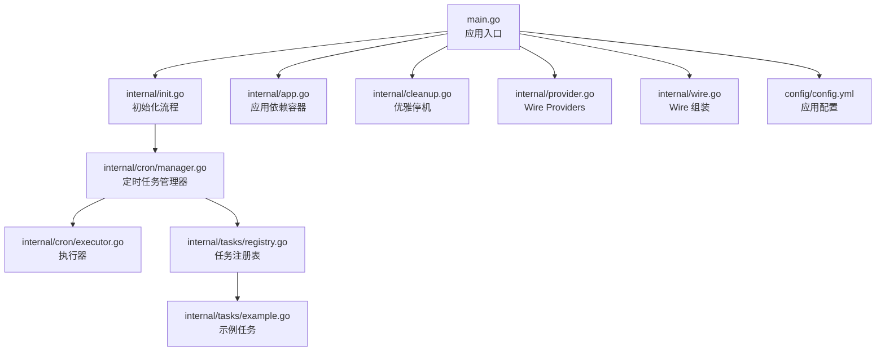
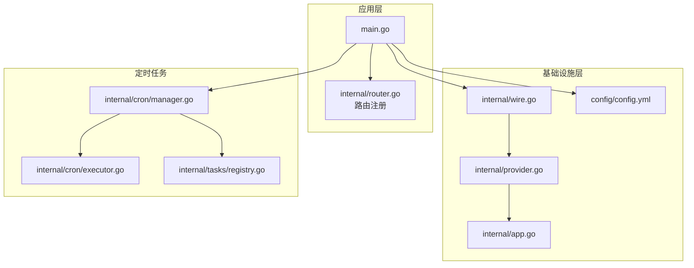
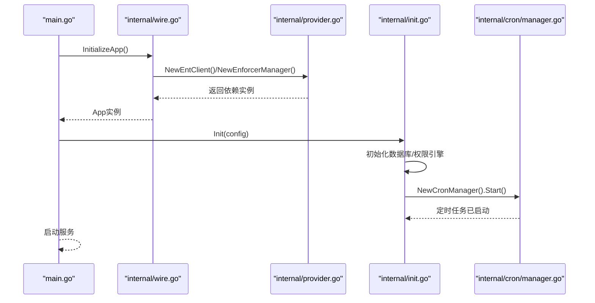
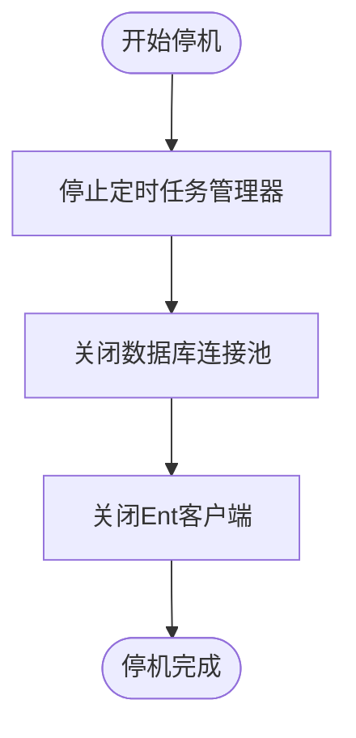
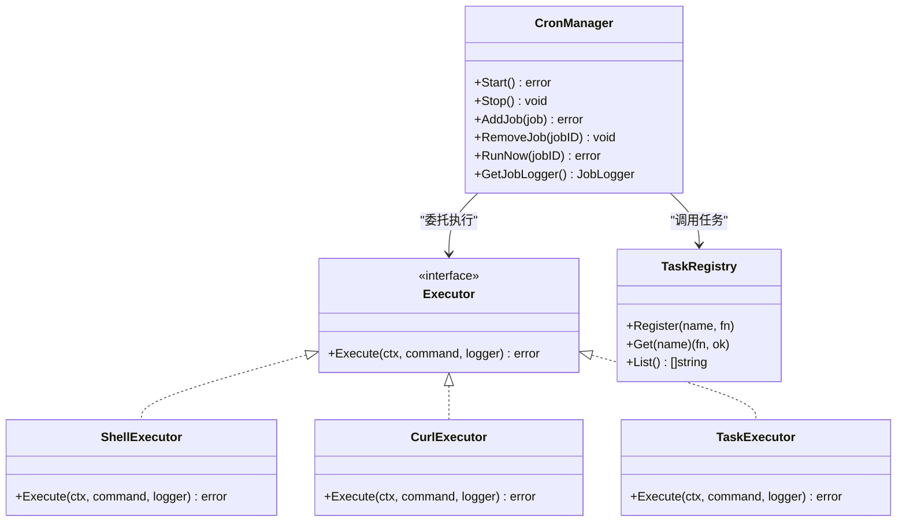
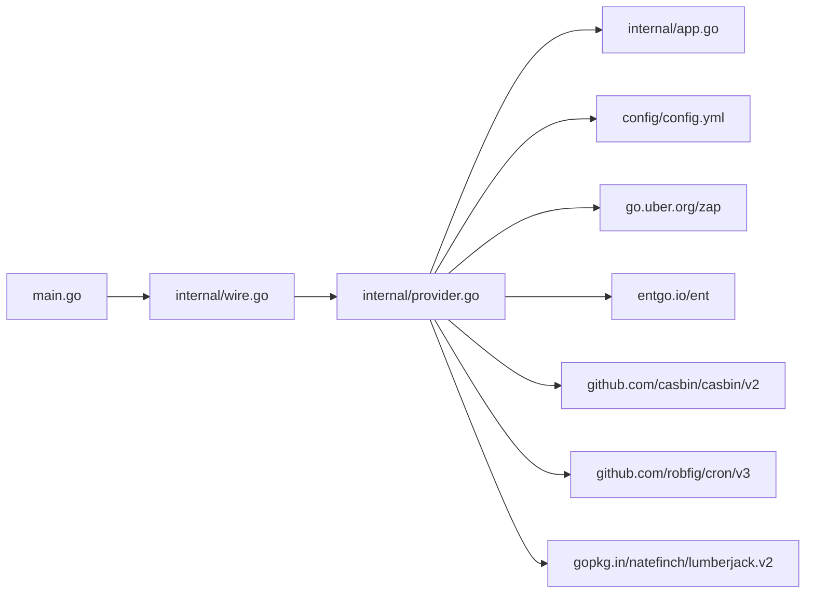

# 运维管理

<cite>
**本文引用的文件**
- [main.go](file://main.go)
- [config.yml](file://config/config.yml)
- [app.go](file://internal/app.go)
- [init.go](file://internal/init.go)
- [cleanup.go](file://internal/cleanup.go)
- [provider.go](file://internal/provider.go)
- [wire.go](file://internal/wire.go)
- [manager.go](file://internal/cron/manager.go)
- [executor.go](file://internal/cron/executor.go)
- [registry.go](file://internal/tasks/registry.go)
- [example.go](file://internal/tasks/example.go)
- [go.mod](file://go.mod)
</cite>

## 目录
1. [简介](#简介)
2. [项目结构](#项目结构)
3. [核心组件](#核心组件)
4. [架构总览](#架构总览)
5. [详细组件分析](#详细组件分析)
6. [依赖分析](#依赖分析)
7. [性能考虑](#性能考虑)
8. [故障排查指南](#故障排查指南)
9. [结论](#结论)
10. [附录](#附录)

## 简介
本运维管理文档面向Go Admin管理系统的生产环境运维与开发团队，聚焦以下目标：
- 日常运维操作：应用启动、停止、重启的标准流程与注意事项
- 备份策略：数据库、文件系统与增量备份配置建议
- 灾难恢复：故障切换、数据恢复与业务连续性保障
- 运维自动化：部署、监控与维护脚本示例思路
- 版本升级：灰度发布、回滚策略与风险评估
- 常见问题：性能、内存泄漏、连接池等诊断与处理

## 项目结构
该系统采用模块化分层组织，核心入口负责应用初始化、中间件挂载与路由注册；内部模块负责数据库、缓存、文件系统、定时任务与权限控制等基础设施。

**图表来源**
- [main.go:47-104](file://main.go#L47-L104)
- [init.go:31-67](file://internal/init.go#L31-L67)
- [app.go:15-26](file://internal/app.go#L15-L26)
- [cleanup.go:10-37](file://internal/cleanup.go#L10-L37)
- [provider.go:17-44](file://internal/provider.go#L17-L44)
- [wire.go:22-37](file://internal/wire.go#L22-L37)
- [manager.go:17-77](file://internal/cron/manager.go#L17-L77)
- [executor.go:18-126](file://internal/cron/executor.go#L18-L126)
- [registry.go:8-33](file://internal/tasks/registry.go#L8-L33)
- [example.go:10-29](file://internal/tasks/example.go#L10-L29)
- [config.yml:1-143](file://config/config.yml#L1-L143)

**章节来源**
- [main.go:47-104](file://main.go#L47-L104)
- [config.yml:1-143](file://config/config.yml#L1-L143)

## 核心组件
- 应用依赖容器：集中管理配置、日志、数据库、缓存、文件系统、权限引擎与Ent ORM客户端。
- 初始化流程：按顺序初始化数据库与权限引擎，启动定时任务管理器。
- 优雅停机：先停止定时任务，再关闭数据库连接池与Ent客户端。
- 定时任务：支持Shell、HTTP、Go Task三种执行器，具备日志轮转与保留策略。
- 任务注册表：集中注册与发现Go Task，便于扩展维护。

**章节来源**
- [app.go:15-26](file://internal/app.go#L15-L26)
- [init.go:31-67](file://internal/init.go#L31-L67)
- [cleanup.go:10-37](file://internal/cleanup.go#L10-L37)
- [manager.go:17-77](file://internal/cron/manager.go#L17-L77)
- [registry.go:8-33](file://internal/tasks/registry.go#L8-L33)

## 架构总览
系统基于Fiber框架，通过Wire注入依赖，结合CMF提供的ORM、缓存、文件系统与日志能力，形成统一的基础设施层。定时任务模块独立于主业务，通过数据库驱动的执行器实现跨平台任务编排。

**图表来源**
- [main.go:47-104](file://main.go#L47-L104)
- [wire.go:22-37](file://internal/wire.go#L22-L37)
- [provider.go:17-44](file://internal/provider.go#L17-L44)
- [app.go:15-26](file://internal/app.go#L15-L26)
- [manager.go:17-77](file://internal/cron/manager.go#L17-L77)
- [executor.go:18-126](file://internal/cron/executor.go#L18-L126)
- [registry.go:8-33](file://internal/tasks/registry.go#L8-L33)
- [config.yml:1-143](file://config/config.yml#L1-L143)

## 详细组件分析

### 应用启动与初始化流程
- 启动入口：通过Wire构建应用依赖，设置全局日志器，注册中间件与路由，最后启动引导器。
- 初始化阶段：优先使用Wire注入的EntClient与EnforcerManager；若未注入则手动初始化数据库与权限引擎；随后启动定时任务管理器。
- 中间件与静态资源：挂载SPA前端静态目录，对非API路径回退至index.html，确保单页应用路由正常工作。

**图表来源**
- [main.go:47-104](file://main.go#L47-L104)
- [wire.go:22-37](file://internal/wire.go#L22-L37)
- [provider.go:17-44](file://internal/provider.go#L17-L44)
- [init.go:31-67](file://internal/init.go#L31-L67)
- [manager.go:40-77](file://internal/cron/manager.go#L40-L77)

**章节来源**
- [main.go:47-104](file://main.go#L47-L104)
- [init.go:31-67](file://internal/init.go#L31-L67)
- [provider.go:17-44](file://internal/provider.go#L17-L44)
- [wire.go:22-37](file://internal/wire.go#L22-L37)

### 优雅停机与资源回收
- 停止顺序：先停止定时任务管理器，再关闭数据库连接池，最后关闭Ent客户端，避免资源泄漏与未完成任务中断。
- 错误处理：记录关闭过程中的错误并返回，确保停机流程可追踪。

**图表来源**
- [cleanup.go:10-37](file://internal/cleanup.go#L10-L37)

**章节来源**
- [cleanup.go:10-37](file://internal/cleanup.go#L10-L37)

### 定时任务管理器与执行器
- 管理器职责：从数据库加载启用的任务，注册到调度器，支持立即执行与下次执行时间更新；内置日志清理任务。
- 执行器类型：
  - Shell：跨平台执行系统命令
  - Curl：解析JSON配置执行HTTP请求
  - Task：从注册表查找并执行Go Task
- 日志：每任务创建独立日志文件，记录开始/结束时间、耗时与结果；支持过期日志清理。

**图表来源**
- [manager.go:17-237](file://internal/cron/manager.go#L17-L237)
- [executor.go:18-126](file://internal/cron/executor.go#L18-L126)
- [registry.go:8-33](file://internal/tasks/registry.go#L8-L33)

**章节来源**
- [manager.go:17-237](file://internal/cron/manager.go#L17-L237)
- [executor.go:18-126](file://internal/cron/executor.go#L18-L126)
- [registry.go:8-33](file://internal/tasks/registry.go#L8-L33)
- [example.go:10-29](file://internal/tasks/example.go#L10-L29)

### 配置与基础设施
- 应用配置：端口、调试模式、超时、Swagger开关、登录过期等。
- 日志配置：文件路径、控制台输出、文件输出、滚动参数。
- 数据库配置：默认连接、驱动、主机、端口、用户、密码、库名、SSL、表前缀。
- 缓存配置：内存与Redis存储，TTL等。
- Redis连接池：地址、用户名、密码、DB、拨号/读写超时、连接池大小与生命周期。
- 文件系统：本地与S3驱动，根目录与桶配置。
- Casbin：多域模型配置与自动加载策略。

**章节来源**
- [config.yml:1-143](file://config/config.yml#L1-L143)

## 依赖分析
- Wire注入：通过ProviderSet与自定义Provider创建并组装应用依赖。
- 外部依赖：Fiber、Ent、Casbin、Robfig Cron、Zap、Lumberjack等。
- 替换依赖：本地CMF模块替换，便于内网或私有化部署。

**图表来源**
- [main.go:47-104](file://main.go#L47-L104)
- [wire.go:22-37](file://internal/wire.go#L22-L37)
- [provider.go:17-44](file://internal/provider.go#L17-L44)
- [app.go:15-26](file://internal/app.go#L15-L26)
- [config.yml:1-143](file://config/config.yml#L1-L143)
- [go.mod:5-21](file://go.mod#L5-L21)
- [go.mod:126](file://go.mod#L126)

**章节来源**
- [go.mod:5-21](file://go.mod#L5-L21)
- [go.mod:126](file://go.mod#L126)

## 性能考虑
- 日志滚动：Lumberjack按大小与天数滚动，避免单文件过大影响IO。
- 连接池：数据库与Redis连接池参数需结合QPS与延迟调优，避免连接抖动。
- 定时任务：任务类型选择与命令优化，避免阻塞调度器；日志文件过大时注意磁盘IO。
- 缓存：Redis作为热数据缓存时，合理设置TTL与淘汰策略，避免内存压力。
- 前端静态资源：嵌入FS减少外部依赖，但需注意资源更新策略。

[本节为通用指导，无需特定文件引用]

## 故障排查指南
- 启动失败
  - 检查配置文件是否正确（端口占用、数据库凭据、Redis连通性）。
  - 关注初始化日志，确认数据库Schema创建与权限引擎初始化是否成功。
- 停机异常
  - 若数据库或缓存关闭报错，记录错误并重试；必要时强制终止进程并检查连接泄漏。
- 定时任务失败
  - 查看任务日志文件定位错误；核对命令格式、HTTP目标可达性与Task注册情况。
- 日志过多
  - 调整日志滚动参数与保留周期；检查定时任务日志清理任务是否正常运行。
- 性能问题
  - 使用系统监控工具观察CPU、内存、连接数与磁盘IO；结合日志定位热点路径。
- 内存泄漏
  - 关注长时间运行后的内存增长趋势；检查定时任务与中间件是否持有大对象。
- 连接池问题
  - 检查数据库与Redis连接池参数；观察最大连接数与空闲连接数是否异常。

**章节来源**
- [config.yml:11-18](file://config/config.yml#L11-L18)
- [init.go:69-84](file://internal/init.go#L69-L84)
- [manager.go:154-221](file://internal/cron/manager.go#L154-L221)
- [cleanup.go:10-37](file://internal/cleanup.go#L10-L37)

## 结论
本系统通过Wire注入与模块化设计实现了清晰的依赖边界与可维护性。配合完善的日志滚动、定时任务与优雅停机机制，能够满足生产环境的稳定性要求。建议在生产中结合监控与告警体系，持续优化连接池与缓存策略，并制定标准化的备份与灾备流程。

[本节为总结，无需特定文件引用]

## 附录

### 日常运维操作流程
- 启动
  - 确认配置文件与环境变量正确
  - 执行构建产物，等待初始化完成与定时任务启动
- 停止
  - 发送终止信号，等待优雅停机完成
- 重启
  - 停止后立即启动，或使用进程管理器实现平滑重启

[本节为通用流程，无需特定文件引用]

### 备份策略实施
- 数据库备份
  - MySQL：使用逻辑备份（如mysqldump）或物理备份（如Percona XtraBackup），按天/周生成归档，校验完整性
  - 归档保留：遵循4-6-8规则（4次每日、6周每周、8个月每月）
- 文件系统备份
  - 本地存储：定期快照或增量备份至远端存储
  - S3：启用版本控制与生命周期策略，区分不同保留期
- 增量备份配置
  - 基于时间戳与差异文件的增量策略，结合校验与恢复演练

[本节为通用策略，无需特定文件引用]

### 灾难恢复计划
- 故障切换
  - 主从切换或读写分离切换，验证数据库与缓存连通性
  - 启动备用节点，逐步放量
- 数据恢复
  - 从最近可用备份恢复，核对时间点一致性
  - 验证关键业务数据与日志
- 业务连续性
  - 多活部署与流量切换预案
  - 监控告警与自动恢复机制

[本节为通用方案，无需特定文件引用]

### 运维自动化脚本示例（思路）
- 部署脚本
  - 拉取镜像/二进制 → 停止旧进程 → 应用配置与迁移 → 启动新进程 → 健康检查
- 监控脚本
  - CPU/内存/磁盘/连接数/定时任务状态采集与阈值告警
- 维护脚本
  - 日志滚动清理、临时文件清理、缓存预热

[本节为通用示例，无需特定文件引用]

### 版本升级流程
- 灰度发布
  - 新版本部署至部分节点，观察指标与日志
- 回滚策略
  - 快速回滚至上一稳定版本，必要时回切数据库
- 升级风险评估
  - 依赖变更、数据库迁移、配置项变更的影响面评估

[本节为通用流程，无需特定文件引用]