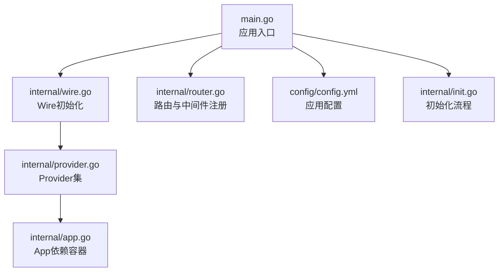
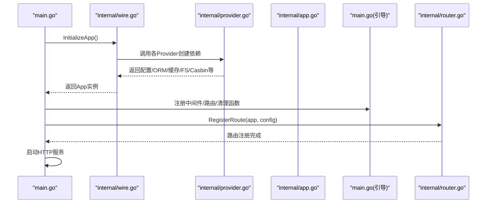
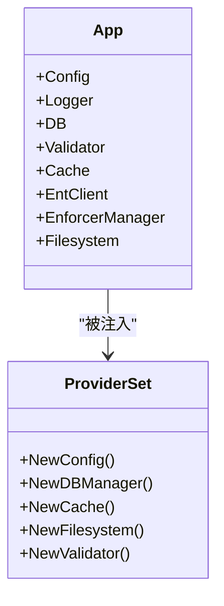
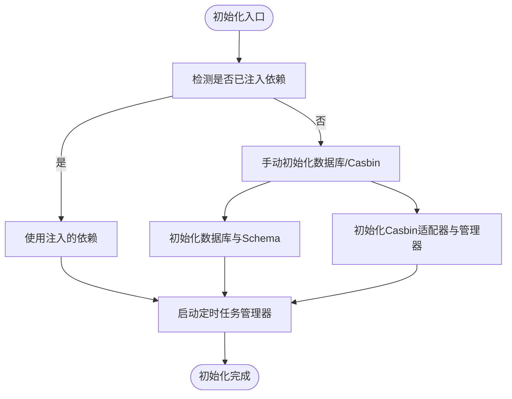
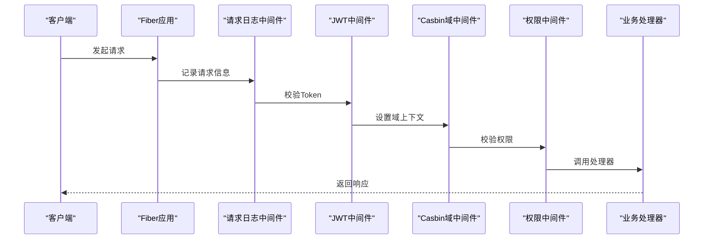
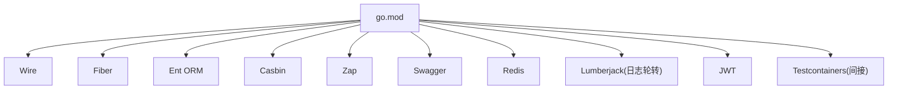

# 部署与运维

<cite>
**本文引用的文件**
- [main.go](file://main.go)
- [config.yml](file://config/config.yml)
- [app.go](file://internal/app.go)
- [init.go](file://internal/init.go)
- [router.go](file://internal/router.go)
- [provider.go](file://internal/provider.go)
- [wire.go](file://internal/wire.go)
- [go.mod](file://go.mod)
- [go.sum](file://go.sum)
- [.golangci.yml](file://.golangci.yml)
- [.gitignore](file://.gitignore)
</cite>

## 目录
1. [简介](#简介)
2. [项目结构](#项目结构)
3. [核心组件](#核心组件)
4. [架构总览](#架构总览)
5. [详细组件分析](#详细组件分析)
6. [依赖分析](#依赖分析)
7. [性能考虑](#性能考虑)
8. [故障排查指南](#故障排查指南)
9. [结论](#结论)
10. [附录](#附录)

## 简介
本文件面向Go Admin管理系统的部署与运维团队，提供从单机到容器化的全栈部署方案、多环境配置策略、性能优化建议、监控告警集成以及运维最佳实践与常见问题排查。文档严格基于仓库现有源码与配置文件进行分析与总结，确保可落地性与可追溯性。

## 项目结构
该系统采用模块化组织，核心入口位于应用主程序，配置集中于YAML文件，依赖注入通过Wire生成，路由与中间件在内部模块中注册，数据库与权限控制分别由ORM与Casbin提供。

图表来源
- [main.go:47-104](file://main.go#L47-L104)
- [wire.go:22-37](file://internal/wire.go#L22-L37)
- [provider.go:17-43](file://internal/provider.go#L17-L43)
- [app.go:15-25](file://internal/app.go#L15-L25)
- [router.go:16-149](file://internal/router.go#L16-L149)
- [config.yml:1-143](file://config/config.yml#L1-L143)
- [init.go:31-67](file://internal/init.go#L31-L67)

章节来源
- [main.go:47-104](file://main.go#L47-L104)
- [config.yml:1-143](file://config/config.yml#L1-L143)

## 核心组件
- 应用入口与引导
  - 应用通过Wire注入依赖，初始化日志、路由、中间件与清理函数，随后启动HTTP服务。
- 依赖注入与Provider
  - 通过ProviderSet与自定义Provider创建配置、日志、ORM、校验器、缓存、文件系统、Ent客户端、Casbin适配器与管理器。
- 初始化流程
  - 支持两种模式：Wire注入与兼容旧模式的手动初始化；同时启动定时任务管理器。
- 路由与中间件
  - 注册版本化路由组、JWT认证中间件、权限中间件、Casbin域中间件与请求日志中间件。
- 配置中心
  - 包含应用、日志、数据库、缓存、Redis、文件系统与Casbin等多模块配置项。

章节来源
- [main.go:47-104](file://main.go#L47-L104)
- [wire.go:22-37](file://internal/wire.go#L22-L37)
- [provider.go:17-43](file://internal/provider.go#L17-L43)
- [init.go:31-100](file://internal/init.go#L31-L100)
- [router.go:16-149](file://internal/router.go#L16-L149)
- [config.yml:1-143](file://config/config.yml#L1-L143)

## 架构总览
下图展示应用启动到路由处理的关键交互，体现依赖注入、初始化与路由注册的顺序关系。

图表来源
- [main.go:47-104](file://main.go#L47-L104)
- [wire.go:22-37](file://internal/wire.go#L22-L37)
- [provider.go:17-43](file://internal/provider.go#L17-L43)
- [router.go:16-149](file://internal/router.go#L16-L149)

## 详细组件分析

### 组件A：应用启动与依赖注入
- 作用
  - 通过Wire按需注入配置、日志、ORM、校验器、缓存、文件系统、Ent客户端、Casbin适配器与管理器。
- 关键点
  - ProviderSet与自定义Provider组合，确保依赖可替换与可测试。
  - 初始化阶段支持兼容旧模式，避免破坏既有部署。
- 优化建议
  - 在生产环境开启预取与连接池参数，减少冷启动延迟。
  - 对日志输出进行异步化，降低I/O阻塞。

图表来源
- [app.go:15-25](file://internal/app.go#L15-L25)
- [wire.go:22-37](file://internal/wire.go#L22-L37)
- [provider.go:17-43](file://internal/provider.go#L17-L43)

章节来源
- [wire.go:22-37](file://internal/wire.go#L22-L37)
- [provider.go:17-43](file://internal/provider.go#L17-L43)
- [app.go:15-25](file://internal/app.go#L15-L25)

### 组件B：初始化流程与定时任务
- 作用
  - 初始化数据库与Casbin，启动定时任务管理器，记录日志。
- 关键点
  - 支持Wire注入与手动初始化双通道，增强部署灵活性。
  - 定时任务日志目录与过期策略在初始化时设定。
- 优化建议
  - 数据库Schema迁移在启动时执行，建议配合只读副本与灰度发布策略。
  - 定时任务日志轮转与保留周期需结合磁盘容量规划。

图表来源
- [init.go:31-100](file://internal/init.go#L31-L100)

章节来源
- [init.go:31-100](file://internal/init.go#L31-L100)

### 组件C：路由与中间件
- 作用
  - 注册版本化路由组、公开接口与鉴权接口，统一注入服务实例，接入JWT、权限与Casbin域中间件。
- 关键点
  - 请求日志中间件按需启用，便于审计与排障。
  - 缓存服务在路由层按需注入，提升权限查询性能。
- 优化建议
  - 对高频接口开启缓存与限流，避免热点压力。
  - 权限中间件与Casbin域中间件的调用链应尽量前置，减少后续处理成本。

图表来源
- [router.go:16-149](file://internal/router.go#L16-L149)

章节来源
- [router.go:16-149](file://internal/router.go#L16-L149)

### 组件D：配置中心
- 作用
  - 提供应用、日志、数据库、缓存、Redis、文件系统与Casbin等配置项。
- 关键点
  - 日志轮转参数、数据库连接参数、Redis连接池参数、文件系统驱动与S3配置均在此集中管理。
  - Casbin多域模型与自动加载策略支持多租户场景。
- 优化建议
  - 生产环境建议关闭调试模式，开启Swagger仅限内网访问。
  - Redis连接池参数需结合并发与延迟目标进行压测调优。

章节来源
- [config.yml:1-143](file://config/config.yml#L1-L143)

## 依赖分析
- 运行时依赖
  - Web框架、ORM、Casbin、缓存、文件系统、日志、Swagger等。
- 构建与工具
  - Wire用于依赖注入生成，golangci-lint用于静态检查。
- 外部替换
  - cmf库通过replace指向本地路径，便于二次开发与调试。

图表来源
- [go.mod:5-21](file://go.mod#L5-L21)
- [go.mod:126](file://go.mod#L126)

章节来源
- [go.mod:5-21](file://go.mod#L5-L21)
- [go.mod:126](file://go.mod#L126)
- [go.sum:83-306](file://go.sum#L83-L306)

## 性能考虑
- 内存管理
  - 使用Zap异步日志，避免I/O阻塞；合理设置日志轮转大小与保留天数，防止磁盘膨胀。
  - 对高频数据结构使用对象池与复用策略，减少GC压力。
- 并发处理
  - Web框架默认并发友好，建议结合限流与熔断中间件保护后端资源。
  - 对权限查询与定时任务执行采用缓存与批量处理，降低数据库压力。
- 数据库连接优化
  - 启动时执行Schema迁移，确保索引与列结构稳定；对慢查询建立索引与SQL审计。
  - 结合连接池参数与只读副本，实现读写分离与负载均衡。
- 缓存与存储
  - Redis连接池参数需根据并发与延迟目标压测调整；内存缓存适合短期热点数据。
  - 文件系统支持本地与S3，生产建议S3直连并开启压缩与CDN加速。

章节来源
- [config.yml:11-18](file://config/config.yml#L11-L18)
- [config.yml:19-31](file://config/config.yml#L19-L31)
- [config.yml:42-58](file://config/config.yml#L42-L58)
- [config.yml:60-76](file://config/config.yml#L60-L76)
- [config.yml:77-143](file://config/config.yml#L77-L143)

## 故障排查指南
- 启动失败
  - 检查配置文件路径与权限，确认数据库连接参数正确；查看日志轮转文件是否存在权限问题。
- 数据库相关
  - 若Schema迁移失败，检查数据库账号权限与网络连通性；确认Ent迁移参数未被禁用。
- 权限与认证
  - JWT密钥不一致会导致认证失败；Casbin策略未生效时检查域配置与自动加载开关。
- 日志与监控
  - 日志轮转后无法读取，检查文件权限与轮转策略；结合操作日志表定位异常请求。
- 定时任务
  - 任务未执行或日志缺失，检查任务管理器启动状态与日志目录权限。

章节来源
- [init.go:31-100](file://internal/init.go#L31-L100)
- [config.yml:11-18](file://config/config.yml#L11-L18)
- [config.yml:19-31](file://config/config.yml#L19-L31)
- [config.yml:77-143](file://config/config.yml#L77-L143)

## 结论
本项目以Wire为核心实现依赖注入，结合Fiber路由与中间件、Ent ORM、Casbin权限控制与Zap日志体系，形成高内聚、低耦合的现代化Go应用骨架。通过合理的配置与性能优化策略，可在多环境中稳定运行。建议在生产环境完善监控告警、备份与灾备方案，并持续进行压测与容量规划。

## 附录

### A. 多环境部署策略
- 开发环境
  - 开启调试模式与Swagger；使用本地MySQL与内存缓存；日志输出至控制台与文件。
- 测试环境
  - 关闭调试模式；启用日志轮转；使用独立数据库与Redis；开启必要的性能指标采集。
- 生产环境
  - 关闭Swagger；严格限制日志轮转参数；使用只读副本与连接池；启用S3存储与CDN；开启健康检查与告警。

章节来源
- [config.yml:1-143](file://config/config.yml#L1-L143)

### B. Docker容器化部署（流程与要点）
- 镜像构建
  - 使用多阶段构建，先编译二进制，再复制到精简基础镜像；将配置文件挂载为卷，避免硬编码。
- 容器运行
  - 暴露应用端口；挂载数据卷用于日志与存储；设置环境变量覆盖敏感配置。
- 健康检查
  - 提供HTTP健康检查端点，定期探测应用存活与数据库连通性。
- 编排建议
  - 使用Compose或Kubernetes编排；为数据库与Redis单独部署；启用滚动更新与就绪探针。

[本节为概念性说明，不直接对应具体源码文件]

### C. 监控告警集成（建议）
- 健康检查
  - 对外暴露健康检查接口，返回应用状态与依赖可用性。
- 指标采集
  - 结合Prometheus导出器采集请求量、错误率、响应时间与数据库连接数。
- 告警规则
  - 设定CPU/内存/磁盘/连接池耗尽阈值与异常错误率阈值，联动通知渠道。

[本节为概念性说明，不直接对应具体源码文件]

### D. 运维最佳实践
- 日志管理
  - 使用结构化日志与统一字段；开启日志轮转与归档；定期清理过期日志。
- 备份策略
  - 数据库与配置文件定期备份；验证恢复流程；异地容灾。
- 灾难恢复
  - 制定RTO/RPO目标；演练故障切换；保持基础设施与应用镜像同步。

[本节为概念性说明，不直接对应具体源码文件]