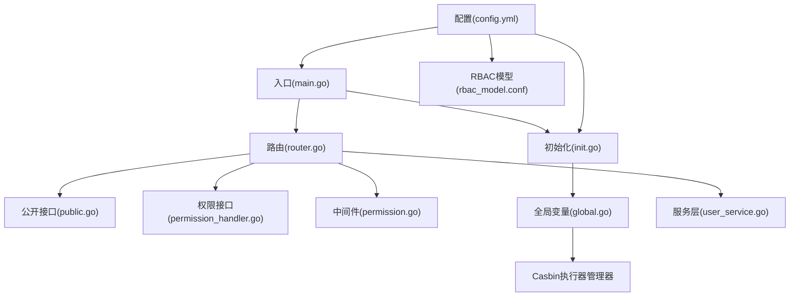
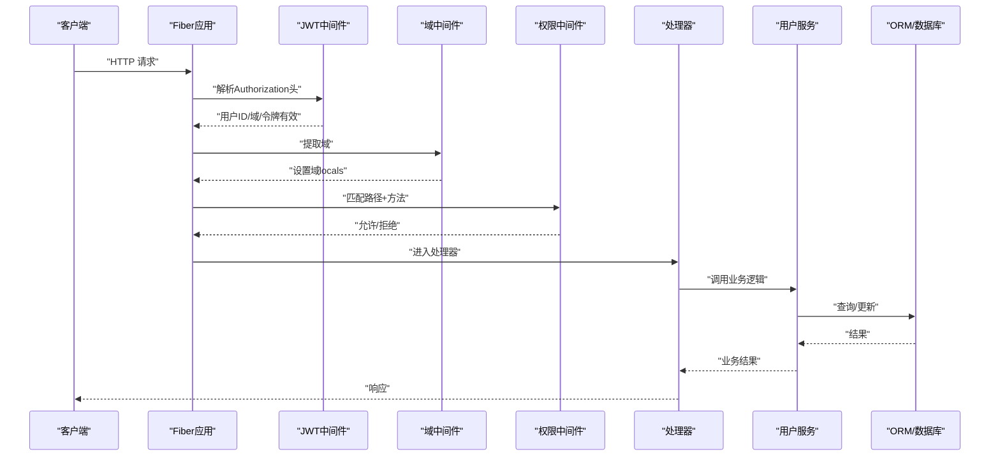
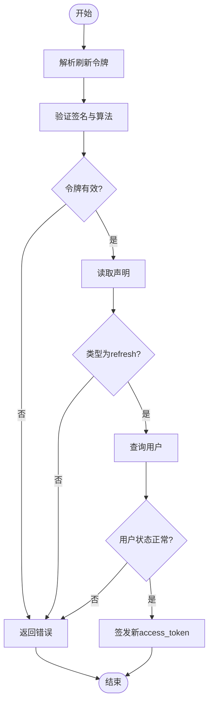
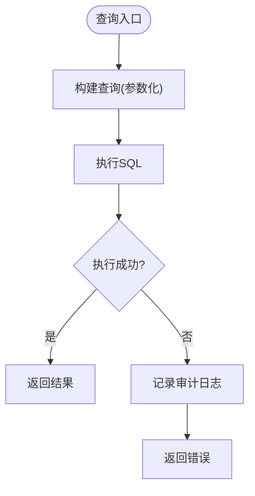
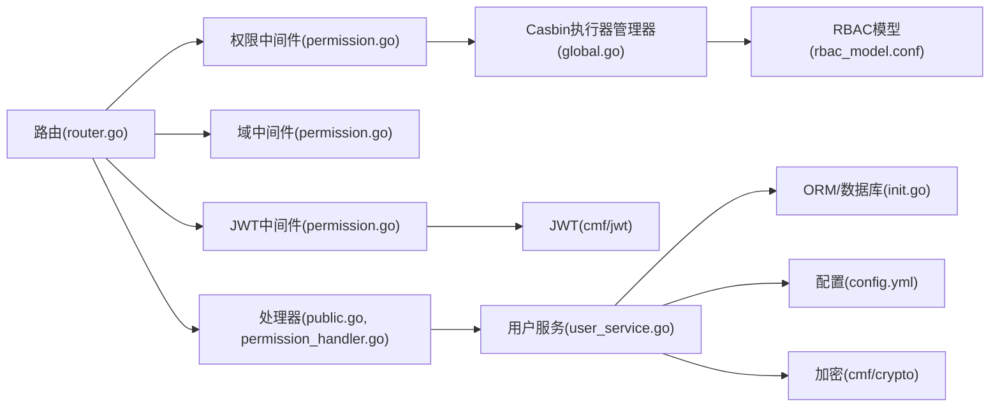

# 安全加固

<cite>
**本文引用的文件**
- [main.go](file://main.go)
- [config.yml](file://config/config.yml)
- [init.go](file://internal/init.go)
- [router.go](file://internal/router.go)
- [permission.go](file://internal/middleware/permission.go)
- [public.go](file://internal/handler/public.go)
- [permission_handler.go](file://internal/handler/permission.go)
- [user_service.go](file://internal/service/user.go)
- [global.go](file://internal/global/global.go)
- [rbac_model.conf](file://config/rbac_model.conf)
- [.golangci.yml](file://.golangci.yml)
</cite>

## 目录
1. [引言](#引言)
2. [项目结构](#项目结构)
3. [核心组件](#核心组件)
4. [架构总览](#架构总览)
5. [详细组件分析](#详细组件分析)
6. [依赖分析](#依赖分析)
7. [性能考虑](#性能考虑)
8. [故障排查指南](#故障排查指南)
9. [结论](#结论)
10. [附录](#附录)

## 引言
本文件面向Go Admin管理系统，提供一套系统化的安全加固方案。内容覆盖应用安全配置（CORS、CSRF、XSS）、JWT令牌安全与过期机制、API安全防护（限流/熔断/防暴力破解）、数据库安全与SQL注入防护、文件上传安全与恶意文件检测、网络安全与WAF建议、密码学与密钥管理、安全审计与合规检查、漏洞扫描与渗透测试、以及安全事件响应与应急处置流程。文档基于仓库现有实现进行分析，并提出可落地的改进建议。

## 项目结构
系统采用模块化组织，核心入口负责初始化与路由注册；内部模块包含中间件、处理器、服务层、实体与全局变量等。配置文件集中于config目录，包含应用、日志、数据库、缓存、Redis、文件系统、Casbin等配置项。

图表来源
- [main.go:43-89](file://main.go#L43-L89)
- [init.go:17-65](file://internal/init.go#L17-L65)
- [router.go:14-72](file://internal/router.go#L14-L72)
- [permission.go:11-68](file://internal/middleware/permission.go#L11-L68)
- [public.go:13-45](file://internal/handler/public.go#L13-L45)
- [permission_handler.go:13-50](file://internal/handler/permission.go#L13-L50)
- [user_service.go:127-206](file://internal/service/user.go#L127-L206)
- [global.go:10-14](file://internal/global/global.go#L10-L14)
- [config.yml:1-143](file://config/config.yml#L1-L143)
- [rbac_model.conf:1-14](file://config/rbac_model.conf#L1-L14)

章节来源
- [main.go:43-89](file://main.go#L43-L89)
- [config.yml:1-143](file://config/config.yml#L1-L143)

## 核心组件
- 应用入口与中间件注册：负责静态资源托管、SPA回退、路由注册与清理。
- 初始化模块：数据库连接、Ent ORM Schema创建、Casbin执行器管理器初始化。
- 路由与鉴权：基于JWT中间件与Casbin权限中间件保护受控接口。
- 服务层：用户登录、令牌刷新、密码变更等业务逻辑，含密码哈希与校验。
- 全局变量：ORM客户端、Bootstrap实例、Casbin执行器管理器。
- 配置中心：应用、日志、数据库、缓存、Redis、文件系统、Casbin多域模型等。

章节来源
- [main.go:43-89](file://main.go#L43-L89)
- [init.go:17-65](file://internal/init.go#L17-L65)
- [router.go:14-72](file://internal/router.go#L14-L72)
- [permission.go:11-68](file://internal/middleware/permission.go#L11-L68)
- [user_service.go:127-206](file://internal/service/user.go#L127-L206)
- [global.go:10-14](file://internal/global/global.go#L10-L14)
- [config.yml:1-143](file://config/config.yml#L1-L143)

## 架构总览
下图展示从客户端到服务端的关键交互路径，以及JWT与Casbin在鉴权链路中的位置。

图表来源
- [router.go:32-37](file://internal/router.go#L32-L37)
- [permission.go:11-68](file://internal/middleware/permission.go#L11-L68)
- [public.go:22-44](file://internal/handler/public.go#L22-L44)
- [user_service.go:127-206](file://internal/service/user.go#L127-L206)

## 详细组件分析

### CORS设置
现状：未显式配置CORS中间件，前端通过代理或同源访问。
建议：
- 在中间件层引入CORS，限定来源、方法与头部，避免通配符。
- 对预检请求明确放行，对敏感接口严格校验Origin。
- 生产环境仅保留必要域名，关闭AllowAll。

### CSRF防护
现状：未发现专用CSRF中间件或令牌校验。
建议：
- 为表单类POST/PUT/DELETE启用CSRF中间件或自定义令牌校验。
- 对Cookie与Token双重校验，确保SameSite Cookie策略。
- 对跨站AJAX请求要求自定义Header或CSRF Token。

### XSS防护
现状：未见专门的XSS过滤或转义中间件。
建议：
- 在输出层统一进行HTML转义，避免直接渲染用户输入。
- 使用白名单模板引擎或安全渲染库。
- 设置Content-Security-Policy响应头，限制脚本来源与内联脚本。

### JWT令牌安全策略与过期机制
现状：登录与刷新令牌均使用HS256签名，登录过期时间来自配置，刷新令牌过期时间未在配置中体现。
建议：
- 使用强随机密钥，定期轮换；生产环境禁用明文配置。
- 区分access_token与refresh_token的过期策略与用途边界。
- 引入黑名单/撤销列表（Redis）以支持即时吊销。
- 令牌最小权限原则，Claims中仅包含必要字段。

图表来源
- [user_service.go:274-356](file://internal/service/user.go#L274-L356)

章节来源
- [user_service.go:127-206](file://internal/service/user.go#L127-L206)
- [user_service.go:274-356](file://internal/service/user.go#L274-L356)
- [config.yml:8-9](file://config/config.yml#L8-L9)

### API安全防护（限流、熔断、防暴力破解）
现状：未发现内置限流/熔断/暴力破解防护。
建议：
- 限流：按IP/用户维度限制请求速率，超过阈值返回429。
- 熔断：对下游依赖（如数据库、Redis）设置超时与失败阈值，触发快速失败。
- 防暴力破解：登录失败计数与临时封禁，结合验证码与二次校验。
- 令牌滥用：对access_token设置短周期，刷新令牌独立管理。

### 数据库安全与SQL注入防护
现状：使用Ent ORM，底层通过SQL构建器生成查询，具备基本参数化能力。
建议：
- 严格遵循Ent查询模式，避免原生SQL拼接。
- 对用户输入进行白名单校验与长度限制。
- 开启只读账号与最小权限原则，分离写库与读库。
- 审计敏感操作，记录失败登录与高危操作。

图表来源
- [init.go:33-47](file://internal/init.go#L33-L47)
- [user_service.go:127-206](file://internal/service/user.go#L127-L206)

章节来源
- [init.go:33-47](file://internal/init.go#L33-L47)
- [config.yml:19-31](file://config/config.yml#L19-L31)

### 文件上传安全与恶意文件检测
现状：未发现文件上传接口与安全策略。
建议：
- 仅允许白名单扩展名与MIME类型。
- 存储路径随机化，禁止执行权限，隔离访问。
- 检测文件头魔数与静态分析，识别压缩包、脚本等风险。
- 上传后立即重命名并生成访问URL，不暴露真实路径。

### 网络安全配置与WAF
现状：未发现WAF或网络层安全中间件。
建议：
- 在网关层部署WAF，规则覆盖常见攻击（SQLi、XSS、LFI、命令注入）。
- 限制HTTP方法与头部，启用TLS 1.3与安全套件。
- 对API网关设置速率限制与IP黑白名单。
- 日志采集与实时告警，联动SOC平台。

### 密码学安全实践与密钥管理
现状：密码使用哈希与盐值存储；JWT密钥在配置中明文。
建议：
- 使用PBKDF2/Argon2等现代密码哈希，调整迭代次数。
- 密钥外置至密钥管理服务（KMS），定期轮换。
- 传输加密：强制HTTPS，HSTS，OCSP Stapling。
- 令牌安全：短生命周期、最小权限、撤销机制。

章节来源
- [user_service.go:358-393](file://internal/service/user.go#L358-L393)
- [config.yml:8](file://config/config.yml#L8)

### 安全审计与合规检查
现状：日志配置存在，但未见审计策略。
建议：
- 记录登录、权限变更、敏感操作等关键事件。
- 审计字段：用户ID、时间戳、IP、UA、目标资源、结果。
- 定期巡检：弱口令、过期令牌、异常登录、越权访问。
- 合规：GDPR/等保要求下的数据最小化与可追溯性。

章节来源
- [config.yml:11-18](file://config/config.yml#L11-L18)

### 漏洞扫描与渗透测试
建议：
- 自动化：CI集成SAST/DAST/Secrets扫描。
- 手工测试：重点接口、文件上传、权限绕过、敏感信息泄露。
- 范围与授权：签署测试协议，限定范围与时间窗口。
- 修复闭环：修复-回归-验证-归档。

### 安全事件响应与应急处置
建议流程：
- 发现与分级：快速评估影响面与敏感度。
- 隔离与遏制：封禁IP、撤销令牌、降级服务。
- 调查与取证：日志、内存镜像、配置备份。
- 修复与恢复：补丁、策略调整、权限回收。
- 复盘与改进：完善监控、演练、培训。

## 依赖分析
系统主要外部依赖包括Fiber框架、Ent ORM、Casbin、CMF工具库（JWT、配置、加密）。路由与中间件围绕JWT与Casbin展开，服务层依赖ORM完成数据访问。

图表来源
- [router.go:14-72](file://internal/router.go#L14-L72)
- [permission.go:11-68](file://internal/middleware/permission.go#L11-L68)
- [public.go:13-45](file://internal/handler/public.go#L13-L45)
- [permission_handler.go:13-50](file://internal/handler/permission.go#L13-L50)
- [user_service.go:127-206](file://internal/service/user.go#L127-L206)
- [init.go:33-47](file://internal/init.go#L33-L47)
- [global.go:10-14](file://internal/global/global.go#L10-L14)
- [rbac_model.conf:1-14](file://config/rbac_model.conf#L1-L14)
- [config.yml:1-143](file://config/config.yml#L1-L143)

章节来源
- [router.go:14-72](file://internal/router.go#L14-L72)
- [permission.go:11-68](file://internal/middleware/permission.go#L11-L68)
- [user_service.go:127-206](file://internal/service/user.go#L127-L206)
- [global.go:10-14](file://internal/global/global.go#L10-L14)
- [rbac_model.conf:1-14](file://config/rbac_model.conf#L1-L14)
- [config.yml:1-143](file://config/config.yml#L1-L143)

## 性能考虑
- 中间件顺序：JWT/Casbin应尽量前置，减少无效请求进入业务层。
- 缓存：对热点权限与用户信息使用Redis缓存，降低Casbin查询压力。
- 数据库：合理索引、连接池参数、慢查询日志与分析。
- 日志：异步写入、滚动策略、避免敏感信息落盘。

## 故障排查指南
- 登录失败：检查用户状态、密码哈希与盐值、JWT密钥一致性。
- 权限拒绝：核对Casbin策略、域配置、路径匹配规则。
- 数据库连接：确认驱动、凭据、SSL模式与连接池参数。
- 配置加载：确认配置文件路径与键名正确，注意大小写。

章节来源
- [user_service.go:127-206](file://internal/service/user.go#L127-L206)
- [permission.go:11-68](file://internal/middleware/permission.go#L11-L68)
- [config.yml:19-31](file://config/config.yml#L19-L31)

## 结论
本加固方案以现有实现为基础，补充了CORS/CSRF/XSS、JWT策略、API防护、数据库安全、文件上传、网络安全、密码学与密钥管理、审计与合规、漏洞扫描与应急流程等关键环节。建议优先落地密钥管理、CORS/CSRF/XSS、JWT撤销与限流/防暴力破解等高风险点，持续完善安全体系。

## 附录
- 代码质量：通过.golangci.yml启用基础lint规则，建议逐步增加SAST规则并排除生成代码。
- 配置清单：应用、日志、数据库、缓存、Redis、文件系统、Casbin、RBAC模型等配置项需纳入配置审计。

章节来源
- [.golangci.yml:14-38](file://.golangci.yml#L14-L38)
- [config.yml:1-143](file://config/config.yml#L1-L143)