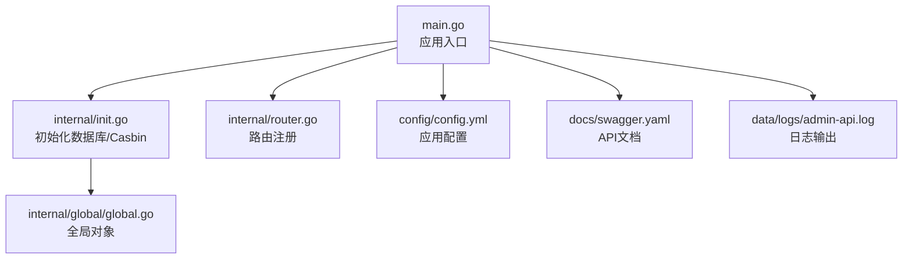
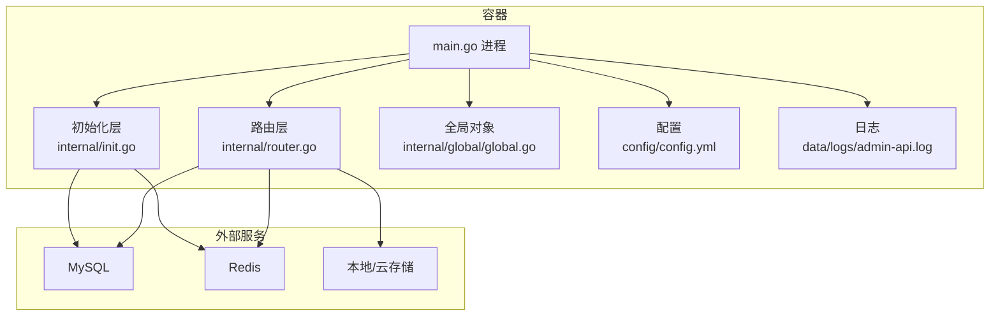
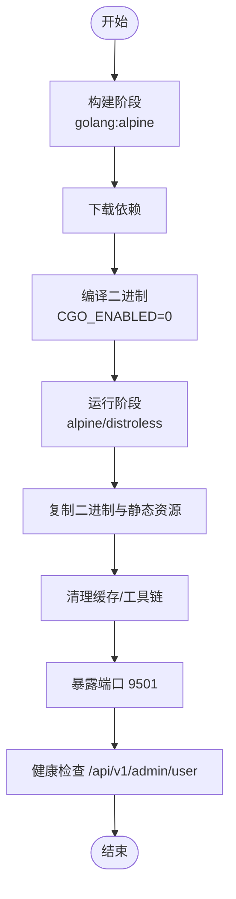
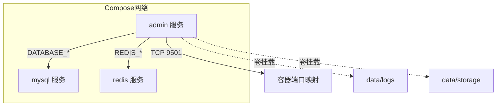
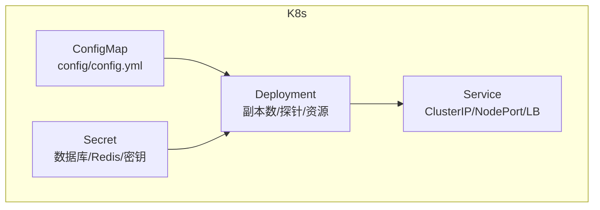
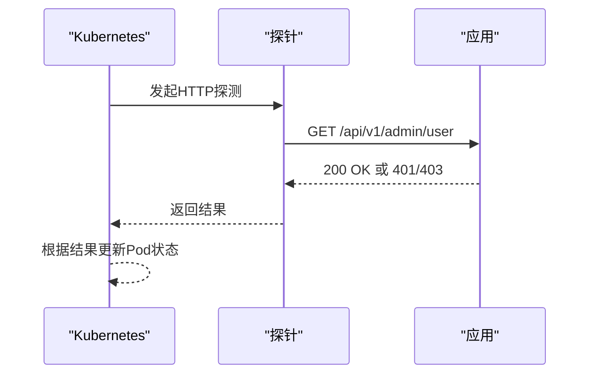
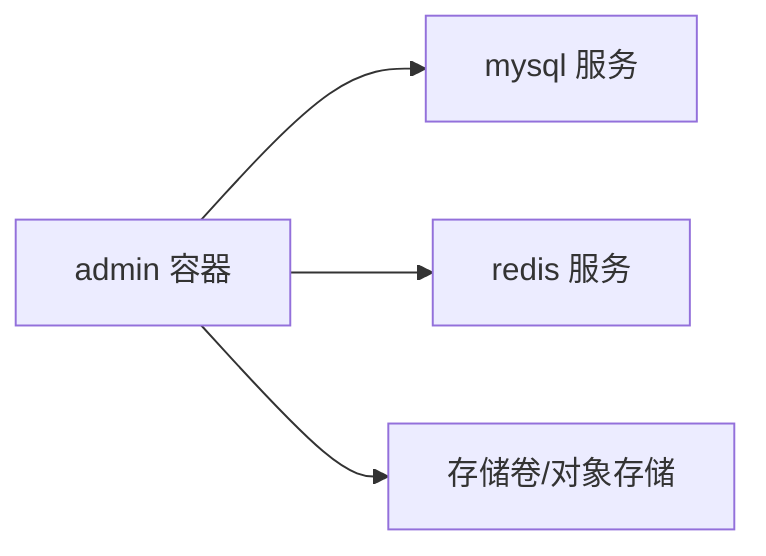
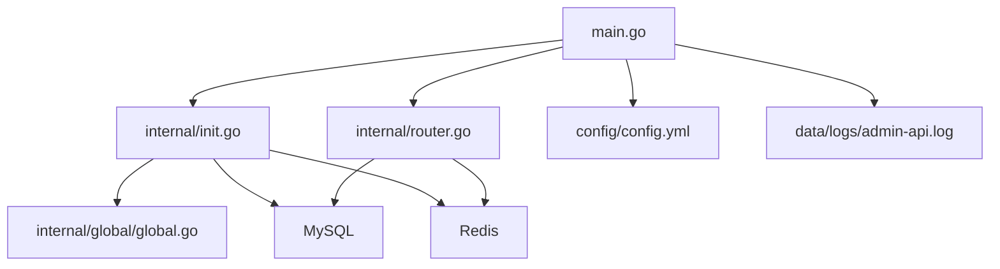
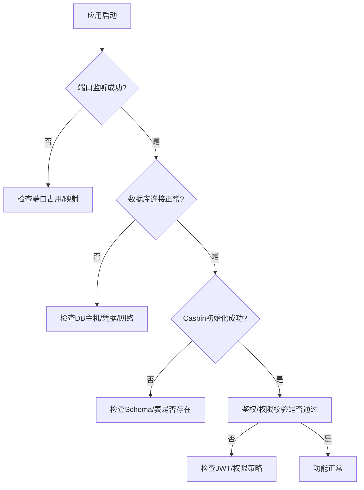

# 容器化部署

<cite>
**本文引用的文件**
- [main.go](file://main.go)
- [go.mod](file://go.mod)
- [config/config.yml](file://config/config.yml)
- [internal/init.go](file://internal/init.go)
- [internal/router.go](file://internal/router.go)
- [internal/global/global.go](file://internal/global/global.go)
- [docs/swagger.yaml](file://docs/swagger.yaml)
- [data/logs/admin-api.log](file://data/logs/admin-api.log)
- [.gitignore](file://.gitignore)
- [.golangci.yml](file://.golangci.yml)
</cite>

## 目录
1. [简介](#简介)
2. [项目结构](#项目结构)
3. [核心组件](#核心组件)
4. [架构总览](#架构总览)
5. [详细组件分析](#详细组件分析)
6. [依赖关系分析](#依赖关系分析)
7. [性能考虑](#性能考虑)
8. [故障排查指南](#故障排查指南)
9. [结论](#结论)
10. [附录](#附录)

## 简介
本文件面向Go Admin管理系统的容器化部署，围绕以下目标展开：
- Docker镜像构建与多阶段优化、镜像体积压缩
- Docker Compose编排：服务定义、网络、卷挂载、环境变量传递
- Kubernetes部署清单：Deployment、Service、ConfigMap、Secret等
- 容器健康检查与重启策略
- 容器间通信与网络拓扑
- 资源限制与性能调优
- 日志收集与故障排查

## 项目结构
该系统基于Go语言与Fiber框架，采用模块化结构，核心入口为main.go，配置集中在config/config.yml，数据库初始化在internal/init.go中完成，路由在internal/router.go中注册。日志输出到data/logs目录，Swagger文档位于docs/swagger.yaml。

图表来源
- [main.go:1-90](file://main.go#L1-L90)
- [internal/init.go:1-66](file://internal/init.go#L1-L66)
- [internal/router.go:1-73](file://internal/router.go#L1-L73)
- [config/config.yml:1-143](file://config/config.yml#L1-L143)
- [docs/swagger.yaml:1-145](file://docs/swagger.yaml#L1-L145)
- [internal/global/global.go:1-15](file://internal/global/global.go#L1-L15)
- [data/logs/admin-api.log:1-797](file://data/logs/admin-api.log#L1-L797)

章节来源
- [main.go:1-90](file://main.go#L1-L90)
- [config/config.yml:1-143](file://config/config.yml#L1-L143)
- [internal/init.go:1-66](file://internal/init.go#L1-L66)
- [internal/router.go:1-73](file://internal/router.go#L1-L73)
- [internal/global/global.go:1-15](file://internal/global/global.go#L1-L15)
- [docs/swagger.yaml:1-145](file://docs/swagger.yaml#L1-L145)
- [data/logs/admin-api.log:1-797](file://data/logs/admin-api.log#L1-L797)

## 核心组件
- 应用入口与中间件：main.go负责初始化Bootstrap、注册中间件（静态资源、SPA路由回退）、注册路由与清理逻辑。
- 初始化流程：internal/init.go负责数据库连接、Schema创建、Casbin Enforcer初始化。
- 路由体系：internal/router.go定义/v1/admin公开与鉴权接口，结合JWT与权限中间件。
- 配置中心：config/config.yml集中管理应用、日志、数据库、缓存、Redis、文件系统、Casbin等配置。
- 全局状态：internal/global/global.go暴露ORM、Bootstrap、EnforcerManager供各层使用。
- 文档与日志：docs/swagger.yaml提供API文档；data/logs/admin-api.log记录运行日志。

章节来源
- [main.go:1-90](file://main.go#L1-L90)
- [internal/init.go:1-66](file://internal/init.go#L1-L66)
- [internal/router.go:1-73](file://internal/router.go#L1-L73)
- [config/config.yml:1-143](file://config/config.yml#L1-L143)
- [internal/global/global.go:1-15](file://internal/global/global.go#L1-L15)
- [docs/swagger.yaml:1-145](file://docs/swagger.yaml#L1-L145)
- [data/logs/admin-api.log:1-797](file://data/logs/admin-api.log#L1-L797)

## 架构总览
系统采用单体应用容器化部署，容器内运行Go应用进程，通过配置文件与外部服务交互（MySQL、Redis）。容器对外暴露HTTP端口，内部通过中间件提供静态前端资源与API路由。

图表来源
- [main.go:1-90](file://main.go#L1-L90)
- [internal/init.go:1-66](file://internal/init.go#L1-L66)
- [internal/router.go:1-73](file://internal/router.go#L1-L73)
- [internal/global/global.go:1-15](file://internal/global/global.go#L1-L15)
- [config/config.yml:1-143](file://config/config.yml#L1-L143)
- [data/logs/admin-api.log:1-797](file://data/logs/admin-api.log#L1-L797)

## 详细组件分析

### Docker镜像构建与多阶段优化
- 基础镜像选择：建议使用官方golang镜像作为构建阶段，alpine或distroless作为运行时镜像，以减小体积。
- 多阶段构建要点：
  - 第一阶段：安装必要工具链，下载依赖（go mod download），编译二进制（CGO_ENABLED=0）。
  - 第二阶段：仅复制编译产物至精简基础镜像，避免携带开发工具与依赖包。
- 镜像体积优化：
  - 使用只读根文件系统、最小化RUN指令合并、清理缓存。
  - 仅打包运行所需文件，排除测试、文档、临时文件。
- 健康检查：容器启动后通过HTTP GET /api/v1/admin/user（需鉴权）或自定义探针端点进行存活/就绪检查。
- 端口暴露：根据配置文件暴露9501端口，或通过环境变量覆盖。

[本图为概念性流程图，不直接映射具体源文件]

章节来源
- [config/config.yml:1-143](file://config/config.yml#L1-L143)
- [main.go:1-90](file://main.go#L1-L90)

### Docker Compose编排
- 服务定义：定义admin服务，映射主机端口到容器9501，挂载data/logs与data/storage目录。
- 网络设置：使用自定义桥接网络，确保admin与mysql、redis在同一网络内。
- 卷挂载：
  - data/logs：持久化日志
  - data/storage：持久化文件存储
- 环境变量传递：
  - DATABASE_HOST、DATABASE_PORT、DATABASE_USER、DATABASE_PASSWORD、DATABASE_NAME
  - REDIS_ADDR、REDIS_PASSWORD
  - APP_SECRET、APP_LOGIN_EXPIRES
- 依赖与启动顺序：通过depends_on与healthcheck实现先数据库后应用的启动顺序。

[本图为概念性编排图，不直接映射具体源文件]

章节来源
- [config/config.yml:1-143](file://config/config.yml#L1-L143)
- [.gitignore:1-3](file://.gitignore#L1-L3)

### Kubernetes部署清单
- Deployment：定义副本数、容器镜像、端口、环境变量、资源限制与探针。
- Service：ClusterIP或LoadBalancer暴露9501端口。
- ConfigMap：挂载config/config.yml为配置文件（或拆分键值对）。
- Secret：存放数据库密码、Redis密码、APP_SECRET等敏感信息。
- Pod安全策略：非root运行、只读根文件系统、禁用特权。
- 资源配额：CPU/内存限制与请求，结合HPA实现弹性扩缩容。

[本图为概念性K8s拓扑图，不直接映射具体源文件]

章节来源
- [config/config.yml:1-143](file://config/config.yml#L1-L143)
- [main.go:1-90](file://main.go#L1-L90)

### 容器健康检查与重启策略
- 存活探针（Liveness）：HTTP GET /api/v1/admin/user（需鉴权），失败重试3次，间隔10秒。
- 就绪探针（Readiness）：同上，但阈值不同，确保流量仅在完全就绪后进入。
- 重启策略：Always（生产环境），设置重启退避（backoffLimit）避免频繁重启。
- 资源限制：CPU/内存设置合理下限，避免饥饿与OOM。

[本图为概念性序列图，不直接映射具体源文件]

章节来源
- [docs/swagger.yaml:1-145](file://docs/swagger.yaml#L1-L145)
- [config/config.yml:1-143](file://config/config.yml#L1-L143)

### 容器间通信与网络拓扑
- 内部通信：admin通过配置访问MySQL与Redis；Casbin策略通过Ent适配器持久化。
- 外部暴露：Service/Ingress暴露9501端口，支持TLS终止与路径转发。
- 网络隔离：使用命名空间与NetworkPolicy限制访问范围。
- DNS解析：服务名解析到ClusterIP，跨命名空间通过FQDN。

[本图为概念性网络拓扑图，不直接映射具体源文件]

章节来源
- [internal/init.go:1-66](file://internal/init.go#L1-L66)
- [config/config.yml:1-143](file://config/config.yml#L1-L143)

### 资源限制与性能调优
- CPU/内存：根据峰值QPS与响应时间估算，设置requests与limits。
- 并发与连接池：
  - 数据库连接池：最大连接数、空闲连接数、连接生命周期
  - Redis连接池：连接数、超时、最大空闲时间
- GC与运行参数：GOGC、GOMAXPROCS按CPU核数调整
- 文件系统：挂载持久化卷，避免I/O瓶颈
- 缓存：Redis作为热点数据缓存，减少数据库压力

章节来源
- [config/config.yml:1-143](file://config/config.yml#L1-L143)
- [internal/init.go:1-66](file://internal/init.go#L1-L66)

## 依赖关系分析
- 应用依赖：Fiber Web框架、Ent ORM、Casbin权限引擎、MySQL驱动、Redis客户端、Swagger文档。
- 初始化依赖：数据库连接字符串、Schema创建、Casbin EnforcerManager初始化。
- 配置依赖：配置文件中的数据库、Redis、日志、Casbin等字段决定运行时行为。

图表来源
- [main.go:1-90](file://main.go#L1-L90)
- [internal/init.go:1-66](file://internal/init.go#L1-L66)
- [internal/router.go:1-73](file://internal/router.go#L1-L73)
- [internal/global/global.go:1-15](file://internal/global/global.go#L1-L15)
- [config/config.yml:1-143](file://config/config.yml#L1-L143)
- [data/logs/admin-api.log:1-797](file://data/logs/admin-api.log#L1-L797)

章节来源
- [go.mod:1-120](file://go.mod#L1-L120)
- [main.go:1-90](file://main.go#L1-L90)
- [internal/init.go:1-66](file://internal/init.go#L1-L66)
- [internal/router.go:1-73](file://internal/router.go#L1-L73)
- [config/config.yml:1-143](file://config/config.yml#L1-L143)
- [internal/global/global.go:1-15](file://internal/global/global.go#L1-L15)
- [data/logs/admin-api.log:1-797](file://data/logs/admin-api.log#L1-L797)

## 性能考虑
- 启动优化：预热数据库连接、延迟加载非关键模块
- 请求处理：中间件顺序优化、静态资源缓存、Gzip压缩
- 数据库：连接池参数、慢查询日志、索引优化
- 缓存：热点数据缓存、缓存失效策略、分布式锁
- 监控：Prometheus指标导出、日志聚合、告警规则

[本节为通用指导，不直接分析具体文件]

## 故障排查指南
- 端口占用：日志显示“Only one usage of each socket address”时，检查宿主机端口冲突或容器端口映射。
- 数据库连接：日志显示“Unknown database”或“connectex: No connection could be made”，确认数据库已创建、网络可达、凭据正确。
- Casbin初始化：日志显示“Table 'cmf.cmf_casbin_rules' doesn't exist”，确认数据库Schema已创建且表存在。
- 权限与鉴权：Swagger文档定义了Bearer认证，确保请求头Authorization格式正确。
- 日志定位：查看data/logs/admin-api.log，关注panic/fatal级别错误与堆栈信息。

章节来源
- [data/logs/admin-api.log:1-797](file://data/logs/admin-api.log#L1-L797)
- [docs/swagger.yaml:1-145](file://docs/swagger.yaml#L1-L145)
- [config/config.yml:1-143](file://config/config.yml#L1-L143)

## 结论
通过多阶段Docker构建、Compose编排与Kubernetes清单，可实现Go Admin管理系统的高效、稳定与可观测的容器化部署。结合合理的资源限制、健康检查与日志监控，能够显著提升系统可用性与运维效率。

[本节为总结性内容，不直接分析具体文件]

## 附录
- Swagger文档：用于API调试与集成测试
- 配置文件：集中管理应用、数据库、缓存、文件系统与Casbin
- 日志目录：data/logs，建议挂载为持久卷

章节来源
- [docs/swagger.yaml:1-145](file://docs/swagger.yaml#L1-L145)
- [config/config.yml:1-143](file://config/config.yml#L1-L143)
- [.gitignore:1-3](file://.gitignore#L1-L3)