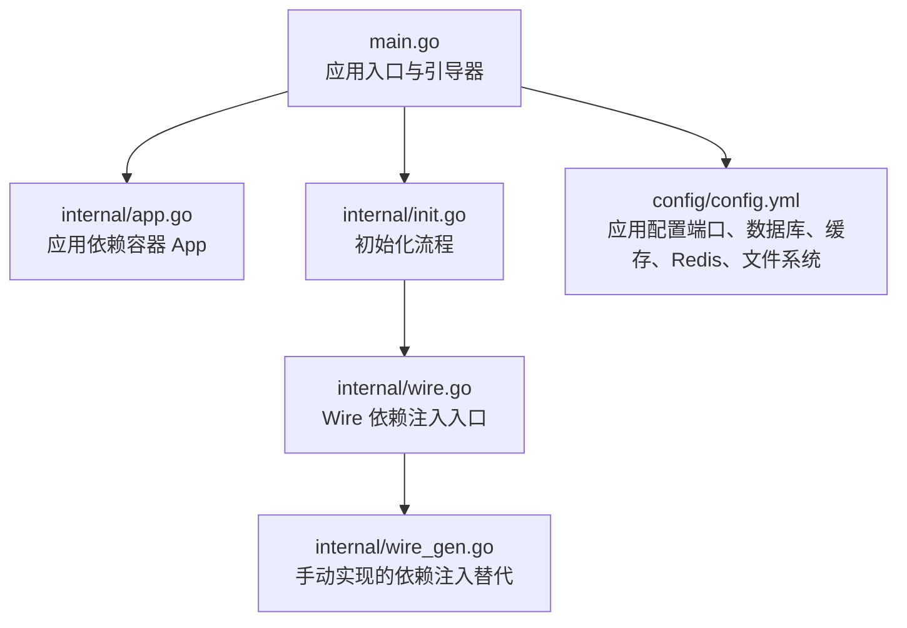
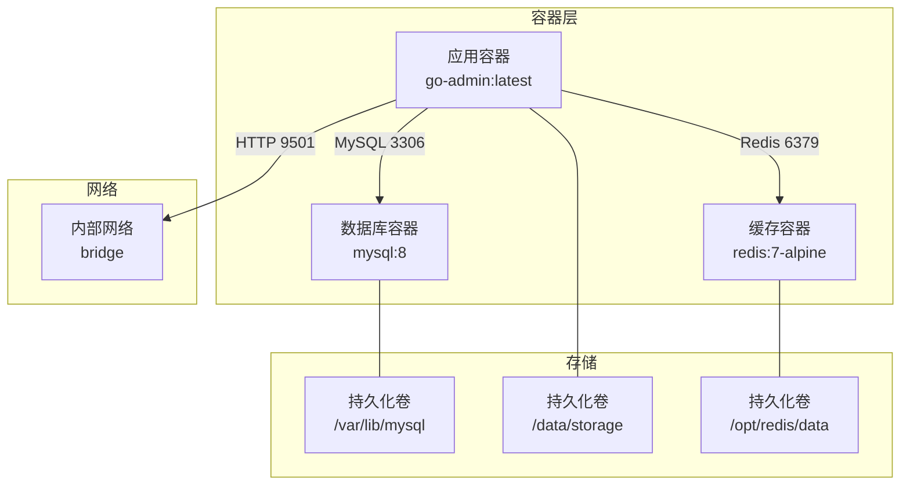
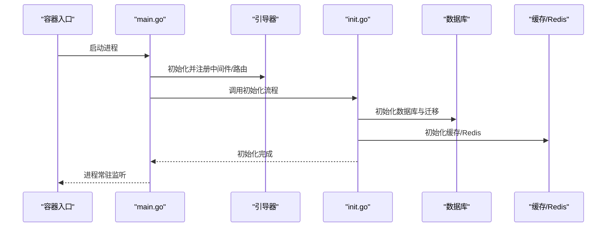
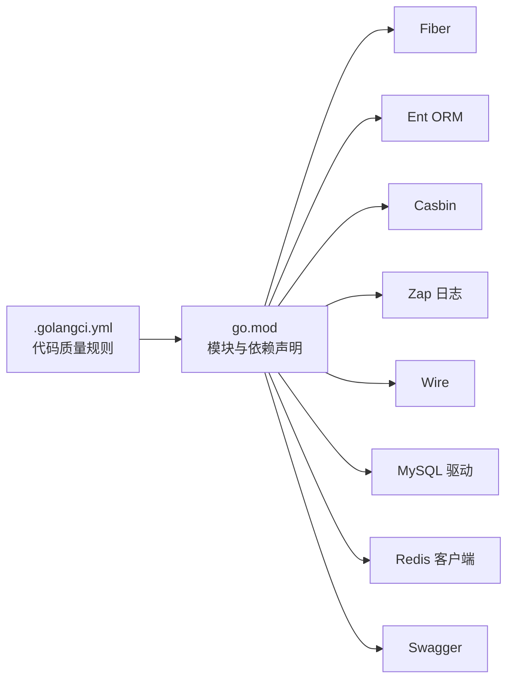

# 容器化部署

<cite>
**本文引用的文件**
- [main.go](file://main.go)
- [config.yml](file://config/config.yml)
- [go.mod](file://go.mod)
- [init.go](file://internal/init.go)
- [app.go](file://internal/app.go)
- [wire.go](file://internal/wire.go)
- [wire_gen.go](file://internal/wire_gen.go)
- [.golangci.yml](file://.golangci.yml)
</cite>

## 目录
1. [简介](#简介)
2. [项目结构](#项目结构)
3. [核心组件](#核心组件)
4. [架构总览](#架构总览)
5. [详细组件分析](#详细组件分析)
6. [依赖分析](#依赖分析)
7. [性能考虑](#性能考虑)
8. [故障排查指南](#故障排查指南)
9. [结论](#结论)
10. [附录](#附录)

## 简介
本文件面向 Go Admin 系统的容器化部署，提供从镜像构建到编排与运维的完整实践指南。内容覆盖：
- Docker 多阶段构建、镜像优化与安全加固
- Docker Compose 编排（应用、数据库、缓存）
- 容器网络、数据卷与环境变量传递
- Kubernetes 清单与 Helm Chart 配置思路
- 健康检查、重启策略与资源限制
- 日志收集与监控
- 故障排查与性能优化建议

## 项目结构
Go Admin 是基于 Fiber 的 Web 应用，采用模块化设计与依赖注入（Wire）。应用启动流程通过引导器注册中间件、路由与清理函数，并在运行时加载配置、初始化数据库与缓存、执行种子数据与定时任务。

图表来源
- [main.go:47-107](file://main.go#L47-L107)
- [app.go:15-26](file://internal/app.go#L15-L26)
- [init.go:39-96](file://internal/init.go#L39-L96)
- [wire.go:22-37](file://internal/wire.go#L22-L37)
- [wire_gen.go:17-62](file://internal/wire_gen.go#L17-L62)
- [config.yml:1-143](file://config/config.yml#L1-L143)

章节来源
- [main.go:47-107](file://main.go#L47-L107)
- [config.yml:1-143](file://config/config.yml#L1-L143)

## 核心组件
- 应用入口与引导器：负责初始化依赖、注册中间件与路由、运行服务。
- 应用依赖容器 App：聚合配置、日志、数据库、校验器、缓存、Ent 客户端、Casbin 策略管理器、文件系统。
- 初始化流程：根据配置初始化数据库、Casbin、定时任务、密钥与随机数存储、种子数据与字典数据。
- 配置系统：集中管理应用、日志、数据库、缓存、Redis、文件系统与 Casbin 等配置项。

章节来源
- [main.go:47-107](file://main.go#L47-L107)
- [app.go:15-26](file://internal/app.go#L15-L26)
- [init.go:39-96](file://internal/init.go#L39-L96)
- [config.yml:1-143](file://config/config.yml#L1-L143)

## 架构总览
应用采用“单体容器”部署模式，前端静态资源由嵌入文件系统提供，后端通过中间件对 API 与静态资源进行分流。数据库与缓存（内存/Redis）可作为外部服务或容器编排。

图表来源
- [main.go:47-107](file://main.go#L47-L107)
- [config.yml:19-30](file://config/config.yml#L19-L30)
- [config.yml:42-58](file://config/config.yml#L42-L58)
- [config.yml:60-76](file://config/config.yml#L60-L76)

## 详细组件分析

### 组件一：应用容器（Go Admin）
- 运行时行为
  - 读取配置并初始化日志、数据库、缓存、Casbin、文件系统与定时任务。
  - 注册中间件：静态资源中间件与 SPA 回退逻辑。
  - 注册路由与清理函数，优雅退出。
- 端口与协议
  - 监听端口来自配置；默认端口为 9501。
- 数据卷
  - 日志与上传文件存储路径来自配置，需映射为持久化卷。
- 环境变量
  - 通过环境变量覆盖配置项（如数据库连接、Redis 地址、日志路径等）。

图表来源
- [main.go:47-107](file://main.go#L47-L107)
- [init.go:39-96](file://internal/init.go#L39-L96)

章节来源
- [main.go:47-107](file://main.go#L47-L107)
- [init.go:39-96](file://internal/init.go#L39-L96)
- [config.yml:19-30](file://config/config.yml#L19-L30)
- [config.yml:42-58](file://config/config.yml#L42-L58)
- [config.yml:60-76](file://config/config.yml#L60-L76)

### 组件二：数据库容器（MySQL）
- 配置要点
  - 主机、端口、用户名、密码、数据库名、SSL、表前缀等均来自配置。
- 卷与备份
  - 建议挂载 /var/lib/mysql，开启备份与快照策略。
- 连接与安全
  - 生产环境建议启用 SSL、弱密码限制与只读账号分离。

章节来源
- [config.yml:19-30](file://config/config.yml#L19-L30)

### 组件三：缓存容器（Redis）
- 配置要点
  - 地址、认证、DB、连接池大小、超时与 TLS 等参数来自配置。
- 卷与持久化
  - Redis 作为缓存可不挂载持久化卷；若需要持久化，建议挂载 /data 并启用 RDB/AOF。
- 性能与安全
  - 合理设置连接池与超时；生产环境启用 TLS 与访问控制。

章节来源
- [config.yml:42-58](file://config/config.yml#L42-L58)

### 组件四：文件系统与静态资源
- 静态资源
  - 嵌入前端 dist 目录，通过中间件提供；无需单独挂载静态目录。
- 上传文件
  - 本地磁盘驱动需映射为持久化卷，避免容器重建丢失数据。
- 对象存储
  - S3 驱动可选，生产建议使用云厂商对象存储并配置凭证。

章节来源
- [main.go:44-45](file://main.go#L44-L45)
- [main.go:64-93](file://main.go#L64-L93)
- [config.yml:60-76](file://config/config.yml#L60-L76)

## 依赖分析
- 运行时依赖
  - Fiber Web 框架、Ent ORM、Casbin 权限引擎、Zap 日志、Wire 依赖注入等。
- 外部依赖
  - MySQL 驱动、Redis 客户端、Swagger 文档工具等。
- 构建与质量
  - 使用 golangci-lint 进行静态检查，排除生成代码与测试文件。

图表来源
- [go.mod:5-18](file://go.mod#L5-L18)
- [.golangci.yml:14-38](file://.golangci.yml#L14-L38)

章节来源
- [go.mod:5-18](file://go.mod#L5-L18)
- [.golangci.yml:14-38](file://.golangci.yml#L14-L38)

## 性能考虑
- 连接池与超时
  - 数据库与 Redis 的连接池大小、空闲时间与超时应结合并发与延迟调优。
- 缓存策略
  - 启用 Redis 缓存热点数据，降低数据库压力；合理设置 TTL。
- 文件系统
  - 上传文件使用本地磁盘时务必挂载持久化卷；高并发场景建议使用对象存储。
- 中间件与路由
  - 静态资源与 API 路由分流，减少不必要的处理开销。
- 日志轮转
  - 合理设置日志文件大小、备份数量与保留天数，避免磁盘占满。

章节来源
- [config.yml:11-17](file://config/config.yml#L11-L17)
- [config.yml:42-58](file://config/config.yml#L42-L58)
- [config.yml:60-76](file://config/config.yml#L60-L76)

## 故障排查指南
- 启动失败
  - 检查配置文件中的数据库与 Redis 地址、凭据是否正确；确认容器网络连通性。
- 数据库连接异常
  - 核对主机、端口、用户名、密码与数据库名；生产环境建议启用 SSL。
- 缓存不可用
  - 检查 Redis 地址、认证与连接池参数；确认网络策略与防火墙。
- 静态资源 404 或路由回退异常
  - 确认中间件对 API 与静态资源的分流逻辑；检查嵌入资源路径。
- 日志异常
  - 检查日志输出开关与文件路径；确认日志卷挂载与权限。
- 性能问题
  - 分析慢查询、缓存命中率与连接池使用情况；调整超时与池大小。

章节来源
- [main.go:64-93](file://main.go#L64-L93)
- [config.yml:11-17](file://config/config.yml#L11-L17)
- [config.yml:19-30](file://config/config.yml#L19-L30)
- [config.yml:42-58](file://config/config.yml#L42-L58)

## 结论
通过合理的镜像构建、编排与运维策略，Go Admin 可以稳定地运行在容器环境中。建议优先采用多阶段构建与最小基础镜像，结合持久化卷与外部数据库/缓存，配合健康检查与资源限制，实现高可用与可观测性。

## 附录

### A. Docker 镜像构建最佳实践
- 多阶段构建
  - 使用构建阶段下载依赖与编译，最终阶段仅拷贝二进制与必要运行时库，减小镜像体积。
- 基础镜像选择
  - 生产环境使用精简的基础镜像（如 alpine），注意二进制兼容性。
- 安全加固
  - 使用非 root 用户运行；最小权限原则；定期更新基础镜像与依赖。
- 运行参数
  - 设置工作目录、环境变量、健康检查与资源限制；暴露端口与映射。

### B. Docker Compose 编排示例（思路）
- 服务
  - 应用服务：挂载日志与上传目录，连接数据库与 Redis。
  - 数据库服务：持久化卷、初始化脚本、只读账号。
  - 缓存服务：持久化卷（可选）、TLS 与访问控制。
- 网络
  - 自定义桥接网络，隔离应用与数据库/缓存。
- 环境变量
  - 使用 .env 文件或 secrets 管理敏感信息。

### C. Kubernetes 清单与 Helm Chart 配置思路
- 清单元素
  - Deployment：副本数、滚动更新策略、资源限制与请求。
  - Service：ClusterIP/LoadBalancer、端口映射。
  - ConfigMap：应用配置（避免硬编码）。
  - Secret：数据库与 Redis 凭据。
  - PersistentVolumeClaim：日志与上传目录。
- 健康检查
  - LivenessProbe/ReadinessProbe：基于 HTTP GET /health。
- Helm Chart
  - 将镜像、端口、资源、存储与配置抽象为可配置参数，便于复用与升级。

### D. 健康检查、重启策略与资源限制
- 健康检查
  - HTTP GET /health 或 TCP Socket 检查端口；失败次数与间隔合理设置。
- 重启策略
  - Always 适合应用容器；数据库与缓存容器根据需求选择。
- 资源限制
  - CPU/内存请求与限制结合历史负载与峰值设定，避免 OOM。

### E. 日志收集与监控
- 日志
  - stdout/stderr 输出结合容器日志驱动；日志轮转与归档策略。
- 监控
  - 指标采集（Prometheus）与链路追踪（OpenTelemetry）；告警规则基于错误率与延迟。