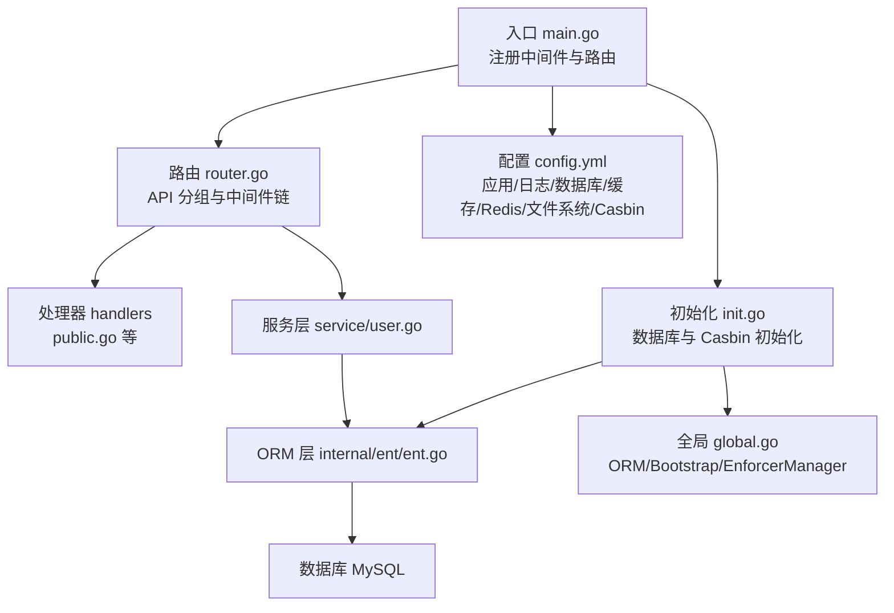
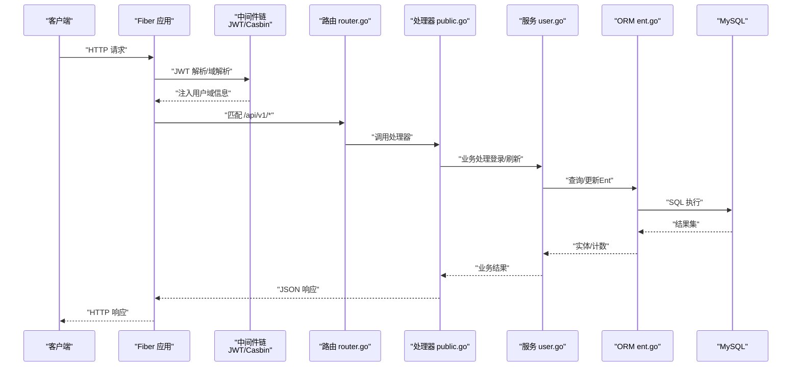
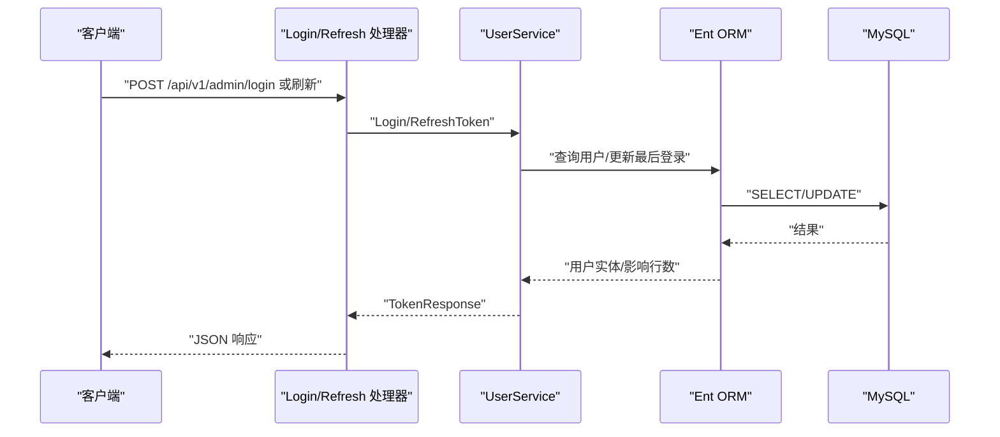
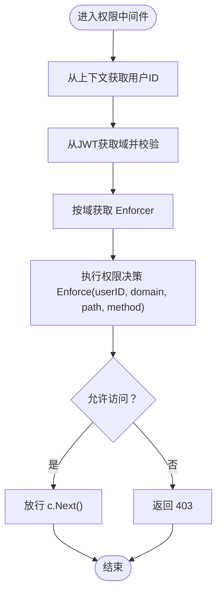
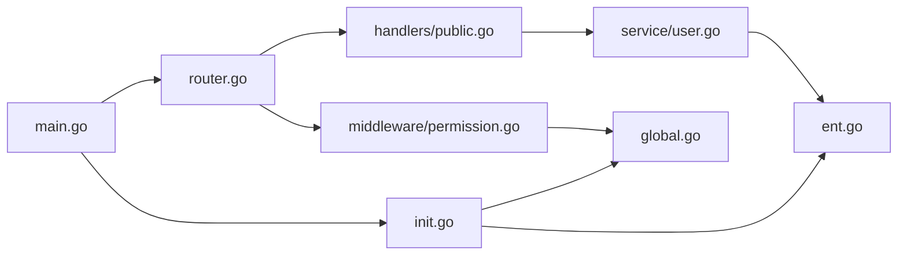

# 性能优化

<cite>
**本文引用的文件**
- [main.go](file://main.go)
- [config.yml](file://config/config.yml)
- [init.go](file://internal/init.go)
- [router.go](file://internal/router.go)
- [global.go](file://internal/global/global.go)
- [ent.go](file://internal/ent/ent.go)
- [user.go](file://internal/service/user.go)
- [permission.go](file://internal/middleware/permission.go)
- [public.go](file://internal/handler/public.go)
- [go.mod](file://go.mod)
</cite>

## 目录
1. [简介](#简介)
2. [项目结构](#项目结构)
3. [核心组件](#核心组件)
4. [架构总览](#架构总览)
5. [详细组件分析](#详细组件分析)
6. [依赖分析](#依赖分析)
7. [性能考虑](#性能考虑)
8. [故障排查指南](#故障排查指南)
9. [结论](#结论)
10. [附录](#附录)

## 简介
本文件面向 Go Admin 管理系统，聚焦于应用性能调优与工程化优化策略，覆盖并发配置、内存与 GC 调优、数据库查询与索引设计、缓存策略与穿透防护、静态资源与 CDN、负载均衡与会话保持、微服务监控与瓶颈分析、性能测试与基准测试、资源利用率与成本控制、以及性能问题诊断与解决路径。文档基于仓库现有代码与配置进行分析，并提供可落地的优化建议。

## 项目结构
系统采用 Fiber 应用 + Ent ORM + Casbin 权限模型的分层架构：
- 入口与中间件：main.go 注册静态资源与 SPA 路由回退、注册路由与清理函数
- 配置中心：config.yml 提供应用、日志、数据库、缓存、Redis、文件系统、Casbin 等配置
- 初始化流程：init.go 负责数据库连接与迁移、Casbin 执行器初始化
- 路由与鉴权：router.go 定义 API 分组与 JWT/Casbin 中间件链
- 服务层：service/user.go 实现用户登录、令牌刷新、密码变更等业务逻辑
- 中间件：middleware/permission.go 实现权限校验与域解析
- 全局状态：global/global.go 暴露 ORM、Bootstrap、EnforcerManager
- ORM 层：internal/ent/ent.go 为 Ent 自动生成的查询与扫描工具集

图表来源
- [main.go:43-89](file://main.go#L43-L89)
- [router.go:14-72](file://internal/router.go#L14-L72)
- [user.go:36-44](file://internal/service/user.go#L36-L44)
- [ent.go:1-615](file://internal/ent/ent.go#L1-L615)
- [config.yml:1-143](file://config/config.yml#L1-L143)
- [init.go:17-65](file://internal/init.go#L17-L65)
- [global.go:10-14](file://internal/global/global.go#L10-L14)

章节来源
- [main.go:43-89](file://main.go#L43-L89)
- [config.yml:1-143](file://config/config.yml#L1-L143)
- [init.go:17-65](file://internal/init.go#L17-L65)
- [router.go:14-72](file://internal/router.go#L14-L72)
- [global.go:10-14](file://internal/global/global.go#L10-L14)
- [ent.go:1-615](file://internal/ent/ent.go#L1-L615)

## 核心组件
- 应用入口与中间件
  - 静态资源嵌入与 SPA 回退：通过 embed 文件系统挂载前端 dist 目录，对非 API 请求回退到 index.html，减少 Nginx/反向代理依赖，降低一次握手与转发开销
  - 中间件注册：在 Bootstrap 中注册自定义中间件，统一处理 SPA 路由与静态资源
- 配置中心
  - 应用参数：端口、调试模式、空闲超时、prefork、Swagger、登录过期时间等
  - 数据库：驱动、主机、端口、凭据、表前缀等
  - 缓存：内存与 Redis 存储，支持 TTL
  - Redis：连接池大小、空闲连接数、读写超时、生命周期等
  - 文件系统：本地与 S3 驱动
  - Casbin：多域模型与自动加载
- 初始化流程
  - 数据库连接与迁移：使用 Ent SQL 驱动创建客户端并执行 Schema.Create
  - Casbin：基于 Ent 适配器初始化 EnforcerManager
- 路由与鉴权
  - API 分组与版本化，JWT 中间件注入用户上下文，Casbin 权限中间件按域校验
- 服务层
  - 用户登录、刷新令牌、密码变更等均通过 ORM 查询与更新，涉及数据库往返
- ORM 工具
  - 提供排序、聚合、扫描等工具，便于构建高效查询

章节来源
- [main.go:43-89](file://main.go#L43-L89)
- [config.yml:1-143](file://config/config.yml#L1-L143)
- [init.go:17-65](file://internal/init.go#L17-L65)
- [router.go:14-72](file://internal/router.go#L14-L72)
- [user.go:36-44](file://internal/service/user.go#L36-L44)
- [ent.go:70-110](file://internal/ent/ent.go#L70-L110)

## 架构总览
下图展示从请求进入至数据库与权限校验的关键路径，帮助定位性能瓶颈与优化点。

图表来源
- [main.go:43-89](file://main.go#L43-L89)
- [router.go:14-72](file://internal/router.go#L14-L72)
- [public.go:22-45](file://internal/handler/public.go#L22-L45)
- [user.go:128-206](file://internal/service/user.go#L128-L206)
- [ent.go:540-577](file://internal/ent/ent.go#L540-L577)

## 详细组件分析

### 组件A：登录与令牌刷新流程
- 流程要点
  - 登录：查询用户、校验状态与密码、生成访问/刷新令牌、更新最后登录时间
  - 刷新：解析刷新令牌、校验类型与用户状态、签发新访问令牌
- 性能关注点
  - 单次数据库往返（查询+更新），建议确保邮箱字段建立合适索引
  - 密码哈希/校验为 CPU 密集操作，建议评估硬件与算法参数
  - 令牌签发与解析为轻量操作，但需避免重复解析与无效重试

图表来源
- [public.go:22-45](file://internal/handler/public.go#L22-L45)
- [public.go:158-179](file://internal/handler/public.go#L158-L179)
- [user.go:128-206](file://internal/service/user.go#L128-L206)
- [user.go:274-356](file://internal/service/user.go#L274-L356)
- [ent.go:540-577](file://internal/ent/ent.go#L540-L577)

章节来源
- [public.go:22-45](file://internal/handler/public.go#L22-L45)
- [public.go:158-179](file://internal/handler/public.go#L158-L179)
- [user.go:128-206](file://internal/service/user.go#L128-L206)
- [user.go:274-356](file://internal/service/user.go#L274-L356)
- [ent.go:540-577](file://internal/ent/ent.go#L540-L577)

### 组件B：权限中间件与 Casbin 执行器
- 流程要点
  - 从 JWT 中提取域信息，按域获取 Enforcer，执行权限决策
- 性能关注点
  - Enforcer 获取与权限决策为轻量操作；高频域建议启用自动加载以减少首次延迟
  - 建议对高频请求路径进行缓存（见“缓存策略”）

图表来源
- [permission.go:12-53](file://internal/middleware/permission.go#L12-L53)

章节来源
- [permission.go:12-53](file://internal/middleware/permission.go#L12-L53)

### 组件C：数据库查询与 ORM 工具
- 关键能力
  - 排序、聚合、扫描等工具，支持 Asc/Desc、Sum/Avg/Count 等
- 性能关注点
  - 查询构建与扫描路径直接影响 IO 与 CPU；建议结合索引与分页
  - 批量更新/删除建议使用 ORM 提供的批量接口，减少往返

章节来源
- [ent.go:70-110](file://internal/ent/ent.go#L70-L110)
- [ent.go:126-175](file://internal/ent/ent.go#L126-L175)
- [ent.go:540-577](file://internal/ent/ent.go#L540-L577)

## 依赖分析
- 运行时依赖
  - Fiber v2：高性能 Web 框架
  - Ent v0.14.5：类型安全 ORM
  - MySQL 驱动：数据库访问
  - Casbin v2：RBAC 权限模型
  - gocache/redis：缓存栈（间接依赖）
- 内部耦合
  - 全局 ORM 与 EnforcerManager 在 init 阶段注入，服务层通过全局访问
  - 路由与中间件链依赖 JWT 与 Casbin 中间件

图表来源
- [main.go:43-89](file://main.go#L43-L89)
- [router.go:14-72](file://internal/router.go#L14-L72)
- [init.go:17-65](file://internal/init.go#L17-L65)
- [global.go:10-14](file://internal/global/global.go#L10-L14)
- [public.go:22-45](file://internal/handler/public.go#L22-L45)
- [permission.go:12-53](file://internal/middleware/permission.go#L12-L53)
- [user.go:36-44](file://internal/service/user.go#L36-L44)
- [ent.go:1-615](file://internal/ent/ent.go#L1-L615)

章节来源
- [go.mod:5-120](file://go.mod#L5-L120)
- [main.go:43-89](file://main.go#L43-L89)
- [router.go:14-72](file://internal/router.go#L14-L72)
- [init.go:17-65](file://internal/init.go#L17-L65)
- [global.go:10-14](file://internal/global/global.go#L10-L14)
- [public.go:22-45](file://internal/handler/public.go#L22-L45)
- [permission.go:12-53](file://internal/middleware/permission.go#L12-L53)
- [user.go:36-44](file://internal/service/user.go#L36-L44)
- [ent.go:1-615](file://internal/ent/ent.go#L1-L615)

## 性能考虑

### 并发配置与运行参数
- 应用并发
  - 配置项 app.prefork 控制是否启用预分叉；在多核环境下可提升吞吐
  - app.idle_timeout 控制空闲连接超时，避免资源泄漏
- HTTP 层
  - 使用 Fiber 的内置中间件与路由分组，减少每请求对象分配
- 建议
  - 生产环境开启 app.debug=false
  - 根据实例核数与负载调整 app.prefork 与连接池参数

章节来源
- [config.yml:1-18](file://config/config.yml#L1-L18)
- [main.go:43-89](file://main.go#L43-L89)

### 内存管理与 GC 调优
- 当前现状
  - 未显式设置 GOGC/GOMAXPROCS；默认行为可能不满足高并发场景
- 建议
  - 显式设置 GOMAXPROCS 与 GOGC，结合压测结果迭代
  - 使用 pprof/trace 定位热点与阻塞点
  - 减少字符串拼接与临时对象创建，复用缓冲区

章节来源
- [main.go:43-89](file://main.go#L43-L89)

### 数据库查询优化与索引设计最佳实践
- 查询路径
  - 登录：按邮箱查询用户，建议为 email 字段建立唯一索引
  - 刷新：按 UID 查询用户，建议为 uid 建立主键/唯一索引
  - 更新：按 UID 更新，建议保持主键命中
- 索引设计
  - 唯一性：email、uid 等唯一标识字段必须有唯一索引
  - 覆盖索引：常用过滤/排序字段组合建立复合索引
  - 分页：对分页查询添加稳定排序列，避免文件排序
- ORM 使用
  - 使用 Asc/Desc 与聚合函数，避免全表扫描
  - 批量更新/删除减少往返次数

章节来源
- [user.go:128-206](file://internal/service/user.go#L128-L206)
- [user.go:274-356](file://internal/service/user.go#L274-L356)
- [ent.go:70-110](file://internal/ent/ent.go#L70-L110)
- [ent.go:126-175](file://internal/ent/ent.go#L126-L175)

### 缓存策略与缓存穿透防护
- 现状
  - 支持内存与 Redis 缓存，可通过 config.yml 配置
- 策略
  - 读多写少数据：热点用户信息、权限清单、菜单树等
  - 写策略：先更新数据库再更新缓存，或延时双删
  - 缓存穿透：对空值也缓存短 TTL，防止恶意/异常高频查询
  - 缓存击穿：热点 key 设置互斥锁或永不过期 + 异步更新
  - 缓存雪崩：为 TTL 墋化增加随机抖动
- 与权限集成
  - 用户权限与菜单可缓存，结合 Casbin 域与用户 ID 构造键

章节来源
- [config.yml:32-58](file://config/config.yml#L32-L58)
- [permission.go:12-53](file://internal/middleware/permission.go#L12-L53)

### 静态资源优化与 CDN 配置
- 现状
  - 使用 embed FS 将前端 dist 嵌入二进制，减少外部依赖
- 优化
  - 开启 gzip/br 压缩（Fiber 可配合中间件）
  - 使用 CDN 缓存静态资源，设置合理 Cache-Control
  - 对 index.html 设置较短缓存，其他资源长期缓存
  - 采用子域名或路径前缀区分静态资源

章节来源
- [main.go:40-76](file://main.go#L40-L76)

### 负载均衡算法与会话保持
- 算法选择
  - 小流量：轮询/权重轮询
  - 高并发：最少连接/加权最少连接
  - 有状态：源地址哈希/粘性会话
- 会话保持
  - 若使用 JWT 无状态鉴权，无需会话粘性
  - 若使用 Cookie/服务器会话，建议开启粘性会话或共享会话存储

章节来源
- [router.go:32-37](file://internal/router.go#L32-L37)

### 微服务架构下的性能监控与瓶颈分析
- 指标
  - QPS/响应时间/错误率/P95/P99
  - CPU/内存/GC 次数/停顿时间
  - 数据库 QPS/慢查询/连接数
- 工具
  - Prometheus + Grafana
  - pprof/火焰图
  - APM（如 Jaeger/OpenTelemetry）
- 方法
  - 分布式追踪定位跨服务链路
  - 数据库慢查询日志与 EXPLAIN 分析
  - 缓存命中率与延迟监控

章节来源
- [go.mod:81-85](file://go.mod#L81-L85)

### 性能测试方法与基准测试工具使用
- 基准测试
  - 使用 Go 内置 testing 包编写 Benchmarks
  - 对关键路径（登录、权限决策、查询）做单测与基准
- 压力测试
  - wrk/ab：模拟高并发请求
  - Locust/JMeter：模拟真实用户行为
- 结果分析
  - 关注 P95/P99 延迟与错误率
  - 逐步引入缓存/索引/连接池优化并回归测试

章节来源
- [user.go:128-206](file://internal/service/user.go#L128-L206)
- [permission.go:12-53](file://internal/middleware/permission.go#L12-L53)

### 资源利用率优化与成本控制
- 计算资源
  - 合理设置副本数与水平扩展阈值
  - 使用 HPA/资源限制避免资源争抢
- 存储与网络
  - 使用对象存储与 CDN 降低带宽与延迟
  - 数据库只读副本与冷热分离
- 成本优化
  - 混合云/预留实例/Spot 实例
  - 自动伸缩与闲置资源回收

章节来源
- [config.yml:60-76](file://config/config.yml#L60-L76)

### 性能问题诊断与解决方案
- 常见问题
  - 登录/刷新慢：检查数据库索引、慢查询日志、密码哈希参数
  - 权限拒绝频繁：检查 Casbin 域配置与 Enforcer 获取路径
  - 静态资源加载慢：检查压缩与 CDN 缓存策略
- 诊断手段
  - pprof/trace 定位 CPU/内存/GC 热点
  - Fiber 日志与自定义中间件埋点
  - 数据库 EXPLAIN 与慢查询分析

章节来源
- [user.go:128-206](file://internal/service/user.go#L128-L206)
- [permission.go:12-53](file://internal/middleware/permission.go#L12-L53)
- [main.go:40-76](file://main.go#L40-L76)

## 故障排查指南
- 登录失败
  - 用户不存在/状态异常/密码错误：服务层返回明确错误码，前端提示
  - 数据库连接异常：检查 config.yml 中数据库配置与网络连通性
- 权限拒绝
  - JWT 缺失域信息：确认中间件链顺序与 JWT 载荷
  - Enforcer 获取失败：检查 Casbin 域配置与自动加载
- 静态资源 404
  - 确认 embed 路径与 SPA 回退逻辑
- 性能退化
  - 使用 pprof/trace 定位热点；检查索引缺失与慢查询

章节来源
- [public.go:22-45](file://internal/handler/public.go#L22-L45)
- [public.go:158-179](file://internal/handler/public.go#L158-L179)
- [permission.go:12-53](file://internal/middleware/permission.go#L12-L53)
- [config.yml:19-31](file://config/config.yml#L19-L31)
- [main.go:40-76](file://main.go#L40-L76)

## 结论
本项目具备清晰的分层与可扩展性，性能优化应围绕“数据库索引与查询、缓存策略、静态资源与 CDN、并发与 GC、监控与压测”五个维度展开。通过合理的配置与工程化手段，可在保证安全性与可维护性的前提下显著提升吞吐与稳定性。

## 附录
- 关键配置参考
  - 应用与日志：config.yml app/log
  - 数据库与表前缀：config.yml database
  - 缓存与 Redis：config.yml cache/redis
  - 文件系统：config.yml filesystem
  - Casbin 多域：config.yml casbin
- 初始化与全局状态
  - init.go：数据库与 Casbin 初始化
  - global.go：ORM/Bootstrap/EnforcerManager 全局持有

章节来源
- [config.yml:1-143](file://config/config.yml#L1-L143)
- [init.go:17-65](file://internal/init.go#L17-L65)
- [global.go:10-14](file://internal/global/global.go#L10-L14)