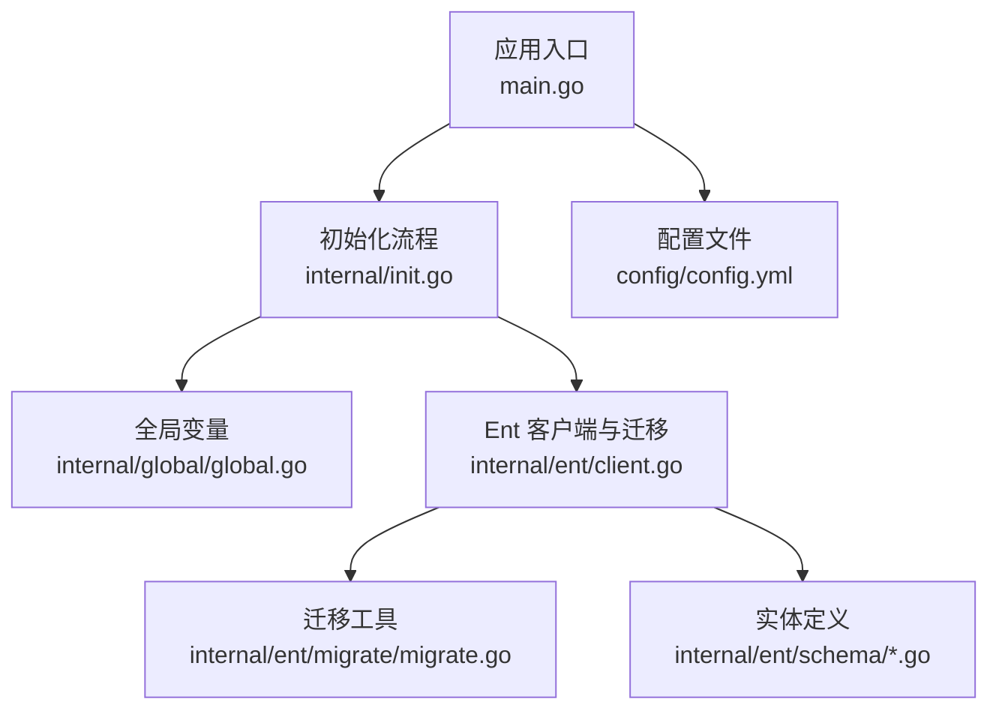
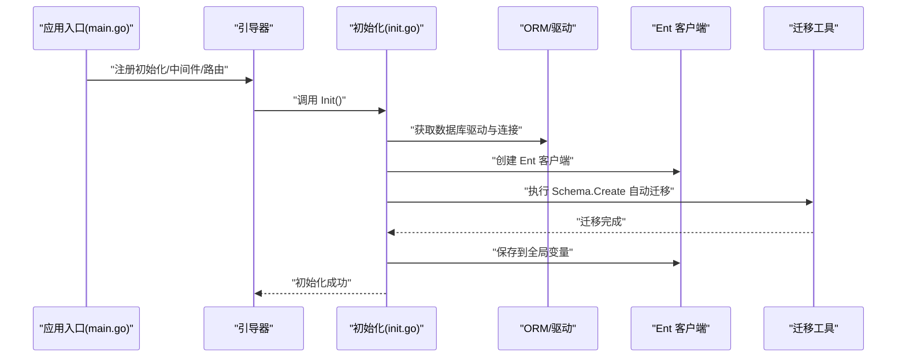
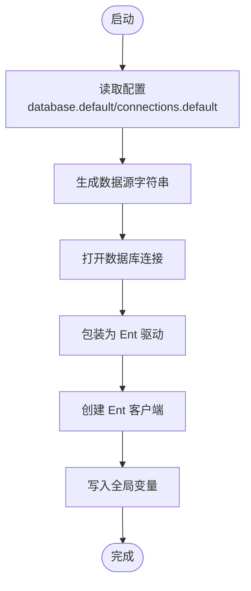
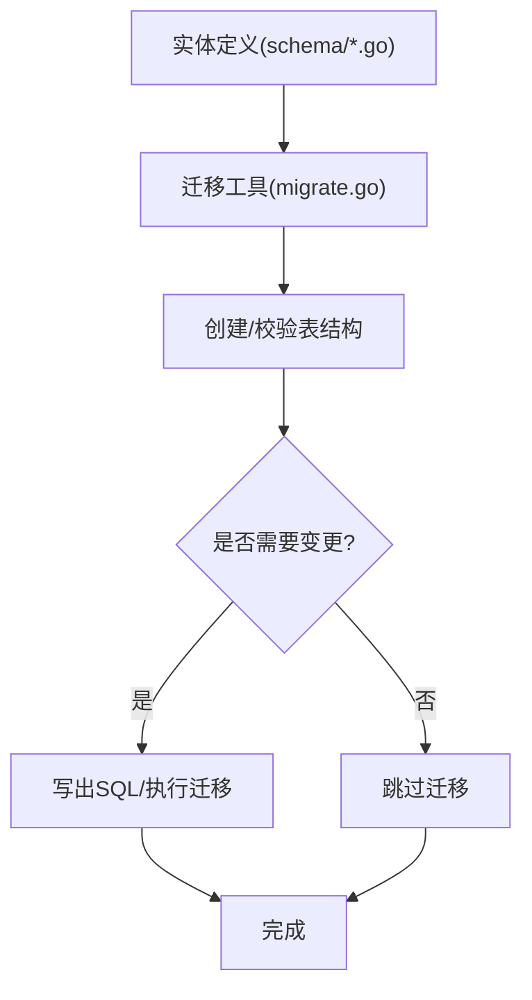
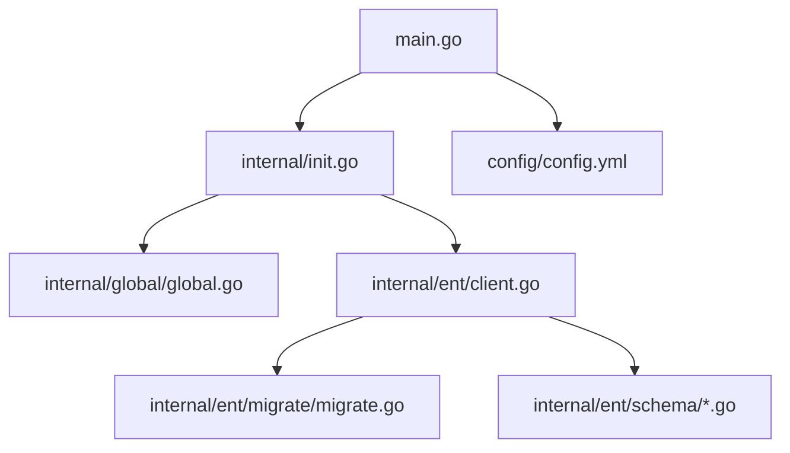

# 数据库初始化

<cite>
**本文引用的文件**
- [config.yml](file://config/config.yml)
- [init.go](file://internal/init.go)
- [global.go](file://internal/global/global.go)
- [ent.go](file://internal/ent/ent.go)
- [client.go](file://internal/ent/client.go)
- [migrate.go](file://internal/ent/migrate/migrate.go)
- [user.go](file://internal/ent/schema/user.go)
- [role.go](file://internal/ent/schema/role.go)
- [userrole.go](file://internal/ent/schema/userrole.go)
- [main.go](file://main.go)
</cite>

## 目录
1. [简介](#简介)
2. [项目结构](#项目结构)
3. [核心组件](#核心组件)
4. [架构总览](#架构总览)
5. [详细组件分析](#详细组件分析)
6. [依赖分析](#依赖分析)
7. [性能考虑](#性能考虑)
8. [故障排查指南](#故障排查指南)
9. [结论](#结论)
10. [附录](#附录)

## 简介
本文件面向 Go Admin 管理系统的数据库初始化与运维，围绕以下主题展开：
- 数据库连接配置与连接池设置
- Ent ORM 数据库迁移机制（自动迁移、版本控制、回滚策略）
- 初始数据导入与种子数据配置
- 数据库备份与恢复脚本模板
- 主从复制与读写分离配置建议
- 数据库性能监控与慢查询分析
- 数据库安全加固与权限管理
- 数据库容量规划与扩容策略
- 数据库维护任务与自动化脚本

## 项目结构
本项目采用模块化组织方式，数据库初始化与 ORM 相关代码集中在 internal/ent 与 internal/init 中，配置集中于 config/config.yml。

图表来源
- [main.go:43-89](file://main.go#L43-L89)
- [init.go:17-66](file://internal/init.go#L17-L66)
- [global.go:10-15](file://internal/global/global.go#L10-L15)
- [client.go:40-53](file://internal/ent/client.go#L40-L53)
- [migrate.go:35-65](file://internal/ent/migrate/migrate.go#L35-L65)
- [user.go:17-104](file://internal/ent/schema/user.go#L17-L104)
- [role.go:10-73](file://internal/ent/schema/role.go#L10-L73)
- [userrole.go:11-56](file://internal/ent/schema/userrole.go#L11-L56)
- [config.yml:19-31](file://config/config.yml#L19-L31)

章节来源
- [main.go:43-89](file://main.go#L43-L89)
- [config.yml:19-31](file://config/config.yml#L19-L31)

## 核心组件
- 应用入口与引导：负责注册初始化函数、中间件与路由，并在启动时调用初始化流程。
- 初始化流程：解析配置，建立数据库连接，创建 Ent 客户端并执行自动迁移，随后初始化权限执行器。
- 全局变量：保存 ORM 客户端与权限执行器管理器，供后续服务层使用。
- Ent 客户端与迁移：封装数据库驱动、事务、调试日志与迁移能力；迁移工具支持创建、写出 SQL 等操作。
- 实体定义：用户、角色、用户角色等表结构与索引定义，作为迁移的基础。

章节来源
- [main.go:43-89](file://main.go#L43-L89)
- [init.go:17-66](file://internal/init.go#L17-L66)
- [global.go:10-15](file://internal/global/global.go#L10-L15)
- [client.go:40-53](file://internal/ent/client.go#L40-L53)
- [migrate.go:35-65](file://internal/ent/migrate/migrate.go#L35-L65)
- [user.go:17-104](file://internal/ent/schema/user.go#L17-L104)
- [role.go:10-73](file://internal/ent/schema/role.go#L10-L73)
- [userrole.go:11-56](file://internal/ent/schema/userrole.go#L11-L56)

## 架构总览
下图展示了应用启动时数据库初始化的关键交互：

图表来源
- [main.go:43-89](file://main.go#L43-L89)
- [init.go:17-66](file://internal/init.go#L17-L66)
- [client.go:111-125](file://internal/ent/client.go#L111-L125)
- [migrate.go:43-55](file://internal/ent/migrate/migrate.go#L43-L55)

## 详细组件分析

### 数据库连接配置与连接池设置
- 连接配置来源于配置文件中的 database.default 与 connections.default 字段，包含驱动类型、主机、端口、用户名、密码、数据库名、SSL 与表前缀等。
- 启动时通过初始化流程获取驱动与数据源字符串，创建数据库连接，并包装为 Ent 的 sql/driver。
- Ent 客户端支持开启调试日志与自定义日志函数，便于开发阶段定位问题。

图表来源
- [config.yml:19-31](file://config/config.yml#L19-L31)
- [init.go:33-47](file://internal/init.go#L33-L47)
- [client.go:111-125](file://internal/ent/client.go#L111-L125)

章节来源
- [config.yml:19-31](file://config/config.yml#L19-L31)
- [init.go:33-47](file://internal/init.go#L33-L47)
- [client.go:80-88](file://internal/ent/client.go#L80-L88)

### Ent ORM 数据库迁移机制
- 自动迁移：初始化流程中直接调用 Schema.Create，基于实体定义自动创建表结构与索引。
- 版本控制：Ent 提供迁移工具，支持将变更写出为 SQL 文件以便审阅与回放，避免直接在生产环境执行变更。
- 回滚策略：迁移工具支持写出 SQL，结合数据库备份可实现可控回滚；生产环境建议先在测试环境验证后再执行。

图表来源
- [user.go:17-104](file://internal/ent/schema/user.go#L17-L104)
- [role.go:10-73](file://internal/ent/schema/role.go#L10-L73)
- [userrole.go:11-56](file://internal/ent/schema/userrole.go#L11-L56)
- [migrate.go:43-55](file://internal/ent/migrate/migrate.go#L43-L55)

章节来源
- [migrate.go:35-65](file://internal/ent/migrate/migrate.go#L35-L65)
- [client.go:47-53](file://internal/ent/client.go#L47-L53)

### 初始数据导入与种子数据配置
- 当前仓库未提供专门的种子数据脚本或导入流程。建议在初始化流程中增加“种子数据”步骤，或在迁移完成后执行一次性的数据填充。
- 种子数据可包含系统内置角色、管理员账户、基础字典项等，确保系统上线即具备可用性。

[本节为概念性说明，不直接分析具体文件]

### 数据库备份与恢复脚本模板
- MySQL 备份模板（逻辑备份）：mysqldump -u 用户 -p 数据库 > backup_$(date +%Y%m%d_%H%M%S).sql
- MySQL 恢复模板：mysql -u 用户 -p 数据库 < backup_YYYYMMDD_HHMMSS.sql
- 生产建议：定期全量备份+增量备份，开启二进制日志，配合时间点恢复（PITR）。

[本节为概念性说明，不直接分析具体文件]

### 主从复制与读写分离配置
- 主从复制：在数据库层面配置主库与从库，从库用于只读查询，降低主库压力。
- 读写分离：应用侧或数据库代理层将写操作路由至主库，读操作路由至从库；可通过连接池配置多套连接或使用中间件实现。
- 注意：当前初始化流程未体现读写分离配置，需在应用配置与数据库部署层面补充。

[本节为概念性说明，不直接分析具体文件]

### 数据库性能监控与慢查询分析
- 慢查询日志：开启 long_query_time 与 slow_query_log，定位耗时 SQL。
- 性能视图：利用 INFORMATION_SCHEMA 与性能模式（如 performance_schema）分析锁等待、排序、临时表等。
- 建议：对高频查询添加合适索引，避免全表扫描；对复杂查询拆分或加缓存。

[本节为概念性说明，不直接分析具体文件]

### 数据库安全加固与权限管理
- 最小权限原则：为应用账号授予最小必要权限（如仅 CRUD 与 DDL 权限），避免使用 root。
- SSL 连接：启用 SSL_MODE 并配置证书，防止明文传输。
- 密码策略：定期轮换密码，限制账号登录失败次数，禁用空密码。
- 表前缀：通过配置中的 table_prefix 降低命名冲突风险，便于多租户隔离。

章节来源
- [config.yml:19-31](file://config/config.yml#L19-L31)

### 数据库容量规划与扩容策略
- 规模评估：根据用户规模、数据增长速率、查询负载估算存储与 IO 需求。
- 扩容路径：垂直扩容（提升 CPU/内存/磁盘）与水平扩容（分库分表/读写分离）相结合。
- 监控指标：关注连接数、缓冲池命中率、磁盘 IO、网络带宽与慢查询数量。

[本节为概念性说明，不直接分析具体文件]

### 数据库维护任务与自动化脚本
- 维护任务：定期优化表、重建索引、统计信息更新、清理历史日志。
- 自动化：通过定时任务（Cron）执行备份、健康检查、慢查询收集与报告。
- 建议：将备份与恢复脚本纳入版本控制，统一命名与归档策略。

[本节为概念性说明，不直接分析具体文件]

## 依赖分析
- 应用入口依赖引导器与初始化流程；初始化流程依赖 ORM 驱动与 Ent 客户端；客户端依赖迁移工具与实体定义。
- 配置文件为初始化提供数据源与连接参数。

图表来源
- [main.go:43-89](file://main.go#L43-L89)
- [init.go:17-66](file://internal/init.go#L17-L66)
- [global.go:10-15](file://internal/global/global.go#L10-L15)
- [client.go:40-53](file://internal/ent/client.go#L40-L53)
- [migrate.go:35-65](file://internal/ent/migrate/migrate.go#L35-L65)
- [user.go:17-104](file://internal/ent/schema/user.go#L17-L104)
- [role.go:10-73](file://internal/ent/schema/role.go#L10-L73)
- [userrole.go:11-56](file://internal/ent/schema/userrole.go#L11-L56)
- [config.yml:19-31](file://config/config.yml#L19-L31)

章节来源
- [main.go:43-89](file://main.go#L43-L89)
- [init.go:17-66](file://internal/init.go#L17-L66)
- [client.go:40-53](file://internal/ent/client.go#L40-L53)
- [migrate.go:35-65](file://internal/ent/migrate/migrate.go#L35-L65)
- [config.yml:19-31](file://config/config.yml#L19-L31)

## 性能考虑
- 连接池：合理设置最大连接数、空闲连接数与生命周期，避免连接泄漏与抖动。
- 查询优化：为高频字段添加索引，避免 SELECT *，减少 JOIN 层级。
- 缓存：对热点数据与静态配置引入缓存，降低数据库压力。
- 日志：生产环境谨慎开启调试日志，避免 IO 放大。

[本节为一般性指导，不直接分析具体文件]

## 故障排查指南
- 连接失败：检查配置文件中的主机、端口、用户名、密码与数据库名；确认网络连通与防火墙策略。
- 权限不足：核对数据库账号权限，确保具备 CREATE/ALTER/DROP 等 DDL 权限。
- 迁移异常：查看迁移输出与错误日志；必要时将迁移变更写出为 SQL 文件人工审阅。
- 慢查询：启用慢查询日志，定位热点 SQL 并优化索引或查询计划。

章节来源
- [init.go:33-47](file://internal/init.go#L33-L47)
- [migrate.go:43-55](file://internal/ent/migrate/migrate.go#L43-L55)

## 结论
本项目的数据库初始化流程简洁可靠：通过配置文件提供连接参数，初始化阶段创建数据库连接与 Ent 客户端，并执行自动迁移。建议在现有流程基础上补充种子数据、迁移回滚策略与读写分离配置，并完善备份恢复、性能监控与安全加固方案，以满足生产环境的稳定性与可维护性要求。

[本节为总结性内容，不直接分析具体文件]

## 附录
- 配置文件位置与关键键位：database.default、connections.default、driver/host/port/user/password/name/ssl_mode/table_prefix
- 初始化流程关键步骤：获取驱动与数据源 → 创建数据库连接 → 包装为 Ent 驱动 → 创建客户端 → 执行 Schema.Create → 写入全局变量

章节来源
- [config.yml:19-31](file://config/config.yml#L19-L31)
- [init.go:33-47](file://internal/init.go#L33-L47)
- [client.go:111-125](file://internal/ent/client.go#L111-L125)