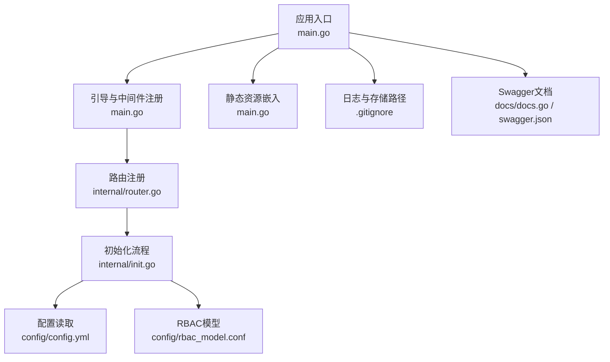
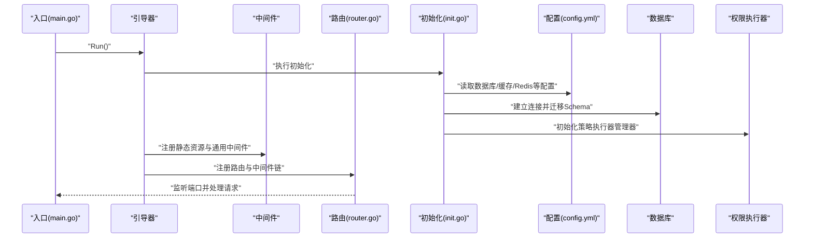
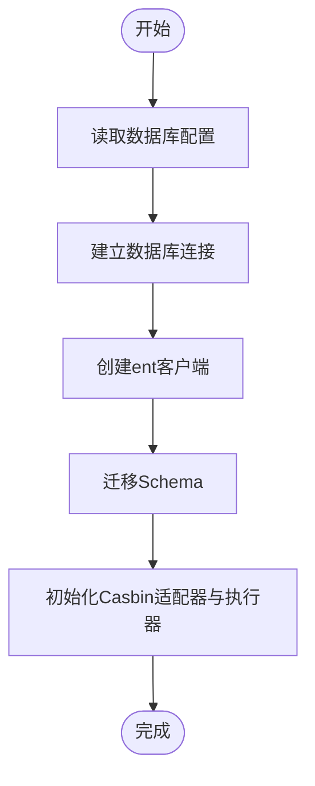
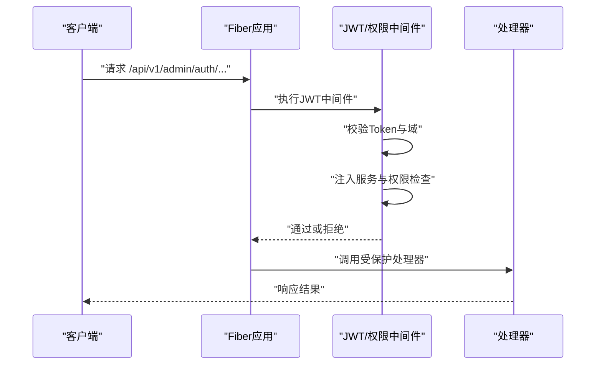
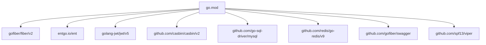

# 环境配置

<cite>
**本文引用的文件**
- [config.yml](file://config/config.yml)
- [rbac_model.conf](file://config/rbac_model.conf)
- [go.mod](file://go.mod)
- [main.go](file://main.go)
- [init.go](file://internal/init.go)
- [router.go](file://internal/router.go)
- [.golangci.yml](file://.golangci.yml)
- [.gitignore](file://.gitignore)
- [docs.go](file://docs/docs.go)
- [swagger.json](file://docs/swagger.json)
</cite>

## 目录
1. [简介](#简介)
2. [项目结构](#项目结构)
3. [核心组件](#核心组件)
4. [架构总览](#架构总览)
5. [详细组件分析](#详细组件分析)
6. [依赖分析](#依赖分析)
7. [性能考虑](#性能考虑)
8. [故障排查指南](#故障排查指南)
9. [结论](#结论)
10. [附录](#附录)

## 简介
本文件面向Go Admin管理系统的环境配置与部署，覆盖开发与生产环境的搭建步骤、Go语言版本要求、依赖安装、配置文件参数说明、环境变量与敏感信息保护、网络与域名绑定、SSL与HTTPS部署、以及环境兼容性测试与验证流程。文档同时提供可视化图示帮助理解系统架构与数据流。

## 项目结构
该仓库采用模块化组织方式，核心入口位于应用根目录，配置集中在config目录，核心业务逻辑位于internal目录，前端静态资源通过嵌入方式提供，日志与存储位于data目录，文档与Swagger定义位于docs目录。

图表来源
- [main.go:43-89](file://main.go#L43-L89)
- [router.go:14-72](file://internal/router.go#L14-L72)
- [init.go:17-65](file://internal/init.go#L17-L65)
- [config.yml:1-143](file://config/config.yml#L1-L143)
- [rbac_model.conf:1-15](file://config/rbac_model.conf#L1-L15)
- [.gitignore:1-3](file://.gitignore#L1-L3)
- [docs.go:234-247](file://docs/docs.go#L234-L247)
- [swagger.json:157-227](file://docs/swagger.json#L157-L227)

章节来源
- [main.go:1-90](file://main.go#L1-L90)
- [config.yml:1-143](file://config/config.yml#L1-L143)
- [.gitignore:1-3](file://.gitignore#L1-L3)

## 核心组件
- 应用入口与引导
  - 应用通过引导器完成初始化、中间件注册、路由注册与清理流程。
  - 静态资源通过嵌入FS提供，支持SPA回退到index.html。
- 初始化流程
  - 数据库初始化：根据配置选择驱动与连接串，创建ent客户端并迁移Schema。
  - Casbin初始化：基于Ent适配器与配置初始化策略执行器管理器。
- 路由与鉴权
  - API路由分组与版本控制，公开登录接口与受JWT与权限中间件保护的管理接口。
  - JWT中间件与权限中间件组合，确保受保护接口的安全访问。
- 配置体系
  - 应用配置（app）、日志配置（log）、数据库配置（database）、缓存配置（cache）、Redis配置（redis）、文件系统配置（filesystem）、Casbin多域配置（casbin）。
  - RBAC模型配置文件用于权限匹配规则。
- 文档与Swagger
  - Swagger注解与模板集成，提供API文档与安全定义。

章节来源
- [main.go:43-89](file://main.go#L43-L89)
- [init.go:17-65](file://internal/init.go#L17-L65)
- [router.go:14-72](file://internal/router.go#L14-L72)
- [config.yml:1-143](file://config/config.yml#L1-L143)
- [rbac_model.conf:1-15](file://config/rbac_model.conf#L1-L15)
- [docs.go:234-247](file://docs/docs.go#L234-L247)

## 架构总览
下图展示应用启动到路由处理的关键交互，包括配置读取、数据库与Casbin初始化、JWT与权限中间件、以及静态资源处理。

图表来源
- [main.go:43-89](file://main.go#L43-L89)
- [init.go:17-65](file://internal/init.go#L17-L65)
- [router.go:14-72](file://internal/router.go#L14-L72)
- [config.yml:1-143](file://config/config.yml#L1-L143)

## 详细组件分析

### 开发环境搭建
- Go语言版本
  - 项目要求Go版本为1.25.1及以上。
- 依赖安装
  - 使用模块管理器安装依赖，确保网络可达与代理配置正确。
- 运行与调试
  - 直接运行入口文件，应用将按配置启动并监听端口。
- 代码质量工具
  - 配置了golangci-lint的启用规则与排除规则，建议在本地开发中保持一致的代码风格。

章节来源
- [go.mod:3](file://go.mod#L3)
- [.golangci.yml:14-38](file://.golangci.yml#L14-L38)

### 生产环境搭建
- 部署前准备
  - 准备数据库实例与Redis实例，确保网络连通与访问权限。
  - 准备静态资源目录（web/dist），确保Nginx/Apache可访问。
- 运行与监控
  - 在容器或服务器上以守护进程方式运行应用，结合系统日志与应用日志进行监控。
  - 使用健康检查端点与指标暴露（如需）保障可用性。

章节来源
- [config.yml:19-58](file://config/config.yml#L19-L58)
- [config.yml:60-76](file://config/config.yml#L60-L76)

### 配置文件详解与最佳实践
- 应用配置（app）
  - 名称、端口、调试模式、空闲超时、预fork、Swagger开关、密钥、登录过期时间等。
  - 最佳实践：生产环境关闭调试模式；设置合理的登录过期时间；启用Swagger仅在开发阶段。
- 日志配置（log）
  - 日志文件路径、控制台输出、文件输出、滚动大小、备份数量、保留天数。
  - 最佳实践：生产环境开启文件输出并配置滚动策略；避免在高并发场景下频繁写盘。
- 数据库配置（database）
  - 默认连接名、驱动、主机、端口、用户名、密码、数据库名、SSL模式、表前缀。
  - 最佳实践：生产环境启用SSL；使用专用账号与最小权限原则；设置合适的表前缀避免冲突。
- 缓存配置（cache）
  - 默认缓存存储、内存与Redis两种存储实现及默认TTL。
  - 最佳实践：高频读写场景优先使用Redis；合理设置TTL与容量。
- Redis配置（redis）
  - 连接地址、用户名、密码、数据库号、拨号/读写超时、连接池大小、空闲连接数、生命周期、TLS开关。
  - 最佳实践：生产环境启用TLS；根据QPS调整连接池大小；设置合理的超时与生命周期。
- 文件系统配置（filesystem）
  - 默认磁盘、是否与本地结合、本地磁盘根目录、S3磁盘的AK/SK/区域/桶/端点。
  - 最佳实践：生产环境使用S3或对象存储；本地磁盘仅用于开发测试。
- Casbin配置（casbin）
  - 默认域、多域列表（名称、自动加载、模型路径或内联模型文本）。
  - 最佳实践：高频访问域启用自动加载；多租户场景为不同域配置独立模型。

章节来源
- [config.yml:1-143](file://config/config.yml#L1-L143)

### 网络配置、防火墙与域名绑定
- 端口与监听
  - 应用默认监听端口可通过配置项设置；确保防火墙放行对应端口。
- 反向代理
  - 建议通过Nginx/Apache反向代理，统一处理静态资源、压缩与缓存。
- 域名绑定
  - 在反向代理层配置域名与证书；应用内部无需关心域名解析。
- 跨域与CORS
  - 如需跨域访问，可在反向代理层统一配置CORS头。

章节来源
- [config.yml:2-9](file://config/config.yml#L2-L9)
- [docs.go:234-247](file://docs/docs.go#L234-L247)

### SSL证书与HTTPS部署
- 证书获取
  - 使用Let’s Encrypt或其他CA签发证书；确保证书链完整。
- 反向代理配置
  - 在Nginx/Apache中配置HTTPS监听、证书路径与私钥；重定向HTTP至HTTPS。
- 应用侧注意事项
  - 应用内部不直接处理TLS；确保反向代理透传必要的头部（如X-Forwarded-Proto）。

章节来源
- [config.yml:29](file://config/config.yml#L29)
- [config.yml:58](file://config/config.yml#L58)

### 环境变量与敏感信息保护
- 环境变量
  - 建议将数据库密码、Redis密码、应用密钥等敏感信息通过环境变量注入，并在启动脚本或容器编排中管理。
- 密钥管理
  - 使用密钥管理服务（如KMS、Vault）或容器平台的密钥管理功能。
- 配置覆盖
  - 通过环境变量覆盖配置文件中的敏感字段，避免将明文写入仓库。

章节来源
- [config.yml:26-28](file://config/config.yml#L26-L28)
- [config.yml:47-49](file://config/config.yml#L47-L49)
- [config.yml:8](file://config/config.yml#L8)

### 初始化流程与数据库迁移

图表来源
- [init.go:33-65](file://internal/init.go#L33-L65)

章节来源
- [init.go:17-65](file://internal/init.go#L17-L65)

### 路由与中间件序列

图表来源
- [router.go:22-72](file://internal/router.go#L22-L72)

章节来源
- [router.go:14-72](file://internal/router.go#L14-L72)

### RBAC模型与策略存储
- 模型文件
  - RBAC模型配置文件定义请求、策略、角色关系、策略效果与匹配器。
- 策略存储
  - Casbin策略通过Ent适配器存储于数据库，支持多域与动态模型。
- 最佳实践
  - 为高频访问域启用自动加载；根据租户或业务域拆分模型与策略。

章节来源
- [rbac_model.conf:1-15](file://config/rbac_model.conf#L1-L15)
- [config.yml:77-143](file://config/config.yml#L77-L143)

## 依赖分析
- 语言与框架
  - Go 1.25.1；Web框架Fiber；ORM与Schema迁移ent；JWT鉴权；Casbin权限控制；日志zap；Viper配置读取。
- 关键外部依赖
  - MySQL驱动、Redis客户端、Swagger文档、CASBIN适配器等。
- 本地替换
  - 项目对某个模块进行了本地替换，便于开发调试。

图表来源
- [go.mod:5-13](file://go.mod#L5-L13)

章节来源
- [go.mod:1-120](file://go.mod#L1-L120)

## 性能考虑
- 数据库与连接池
  - 合理设置连接池大小与超时，避免高并发下的连接争用。
- 缓存策略
  - 对热点数据使用Redis缓存，设置合适TTL；内存缓存适合低延迟场景。
- 日志滚动
  - 控制日志文件大小与备份数量，避免磁盘IO瓶颈。
- 预热与自动加载
  - 对高频访问的Casbin域启用自动加载，减少首次请求延迟。

章节来源
- [config.yml:32-41](file://config/config.yml#L32-L41)
- [config.yml:42-58](file://config/config.yml#L42-L58)
- [config.yml:11-17](file://config/config.yml#L11-L17)
- [config.yml:86-101](file://config/config.yml#L86-L101)

## 故障排查指南
- 启动失败
  - 检查配置文件路径与语法；确认数据库与Redis连通性；查看日志文件定位错误。
- 登录异常
  - 核对JWT密钥与登录过期配置；确认用户状态与密码哈希；检查反向代理是否正确传递认证头。
- 权限问题
  - 检查Casbin策略与模型配置；确认域与匹配器规则；验证策略是否已持久化。
- Swagger文档
  - 确认Swagger开关与Host配置；检查文档生成与访问路径。

章节来源
- [config.yml:1-143](file://config/config.yml#L1-L143)
- [docs.go:234-247](file://docs/docs.go#L234-L247)
- [swagger.json:157-227](file://docs/swagger.json#L157-L227)

## 结论
通过规范的环境配置与严格的敏感信息保护，结合合理的网络与SSL部署策略，Go Admin管理系统可在开发与生产环境中稳定运行。建议在生产环境启用TLS、最小权限数据库账号、Redis缓存与日志滚动，并对Casbin域进行性能优化与多租户隔离。

## 附录

### 环境兼容性测试与验证步骤
- 语言版本验证
  - 使用指定Go版本编译并运行，确保二进制兼容。
- 依赖一致性
  - 清理依赖缓存后重新安装，确保go.sum与go.mod一致。
- 配置覆盖测试
  - 通过环境变量覆盖敏感配置，验证应用启动与功能正常。
- 端到端验证
  - 访问登录接口、受保护接口与Swagger文档，确认鉴权与路由工作正常。
- 性能基准
  - 在模拟负载下观察响应时间与资源占用，必要时调整连接池与缓存策略。

章节来源
- [go.mod:3](file://go.mod#L3)
- [config.yml:1-143](file://config/config.yml#L1-L143)
- [router.go:28-71](file://internal/router.go#L28-L71)
- [docs.go:234-247](file://docs/docs.go#L234-L247)