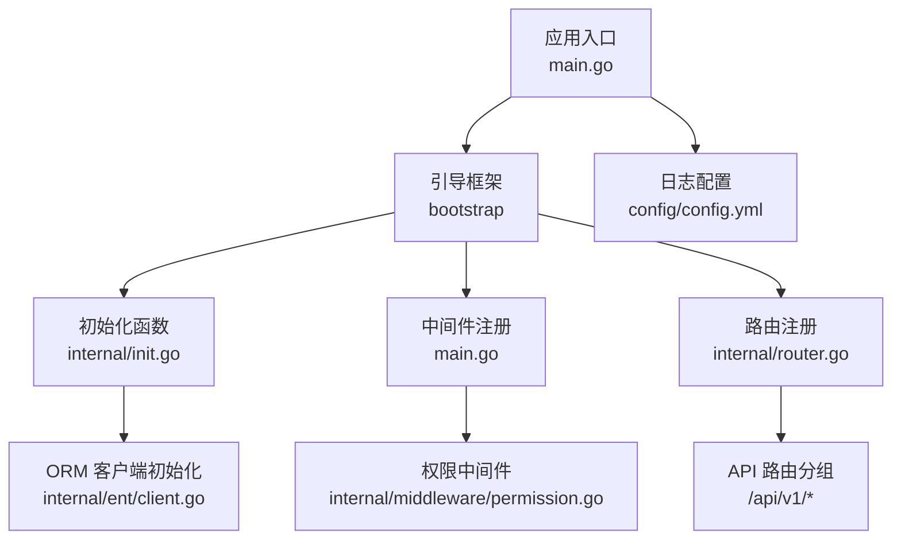
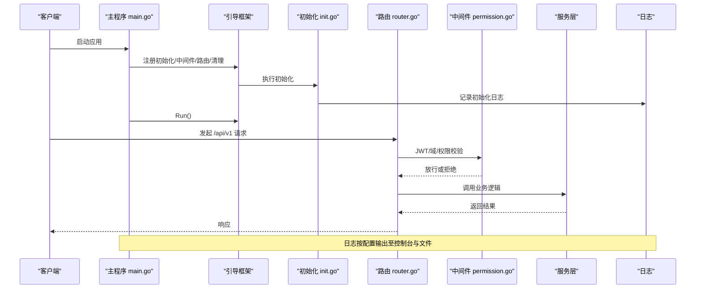
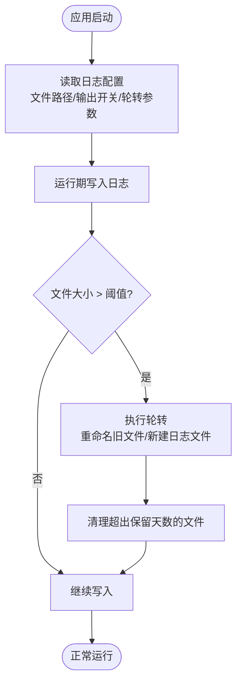
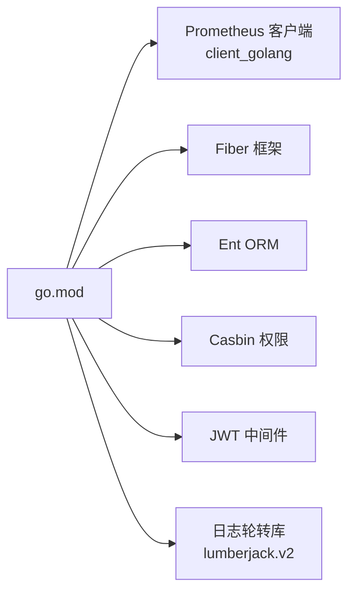
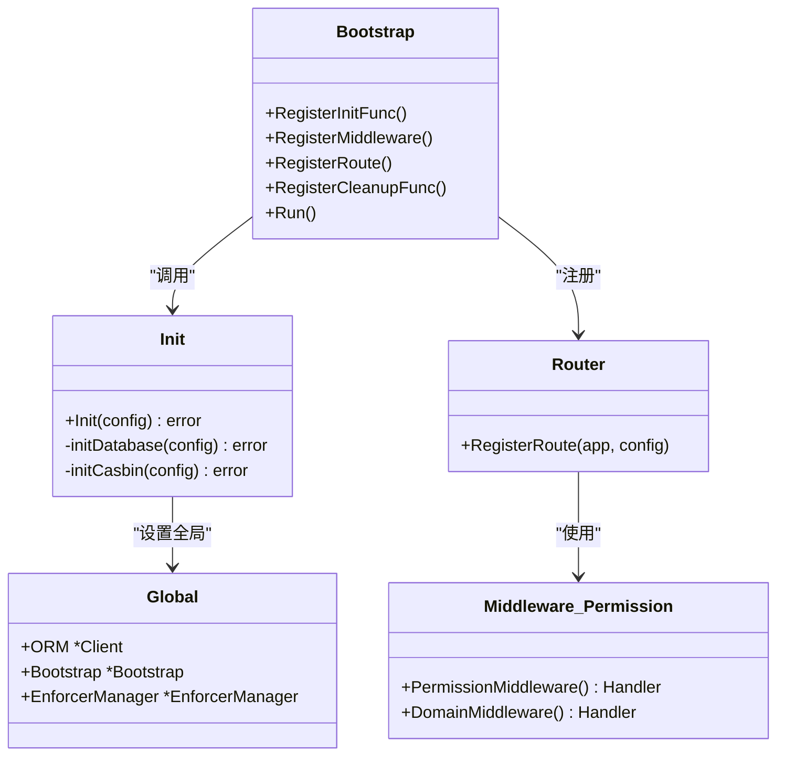

# 监控日志

<cite>
**本文引用的文件**
- [config.yml](file://config/config.yml)
- [main.go](file://main.go)
- [init.go](file://internal/init.go)
- [router.go](file://internal/router.go)
- [permission.go](file://internal/middleware/permission.go)
- [global.go](file://internal/global/global.go)
- [go.mod](file://go.mod)
- [.gitignore](file://.gitignore)
- [client.go](file://internal/ent/client.go)
- [cleanup.go](file://internal/cleanup.go)
- [docs.go](file://docs/docs.go)
</cite>

## 目录
1. [简介](#简介)
2. [项目结构](#项目结构)
3. [核心组件](#核心组件)
4. [架构总览](#架构总览)
5. [详细组件分析](#详细组件分析)
6. [依赖分析](#依赖分析)
7. [性能考虑](#性能考虑)
8. [故障排查指南](#故障排查指南)
9. [结论](#结论)
10. [附录](#附录)

## 简介
本文件面向 Go Admin 管理系统的运维与开发团队，系统性梳理应用日志配置、日志轮转与归档策略、性能指标监控、告警规则与通知机制、分布式追踪与链路监控、APM 工具集成与性能分析方法、系统资源监控与健康检查、日志分析与可视化仪表板以及监控数据导出与报告生成等主题。由于当前仓库未内置 Prometheus、APM 或链路追踪的具体实现，本文在“概念性”部分提供通用实践建议，并在“已实现/可扩展”部分基于现有配置与代码给出可落地的建议。

## 项目结构
- 应用入口与引导：通过引导框架完成初始化、中间件注册、路由注册与清理流程。
- 日志配置：通过 YAML 配置文件定义日志输出目标、轮转参数与开关。
- 数据库与实体：使用 ORM 客户端初始化数据库连接与 Schema。
- 中间件：权限中间件、域中间件等，贯穿请求生命周期。
- 文档：Swagger 文档自动生成与暴露。

**图表来源**
- [main.go:43-89](file://main.go#L43-L89)
- [init.go:17-66](file://internal/init.go#L17-L66)
- [router.go:14-72](file://internal/router.go#L14-L72)
- [permission.go:11-68](file://internal/middleware/permission.go#L11-L68)
- [client.go:55-109](file://internal/ent/client.go#L55-L109)
- [config.yml:11-17](file://config/config.yml#L11-L17)

**章节来源**
- [main.go:43-89](file://main.go#L43-L89)
- [config.yml:11-17](file://config/config.yml#L11-L17)

## 核心组件
- 日志子系统
  - 输出目标：控制台与文件双通道输出。
  - 文件轮转：基于文件大小、备份数量与保留天数。
  - 日志路径：统一在配置文件中指定。
- 性能监控与可观测性
  - 当前未发现内置 Prometheus 指标导出或链路追踪实现。
  - 可通过引入第三方库扩展指标采集与上报。
- 运行时与资源
  - 应用端口、调试模式、Swagger 开关等在应用配置中定义。
  - 数据库连接池参数在数据库配置中定义。

**章节来源**
- [config.yml:11-17](file://config/config.yml#L11-L17)
- [go.mod:81-84](file://go.mod#L81-L84)

## 架构总览
下图展示应用启动到请求处理的关键路径，以及日志与中间件的交互位置。

**图表来源**
- [main.go:43-89](file://main.go#L43-L89)
- [init.go:17-66](file://internal/init.go#L17-L66)
- [router.go:14-72](file://internal/router.go#L14-L72)
- [permission.go:11-68](file://internal/middleware/permission.go#L11-L68)

## 详细组件分析

### 日志配置与级别
- 配置项说明
  - 文件路径：统一的日志文件位置。
  - 控制台输出：是否同时输出到标准输出。
  - 文件输出：是否写入文件。
  - 轮转参数：单文件最大大小、保留备份数、最大保留天数。
- 级别设置
  - 当前未在配置中显式设置日志级别；可通过 Fiber 日志或底层日志库在初始化阶段设置。
  - 建议在初始化阶段根据环境变量或配置动态设置级别（如 info、warn、error）。

**章节来源**
- [config.yml:11-17](file://config/config.yml#L11-L17)
- [init.go:33-47](file://internal/init.go#L33-L47)

### 日志轮转与归档策略
- 轮转触发条件
  - 文件大小达到阈值时触发轮转。
- 归档与保留
  - 保留固定数量的旧日志文件。
  - 旧于设定天数的日志文件会被清理。
- 存储位置
  - 日志文件位于配置文件指定路径，仓库中包含忽略规则，避免将日志提交到版本库。

**图表来源**
- [config.yml:11-17](file://config/config.yml#L11-L17)
- [.gitignore:1-3](file://.gitignore#L1-L3)

**章节来源**
- [config.yml:11-17](file://config/config.yml#L11-L17)
- [.gitignore:1-3](file://.gitignore#L1-L3)

### 性能指标监控（响应时间、吞吐量、错误率）
- 当前状态
  - 仓库未包含 Prometheus 指标导出或中间件埋点实现。
- 建议方案
  - 引入指标采集库，在路由中间件中对每个请求记录响应时间、状态码计数与错误率。
  - 指标命名建议：请求总次数、成功/失败计数、响应时间直方图、并发请求数。
  - 暴露指标端点供监控系统抓取。

[本节为概念性指导，无需源码引用]

### 告警规则配置与通知机制
- 告警维度建议
  - 错误率阈值、P95/P99 响应时间、CPU/内存/磁盘使用率、连接池饱和度、日志错误条数。
- 通知渠道
  - 邮件、Webhook、IM 机器人等。
- 实施步骤
  - 在监控系统中配置规则与静默窗口。
  - 绑定通知接收人与渠道。

[本节为概念性指导，无需源码引用]

### 分布式追踪与链路监控
- 当前状态
  - 仓库未包含 OpenTelemetry 或链路追踪中间件。
- 建议方案
  - 在请求进入与退出处打点，生成 TraceId 并传递到下游。
  - 将 Span 上报至集中式追踪系统（如 Jaeger、Zipkin、OTLP）。
  - 在网关或边缘层注入追踪上下文。

[本节为概念性指导，无需源码引用]

### APM 工具集成与性能分析
- 建议集成
  - APM 工具（如 New Relic、AppDynamics、自建 Prometheus+Grafana）。
  - 在关键业务路径添加采样与埋点。
- 性能分析
  - 结合火焰图、慢查询、GC 统计与线程阻塞分析定位瓶颈。

[本节为概念性指导，无需源码引用]

### 系统资源监控与健康检查
- 资源监控
  - CPU、内存、磁盘、网络 I/O、数据库连接池健康。
- 健康检查
  - 提供 /health 接口，检查数据库连通性、缓存可用性、外部依赖可达性。
  - 建议返回状态码与简要诊断信息。

[本节为概念性指导，无需源码引用]

### 日志分析与可视化仪表板
- 日志分析
  - 使用 ELK/EFK 或 Loki+Grafana 进行日志聚合与检索。
  - 关键字段：时间戳、级别、模块、请求 ID、用户 ID、路径、状态码、耗时。
- 仪表板
  - 展示错误趋势、Top 路径、慢请求分布、用户行为热力图。

[本节为概念性指导，无需源码引用]

### 监控数据导出与报告生成
- 导出
  - 指标与日志支持定时导出到对象存储或本地归档。
- 报告
  - 按日/周/月生成 SLA 报告、容量与性能趋势报告。

[本节为概念性指导，无需源码引用]

## 依赖分析
- 日志轮转依赖
  - 仓库中包含日志轮转库的间接依赖声明，可用于实现文件轮转。
- 监控生态依赖
  - Prometheus 客户端库已在依赖中声明，可用于指标导出。
- 其他
  - Fiber、Ent、Casbin、JWT 等为应用核心依赖。

**图表来源**
- [go.mod:81-84](file://go.mod#L81-L84)
- [go.mod:115](file://go.mod#L115)

**章节来源**
- [go.mod:81-84](file://go.mod#L81-L84)
- [go.mod:115](file://go.mod#L115)

## 性能考虑
- 日志写入
  - 文件轮转参数需结合磁盘 IO 与日志体量调优，避免高峰时段 IO 抖动。
- 数据库连接
  - 连接池参数与超时设置影响整体吞吐与稳定性，建议与监控联动调整。
- 中间件链
  - 权限与域中间件在认证链路中应尽量轻量化，避免成为瓶颈。

[本节为通用建议，无需源码引用]

## 故障排查指南
- 启动失败
  - 检查数据库连接参数与 DNS，确认初始化日志输出。
- 权限异常
  - 核对 JWT 中域信息与权限模型，确认中间件链顺序。
- 日志缺失
  - 检查日志配置开关与文件路径权限，确认轮转策略未过早清理。
- 资源占用高
  - 结合系统监控查看 CPU/内存/IO，定位热点请求与慢查询。

**章节来源**
- [init.go:33-66](file://internal/init.go#L33-L66)
- [permission.go:11-68](file://internal/middleware/permission.go#L11-L68)
- [config.yml:11-17](file://config/config.yml#L11-L17)

## 结论
- 日志方面：已具备基础的文件轮转与多通道输出能力，建议在初始化阶段完善日志级别与采样策略。
- 监控方面：当前仓库未内置指标导出、链路追踪与 APM 集成，建议按本文“概念性”部分逐步引入。
- 运维方面：建议补充健康检查、告警规则与可视化仪表板，形成闭环的可观测体系。

[本节为总结，无需源码引用]

## 附录

### 配置清单与建议
- 应用配置
  - 端口、调试模式、Swagger 开关、登录过期时间等。
- 日志配置
  - 文件路径、控制台/文件输出开关、轮转参数（大小、备份数、保留天数）。
- 数据库配置
  - 连接参数、表前缀、SSL 等。
- 缓存与 Redis
  - 存储驱动、TTL、连接池参数等。

**章节来源**
- [config.yml:1-143](file://config/config.yml#L1-L143)

### 代码级关系图（类与模块）

**图表来源**
- [main.go:43-89](file://main.go#L43-L89)
- [init.go:17-66](file://internal/init.go#L17-L66)
- [router.go:14-72](file://internal/router.go#L14-L72)
- [permission.go:11-68](file://internal/middleware/permission.go#L11-L68)
- [global.go:10-14](file://internal/global/global.go#L10-L14)