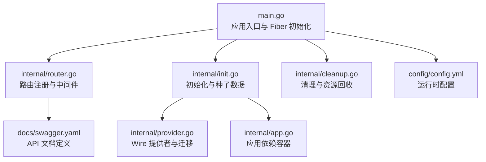
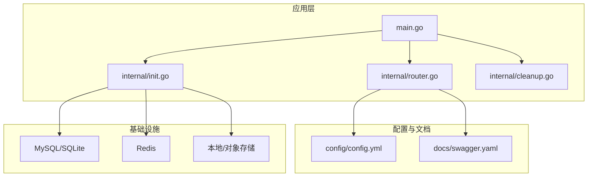
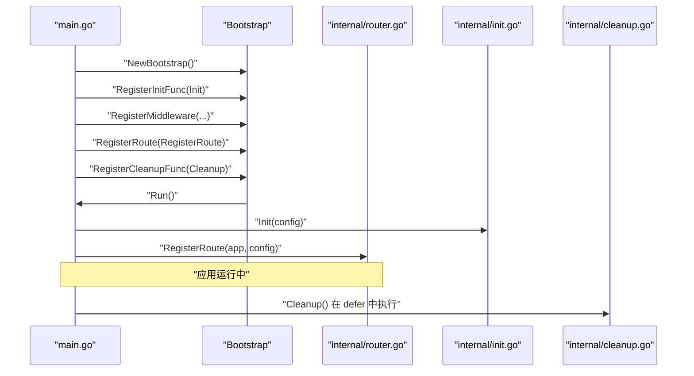
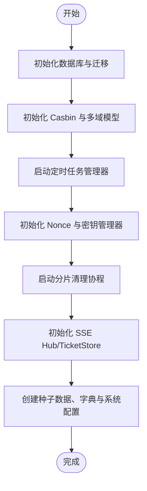
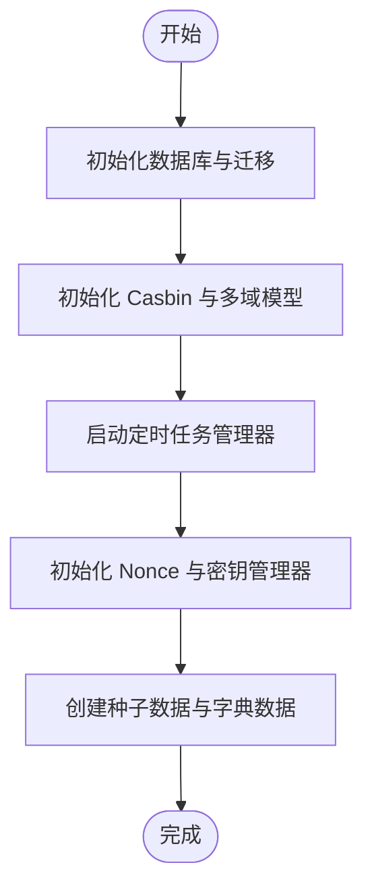
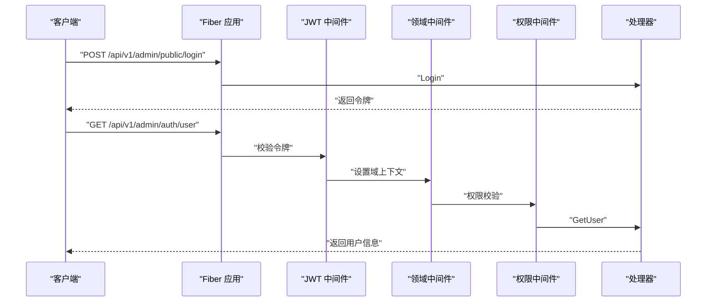
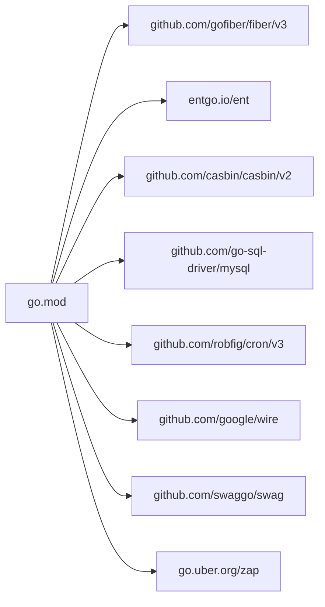

# 部署运维

<cite>
**本文引用的文件**
- [main.go](file://main.go)
- [config.yml](file://config/config.yml)
- [go.mod](file://go.mod)
- [app.go](file://internal/app.go)
- [init.go](file://internal/init.go)
- [provider.go](file://internal/provider.go)
- [router.go](file://internal/router.go)
- [cleanup.go](file://internal/cleanup.go)
- [swagger.yaml](file://docs/swagger.yaml)
</cite>

## 目录
1. [简介](#简介)
2. [项目结构](#项目结构)
3. [核心组件](#核心组件)
4. [架构总览](#架构总览)
5. [详细组件分析](#详细组件分析)
6. [依赖分析](#依赖分析)
7. [性能考虑](#性能考虑)
8. [故障排查指南](#故障排查指南)
9. [结论](#结论)
10. [附录](#附录)

## 简介
本部署运维文档面向 Go Admin 管理系统，提供从服务器准备、环境配置、单机与容器化部署、负载均衡与反向代理、SSL 证书、性能监控与日志管理、数据库备份恢复与版本升级回滚、安全加固与漏洞防护、故障排查与应急响应，以及自动化运维与 CI/CD 流水线的完整实践指南。文档严格基于仓库中的实际代码与配置文件，确保可落地、可验证。

## 项目结构
Go Admin 采用模块化与分层设计，入口程序负责 Fiber 应用初始化、静态资源托管与 SPA 回退、路由注册与生命周期清理；内部模块负责配置、数据库、缓存、权限、文件系统、定时任务等子系统集成；配置文件集中管理应用、日志、数据库、缓存、Redis、文件系统、Casbin 等运行参数。

图表来源
- [main.go:47-106](file://main.go#L47-L106)
- [router.go:16-189](file://internal/router.go#L16-L189)
- [init.go:46-129](file://internal/init.go#L46-L129)
- [cleanup.go:12-51](file://internal/cleanup.go#L12-L51)
- [config.yml:1-147](file://config/config.yml#L1-L147)
- [swagger.yaml:1-800](file://docs/swagger.yaml#L1-L800)
- [provider.go:17-47](file://internal/provider.go#L17-L47)
- [app.go:16-28](file://internal/app.go#L16-L28)

章节来源
- [main.go:47-106](file://main.go#L47-L106)
- [router.go:16-189](file://internal/router.go#L16-L189)
- [init.go:46-129](file://internal/init.go#L46-L129)
- [cleanup.go:12-51](file://internal/cleanup.go#L12-L51)
- [config.yml:1-147](file://config/config.yml#L1-L147)
- [swagger.yaml:1-800](file://docs/swagger.yaml#L1-L800)
- [provider.go:17-47](file://internal/provider.go#L17-L47)
- [app.go:16-28](file://internal/app.go#L16-L28)

## 核心组件
- 应用入口与 Fiber 初始化：嵌入前端静态资源，实现 SPA 回退；注册中间件链路与路由；统一生命周期清理。
- 配置中心：集中管理应用、日志、数据库、缓存、Redis、文件系统、Casbin 等。
- 初始化流程：数据库与 Casbin 初始化、定时任务启动、Nonce 与密钥管理器初始化、分片清理协程启动、SSE Hub 与 TicketStore 初始化、种子数据与字典数据初始化。
- 路由与中间件：JWT 认证、权限中间件、请求日志中间件、领域中间件。
- 资源清理：UID 持久化、分片会话清理、定时任务停止、数据库连接池与 ORM 关闭。
- Swagger 文档：自动生成 API 定义，便于联调与运维监控。

章节来源
- [main.go:47-106](file://main.go#L47-L106)
- [config.yml:1-147](file://config/config.yml#L1-L147)
- [init.go:46-129](file://internal/init.go#L46-L129)
- [router.go:16-189](file://internal/router.go#L16-L189)
- [cleanup.go:12-51](file://internal/cleanup.go#L12-L51)
- [swagger.yaml:1-800](file://docs/swagger.yaml#L1-L800)

## 架构总览
系统采用 Fiber v3 Web 框架，结合 Ent ORM、Casbin 权限引擎、Redis 缓存、本地/对象存储文件系统、SSE 实时推送、Swagger 文档与定时任务。应用通过 Wire 注入依赖，支持自动迁移与多域权限模型。

图表来源
- [main.go:47-107](file://main.go#L47-L107)
- [router.go:16-189](file://internal/router.go#L16-L189)
- [init.go:39-96](file://internal/init.go#L39-L96)
- [config.yml:19-76](file://config/config.yml#L19-L76)
- [swagger.yaml:1-800](file://docs/swagger.yaml#L1-L800)

## 详细组件分析

### 应用入口与生命周期
- 初始化应用依赖并通过 Wire 注入；设置全局日志；注册中间件（静态文件服务使用 `static.New` + 嵌入文件系统，SPA 回退使用自定义中间件）；注册路由与清理函数。
- 生命周期结束时执行清理：持久化 UID、清理过期分片会话、停止分片清理协程、停止定时任务、关闭数据库连接池与 ORM。

图表来源
- [main.go:47-106](file://main.go#L47-L106)
- [router.go:16-189](file://internal/router.go#L16-L189)
- [init.go:46-129](file://internal/init.go#L46-L129)
- [cleanup.go:12-51](file://internal/cleanup.go#L12-L51)

章节来源
- [main.go:47-106](file://main.go#L47-L106)
- [cleanup.go:12-51](file://internal/cleanup.go#L12-L51)

### 配置中心与运行参数
- 应用：名称、监听端口（默认 9501）、调试模式、空闲超时、预取 fork、Swagger 开关、密钥、登录过期时间、请求体大小限制（body_limit: 10485760 即 10MB）。
- 日志：文件路径、控制台输出、文件输出、最大大小、备份数量、保留天数。
- 数据库：默认连接、驱动（mysql）、主机、端口、用户名、密码、库名、SSL、表前缀（admin_）。
- 缓存：默认存储（内存/Redis）、TTL。
- Redis：地址、认证、DB、超时、连接池大小、TLS。
- 文件系统：默认磁盘（本地/S3）、根目录、S3 参数。
- Casbin：默认域（default）、多域模型配置、自动加载策略。

章节来源
- [config.yml:1-147](file://config/config.yml#L1-L147)

### 初始化流程与种子数据
- 数据库初始化：根据配置选择驱动与 DSN，创建 Ent 客户端并执行自动迁移（WithDropIndex/WithDropColumn）。
- Casbin 初始化：创建适配器与 EnforcerManager，支持多域模型。
- 定时任务：创建 CronManager 并启动，日志目录与过期策略。
- 安全初始化：Nonce 存储（防重放）、密钥管理器（轮换周期）。
- 分片清理：启动分片上传会话过期清理协程。
- SSE 初始化：初始化 SSE Hub 与 TicketStore，支持站内消息实时推送。
- 种子数据：创建"超级管理员"角色、默认管理员用户（users 表）和管理员账号（admins 表）、用户-角色关联/admin-角色关联、Casbin 策略与分组规则、系统权限定义（SystemPermission）、普通管理员角色（normal_admin）及对应策略。
- 字典种子：初始化操作日志模块字典项（sys_oper_log_module）和系统配置分组字典（sys_config_group）。
- 系统配置：初始化动态配置种子数据（如 site_name、attachment.chunk_threshold 等）。
- Ent 迁移开启 WithDropIndex(true) 与 WithDropColumn(true)，确保 schema 变更时自动清理旧索引与列。

图表来源
- [init.go:46-129](file://internal/init.go#L46-L129)
- [provider.go:17-47](file://internal/provider.go#L17-L47)

章节来源
- [init.go:46-129](file://internal/init.go#L46-L129)
- [provider.go:17-47](file://internal/provider.go#L17-L47)
- 数据库初始化：根据配置选择驱动与 DSN，创建 Ent 客户端并执行自动迁移。
- Casbin 初始化：创建适配器与 EnforcerManager，支持多域模型。
- 定时任务：创建 CronManager 并启动，日志目录与过期策略。
- 安全初始化：Nonce 存储（防重放）、密钥管理器（轮换周期）。
- 种子数据：创建“超级管理员”角色、默认管理员用户、用户-角色关联、Casbin 策略与分组规则。
- 字典种子：初始化操作日志模块字典项。

图表来源
- [init.go:39-96](file://internal/init.go#L39-L96)
- [provider.go:17-47](file://internal/provider.go#L17-L47)

章节来源
- [init.go:39-96](file://internal/init.go#L39-L96)
- [provider.go:17-47](file://internal/provider.go#L17-L47)

### 路由与中间件
- 路由分组：/api/v1/admin 下按公开、认证、权限三层组织。
- 中间件链：请求日志、JWT 认证、领域中间件、权限中间件。
- 公开接口：登录、刷新令牌、获取 RSA 公钥。
- 认证接口：用户信息查询与更新、修改密码。
- 权限与角色：角色 CRUD、角色权限分配与回收、权限 CRUD、用户权限查询。
- 附件与文件：分组 CRUD、上传/移动/删除/预览、批量删除。
- 定时任务：创建/查询/更新/启用/禁用/立即执行/日志查看。
- 操作日志：列表与详情查询。
- 动态配置：按键/分组查询、CRUD。
- Swagger：API 文档自动生成。

图表来源
- [router.go:16-189](file://internal/router.go#L16-L189)

章节来源
- [router.go:16-189](file://internal/router.go#L16-L189)
- [swagger.yaml:690-800](file://docs/swagger.yaml#L690-L800)

### 资源清理与优雅停机
- UID 持久化：保证重启后 UID 连续性。
- 过期分片清理：在关闭前执行最后一次过期分片会话清理。
- 分片协程停止：停止分片上传会话清理协程。
- 定时任务停止：在关闭数据库前停止 CronManager。
- 数据库连接池与 ORM 关闭：释放连接与客户端资源。

章节来源
- [cleanup.go:12-51](file://internal/cleanup.go#L12-L51)

## 依赖分析
- 运行时框架：Fiber v3 (v3.2.0)、Zap 日志、Swag/Swagger 文档。
- ORM 与迁移：Ent v0.14.5、MySQL 驱动。
- 权限：Casbin v2 (v2.135.0)、Casbin 适配器。
- 定时任务：robfig/cron/v3。
- 依赖注入：Google Wire (v0.7.0)。
- 替换模块：本地 cmf (d:/www/cmf) 与 ent (d:/www/ent) 模块。

图表来源
- [go.mod:5-18](file://go.mod#L5-L18)

章节来源
- [go.mod:5-18](file://go.mod#L5-L18)

## 性能考虑
- 连接池与超时：数据库与 Redis 的连接池大小、读写超时、连接生命周期需结合并发与延迟调优。
- 缓存策略：启用 Redis 缓存角色与权限服务，降低数据库压力；合理设置 TTL。
- 日志轮转：控制日志文件大小与保留天数，避免磁盘打满。
- 预取与并发：根据业务流量开启预取与并发策略，观察 CPU 与连接池占用。
- 定时任务：日志目录与过期策略避免磁盘膨胀；任务粒度与并发限制防止抖动。

## 故障排查指南
- 启动失败
  - 检查配置文件数据库连接参数与表前缀是否正确。
  - 查看日志文件路径与权限，确认可写。
  - 关注初始化阶段数据库迁移与 Casbin 初始化错误。
- 登录异常
  - 确认 JWT 密钥与登录过期时间配置一致。
  - 检查公开接口是否可达，确认中间件链顺序。
- 权限问题
  - 核对 Casbin 策略与分组规则是否加载成功。
  - 检查多域模型配置与自动加载开关。
- 文件上传失败
  - 校验文件系统磁盘配置与根目录权限。
  - 若使用 S3，检查凭证与 Endpoint。
- 定时任务异常
  - 查看任务日志目录是否存在与可读写。
  - 检查表达式与命令是否正确。
- 优雅停机
  - 确认清理流程执行，特别是 CronManager 停止与数据库连接关闭。

章节来源
- [config.yml:19-76](file://config/config.yml#L19-L76)
- [init.go:46-129](file://internal/init.go#L46-L129)
- [router.go:16-189](file://internal/router.go#L16-L189)
- [cleanup.go:12-51](file://internal/cleanup.go#L12-L51)

## 结论
本指南基于仓库中的实际代码与配置，提供了从单机到容器化、从负载均衡到安全加固、从监控日志到备份升级的全栈运维实践。建议在生产环境中结合业务流量与合规要求，细化参数与流程，并建立完善的自动化与应急机制。

## 附录

### 生产环境部署步骤（单机）
- 服务器准备
  - 操作系统：Linux（推荐稳定版本）。
  - 系统资源：CPU/内存/磁盘容量满足业务峰值与日志、备份空间。
  - 防火墙：开放应用端口与数据库/Redis 端口。
- 环境准备
  - 安装 Go 运行时与系统依赖。
  - 准备数据库与 Redis 实例，确保网络连通。
  - 准备文件系统根目录与 S3 凭证（如使用）。
- 部署步骤
  - 构建二进制：使用构建脚本或 Makefile（若存在）。
  - 配置应用：编辑配置文件，设置数据库、Redis、文件系统、日志参数。
  - 启动应用：以 systemd 或 supervisor 管理进程，设置工作目录与环境变量。
  - 验证：访问 Swagger 文档与登录接口，检查日志输出。
- 反向代理与负载均衡
  - Nginx/HAProxy：监听 80/443，转发至应用端口；开启健康检查。
  - 会话粘性：若需要，启用基于 Cookie 的粘性会话。
- SSL 证书
  - 使用 Let’s Encrypt 或商业证书；配置证书链与私钥权限。
  - 强制 HTTPS 重定向与 HSTS。
- 性能监控与日志
  - 日志：控制台与文件双输出，开启轮转；集中采集至 ELK/Fluentd。
  - 指标：暴露 Prometheus 指标（可扩展），关注 QPS、P95/P99、连接池利用率。
  - 告警：阈值告警与异常检测联动。
- 数据库备份与恢复
  - MySQL：逻辑备份（mysqldump/Percona XtraBackup）与物理备份结合；定期校验。
  - Redis：RDB/AOF 策略与持久化；主从复制与哨兵/集群。
  - 恢复演练：定期进行恢复测试，记录 RTO/RPO。
- 版本升级与回滚
  - 升级窗口：维护期滚动升级，灰度 1 台验证。
  - 回滚：保留上一版本二进制与配置；快速回滚与数据库回滚点。
- 安全加固
  - 最小权限：应用账户只授予必要数据库与文件系统权限。
  - 网络隔离：数据库与 Redis 放置于内网；白名单访问。
  - 密钥管理：使用 KMS 或密钥管理服务；定期轮换。
  - 输入校验与防注入：启用参数校验与 SQL 注入防护。
  - 审计与日志：开启操作日志与审计日志，保留期限符合法规。
- 故障排查与应急响应
  - 快速定位：日志级别、错误码、堆栈与上下文。
  - 应急预案：数据库不可用、Redis 故障、文件系统异常、定时任务阻塞。
- 自动化运维与 CI/CD
  - 构建：镜像构建流水线，生成多架构镜像。
  - 发布：蓝绿/金丝雀发布，配合健康检查。
  - 回滚：一键回滚至上一版本。
  - 配置：环境变量与配置中心，禁止硬编码敏感信息。

### Docker 容器化部署方案
- 镜像构建
  - 多阶段构建：编译阶段与运行阶段分离，减小镜像体积。
  - 基础镜像：Alpine 或 Debian slim。
  - 运行用户：非 root 用户运行，限制权限。
- 容器编排
  - Compose：定义应用、数据库、Redis、存储卷与网络。
  - Kubernetes：Deployment/Service/ConfigMap/Secret/PVC；HPA/滚动更新/就绪/存活探针。
- 集群管理
  - 节点：控制面与工作节点分离；网络插件与存储 CSI。
  - 策略：Pod 安全标准、资源配额与限制。
- 负载均衡与反向代理
  - Ingress/Nginx：域名路由、证书管理、健康检查。
  - 负载均衡：轮询/最少连接/IP 哈希。
- SSL 证书
  - ACME 自动签发（Cert-Manager）或手动导入 Secret。
  - 强制 TLS 与安全头。
- 性能监控与日志
  - Sidecar/InitContainer：日志收集与指标导出。
  - Prometheus/Grafana：指标可视化与告警。
- 数据备份与恢复
  - 备份：PVC 快照、数据库逻辑备份。
  - 恢复：命名空间/集群级别的恢复演练。
- 安全与合规
  - RBAC 与 PSP：最小权限与 Pod 安全。
  - 审计：事件与日志审计，合规报告。
- 故障排查与应急
  - 快速诊断：日志聚合、链路追踪、指标异常定位。
  - 应急：快速回滚、扩缩容、故障转移。
- CI/CD
  - GitOps：声明式配置与变更审批。
  - 多环境：开发/测试/预生产/生产四环境流水线。
  - 质量门禁：单元测试、集成测试、安全扫描、合规检查。