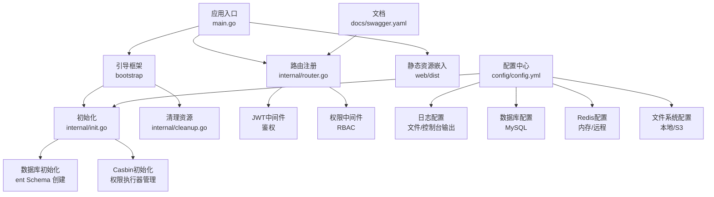
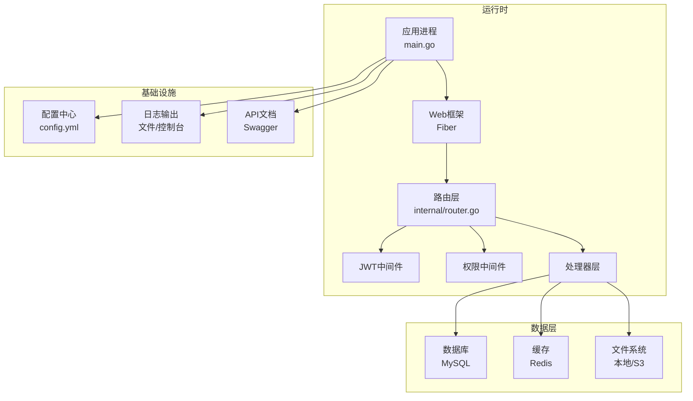
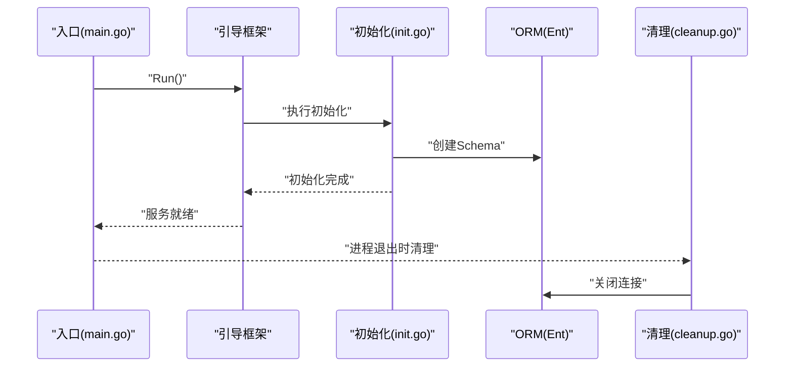
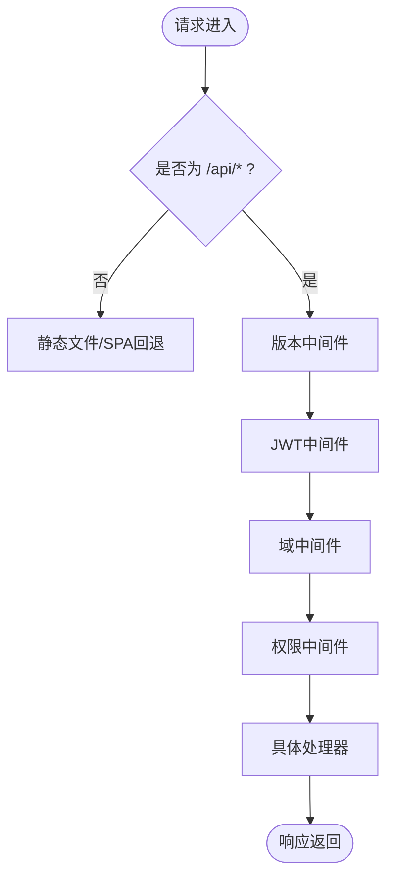
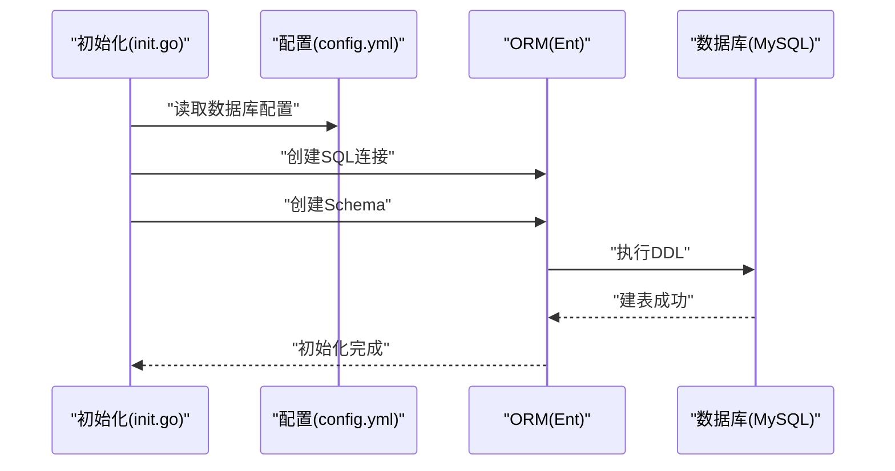
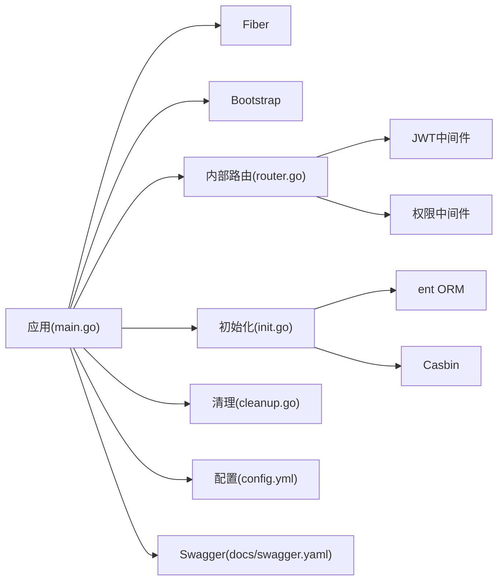

# 部署运维

<cite>
**本文引用的文件**
- [main.go](file://main.go)
- [config.yml](file://config/config.yml)
- [go.mod](file://go.mod)
- [.golangci.yml](file://.golangci.yml)
- [init.go](file://internal/init.go)
- [cleanup.go](file://internal/cleanup.go)
- [router.go](file://internal/router.go)
- [global.go](file://internal/global/global.go)
- [swagger.yaml](file://docs/swagger.yaml)
- [schema.go](file://internal/ent/migrate/schema.go)
- [client.go](file://internal/ent/client.go)
- [role.go](file://internal/ent/role/role.go)
- [user.go](file://internal/ent/user/user.go)
- [where.go](file://internal/ent/user/where.go)
</cite>

## 目录
1. [简介](#简介)
2. [项目结构](#项目结构)
3. [核心组件](#核心组件)
4. [架构总览](#架构总览)
5. [详细组件分析](#详细组件分析)
6. [依赖关系分析](#依赖关系分析)
7. [性能考虑](#性能考虑)
8. [故障排查指南](#故障排查指南)
9. [结论](#结论)
10. [附录](#附录)

## 简介
本文件面向Go Admin管理系统的生产环境部署与运维，覆盖环境准备、依赖安装、配置设置、数据库初始化与迁移、容器化与Kubernetes编排、负载均衡与高可用、监控与日志、性能调优、备份恢复与灾备、滚动更新与蓝绿发布、安全加固与漏洞扫描、运维自动化与CI/CD、以及常见问题诊断与解决。

## 项目结构
该系统采用模块化分层组织：
- 应用入口与引导：main.go负责应用启动、中间件注册、静态资源嵌入与路由注册，并通过外部引导框架完成生命周期管理。
- 配置中心：config/config.yml集中管理应用、日志、数据库、缓存、Redis、文件系统、Casbin等配置。
- 内部模块：internal目录包含初始化、清理、路由、中间件、服务与工具等。
- 数据访问：基于ent框架生成的ORM模型与迁移脚本，支持MySQL驱动与Schema自动创建。
- 文档：Swagger定义了API接口规范，便于前后端协作与测试。

图表来源
- [main.go:43-89](file://main.go#L43-L89)
- [router.go:14-72](file://internal/router.go#L14-L72)
- [init.go:17-65](file://internal/init.go#L17-L65)
- [cleanup.go:7-19](file://internal/cleanup.go#L7-L19)
- [config.yml:1-143](file://config/config.yml#L1-L143)
- [swagger.yaml:1-145](file://docs/swagger.yaml#L1-L145)

章节来源
- [main.go:1-90](file://main.go#L1-L90)
- [config.yml:1-143](file://config/config.yml#L1-L143)
- [router.go:1-73](file://internal/router.go#L1-L73)
- [init.go:1-66](file://internal/init.go#L1-L66)
- [cleanup.go:1-20](file://internal/cleanup.go#L1-L20)
- [swagger.yaml:1-145](file://docs/swagger.yaml#L1-L145)

## 核心组件
- 应用引导与中间件
  - 引导框架负责注册初始化函数、中间件、路由与清理函数，统一生命周期管理。
  - 中间件包含静态文件服务与SPA回退逻辑，确保前端路由与后端API共存。
- 路由与鉴权
  - 路由按版本分组，公开接口与认证接口分离；JWT中间件与权限中间件组合实现细粒度授权。
- 初始化与清理
  - 初始化阶段完成数据库Schema创建与Casbin执行器管理器装配；清理阶段关闭ORM连接，避免资源泄漏。
- 配置中心
  - 统一管理应用、日志、数据库、缓存、Redis、文件系统与Casbin等配置项。
- 文档与API
  - Swagger定义了登录、刷新令牌、用户信息、角色与权限管理等接口规范。

章节来源
- [main.go:43-89](file://main.go#L43-L89)
- [router.go:14-72](file://internal/router.go#L14-L72)
- [init.go:17-65](file://internal/init.go#L17-L65)
- [cleanup.go:7-19](file://internal/cleanup.go#L7-L19)
- [config.yml:1-143](file://config/config.yml#L1-L143)
- [swagger.yaml:45-145](file://docs/swagger.yaml#L45-L145)

## 架构总览
系统采用“引导框架 + Fiber Web框架 + ent ORM + Casbin RBAC”的技术栈，结合Swagger文档与多存储后端（MySQL、Redis、本地/S3）实现管理平台的高内聚低耦合架构。

图表来源
- [main.go:43-89](file://main.go#L43-L89)
- [router.go:14-72](file://internal/router.go#L14-L72)
- [config.yml:19-76](file://config/config.yml#L19-L76)
- [swagger.yaml:1-145](file://docs/swagger.yaml#L1-L145)

## 详细组件分析

### 应用引导与中间件
- 启动流程
  - 初始化引导框架，注册初始化、中间件、路由与清理函数。
  - 注册静态文件中间件与SPA回退逻辑，确保前端单页应用路由正确。
- 生命周期
  - 启动前执行初始化；退出时执行清理，确保ORM连接被释放。

图表来源
- [main.go:43-89](file://main.go#L43-L89)
- [init.go:17-47](file://internal/init.go#L17-L47)
- [cleanup.go:7-19](file://internal/cleanup.go#L7-L19)

章节来源
- [main.go:43-89](file://main.go#L43-L89)
- [init.go:17-47](file://internal/init.go#L17-L47)
- [cleanup.go:7-19](file://internal/cleanup.go#L7-L19)

### 路由与鉴权
- 路由分组
  - /api/v1/admin/public：公开接口（登录、刷新令牌）。
  - /api/v1/admin/auth：认证后接口（用户信息、修改密码）。
  - /api/v1/admin/roles、/api/v1/admin/permissions、/api/v1/admin/roles/permissions、/api/v1/admin/user：角色、权限与用户权限管理。
- 中间件链
  - JWT中间件校验令牌；域中间件与权限中间件共同实现RBAC控制。

图表来源
- [router.go:14-72](file://internal/router.go#L14-L72)

章节来源
- [router.go:14-72](file://internal/router.go#L14-L72)

### 数据库初始化与迁移
- 初始化流程
  - 读取配置中的数据库驱动与连接信息，建立SQL连接。
  - 基于ent驱动创建ORM客户端，并执行Schema创建。
- 迁移与模式
  - 通过ent迁移脚本定义表结构、索引与字段约束，支持自动建表与索引创建。
- 清理流程
  - 进程退出时关闭ORM连接，避免资源泄露。

图表来源
- [init.go:33-47](file://internal/init.go#L33-L47)
- [config.yml:19-31](file://config/config.yml#L19-L31)
- [schema.go:52-68](file://internal/ent/migrate/schema.go#L52-L68)

章节来源
- [init.go:33-47](file://internal/init.go#L33-L47)
- [config.yml:19-31](file://config/config.yml#L19-L31)
- [schema.go:52-68](file://internal/ent/migrate/schema.go#L52-L68)
- [client.go:55-109](file://internal/ent/client.go#L55-L109)

### 配置中心与运行参数
- 应用参数
  - 名称、端口、调试模式、空闲超时、预取fork、Swagger开关、密钥、登录过期时间。
- 日志参数
  - 文件路径、控制台输出、文件输出、最大大小、备份数量、保留天数。
- 数据库参数
  - 默认连接、驱动、主机、端口、用户名、密码、数据库名、SSL、表前缀。
- 缓存与Redis
  - 默认存储、内存与Redis配置、连接池参数、TLS开关。
- 文件系统
  - 默认磁盘、本地根目录、S3接入参数。
- Casbin
  - 默认域、域列表、自动加载、模型文本或路径。

章节来源
- [config.yml:1-143](file://config/config.yml#L1-L143)

### API接口与文档
- 登录与令牌
  - 登录接口返回访问令牌与刷新令牌；刷新令牌接口用于续期。
- 用户管理
  - 获取与更新用户信息、修改密码。
- 角色与权限
  - 角色的增删改启停；权限的增删改查；角色与权限的分配/移除。
- 用户权限
  - 获取用户菜单权限、按钮权限与API权限。

章节来源
- [swagger.yaml:45-145](file://docs/swagger.yaml#L45-L145)
- [router.go:28-71](file://internal/router.go#L28-L71)

## 依赖关系分析
- 外部依赖
  - Web框架：Fiber v2
  - ORM：ent v0.14.5
  - 数据库驱动：MySQL驱动
  - 权限：Casbin v2
  - 文档：Swagger
  - 日志：zap + lumberjack
  - Redis：redis/go-redis v9
- 内部依赖
  - 引导框架：bootstrap
  - 全局状态：global（ORM、Bootstrap、EnforcerManager）

图表来源
- [main.go:3-18](file://main.go#L3-L18)
- [router.go:3-12](file://internal/router.go#L3-L12)
- [init.go:3-15](file://internal/init.go#L3-L15)
- [cleanup.go:3-5](file://internal/cleanup.go#L3-L5)
- [config.yml:1-143](file://config/config.yml#L1-L143)
- [swagger.yaml:1-145](file://docs/swagger.yaml#L1-L145)

章节来源
- [go.mod:5-13](file://go.mod#L5-L13)
- [main.go:3-18](file://main.go#L3-L18)
- [router.go:3-12](file://internal/router.go#L3-L12)
- [init.go:3-15](file://internal/init.go#L3-L15)
- [cleanup.go:3-5](file://internal/cleanup.go#L3-L5)
- [config.yml:1-143](file://config/config.yml#L1-L143)
- [swagger.yaml:1-145](file://docs/swagger.yaml#L1-L145)

## 性能考虑
- 并发与预取
  - 预取fork与空闲超时参数影响并发处理能力与资源占用，需根据CPU核数与QPS调整。
- 数据库连接
  - 合理设置连接池大小、最大生命周期与空闲时间，避免连接抖动与资源耗尽。
- 缓存策略
  - Redis连接池参数与默认TTL影响读写延迟与命中率；内存缓存适合热点数据。
- 日志轮转
  - 文件大小、备份数与保留天数平衡磁盘空间与审计需求。
- ORM与查询
  - 利用ent的谓词与索引优化查询；避免N+1查询；对高频接口开启调试日志定位瓶颈。

章节来源
- [config.yml:4-7](file://config/config.yml#L4-L7)
- [config.yml:42-58](file://config/config.yml#L42-L58)
- [config.yml:11-18](file://config/config.yml#L11-L18)
- [client.go:55-109](file://internal/ent/client.go#L55-L109)
- [where.go:927-1015](file://internal/ent/user/where.go#L927-L1015)

## 故障排查指南
- 启动失败
  - 检查配置文件中数据库连接参数与权限；确认MySQL服务可达；查看日志文件路径与权限。
- 登录异常
  - 核对JWT密钥与过期时间；确认公开接口是否正确暴露；检查权限中间件是否误拦截。
- 权限拒绝
  - 检查Casbin模型与策略；确认域配置与自动加载；验证用户角色与权限映射。
- 数据库错误
  - 查看Schema创建日志；确认表前缀与索引；检查连接池参数与超时设置。
- 日志问题
  - 确认日志文件输出路径存在且可写；检查轮转参数避免磁盘占满。

章节来源
- [config.yml:19-31](file://config/config.yml#L19-L31)
- [config.yml:77-143](file://config/config.yml#L77-L143)
- [init.go:33-47](file://internal/init.go#L33-L47)
- [router.go:28-71](file://internal/router.go#L28-L71)
- [swagger.yaml:45-145](file://docs/swagger.yaml#L45-L145)

## 结论
本文从部署到运维全链路梳理了Go Admin管理系统的架构与实践要点，涵盖配置、初始化、中间件、路由、鉴权、数据库、文档与性能优化等方面。结合容器化与Kubernetes编排、负载均衡与高可用、监控与日志、备份恢复、滚动更新与蓝绿发布、安全加固与CI/CD等主题，可形成完整的生产级交付与运维体系。

## 附录

### 生产环境部署步骤
- 环境准备
  - 操作系统：Linux（推荐Ubuntu/CentOS）。
  - 运行时：Go 1.25+，MySQL 5.7+/8.0+，Redis 6+/7+。
  - 容器：Docker 20+，Kubernetes 1.25+。
- 依赖安装
  - 安装Go工具链与构建依赖；安装MySQL与Redis服务；准备Docker与kubectl。
- 配置设置
  - 复制并编辑配置文件，设置数据库、Redis、日志、Casbin等参数；确保文件系统根目录与S3配置正确。
- 构建与打包
  - 使用Go构建二进制；将web/dist静态资源嵌入；生成镜像并推送至私有仓库。
- 部署验证
  - 启动服务，访问Swagger文档；登录并验证权限；检查日志与指标。

章节来源
- [go.mod:3](file://go.mod#L3)
- [config.yml:1-143](file://config/config.yml#L1-L143)
- [main.go:40-41](file://main.go#L40-L41)

### Docker容器化部署方案
- 镜像构建
  - 使用多阶段构建减少镜像体积；将二进制与嵌入的静态资源打包。
- 容器运行
  - 挂载日志与存储目录；设置环境变量覆盖配置；暴露应用端口。
- 健康检查
  - 提供HTTP健康探针，检测端口与关键接口可用性。

章节来源
- [main.go:40-41](file://main.go#L40-L41)
- [config.yml:11-18](file://config/config.yml#L11-L18)

### Kubernetes编排配置
- Deployment
  - 设置副本数、资源请求与限制、滚动更新策略；挂载配置卷与持久化存储。
- Service
  - 暴露ClusterIP或LoadBalancer；配置会话亲和与超时。
- Ingress/Nginx
  - 配置TLS终止、路径转发与速率限制。
- ConfigMap/Secret
  - 将敏感配置放入Secret，非敏感配置放入ConfigMap。
- HPA/资源调度
  - 根据CPU/自定义指标扩缩容；合理设置亲和与反亲和规则。

章节来源
- [config.yml:1-143](file://config/config.yml#L1-L143)

### 数据库初始化与迁移流程
- 初始化
  - 应用启动时自动创建数据库Schema；确保数据库用户具备DDL权限。
- 迁移
  - 使用ent迁移脚本维护表结构；在灰度环境中先执行迁移再放量。
- 回滚
  - 保留迁移历史与备份；必要时回滚到上一个稳定版本。

章节来源
- [init.go:33-47](file://internal/init.go#L33-L47)
- [schema.go:52-68](file://internal/ent/migrate/schema.go#L52-L68)

### 负载均衡与高可用部署策略
- 多副本
  - 使用Deployment多副本部署；结合PodDisruptionBudget保障可用性。
- 负载均衡
  - Service使用ClusterIP配合Ingress；或使用云LB。
- 数据一致性
  - 数据库存储与Redis缓存均需高可用；使用持久化存储与快照。

章节来源
- [config.yml:19-31](file://config/config.yml#L19-L31)
- [config.yml:42-58](file://config/config.yml#L42-L58)

### 监控与日志配置指南
- 指标
  - 暴露Prometheus指标；关注请求量、延迟、错误率与连接池状态。
- 日志
  - 控制台与文件双输出；使用lumberjack进行轮转；集中收集到ELK/ Loki。
- 告警
  - 基于阈值与趋势设置告警；区分严重与一般级别。

章节来源
- [config.yml:11-18](file://config/config.yml#L11-L18)
- [go.mod:81-85](file://go.mod#L81-L85)

### 性能调优与资源优化方法
- JVM/Go无关优化
  - 合理设置GOMAXPROCS；优化数据库连接池；启用Redis连接池复用。
- 查询优化
  - 使用索引与谓词；避免SELECT *；批量操作减少往返。
- 缓存优化
  - 分层缓存（本地+Redis）；设置合理的TTL与失效策略。

章节来源
- [config.yml:42-58](file://config/config.yml#L42-L58)
- [where.go:927-1015](file://internal/ent/user/where.go#L927-L1015)

### 备份恢复与灾难恢复计划
- 备份
  - 数据库定时快照；Redis持久化；文件系统快照；日志归档。
- 恢复
  - 制定RTO/RPO目标；演练恢复流程；验证数据一致性。
- 灾备
  - 多机房部署；跨区域复制；自动切换与降级策略。

章节来源
- [config.yml:11-18](file://config/config.yml#L11-L18)
- [config.yml:60-76](file://config/config.yml#L60-L76)

### 滚动更新与蓝绿部署策略
- 滚动更新
  - 设置最大不可用与最大额外实例；配合Readiness/Liveness探针。
- 蓝绿/金丝雀
  - 使用标签选择器与Ingress路由；逐步放量新版本；回滚快速可靠。

章节来源
- [router.go:14-72](file://internal/router.go#L14-L72)

### 安全加固与漏洞扫描建议
- 配置加固
  - 关闭调试模式；设置强密钥；最小权限原则；禁用不必要的接口。
- 运行时安全
  - 使用只读文件系统；限制资源；网络策略隔离；Secret加密存储。
- 漏洞扫描
  - 定期扫描镜像与依赖；修复高危漏洞；建立补丁管理流程。

章节来源
- [config.yml:4-9](file://config/config.yml#L4-L9)
- [config.yml:77-143](file://config/config.yml#L77-L143)

### 运维自动化与CI/CD流水线配置
- 流水线
  - 代码提交触发构建、测试、安全扫描、打包与发布；多环境灰度。
- 自动化
  - 自动化部署、回滚、扩缩容；变更评审与审批。
- 监控与可观测性
  - 指标、日志、追踪一体化；告警闭环。

章节来源
- [.golangci.yml:1-38](file://.golangci.yml#L1-L38)