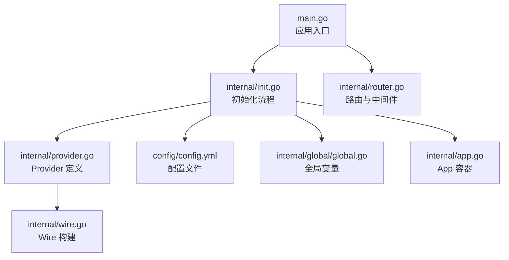
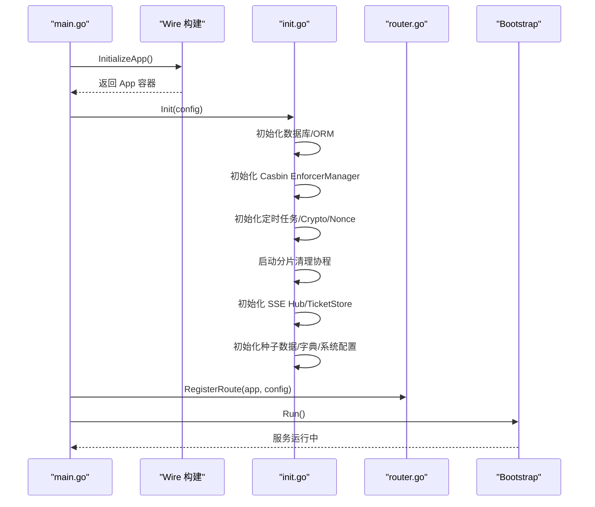
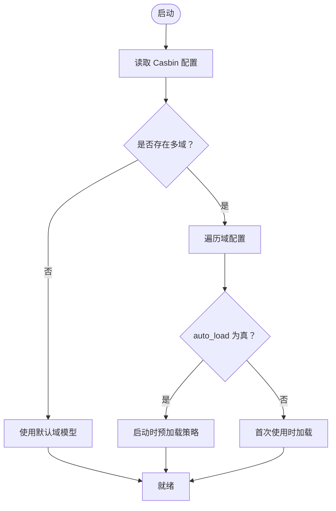
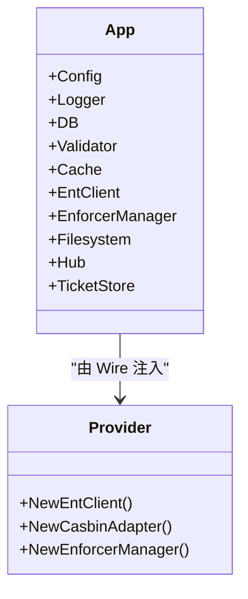
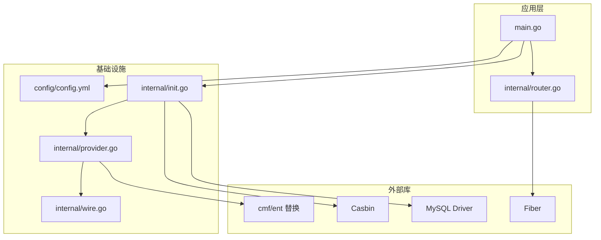

# 部署配置

<cite>
**本文引用的文件**
- [config.yml](file://config/config.yml)
- [main.go](file://main.go)
- [init.go](file://internal/init.go)
- [provider.go](file://internal/provider.go)
- [wire.go](file://internal/wire.go)
- [router.go](file://internal/router.go)
- [global.go](file://internal/global/global.go)
- [app.go](file://internal/app.go)
- [go.mod](file://go.mod)
</cite>

## 目录
1. [简介](#简介)
2. [项目结构](#项目结构)
3. [核心组件](#核心组件)
4. [架构总览](#架构总览)
5. [详细组件分析](#详细组件分析)
6. [依赖分析](#依赖分析)
7. [性能考量](#性能考量)
8. [故障排查指南](#故障排查指南)
9. [结论](#结论)
10. [附录](#附录)

## 简介
本文件面向运维与开发团队，提供 Go Admin 管理系统的完整部署配置说明。内容覆盖应用配置、数据库与缓存、文件系统（本地与 S3）、Casbin 权限系统（含多域与模型）、不同环境（开发/测试/生产）的最佳实践、安全性与敏感信息保护、以及配置验证与常见问题排查方法。

## 项目结构
- 配置文件位于 config/config.yml，集中定义应用、日志、数据库、缓存、Redis、文件系统、Casbin 等配置项。
- 应用入口 main.go 通过内部初始化流程完成依赖注入与中间件注册，并启动 Fiber 服务。
- 内部初始化 init.go 负责数据库、Casbin、定时任务、密钥与随机数存储、种子数据等初始化。
- 依赖注入采用 Wire，provider.go 与 wire.go 定义了 ORM、Casbin、缓存、文件系统等 Provider。
- 路由与中间件在 router.go 中注册，包含 JWT 认证、权限中间件、域中间件等。
- 全局变量 global.go 与内部 App 结构 app.go 统一承载 ORM、Bootstrap、EnforcerManager、CronManager 等全局状态。App 容器额外包含 SSE Hub 与 TicketStore，支持站内消息实时推送。

图表来源
- [main.go:47-106](file://main.go#L47-L106)
- [init.go:46-129](file://internal/init.go#L46-L129)
- [router.go:16-189](file://internal/router.go#L16-L189)
- [provider.go:17-46](file://internal/provider.go#L17-L46)
- [wire.go:22-37](file://internal/wire.go#L22-L37)
- [config.yml:1-147](file://config/config.yml#L1-L147)
- [global.go:11-16](file://internal/global/global.go#L11-L16)
- [app.go:16-28](file://internal/app.go#L16-L28)

章节来源
- [main.go:47-106](file://main.go#L47-L106)
- [config.yml:1-147](file://config/config.yml#L1-L147)

## 核心组件
- 应用配置（app）
  - 名称、监听端口（默认 9501）、调试模式、空闲超时、预取 fork、Swagger 开关、密钥、登录过期时间、请求体大小限制（body_limit: 10485760 即 10MB）等。
- 日志配置（log）
  - 日志文件路径、控制台输出、文件输出、滚动大小、备份数量、保留天数。
- 数据库配置（database）
  - 默认连接名、驱动类型（mysql）、主机、端口、用户名、密码、数据库名、SSL、表前缀（admin_）。
- 缓存配置（cache）
  - 默认缓存存储、内存缓存与 Redis 缓存的 TTL。
- Redis 连接配置（redis）
  - 地址、用户名、密码、库号、拨号/读写超时、连接池大小、空闲连接数、连接生命周期、TLS。
- 文件系统配置（filesystem）
  - 默认磁盘、是否与本地联动、本地磁盘根目录、S3 访问密钥、区域、桶、端点。
- Casbin 权限系统（casbin）
  - 默认域（default）、多域列表（域名、自动加载、模型路径或内联模型文本）。
- 依赖注入（Wire）
  - 提供配置、日志、ORM、校验器、缓存、文件系统、Ent 客户端、Casbin 适配器、EnforcerManager。

章节来源
- [config.yml:1-147](file://config/config.yml#L1-L147)
- [app.go:16-28](file://internal/app.go#L16-L28)
- [provider.go:17-46](file://internal/provider.go#L17-L46)
- [wire.go:22-37](file://internal/wire.go#L22-L37)

## 架构总览
下图展示应用启动与初始化的关键交互：main.go 通过 Wire 构建 App 容器，随后初始化数据库、Casbin、定时任务、密钥与随机数存储、分片清理协程、SSE Hub/TicketStore、种子数据；注册路由与中间件；最后运行 Bootstrap。

图表来源
- [main.go:47-106](file://main.go#L47-L106)
- [init.go:46-129](file://internal/init.go#L46-L129)
- [router.go:16-189](file://internal/router.go#L16-L189)

## 详细组件分析

### 应用配置（app）
- 关键参数
  - 名称：应用标识
  - 端口：HTTP 监听端口（默认 9501）
  - 调试模式：开启后输出更详细日志
  - 空闲超时：连接空闲超时秒数
  - 预取 fork：是否启用预取 fork（多进程）
  - Swagger：是否启用 API 文档
  - 密钥：JWT 签名密钥
  - 登录过期：登录令牌过期秒数
  - 请求体大小限制：body_limit（默认 10485760 即 10MB）
- 最佳实践
  - 生产环境关闭调试模式，设置强密钥，合理设置登录过期时间。
  - 端口需与反向代理或容器编排一致。

章节来源
- [config.yml:1-9](file://config/config.yml#L1-L9)

### 日志配置（log）
- 关键参数
  - 文件路径：日志文件位置
  - 控制台输出：是否输出到标准输出
  - 文件输出：是否输出到文件
  - 最大尺寸：单文件最大大小（MB）
  - 备份数：保留的日志文件数量
  - 保留天数：日志保留天数
- 最佳实践
  - 生产环境建议同时开启控制台与文件输出，配合滚动策略。
  - 日志目录需具备写权限。

章节来源
- [config.yml:11-17](file://config/config.yml#L11-L17)

### 数据库配置（database）
- 关键参数
  - 默认连接：default
  - 驱动：mysql
  - 主机/端口/用户/密码/库名/SSL
  - 表前缀：用于多租户或隔离场景
- 初始化流程
  - 通过 ORM 获取连接字符串并创建 Ent 客户端，自动迁移 schema。
- 最佳实践
  - 生产环境使用只读账号用于查询，主从分离。
  - SSL 在生产环境建议开启。

章节来源
- [config.yml:19-31](file://config/config.yml#L19-L31)
- [init.go:98-116](file://internal/init.go#L98-L116)
- [provider.go:17-36](file://internal/provider.go#L17-L36)

### 缓存与 Redis 配置（cache/redis）
- 缓存存储
  - 默认存储：memory 或 redis
  - 默认 TTL：秒
- Redis 连接
  - 地址、用户名、密码、库号、拨号/读写超时、连接池大小、空闲连接数、生命周期、TLS
- 初始化与使用
  - 初始化阶段根据配置创建缓存客户端；路由层可按需注入缓存服务。
- 最佳实践
  - 生产环境建议使用 Redis，开启 TLS 并限制密码复杂度。
  - 合理设置连接池与生命周期，避免资源泄露。

章节来源
- [config.yml:32-58](file://config/config.yml#L32-L58)
- [router.go:35-44](file://internal/router.go#L35-L44)

### 文件系统配置（filesystem）
- 默认磁盘：local 或 s3
- 本地磁盘
  - driver: local
  - options.root: 本地根目录
- S3 磁盘
  - driver: s3
  - options.access_key/secret_key/region/bucket/endpoint
- 使用场景
  - 本地：开发与小规模部署
  - S3：高可用、跨节点共享存储
- 最佳实践
  - S3 参数务必通过环境变量或密钥管理服务注入，避免硬编码。
  - S3 区域与端点需与实际对象存储一致。

章节来源
- [config.yml:60-76](file://config/config.yml#L60-L76)

### Casbin 权限系统（casbin）
- 默认域与多域
  - 默认域名称：domains_default
  - 多域列表：name/auto_load/model_text/model_path
- 模型与策略
  - 支持内联模型文本或外部模型文件路径
  - auto_load=true 可在启动时预热，提升高频域访问性能
- 初始化与策略
  - 初始化阶段创建 EnforcerManager 并加载策略；种子数据中为 admin 角色创建全量策略与用户到角色的分组规则。
- 最佳实践
  - 多租户场景建议为每个租户配置独立域，按需启用 auto_load。
  - 模型文本优先于模型文件，便于动态更新。

图表来源
- [config.yml:77-143](file://config/config.yml#L77-L143)
- [init.go:118-132](file://internal/init.go#L118-L132)

章节来源
- [config.yml:77-143](file://config/config.yml#L77-L143)
- [init.go:118-132](file://internal/init.go#L118-L132)
- [init.go:231-306](file://internal/init.go#L231-L306)

### 依赖注入与初始化（Wire）
- Wire 构建顺序
  - 提供上下文 -> 加载配置 -> 注入日志/ORM/校验器/缓存/文件系统
  - 创建 Ent 客户端 -> 创建 Casbin 适配器 -> 创建 EnforcerManager
- 全局状态
  - ORM、Bootstrap、EnforcerManager、CronManager 通过 global.go 全局持有。
- 最佳实践
  - 保持 ProviderSet 稳定，避免频繁变更导致注入失败。
  - 在 init.go 中对关键组件进行二次检查与初始化。

图表来源
- [app.go:16-28](file://internal/app.go#L16-L28)
- [provider.go:17-46](file://internal/provider.go#L17-L46)
- [wire.go:22-37](file://internal/wire.go#L22-L37)

章节来源
- [app.go:16-28](file://internal/app.go#L16-L28)
- [provider.go:17-46](file://internal/provider.go#L17-L46)
- [wire.go:22-37](file://internal/wire.go#L22-L37)
- [global.go:11-16](file://internal/global/global.go#L11-L16)

### 路由与中间件（JWT、权限、域）
- 路由分组
  - /api/v1/admin 下挂载认证、权限、角色、定时任务、附件、操作日志、数据字典、动态配置等子路由。
- 中间件链
  - 请求日志中间件
  - JWT 认证中间件（使用 app.secret）
  - 域中间件（DomainMiddleware）
  - 权限中间件（PermissionMiddleware）
- 最佳实践
  - 将公开接口置于 /public 分组，避免被权限中间件拦截。
  - 域中间件应位于 JWT 之后，确保域解析基于已认证主体。

章节来源
- [router.go:16-189](file://internal/router.go#L16-L189)

## 依赖分析
- 外部依赖与替换
  - cmf 与 ent 通过 replace 指向本地仓库，便于定制化开发与调试。
  - Fiber 作为 Web 框架，Casbin 作为权限引擎，MySQL 驱动用于数据库访问。
- 组件耦合
  - App 容器聚合配置、日志、ORM、校验器、缓存、文件系统、Casbin 管理器。
  - 初始化流程对 ORM、Casbin、定时任务、密钥与随机数存储有强依赖。

图表来源
- [go.mod:143-144](file://go.mod#L143-L144)
- [main.go:18-22](file://main.go#L18-L22)
- [init.go:98-116](file://internal/init.go#L98-L116)
- [provider.go:17-36](file://internal/provider.go#L17-L36)

章节来源
- [go.mod:143-144](file://go.mod#L143-L144)
- [main.go:18-22](file://main.go#L18-L22)

## 性能考量
- 数据库
  - 合理设置表前缀，避免跨库冲突；生产环境启用连接池与只读副本。
- 缓存
  - 高频域启用 auto_load，减少首次加载延迟；Redis 连接池大小与生命周期需与负载匹配。
- Casbin
  - 对热点域启用自动加载；策略与模型尽量精简，避免过度通配。
- 文件系统
  - S3 适合高并发与跨节点共享；本地存储适合低并发与简单部署。
- 日志
  - 合理设置滚动参数，避免磁盘占用过高。

## 故障排查指南
- 配置加载失败
  - 检查 config.yml 语法与字段拼写；确认默认连接、驱动、主机、端口、凭据正确。
- 数据库连接异常
  - 核对数据库连通性、凭据与 SSL 设置；查看初始化日志中的错误堆栈。
- Casbin 策略不生效
  - 确认默认域与目标域一致；检查 auto_load 与模型文本/文件路径；必要时手动触发策略重载。
- 缓存/Redis 异常
  - 校验连接地址、密码、库号与超时参数；观察连接池使用情况。
- 文件系统上传失败
  - 校验本地根目录权限与 S3 凭据；确认桶与区域配置正确。
- 路由 403/401
  - 检查 JWT 密钥与签名算法；确认权限中间件链顺序；核对用户角色与策略。
- 启动崩溃
  - 查看 main.go 中的 fatal 错误；确认 Wire 构建成功与 ProviderSet 正确。

章节来源
- [config.yml:1-147](file://config/config.yml#L1-L147)
- [init.go:98-116](file://internal/init.go#L98-L116)
- [init.go:118-132](file://internal/init.go#L118-L132)
- [router.go:16-189](file://internal/router.go#L16-L189)
- [main.go:47-106](file://main.go#L47-L106)

## 结论
通过集中式配置文件与 Wire 依赖注入，Go Admin 实现了清晰的部署与扩展边界。结合合理的数据库、缓存、文件系统与 Casbin 权限设计，可在不同环境中稳定运行。建议在生产环境严格遵循安全与性能最佳实践，并建立完善的配置验证与故障排查流程。

## 附录

### 不同环境配置差异与最佳实践
- 开发环境
  - app.debug=true，log.file_output=false（便于快速迭代）
  - database.ssl_mode=false，cache.driver=memory
  - filesystem.driver=local，redis.pool_size=小型值
- 测试环境
  - app.debug=false，log.max_age=30
  - database.table_prefix=测试前缀，cache.redis.disable
  - filesystem.driver=local，casbin.auto_load=true
- 生产环境
  - app.debug=false，secret 强密钥，login_expires 合理
  - database.ssl_mode=true，cache.redis.enable，redis.tls=true
  - filesystem.driver=s3，casbin.auto_load=true（高频域）
  - log.max_size/max_backups/retention 合理配置

### 安全性与敏感信息保护
- 配置文件
  - 不要将敏感字段（数据库密码、Redis 密码、S3 凭据、JWT 密钥）提交到版本库
  - 使用环境变量或密钥管理服务注入敏感值
- 日志
  - 生产环境避免记录明文密码与令牌
- 网络
  - Redis/TLS 与数据库连接建议使用内网或受控网络
- 访问控制
  - 限制 /api 路由暴露范围，结合权限中间件与域中间件

### 配置验证清单
- 必检项
  - app.name/port/debug/secret/login_expires
  - log.file_path/console_output/file_output
  - database.default/driver/host/port/user/password/name/ssl/table_prefix
  - cache.default/memory.redis
  - redis.addr/db/password/pool_size/use_tls
  - filesystem.default/local.s3
  - casbin.domains_default/domains.auto_load/model_text/model_path
- 可选项
  - swagger、prefork、idle_timeout、max_size/max_backups/max_age