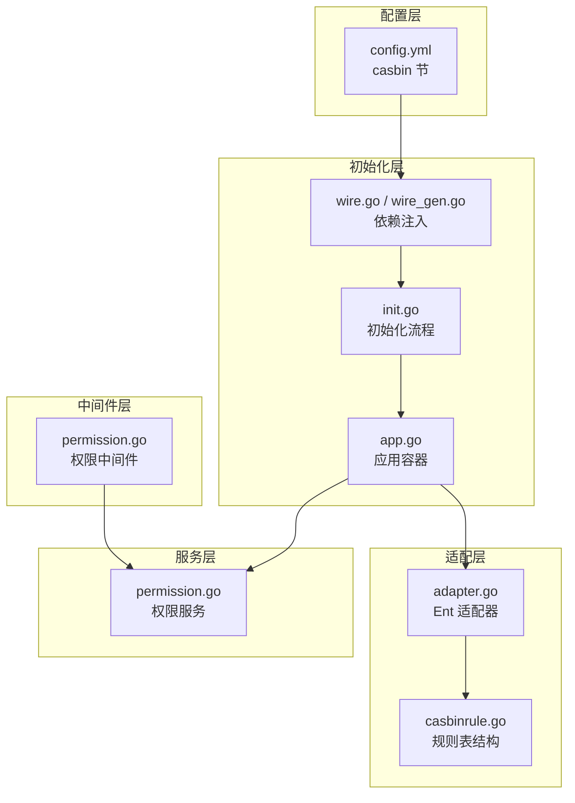
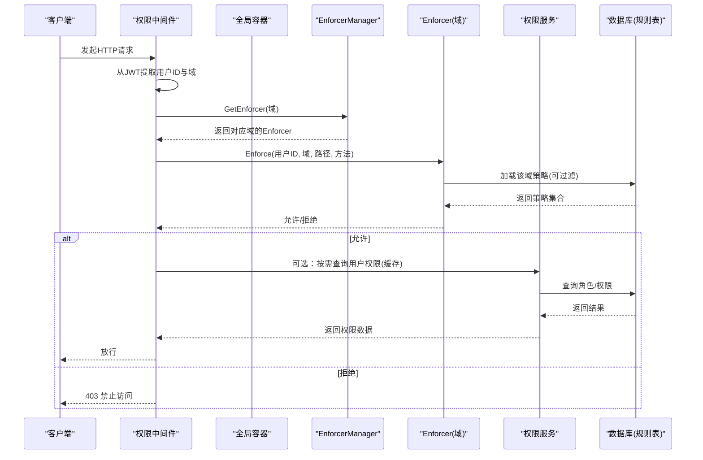
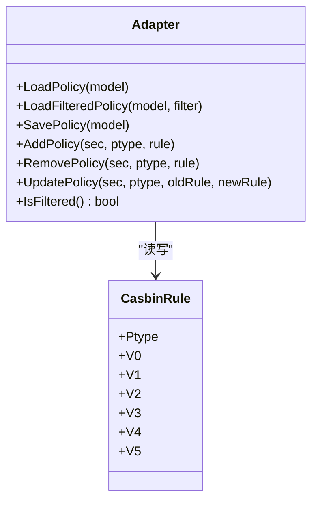
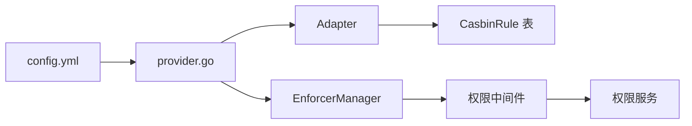
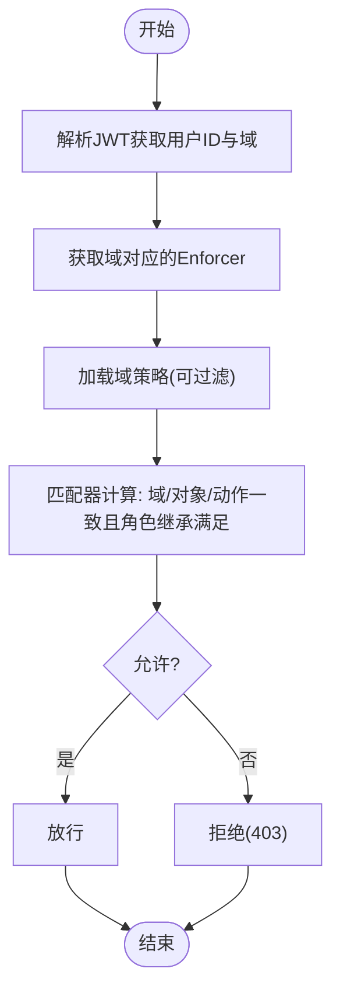

# Casbin权限配置

<cite>
**本文引用的文件**
- [config.yml](file://config/config.yml)
- [adapter.go](file://internal/casbin/adapter/adapter.go)
- [permission.go](file://internal/service/permission.go)
- [permission.go](file://internal/middleware/permission.go)
- [casbinrule.go](file://internal/ent/schema/casbinrule.go)
- [app.go](file://internal/app.go)
- [provider.go](file://internal/provider.go)
- [init.go](file://internal/init.go)
- [wire.go](file://internal/wire.go)
- [wire_gen.go](file://internal/wire_gen.go)
</cite>

## 目录
1. [简介](#简介)
2. [项目结构](#项目结构)
3. [核心组件](#核心组件)
4. [架构总览](#架构总览)
5. [详细组件分析](#详细组件分析)
6. [依赖分析](#依赖分析)
7. [性能考虑](#性能考虑)
8. [故障排查指南](#故障排查指南)
9. [结论](#结论)
10. [附录](#附录)

## 简介
本文件面向管理员与开发者，系统性阐述本项目的 Casbin 权限配置与实现细节，重点覆盖：
- config.yml 中 casbin 节的配置结构与参数语义
- 默认域与多域支持机制
- 带域 RBAC 模型的配置要点与工作原理
- 自动加载策略与性能优化建议
- 多租户权限隔离的配置示例与最佳实践
- 模型调试与权限问题排查流程

## 项目结构
围绕 Casbin 的权限体系，项目采用“配置驱动 + 数据持久化 + 中间件拦截 + 服务层校验”的分层设计：
- 配置层：config.yml 定义默认域、多域列表及各域的模型文本
- 适配层：基于 Ent ORM 的 Casbin 规则表持久化适配器
- 服务层：权限服务封装角色/用户/权限的增删改查与缓存
- 中间件层：HTTP 请求拦截，按域进行权限强制校验
- 初始化层：通过 Wire 或手动初始化 EnforcerManager 与适配器

图表来源
- [config.yml:77-143](file://config/config.yml#L77-L143)
- [wire.go:22-37](file://internal/wire.go#L22-L37)
- [wire_gen.go:17-62](file://internal/wire_gen.go#L17-L62)
- [init.go:31-67](file://internal/init.go#L31-L67)
- [app.go:15-26](file://internal/app.go#L15-L26)
- [adapter.go:115-175](file://internal/casbin/adapter/adapter.go#L115-L175)
- [casbinrule.go:9-37](file://internal/ent/schema/casbinrule.go#L9-L37)
- [permission.go:118-134](file://internal/service/permission.go#L118-L134)
- [permission.go:14-78](file://internal/middleware/permission.go#L14-L78)

章节来源
- [config.yml:77-143](file://config/config.yml#L77-L143)
- [wire.go:22-37](file://internal/wire.go#L22-L37)
- [wire_gen.go:17-62](file://internal/wire_gen.go#L17-L62)
- [init.go:31-67](file://internal/init.go#L31-L67)
- [app.go:15-26](file://internal/app.go#L15-L26)
- [adapter.go:115-175](file://internal/casbin/adapter/adapter.go#L115-L175)
- [casbinrule.go:9-37](file://internal/ent/schema/casbinrule.go#L9-L37)
- [permission.go:118-134](file://internal/service/permission.go#L118-L134)
- [permission.go:14-78](file://internal/middleware/permission.go#L14-L78)

## 核心组件
- 配置文件：定义默认域与多域列表，以及每个域的模型文本
- 适配器：将 Casbin 策略与角色规则持久化到数据库，并支持批量写入与过滤加载
- 权限服务：封装权限 CRUD、角色权限分配、用户权限查询与缓存
- 权限中间件：从 JWT 提取域与用户信息，调用 Enforcer 进行强制校验
- EnforcerManager：根据配置动态管理多个域的 Enforcer 实例

章节来源
- [config.yml:77-143](file://config/config.yml#L77-L143)
- [adapter.go:115-214](file://internal/casbin/adapter/adapter.go#L115-L214)
- [permission.go:118-134](file://internal/service/permission.go#L118-L134)
- [permission.go:14-78](file://internal/middleware/permission.go#L14-L78)
- [provider.go:40-43](file://internal/provider.go#L40-L43)

## 架构总览
下图展示从请求到权限决策的关键交互链路，以及配置如何驱动 Enforcer 的创建与加载。

图表来源
- [permission.go:14-78](file://internal/middleware/permission.go#L14-L78)
- [permission.go:558-734](file://internal/service/permission.go#L558-L734)
- [adapter.go:115-175](file://internal/casbin/adapter/adapter.go#L115-L175)
- [casbinrule.go:9-37](file://internal/ent/schema/casbinrule.go#L9-L37)

## 详细组件分析

### 配置结构与参数详解（config.yml 中的 casbin 节）
- 默认域
  - domains_default：指定默认域名称，GetDefaultEnforcer() 将返回该域的 Enforcer
- 多域配置
  - domains：域配置列表，每个域包含：
    - name：域名称（必填，唯一标识）
    - auto_load：是否启动时自动加载（可选，默认 false）
    - model_text：模型文本内容（可选，优先级高于 model_path）
    - model_path：模型文件路径（可选）
- 行为说明
  - 若未配置 domains，则系统会使用 model_path 为默认域创建配置
  - 建议高频访问的域设置 auto_load: true 以提升性能

章节来源
- [config.yml:77-143](file://config/config.yml#L77-L143)

### 带域 RBAC 模型配置要点
- 模型字段
  - r = sub, dom, obj, act：请求主体、域、对象、动作
  - p = sub, dom, obj, act：策略主体、域、对象、动作
  - g = _, _, _：角色继承映射（可带域）
- 匹配器
  - m = g(r.sub, p.sub, r.dom) && r.dom == p.dom && r.obj == p.obj && r.act == p.act
  - 关键点：匹配器必须同时比较域、对象与动作，确保跨域隔离
- 建议
  - 对不同租户/业务域定制独立模型，避免共享域导致策略冲突

章节来源
- [config.yml:87-101](file://config/config.yml#L87-L101)

### EnforcerManager 初始化与域管理
- 初始化入口
  - 通过 provider.go 中的 NewEnforcerManager 创建 EnforcerManager
  - 通过 wire 或手动初始化流程完成注入
- 域管理
  - 根据 domains_default 与 domains 列表，按需创建/加载各域的 Enforcer
  - auto_load 控制是否在启动时加载；未自动加载的域会在首次使用时惰性加载

章节来源
- [provider.go:40-43](file://internal/provider.go#L40-L43)
- [wire.go:22-37](file://internal/wire.go#L22-L37)
- [wire_gen.go:17-62](file://internal/wire_gen.go#L17-L62)
- [init.go:31-67](file://internal/init.go#L31-L67)
- [app.go:15-26](file://internal/app.go#L15-L26)

### 适配器与规则存储（Ent ORM）
- 存储结构
  - 规则表包含 Ptype、V0-V5 字段，分别对应策略类型与规则值
  - 唯一索引覆盖全部字段，保证规则去重
- 加载与保存
  - LoadPolicy：全量加载并按行解析到模型
  - SavePolicy：事务+批量插入，提升写入性能
  - LoadFilteredPolicy：支持按 Ptype/V0..V5 过滤加载，减少内存占用
- 自动保存
  - AddPolicy/RemovePolicy/UpdatePolicy 等方法支持自动保存策略变更

图表来源
- [adapter.go:115-214](file://internal/casbin/adapter/adapter.go#L115-L214)
- [adapter.go:243-272](file://internal/casbin/adapter/adapter.go#L243-L272)
- [adapter.go:401-453](file://internal/casbin/adapter/adapter.go#L401-L453)
- [casbinrule.go:9-37](file://internal/ent/schema/casbinrule.go#L9-L37)

章节来源
- [adapter.go:115-214](file://internal/casbin/adapter/adapter.go#L115-L214)
- [adapter.go:243-272](file://internal/casbin/adapter/adapter.go#L243-L272)
- [adapter.go:401-453](file://internal/casbin/adapter/adapter.go#L401-L453)
- [casbinrule.go:9-37](file://internal/ent/schema/casbinrule.go#L9-L37)

### 权限服务与缓存策略
- 功能范围
  - 权限 CRUD、角色权限分配/移除、用户权限查询（菜单/按钮/API）
  - 缓存键命名规范：user/menu|button|api:userID:domain 或 role:perms:roleName:domain
  - 默认缓存 TTL：5 分钟
- 性能优化
  - 读路径：优先命中缓存，减少数据库查询
  - 写路径：权限变更后清除相关缓存，避免脏读
- 查询要点
  - 用户权限查询时先加载用户角色，再按域过滤策略
  - API 权限排除菜单与按钮类型，确保区分度

章节来源
- [permission.go:118-134](file://internal/service/permission.go#L118-L134)
- [permission.go:146-187](file://internal/service/permission.go#L146-L187)
- [permission.go:558-734](file://internal/service/permission.go#L558-L734)

### 权限中间件与强制校验
- 流程
  - 从 JWT 提取用户 ID 与域
  - 通过 EnforcerManager 获取对应域的 Enforcer
  - 调用 Enforce(用户ID, 域, 路径, 方法) 进行决策
- 错误处理
  - 未授权/缺少域信息/权限检查失败均返回相应状态码

章节来源
- [permission.go:14-78](file://internal/middleware/permission.go#L14-L78)

### 多租户权限隔离配置示例
- 场景目标
  - 为租户 A/B/C 配置独立域，各自拥有独立模型与策略
- 配置要点
  - 在 domains 列表中为每个租户新增域条目
  - 为高频访问的租户开启 auto_load
  - 使用 model_text 为不同租户定制模型，确保匹配器包含域字段
- 最佳实践
  - 租户间策略完全隔离，避免共享域导致策略冲突
  - 为每个租户维护独立的策略文件或内联模型文本

章节来源
- [config.yml:103-134](file://config/config.yml#L103-L134)

## 依赖分析
- 组件耦合
  - EnforcerManager 依赖适配器与配置
  - 适配器依赖 Ent ORM 与规则表结构
  - 权限服务依赖 ORM、缓存与权限规则
  - 中间件依赖全局容器中的 EnforcerManager
- 初始化顺序
  - Wire 提供者按顺序创建配置、日志、ORM、缓存、文件系统、适配器与 EnforcerManager
  - 手动初始化流程等效于 Wire 生成代码

图表来源
- [provider.go:35-43](file://internal/provider.go#L35-L43)
- [adapter.go:115-175](file://internal/casbin/adapter/adapter.go#L115-L175)
- [casbinrule.go:9-37](file://internal/ent/schema/casbinrule.go#L9-L37)
- [permission.go:14-78](file://internal/middleware/permission.go#L14-L78)
- [permission.go:118-134](file://internal/service/permission.go#L118-L134)

章节来源
- [provider.go:35-43](file://internal/provider.go#L35-L43)
- [adapter.go:115-175](file://internal/casbin/adapter/adapter.go#L115-L175)
- [casbinrule.go:9-37](file://internal/ent/schema/casbinrule.go#L9-L37)
- [permission.go:14-78](file://internal/middleware/permission.go#L14-L78)
- [permission.go:118-134](file://internal/service/permission.go#L118-L134)

## 性能考虑
- 启动时加载
  - 对高频访问的域启用 auto_load，避免首次请求的延迟
- 批量写入
  - SavePolicy 使用事务与批量插入，批大小为 5000，显著降低写入开销
- 过滤加载
  - LoadFilteredPolicy 支持按条件过滤，减少内存占用与匹配成本
- 缓存策略
  - 用户权限与角色权限缓存默认 TTL 5 分钟，命中率高时可显著降低数据库压力
- 并发与连接
  - 建议结合数据库连接池与缓存集群，避免热点域造成数据库压力

章节来源
- [config.yml:142-143](file://config/config.yml#L142-L143)
- [adapter.go:199-213](file://internal/casbin/adapter/adapter.go#L199-L213)
- [adapter.go:127-170](file://internal/casbin/adapter/adapter.go#L127-L170)
- [permission.go:141-144](file://internal/service/permission.go#L141-L144)

## 故障排查指南
- 常见问题定位
  - 未授权/缺少域信息：检查 JWT 中是否包含 domain 字段
  - 权限检查失败：确认 Enforcer 是否正确加载对应域的模型与策略
  - 策略未生效：核对匹配器是否包含域字段，确保 r.dom == p.dom
  - 性能异常：检查 auto_load 配置、过滤加载使用情况与缓存命中率
- 调试步骤
  - 开启日志，观察 EnforcerManager 初始化与 Enforce 调用
  - 使用 LoadFilteredPolicy 按域/对象/动作过滤加载策略，缩小问题范围
  - 清理相关缓存后重试，确认策略变更已生效
- 排查清单
  - 配置文件：domains_default、domains 列表、auto_load、model_text/model_path
  - 数据库：规则表是否完整、唯一索引是否生效
  - 中间件：JWT 解析、域提取、Enforce 参数传递
  - 服务层：角色/权限查询逻辑、缓存键与 TTL

章节来源
- [permission.go:14-78](file://internal/middleware/permission.go#L14-L78)
- [adapter.go:127-170](file://internal/casbin/adapter/adapter.go#L127-L170)
- [permission.go:146-187](file://internal/service/permission.go#L146-L187)

## 结论
本项目通过配置驱动的多域 Casbin 权限体系，实现了租户级权限隔离与高性能策略管理。建议：
- 明确划分域边界，为高频域开启自动加载
- 为不同租户定制独立模型，确保匹配器包含域字段
- 结合缓存与批量写入，持续优化读写性能
- 建立完善的日志与监控，快速定位策略与匹配问题

## 附录

### 带域 RBAC 工作流程（算法流）

图表来源
- [permission.go:14-78](file://internal/middleware/permission.go#L14-L78)
- [adapter.go:115-175](file://internal/casbin/adapter/adapter.go#L115-L175)
- [config.yml:87-101](file://config/config.yml#L87-L101)