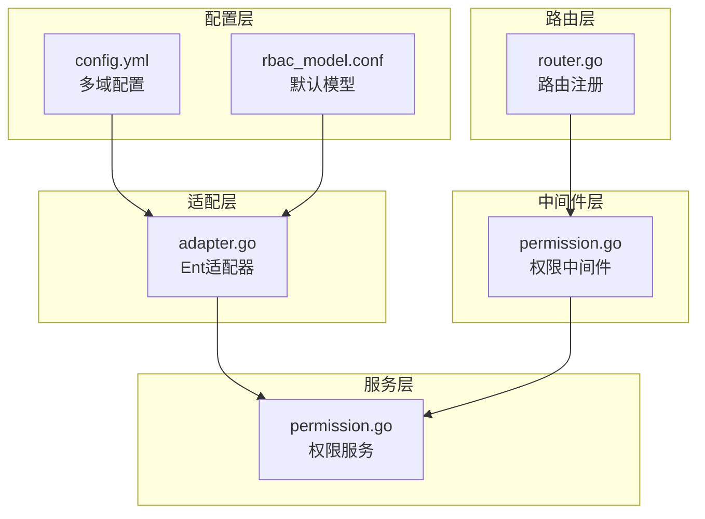
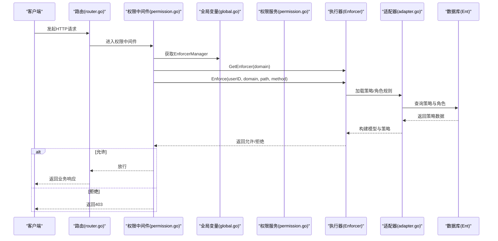
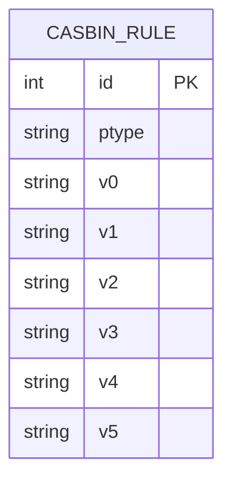
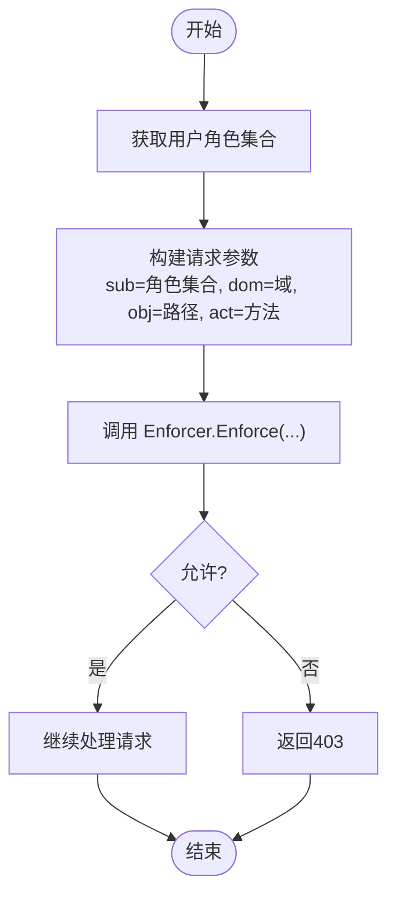
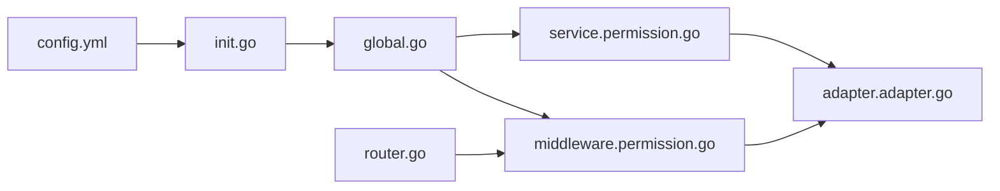

# Casbin模型配置

<cite>
**本文引用的文件**
- [rbac_model.conf](file://config/rbac_model.conf)
- [config.yml](file://config/config.yml)
- [adapter.go](file://internal/casbin/adapter/adapter.go)
- [permission.go](file://internal/service/permission.go)
- [permission.go](file://internal/middleware/permission.go)
- [permission.go](file://internal/handler/permission.go)
- [global.go](file://internal/global/global.go)
- [init.go](file://internal/init.go)
- [router.go](file://internal/router.go)
- [casbinrule.go](file://internal/ent/schema/casbinrule.go)
</cite>

## 目录
1. [简介](#简介)
2. [项目结构](#项目结构)
3. [核心组件](#核心组件)
4. [架构总览](#架构总览)
5. [详细组件分析](#详细组件分析)
6. [依赖关系分析](#依赖关系分析)
7. [性能考虑](#性能考虑)
8. [故障排查指南](#故障排查指南)
9. [结论](#结论)
10. [附录](#附录)

## 简介
本文件面向需要在本项目中配置与使用 Casbin RBAC 模型的工程师，系统性讲解模型配置的五大要素：请求定义、策略定义、角色定义、策略效果、匹配器；并结合项目实际，说明多域权限控制的配置方式、域参数 auto_load、model_path、model_text 的使用方法，以及如何为不同业务域配置独立的权限模型。同时提供调试方法、性能优化建议与常见模板示例，帮助快速落地生产级权限控制。

## 项目结构
本项目采用分层架构，围绕权限控制的关键文件如下：
- 配置层：模型配置文件与应用配置
- 适配层：Casbin 与数据库的持久化适配器
- 服务层：权限增删改查、用户权限查询、权限校验
- 中间件层：请求拦截与权限校验
- 路由层：对外暴露的权限管理与用户权限查询接口

图表来源
- [config.yml:77-143](file://config/config.yml#L77-L143)
- [rbac_model.conf:1-15](file://config/rbac_model.conf#L1-L15)
- [adapter.go:115-125](file://internal/casbin/adapter/adapter.go#L115-L125)
- [permission.go:602-640](file://internal/service/permission.go#L602-L640)
- [permission.go:11-53](file://internal/middleware/permission.go#L11-L53)
- [router.go:14-72](file://internal/router.go#L14-L72)

章节来源
- [config.yml:1-143](file://config/config.yml#L1-L143)
- [rbac_model.conf:1-15](file://config/rbac_model.conf#L1-L15)
- [adapter.go:115-125](file://internal/casbin/adapter/adapter.go#L115-L125)
- [permission.go:602-640](file://internal/service/permission.go#L602-L640)
- [permission.go:11-53](file://internal/middleware/permission.go#L11-L53)
- [router.go:14-72](file://internal/router.go#L14-L72)

## 核心组件
- 模型配置文件：定义请求、策略、角色、效果、匹配器五要素
- 多域配置：通过 config.yml 的 domains 列表为不同域配置独立模型
- 数据库适配器：将 Casbin 策略持久化到数据库（Ent Schema）
- 权限服务：封装权限 CRUD、角色权限、用户权限查询、权限校验
- 权限中间件：在请求进入控制器前进行权限校验
- 路由：暴露权限管理与用户权限查询接口

章节来源
- [rbac_model.conf:1-15](file://config/rbac_model.conf#L1-L15)
- [config.yml:77-143](file://config/config.yml#L77-L143)
- [adapter.go:115-125](file://internal/casbin/adapter/adapter.go#L115-L125)
- [permission.go:602-640](file://internal/service/permission.go#L602-L640)
- [permission.go:11-53](file://internal/middleware/permission.go#L11-L53)
- [router.go:14-72](file://internal/router.go#L14-L72)

## 架构总览
下图展示了从请求到权限校验的整体流程，以及模型与数据存储的关系。

图表来源
- [router.go:32-52](file://internal/router.go#L32-L52)
- [permission.go:11-53](file://internal/middleware/permission.go#L11-L53)
- [global.go:10-14](file://internal/global/global.go#L10-L14)
- [adapter.go:115-125](file://internal/casbin/adapter/adapter.go#L115-L125)
- [permission.go:602-640](file://internal/service/permission.go#L602-L640)

## 详细组件分析

### 1) 模型配置语法与五大要素
- 请求定义(request_definition)
  - 定义请求参数的顺序与含义。默认模型中为 sub, obj, act；多域模型中为 sub, dom, obj, act。
- 策略定义(policy_definition)
  - 定义策略规则的字段顺序。默认模型中为 sub, obj, act；多域模型中为 sub, dom, obj, act。
- 角色定义(role_definition)
  - 定义角色继承关系的匹配函数。默认模型中为 g(_, _)；多域模型中为 g(_, _, _)。
- 策略效果(policy_effect)
  - 定义策略匹配后的效果聚合规则。此处使用 some(where (p.eft == allow))。
- 匹配器(matchers)
  - 定义请求与策略之间的匹配逻辑。默认模型使用 keyMatch2 与 regexMatch；多域模型增加域匹配 r.dom == p.dom。

章节来源
- [rbac_model.conf:1-15](file://config/rbac_model.conf#L1-L15)
- [config.yml:87-101](file://config/config.yml#L87-L101)

### 2) 多域权限控制配置
- domains_default：指定默认域名称，GetDefaultEnforcer() 返回该域的执行器。
- domains：域配置列表，每个域包含 name、auto_load、model_path 或 model_text。
  - auto_load：是否在启动时自动加载该域的模型与策略。
  - model_path：指向外部模型文件路径。
  - model_text：内联模型文本，优先级高于 model_path。
- 建议：高频访问的域设置 auto_load: true，以减少首次请求延迟。

章节来源
- [config.yml:77-143](file://config/config.yml#L77-L143)

### 3) 域配置参数详解
- auto_load
  - true：启动即加载，适合高频域
  - false：按需加载，适合低频域
- model_path
  - 指向外部 .conf 文件，便于版本化管理
- model_text
  - 内联模型文本，优先于 model_path 生效

章节来源
- [config.yml:87-101](file://config/config.yml#L87-L101)

### 4) 为不同业务域配置独立模型
- 为租户 A 配置独立模型：设置 name、auto_load、model_path
- 为租户 B 配置独立模型：设置 name、auto_load、model_text
- 特殊业务域：设置 name、auto_load、model_path

章节来源
- [config.yml:106-133](file://config/config.yml#L106-L133)

### 5) 数据模型与存储
- CasbinRule 表结构包含 Ptype 与 V0-V5 字段，用于存储策略类型与策略字段。
- 唯一索引覆盖全部字段，保证策略去重。
- 适配器负责将数据库记录转换为 Casbin 模型条目，并支持批量保存与事务处理。

图表来源
- [casbinrule.go:15-24](file://internal/ent/schema/casbinrule.go#L15-L24)
- [casbinrule.go:32-36](file://internal/ent/schema/casbinrule.go#L32-L36)

章节来源
- [adapter.go:115-125](file://internal/casbin/adapter/adapter.go#L115-L125)
- [adapter.go:327-347](file://internal/casbin/adapter/adapter.go#L327-L347)
- [adapter.go:375-399](file://internal/casbin/adapter/adapter.go#L375-L399)
- [adapter.go:511-520](file://internal/casbin/adapter/adapter.go#L511-L520)
- [casbinrule.go:15-24](file://internal/ent/schema/casbinrule.go#L15-L24)
- [casbinrule.go:32-36](file://internal/ent/schema/casbinrule.go#L32-L36)

### 6) 权限服务与权限校验
- 权限服务提供：
  - 权限 CRUD、角色权限分配/移除、用户权限查询（菜单、按钮、API）
  - CheckPermission：基于角色集合与域进行权限校验
- 中间件：
  - 从 JWT 获取域信息，调用 EnforcerManager.GetEnforcer(domain)
  - 执行 Enforce(userID, domain, path, method)，根据结果放行或拒绝

图表来源
- [permission.go:602-640](file://internal/service/permission.go#L602-L640)
- [permission.go:11-53](file://internal/middleware/permission.go#L11-L53)

章节来源
- [permission.go:602-640](file://internal/service/permission.go#L602-L640)
- [permission.go:11-53](file://internal/middleware/permission.go#L11-L53)

### 7) 路由与中间件集成
- 路由组 adminAuth 在进入控制器前，依次经过 JWT 验证、域中间件、权限中间件
- 权限中间件从 JWT 中提取域，调用 EnforcerManager 获取对应域的执行器并进行校验

章节来源
- [router.go:32-52](file://internal/router.go#L32-L52)
- [permission.go:11-53](file://internal/middleware/permission.go#L11-L53)

## 依赖关系分析
- 配置依赖：config.yml 决定多域模型加载策略与默认域
- 适配器依赖：adapter.go 依赖 Ent ORM 与 Casbin 接口，负责策略的持久化与加载
- 服务依赖：permission.go 依赖全局 ORM 与 EnforcerManager，提供权限业务能力
- 中间件依赖：permission.go 依赖全局 EnforcerManager 与 JWT 工具
- 路由依赖：router.go 注册中间件链路

图表来源
- [config.yml:77-143](file://config/config.yml#L77-L143)
- [init.go:49-65](file://internal/init.go#L49-L65)
- [global.go:10-14](file://internal/global/global.go#L10-L14)
- [permission.go:11-53](file://internal/middleware/permission.go#L11-L53)
- [permission.go:602-640](file://internal/service/permission.go#L602-L640)
- [adapter.go:115-125](file://internal/casbin/adapter/adapter.go#L115-L125)
- [router.go:32-52](file://internal/router.go#L32-L52)

章节来源
- [config.yml:77-143](file://config/config.yml#L77-L143)
- [init.go:49-65](file://internal/init.go#L49-L65)
- [global.go:10-14](file://internal/global/global.go#L10-L14)
- [permission.go:11-53](file://internal/middleware/permission.go#L11-L53)
- [permission.go:602-640](file://internal/service/permission.go#L602-L640)
- [adapter.go:115-125](file://internal/casbin/adapter/adapter.go#L115-L125)
- [router.go:32-52](file://internal/router.go#L32-L52)

## 性能考虑
- 高频域启用 auto_load：避免首次请求的模型加载开销
- 批量写入：保存策略时使用批量插入，降低数据库往返次数
- 事务一致性：所有策略变更使用事务，确保一致性
- 索引设计：CasbinRule 表对全部字段建立唯一索引，避免重复策略
- 匹配器优化：尽量使用精确匹配与简单正则，避免复杂表达式导致的性能问题

章节来源
- [config.yml:139-142](file://config/config.yml#L139-L142)
- [adapter.go:199-213](file://internal/casbin/adapter/adapter.go#L199-L213)
- [adapter.go:304-325](file://internal/casbin/adapter/adapter.go#L304-L325)
- [casbinrule.go:32-36](file://internal/ent/schema/casbinrule.go#L32-L36)

## 故障排查指南
- 权限中间件报错“缺少域信息”
  - 检查 JWT 中是否包含 domain 字段，确认 DomainMiddleware 正常执行
- 权限中间件报错“获取权限执行器失败”或“权限检查失败”
  - 检查 EnforcerManager 初始化是否成功，确认 domains 配置正确
- 权限校验总是失败
  - 检查策略表中是否存在对应域、对象、动作的策略
  - 确认匹配器逻辑与请求参数一致
- 策略无法生效
  - 检查 auto_load 配置，确认域已加载
  - 如使用 model_path，请确认路径正确且模型语法无误

章节来源
- [permission.go:11-53](file://internal/middleware/permission.go#L11-L53)
- [init.go:49-65](file://internal/init.go#L49-L65)
- [config.yml:77-143](file://config/config.yml#L77-L143)
- [adapter.go:115-125](file://internal/casbin/adapter/adapter.go#L115-L125)

## 结论
本项目通过清晰的分层设计与完善的配置体系，实现了灵活的多域 RBAC 权限控制。通过合理配置 domains、auto_load、model_path/model_text，可以为不同业务域提供独立的权限模型；配合数据库持久化的策略存储与高效的匹配器，满足生产环境的性能与可维护性需求。

## 附录

### A. 模型配置模板
- 默认模型（无域）
  - 请求定义：r = sub, obj, act
  - 策略定义：p = sub, obj, act
  - 角色定义：g = _, _
  - 策略效果：e = some(where (p.eft == allow))
  - 匹配器：m = g(r.sub, p.sub) && keyMatch2(r.obj, p.obj) && regexMatch(r.act, p.act)
- 多域模型（含域）
  - 请求定义：r = sub, dom, obj, act
  - 策略定义：p = sub, dom, obj, act
  - 角色定义：g = _, _, _
  - 策略效果：e = some(where (p.eft == allow))
  - 匹配器：m = g(r.sub, p.sub, r.dom) && r.dom == p.dom && r.obj == p.obj && r.act == p.act

章节来源
- [rbac_model.conf:1-15](file://config/rbac_model.conf#L1-L15)
- [config.yml:87-101](file://config/config.yml#L87-L101)

### B. 多域配置示例
- 默认域
  - name: "default"
  - auto_load: true
  - model_text: 内联模型文本
- 租户 A
  - name: "tenant-a"
  - auto_load: true
  - model_path: "./config/tenant_a_model.conf"
- 租户 B
  - name: "tenant-b"
  - auto_load: false
  - model_text: 内联模型文本
- 特殊业务域
  - name: "special-domain"
  - auto_load: true
  - model_path: "./config/special_model.conf"

章节来源
- [config.yml:84-133](file://config/config.yml#L84-L133)

### C. 最佳实践
- 高频域开启 auto_load，降低首次请求延迟
- 使用 model_text 便于版本化管理，必要时使用 model_path 引用外部文件
- 为不同租户/业务域提供独立模型，避免相互影响
- 对策略表建立唯一索引，确保策略不重复
- 使用批量插入与事务，保证写入性能与一致性
- 匹配器尽量简洁，避免复杂正则导致性能问题

章节来源
- [config.yml:139-142](file://config/config.yml#L139-L142)
- [adapter.go:199-213](file://internal/casbin/adapter/adapter.go#L199-L213)
- [adapter.go:304-325](file://internal/casbin/adapter/adapter.go#L304-L325)
- [casbinrule.go:32-36](file://internal/ent/schema/casbinrule.go#L32-L36)