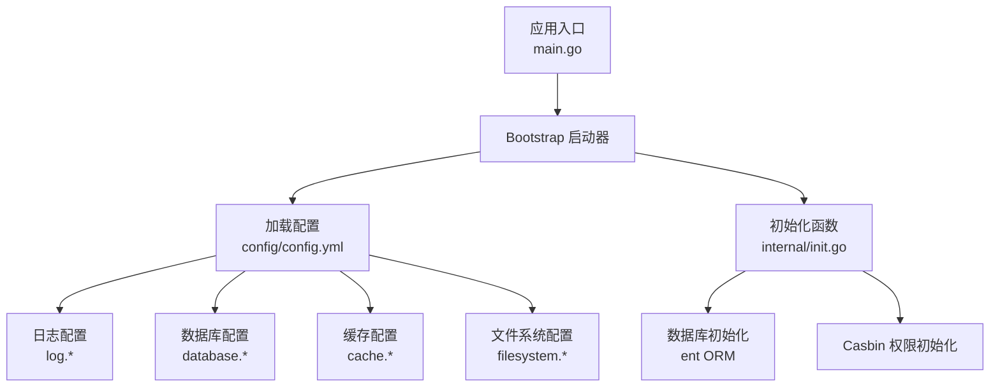
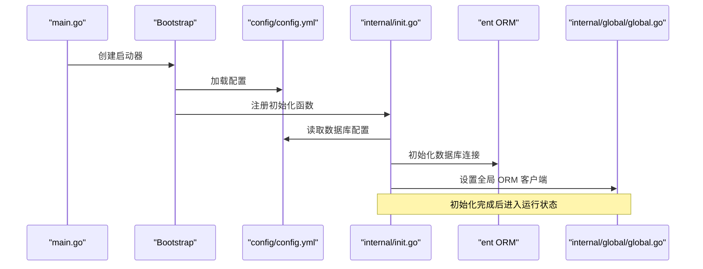
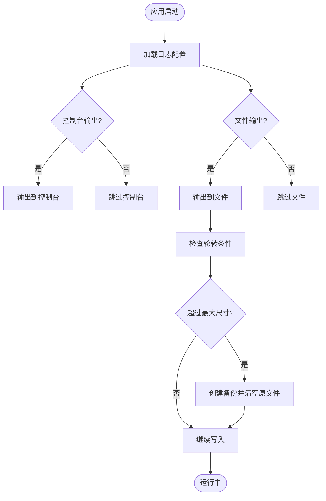
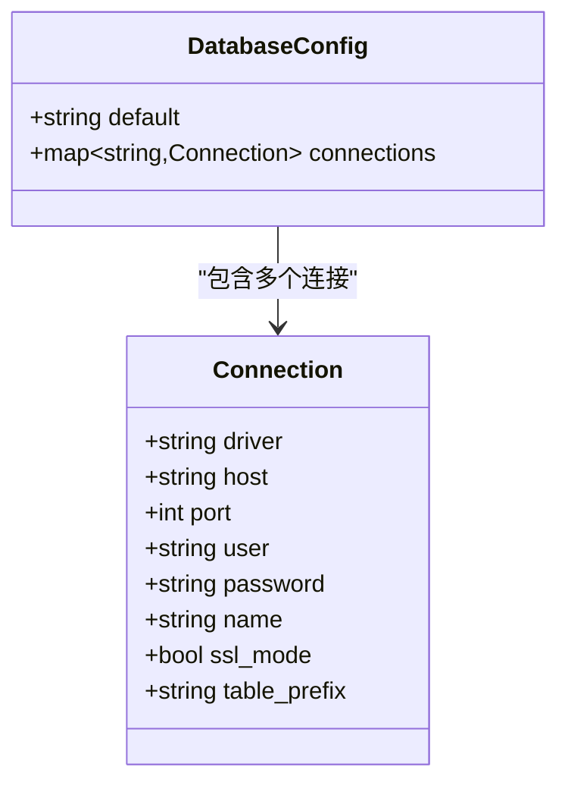
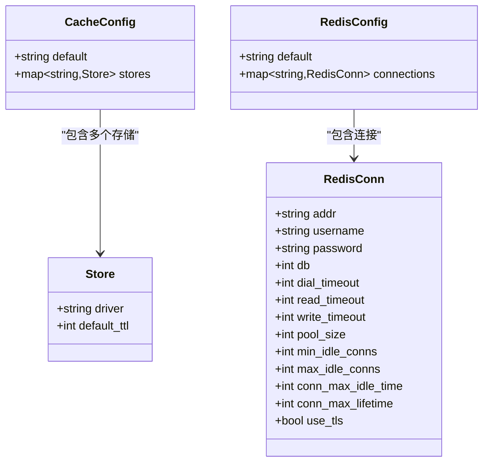
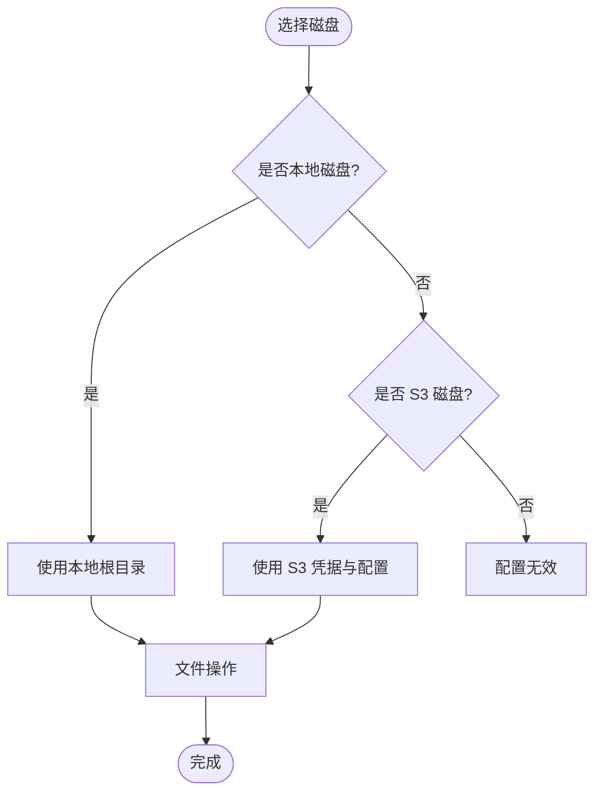
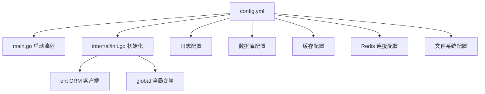

# 主配置文件详解

<cite>
**本文档引用的文件**
- [config.yml](file://config/config.yml)
- [main.go](file://main.go)
- [init.go](file://internal/init.go)
- [global.go](file://internal/global/global.go)
- [.gitignore](file://.gitignore)
- [go.mod](file://go.mod)
- [go.sum](file://go.sum)
</cite>

## 目录
1. [简介](#简介)
2. [项目结构](#项目结构)
3. [核心组件](#核心组件)
4. [架构概览](#架构概览)
5. [详细组件分析](#详细组件分析)
6. [依赖关系分析](#依赖关系分析)
7. [性能考虑](#性能考虑)
8. [故障排除指南](#故障排除指南)
9. [结论](#结论)

## 简介
本文件详细解析主配置文件 config.yml 的所有配置项，涵盖应用配置、日志配置、数据库配置、缓存配置、文件系统配置等关键模块。文档不仅说明各配置项的作用与取值范围，还提供默认值、最佳实践建议，并给出配置验证规则与常见问题排查方法。

## 项目结构
配置文件位于 config/config.yml，应用通过 Bootstrap 启动流程加载该配置，并在初始化阶段完成数据库、缓存、文件系统等基础设施的装配。

**图表来源**
- [main.go:43-89](file://main.go#L43-L89)
- [config.yml:1-143](file://config/config.yml#L1-L143)
- [init.go:17-65](file://internal/init.go#L17-L65)

**章节来源**
- [config.yml:1-143](file://config/config.yml#L1-L143)
- [main.go:43-89](file://main.go#L43-L89)

## 核心组件

### 应用配置(app)
应用配置控制服务的基本运行参数，包括名称、端口、调试模式、超时设置等。

- 名称(name): 服务名称，用于标识应用实例。
- 端口(port): HTTP 服务监听端口，默认 9501。
- 调试模式(debug): 开启后启用调试日志与详细错误信息。
- 空闲超时(idle_timeout): 连接空闲超时时间（秒），默认 60。
- 预分叉(prefork): 是否启用预分叉模式以提升并发性能，默认 false。
- Swagger(swagger): 是否启用 Swagger 文档，默认 true。
- 密钥(secret): 用于签发令牌等场景的密钥。
- 登录过期(login_expires): 登录态有效期（秒），默认 86400（1 天）。

默认值与取值范围建议：
- port: 整数，建议 1024-65535，避免特权端口。
- debug: 布尔值，生产环境建议 false。
- idle_timeout: 正整数，建议 30-300 秒。
- prefork: 布尔值，高并发场景可考虑开启。
- swagger: 布尔值，开发环境建议 true。
- secret: 字符串，建议至少 16 字符且随机。
- login_expires: 正整数，建议 3600-604800 秒。

使用建议：
- 生产环境关闭 debug，开启 prefork 提升吞吐。
- 登录过期时间应结合业务安全策略调整。
- 端口需确保防火墙放行与无冲突。

**章节来源**
- [config.yml:1-9](file://config/config.yml#L1-L9)

### 日志配置(log)
日志配置控制日志输出位置与轮转策略，支持控制台与文件双输出。

- 文件路径(file_path): 日志文件绝对或相对路径，默认 ./data/logs/admin-api.log。
- 控制台输出(console_output): 是否输出到控制台，默认 true。
- 文件输出(file_output): 是否输出到文件，默认 true。
- 最大尺寸(max_size): 单个日志文件最大大小（MB），默认 10。
- 最大备份数(max_backups): 保留的日志备份数量，默认 10。
- 最大保存天数(max_age): 日志文件最大保存天数，默认 180。

默认值与取值范围建议：
- max_size: 正整数，建议 50-500 MB。
- max_backups: 非负整数，建议 5-30。
- max_age: 非负整数，建议 30-365 天。

使用建议：
- 生产环境建议同时开启 console_output 与 file_output，便于实时监控与离线分析。
- 合理设置 max_size 与 max_backups，避免磁盘空间被占满。
- 结合 .gitignore 中对日志文件的忽略策略，避免误提交。

**章节来源**
- [config.yml:11-17](file://config/config.yml#L11-L17)
- [.gitignore:1-3](file://.gitignore#L1-L3)

### 数据库配置(database)
数据库配置定义默认连接与连接详情，支持多连接配置。

- 默认连接(default): 指定默认使用的连接名，默认 default。
- 连接集合(connections): 包含多个命名连接，示例 default。
  - 驱动(driver): 数据库驱动类型，示例 mysql。
  - 主机(host): 数据库主机地址，默认 localhost。
  - 端口(port): 数据库端口，默认 3306。
  - 用户(user): 数据库用户名，默认 root。
  - 密码(password): 数据库密码，默认 root。
  - 名称(name): 数据库名称，默认 cmf。
  - SSL 模式(ssl_mode): 是否启用 SSL，默认 false。
  - 表前缀(table_prefix): 表名前缀，默认 test_。

连接池与驱动选择：
- 驱动类型受 ent 支持限制，当前示例使用 mysql。
- 连接池参数由底层数据库驱动与应用框架共同决定，此处未显式配置连接池参数，需参考驱动实现。

默认值与取值范围建议：
- port: 1-65535，MySQL 常用 3306。
- ssl_mode: 布尔值，生产环境建议 true 并正确配置证书。
- table_prefix: 字符串，建议以业务域命名，避免冲突。

使用建议：
- 生产环境务必配置强密码与最小权限账户。
- 启用 SSL 并校验证书链，防止中间人攻击。
- 表前缀用于多租户隔离，需与实体映射保持一致。

**章节来源**
- [config.yml:19-30](file://config/config.yml#L19-L30)
- [init.go:33-47](file://internal/init.go#L33-L47)

### 缓存配置(cache)
缓存配置定义默认缓存存储与各存储的 TTL 设置。

- 默认存储(default): 指定默认使用的缓存存储，默认 memory。
- 存储集合(stores):
  - 内存缓存(memory): 驱动 memory，TTL 默认 3600 秒。
  - Redis 缓存(redis): 驱动 redis，TTL 默认 3600 秒。

默认值与取值范围建议：
- default_ttl: 正整数，建议 300-86400 秒，热点数据可更短。

使用建议：
- 内存缓存适合单实例部署与短期缓存。
- Redis 缓存适合分布式部署与持久化需求。
- 合理设置 TTL，避免缓存雪崩与击穿。

**章节来源**
- [config.yml:32-40](file://config/config.yml#L32-L40)

### Redis 连接配置(redis)
Redis 连接配置用于连接外部 Redis 实例，支持连接池与超时设置。

- 默认连接(default): 指定默认连接名，默认 redis。
- 连接集合(connections):
  - 连接名(redis): 默认连接名。
  - 地址(addr): Redis 地址，默认 localhost:6379。
  - 用户名(username): 认证用户名，默认空字符串。
  - 密码(password): 认证密码，默认空字符串。
  - 数据库(db): 逻辑数据库编号，默认 0。
  - 拨号超时(dial_timeout): 拨号超时（秒），默认 5。
  - 读取超时(read_timeout): 读取超时（秒），默认 3。
  - 写入超时(write_timeout): 写入超时（秒），默认 3。
  - 连接池大小(pool_size): 连接池总大小，默认 10。
  - 最小空闲连接(min_idle_conns): 最小空闲连接数，默认 5。
  - 最大空闲连接(max_idle_conns): 最大空闲连接数，默认 10。
  - 最大空闲时间(conn_max_idle_time): 连接最大空闲时间（秒），默认 30。
  - 最大生命周期(conn_max_lifetime): 连接最大存活时间（秒），默认 24。
  - 使用 TLS(use_tls): 是否启用 TLS，默认 false。

默认值与取值范围建议：
- dial_timeout/read_timeout/write_timeout: 正整数，建议 3-10 秒。
- pool_size: 正整数，建议 10-100，依据 QPS 调整。
- conn_max_idle_time/conn_max_lifetime: 正整数，建议根据业务峰值调优。

使用建议：
- 生产环境启用 TLS 并配置强认证。
- 连接池大小与空闲连接数需结合并发与延迟要求调优。
- 合理设置超时参数，避免阻塞与资源泄漏。

**章节来源**
- [config.yml:42-58](file://config/config.yml#L42-L58)

### 文件系统配置(filesystem)
文件系统配置定义默认磁盘与磁盘选项，支持本地存储与 S3 云存储。

- 默认磁盘(default): 指定默认磁盘，默认 local。
- 本地标志(is_and_local): 是否同时启用本地磁盘，默认 false。
- 磁盘集合(disks):
  - 本地磁盘(local): 驱动 local，根目录 root 默认 ./data/storage。
  - S3 磁盘(s3): 驱动 s3，需配置 access_key、secret_key、region、bucket、endpoint。

默认值与取值范围建议：
- root: 有效文件系统路径，建议使用绝对路径。
- S3 参数: 必须按需填写，缺失会导致 S3 功能不可用。

使用建议：
- 本地磁盘适合开发与小规模部署；S3 适合高可用与跨地域场景。
- S3 配置需确保网络可达与凭据正确。
- 生产环境建议为不同用途划分独立 bucket 或前缀。

**章节来源**
- [config.yml:60-75](file://config.yml#L60-L75)

### Casbin 权限配置(casbin)
Casbin 权限配置用于多域权限模型管理，支持默认域与多域配置。

- 默认域(domains_default): 默认域名称，默认 default。
- 域列表(domains): 域配置数组，示例包含默认域。
  - 域名(name): 域名称，唯一标识。
  - 自动加载(auto_load): 启动时是否自动加载，默认 false。
  - 模型文本(model_text): 内联模型文本，优先于模型路径。
  - 模型路径(model_path): 模型文件路径（可选）。

使用建议：
- 高频访问的域建议设置 auto_load: true 以提升性能。
- 多域场景下，为不同租户或业务域配置独立模型。
- 模型文本与模型路径二选一，优先使用模型文本。

**章节来源**
- [config.yml:77-143](file://config.yml#L77-L143)

## 架构概览
配置在应用启动时被加载，随后初始化数据库、Casbin 权限管理器与清理资源。

**图表来源**
- [main.go:43-89](file://main.go#L43-L89)
- [config.yml:19-30](file://config.yml#L19-L30)
- [init.go:33-47](file://internal/init.go#L33-L47)
- [global.go:10-14](file://internal/global/global.go#L10-L14)

## 详细组件分析

### 应用配置(app)参数详解
- name: 服务标识，影响日志与监控标签。
- port: 监听端口，需与反向代理或容器编排一致。
- debug: 影响 ent 调试日志与 Fiber 错误详情输出。
- idle_timeout: 控制 HTTP 连接空闲回收，避免资源泄露。
- prefork: 多进程模式，提升 CPU 利用率。
- swagger: 文档开关，开发环境建议开启。
- secret: 令牌签发与校验所需密钥。
- login_expires: 登录态有效期，建议结合风控策略调整。

**章节来源**
- [config.yml:1-9](file://config.yml#L1-L9)

### 日志配置(log)参数详解
- file_path: 日志文件路径，需确保写权限与磁盘空间。
- console_output: 控制台输出便于开发调试。
- file_output: 文件输出便于归档与分析。
- max_size/max_backups/max_age: 日志轮转三件套，避免无限增长。

**图表来源**
- [config.yml:11-17](file://config.yml#L11-L17)

**章节来源**
- [config.yml:11-17](file://config.yml#L11-L17)

### 数据库配置(database)参数详解
- default: 指定默认连接名，便于多连接切换。
- connections.default.*: 驱动、主机、端口、用户、密码、库名、SSL、表前缀。
- 驱动选择: 当前示例为 mysql，ent 支持 MySQL、Postgres、SQLite。

**图表来源**
- [config.yml:19-30](file://config.yml#L19-L30)

**章节来源**
- [config.yml:19-30](file://config.yml#L19-L30)
- [init.go:33-47](file://internal/init.go#L33-L47)

### 缓存配置(cache)与 Redis 配置
- cache.default: 指定默认缓存存储（memory 或 redis）。
- cache.stores.*: 各存储的驱动与默认 TTL。
- redis.connections.redis.*: 连接地址、认证、数据库、超时与连接池参数。

**图表来源**
- [config.yml:32-58](file://config.yml#L32-L58)

**章节来源**
- [config.yml:32-58](file://config.yml#L32-L58)

### 文件系统配置(filesystem)详解
- default: 默认磁盘（local 或 s3）。
- is_and_local: 是否同时启用本地磁盘。
- disks.local: 本地磁盘根目录。
- disks.s3: S3 凭据与区域、桶、端点。

**图表来源**
- [config.yml:60-75](file://config.yml#L60-L75)

**章节来源**
- [config.yml:60-75](file://config.yml#L60-L75)

## 依赖关系分析
配置文件与运行时组件的依赖关系如下：

**图表来源**
- [config.yml:1-143](file://config.yml#L1-143)
- [main.go:43-89](file://main.go#L43-L89)
- [init.go:17-65](file://internal/init.go#L17-L65)
- [global.go:10-14](file://internal/global/global.go#L10-L14)

**章节来源**
- [config.yml:1-143](file://config.yml#L1-L143)
- [main.go:43-89](file://main.go#L43-L89)
- [init.go:17-65](file://internal/init.go#L17-L65)
- [global.go:10-14](file://internal/global/global.go#L10-L14)

## 性能考虑
- app.prefork: 在多核环境下可提升吞吐，但需注意进程间共享资源。
- app.idle_timeout: 合理设置避免连接堆积导致内存占用过高。
- cache.default_ttl: 热点数据建议较短 TTL，降低陈旧风险。
- redis.pool_size/min_idle_conns/max_idle_conns: 根据 QPS 与延迟目标调优。
- filesystem.is_and_local: 同时启用本地与 S3 会增加维护成本，建议按场景选择其一。

## 故障排除指南
- 配置加载失败
  - 检查 YAML 缩进与键名拼写。
  - 确认 config.yml 路径正确且可读。
- 数据库连接异常
  - 校验 host/port/user/password/name/ssl_mode。
  - 确认数据库服务可达且账号有权限。
- Redis 连接异常
  - 校验 addr/username/password/db。
  - 检查 dial_timeout/read_timeout/write_timeout 与网络连通性。
- 日志无法写入
  - 校验 file_path 权限与磁盘空间。
  - 确认 lumberjack 轮转参数合理。
- 文件系统异常
  - 校验 local.root 与 s3.* 配置。
  - 确认 S3 凭据与网络可达。

**章节来源**
- [config.yml:11-17](file://config.yml#L11-L17)
- [config.yml:19-30](file://config.yml#L19-L30)
- [config.yml:42-58](file://config.yml#L42-L58)
- [config.yml:60-75](file://config.yml#L60-L75)

## 结论
config.yml 是应用运行的核心配置文件，涵盖应用、日志、数据库、缓存、文件系统与权限等多个方面。遵循本文档提供的默认值、取值范围与最佳实践，可显著提升系统的稳定性、安全性与可维护性。建议在生产环境中严格校验配置项，定期审查日志与缓存策略，并根据业务增长持续优化连接池与超时参数。