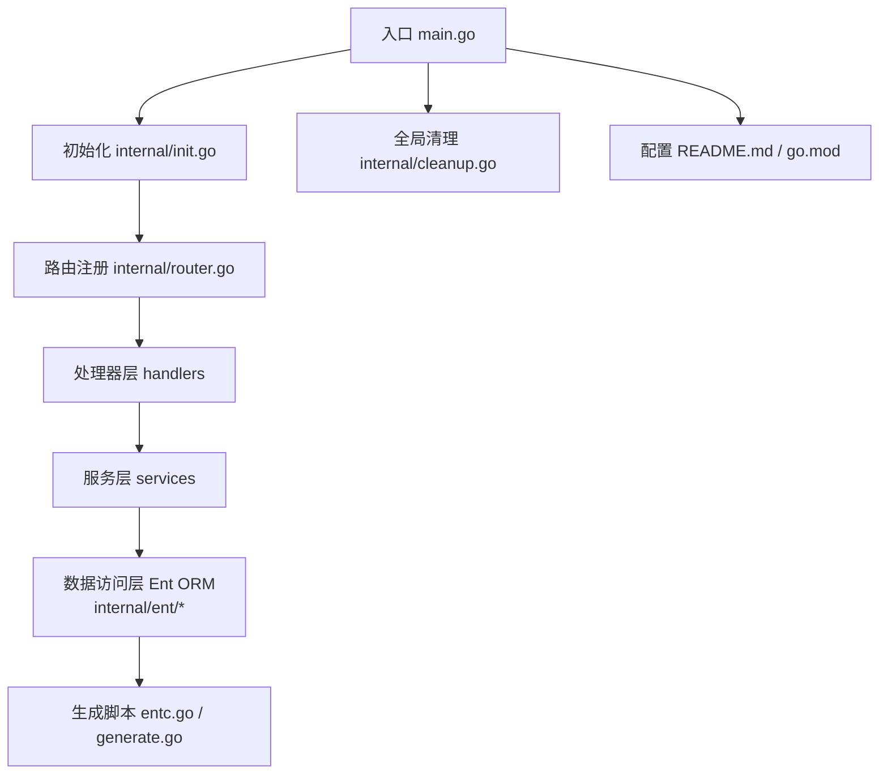
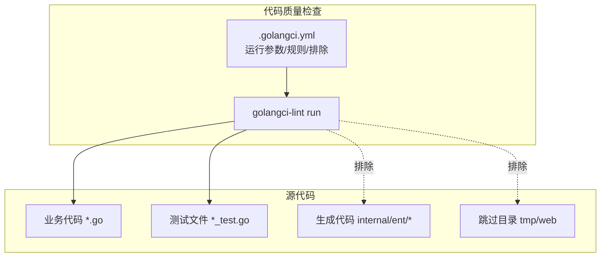
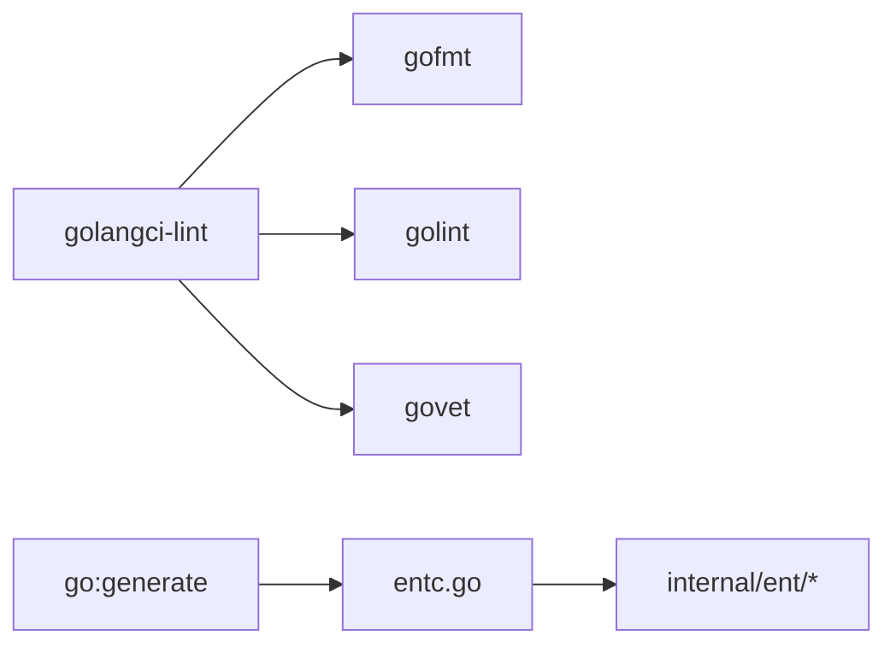

# 代码质量配置

<cite>
**本文引用的文件**
- [.golangci.yml](file://.golangci.yml)
- [go.mod](file://go.mod)
- [README.md](file://README.md)
- [main.go](file://main.go)
- [internal/init.go](file://internal/init.go)
- [internal/router.go](file://internal/router.go)
- [internal/cleanup.go](file://internal/cleanup.go)
- [internal/ent/entc.go](file://internal/ent/entc.go)
- [internal/ent/generate.go](file://internal/ent/generate.go)
</cite>

## 目录
1. [简介](#简介)
2. [项目结构](#项目结构)
3. [核心组件](#核心组件)
4. [架构总览](#架构总览)
5. [详细组件分析](#详细组件分析)
6. [依赖分析](#依赖分析)
7. [性能考虑](#性能考虑)
8. [故障排查指南](#故障排查指南)
9. [结论](#结论)
10. [附录](#附录)

## 简介
本文件围绕项目中的代码质量检查配置展开，重点解析 .golangci.yml 的作用与配置项，并结合项目实际（如 Ent 代码生成、测试文件过滤、目录排除等）给出可操作的说明与最佳实践。同时提供不同严格程度的配置模板，帮助团队按需定制规则，提升代码一致性与可维护性。

## 项目结构
该项目采用分层架构，包含入口程序、路由层、处理器层、服务层、数据访问层（Ent ORM）、中间件、全局配置与工具等模块。代码质量检查通过 golangci-lint 在 CI/CD 或本地开发中统一执行，确保代码风格、静态分析与生成代码的合规性。

图表来源
- [main.go:1-90](file://main.go#L1-L90)
- [internal/init.go:1-66](file://internal/init.go#L1-L66)
- [internal/router.go:1-73](file://internal/router.go#L1-L73)
- [internal/cleanup.go:1-20](file://internal/cleanup.go#L1-L20)
- [internal/ent/entc.go:1-44](file://internal/ent/entc.go#L1-L44)
- [internal/ent/generate.go:1-3](file://internal/ent/generate.go#L1-L3)

章节来源
- [main.go:1-90](file://main.go#L1-L90)
- [internal/init.go:1-66](file://internal/init.go#L1-L66)
- [internal/router.go:1-73](file://internal/router.go#L1-L73)
- [internal/cleanup.go:1-20](file://internal/cleanup.go#L1-L20)
- [internal/ent/entc.go:1-44](file://internal/ent/entc.go#L1-L44)
- [internal/ent/generate.go:1-3](file://internal/ent/generate.go#L1-L3)

## 核心组件
- 代码质量检查配置：.golangci.yml
  - 运行参数：跳过目录、跳过文件、超时时间
  - Linters：启用/禁用规则集合
  - 问题过滤：按路径与规则排除特定 issue
  - 限制：每 linter 最大问题数、相同问题重复数
- 项目依赖与工具链：go.mod 中声明 golangci-lint、Ent、Fiber、Casbin 等
- 生成代码与静态分析：Ent 代码生成产物位于 internal/ent，配置中对其 golint 进行排除以避免误报

章节来源
- [.golangci.yml:1-38](file://.golangci.yml#L1-L38)
- [go.mod:1-120](file://go.mod#L1-L120)

## 架构总览
下图展示代码质量检查在项目中的位置与影响范围，以及与生成代码、测试文件、目录排除的关系。

图表来源
- [.golangci.yml:1-38](file://.golangci.yml#L1-L38)

## 详细组件分析

### .golangci.yml 配置详解
- 运行参数
  - 跳过目录：tmp、web
  - 跳过文件：以 _test.go 结尾的文件（正则）
  - 超时时间：默认 5 分钟
- Linters
  - 启用：gofmt、golint、govet
  - 禁用：maligned、prealloc
  - 注意：disable-all 默认为 false，表示保留默认启用的 linters
- 问题过滤
  - 排除规则：对 internal/ent 目录下的 golint 检查进行排除
  - 限制：max-issues-per-linter 与 max-same-issues 设为 0 表示不限制数量

该配置与项目现状匹配：
- 跳过目录与文件符合前端资源与测试文件的隔离需求
- 对生成代码（internal/ent）排除 golint，避免因自动生成的结构体标签缺失导致误报
- 启用 gofmt、golint、govet，兼顾格式化、命名与静态分析

章节来源
- [.golangci.yml:1-38](file://.golangci.yml#L1-L38)

### 生成代码与静态分析
- Ent 代码生成
  - 生成脚本：internal/ent/entc.go
  - 触发方式：internal/ent/generate.go 中的 //go:generate 指令
  - 生成产物：internal/ent 下的 schema、client、runtime 等
- 静态分析策略
  - 配置中对 internal/ent 目录 golint 排除，避免对生成代码的过度检查
  - 建议仅对业务代码启用严格规则，生成代码保持“可读但不强求”原则

章节来源
- [internal/ent/entc.go:1-44](file://internal/ent/entc.go#L1-L44)
- [internal/ent/generate.go:1-3](file://internal/ent/generate.go#L1-L3)
- [.golangci.yml:28-35](file://.golangci.yml#L28-L35)

### 测试文件与目录排除
- 测试文件过滤：通过正则排除 *_test.go 文件，减少不必要的检查成本
- 目录排除：tmp、web 目录通常存放临时文件或前端构建产物，无需纳入检查
- 建议：若团队有其他非核心目录（如 docs、scripts），可在 skip-dirs 中补充

章节来源
- [.golangci.yml:3-12](file://.golangci.yml#L3-L12)

### Linters 选择与权衡
- gofmt：强制统一代码格式，建议始终启用
- golint：提供风格与命名建议，可适度放宽或排除生成代码
- govet：执行静态分析，发现潜在问题，建议保留
- maligned、prealloc：部分团队认为对性能微优化影响有限，可按需禁用

章节来源
- [.golangci.yml:14-27](file://.golangci.yml#L14-L27)

### 问题限制与阈值
- max-issues-per-linter: 0 表示不限制每个 linter 的问题数量
- max-same-issues: 0 表示不限制相同问题的重复次数
- 建议：在 CI 中适当设置上限，避免大量问题阻塞合并流程

章节来源
- [.golangci.yml:36-38](file://.golangci.yml#L36-L38)

### 与项目技术栈的契合度
- Fiber：高性能 Web 框架，代码质量检查有助于保持路由与中间件的一致性
- Ent：类型安全 ORM，生成代码较多，需合理排除
- Casbin：权限控制，建议在静态分析中关注 RBAC 规则与策略存储的正确性
- JWT：认证中间件，建议在检查中关注安全性与错误处理

章节来源
- [go.mod:1-120](file://go.mod#L1-L120)
- [README.md:34-38](file://README.md#L34-L38)

## 依赖分析
- 代码质量工具链
  - golangci-lint：统一的静态分析与格式化工具
  - gofmt：标准格式化工具
  - go vet：标准静态分析工具
- 项目依赖
  - Fiber、Ent、Casbin、JWT 等第三方库
  - 生成代码依赖 entc 与 go:generate

图表来源
- [.golangci.yml:14-27](file://.golangci.yml#L14-L27)
- [internal/ent/entc.go:1-44](file://internal/ent/entc.go#L1-L44)
- [internal/ent/generate.go:1-3](file://internal/ent/generate.go#L1-L3)

章节来源
- [.golangci.yml:14-27](file://.golangci.yml#L14-L27)
- [internal/ent/entc.go:1-44](file://internal/ent/entc.go#L1-L44)
- [internal/ent/generate.go:1-3](file://internal/ent/generate.go#L1-L3)

## 性能考虑
- 检查范围控制：通过 skip-dirs 与 skip-files 缩小扫描范围，提高执行效率
- 超时设置：合理设置 timeout，避免长时间阻塞 CI
- 生成代码排除：对 internal/ent 排除 golint，减少误报与无效工作
- 并行执行：golangci-lint 支持多核并行，建议在 CI 中充分利用

## 故障排查指南
- 生成代码触发失败
  - 确认 go:generate 指令存在且路径正确
  - 确认 entc.go 可正常编译与运行
- 生成代码被误报
  - 检查 .golangci.yml 中是否对 internal/ent 目录排除了 golint
- 测试文件被检查
  - 确认 *_test.go 正则是否生效
  - 如需检查测试文件，可调整 exclude-rules 或 skip-files
- 目录被误排除
  - 检查 skip-dirs 是否包含不应排除的目录
- CI 超时
  - 调整 timeout 或缩小检查范围

章节来源
- [.golangci.yml:3-12](file://.golangci.yml#L3-L12)
- [.golangci.yml:28-35](file://.golangci.yml#L28-L35)
- [internal/ent/generate.go:1-3](file://internal/ent/generate.go#L1-L3)
- [internal/ent/entc.go:1-44](file://internal/ent/entc.go#L1-L44)

## 结论
.golangci.yml 为项目提供了统一的代码质量检查基线，结合跳过目录/文件、生成代码排除与合理的 Linters 组合，既能保证业务代码的质量，又能避免对生成代码与测试文件的干扰。建议团队根据自身规范逐步收紧规则，并在 CI 中设置合理的阈值与超时，以获得最佳的开发体验与质量保障。

## 附录

### 不同严格程度的配置模板
- 严格模板
  - 启用更多 linters（如 unused、misspell、ineffassign 等）
  - 对生成代码仍保持排除
  - 设置较小的 max-issues-per-linter 与 max-same-issues
- 中等模板
  - 保留 gofmt、golint、govet
  - 适度放宽生成代码的 golint
  - 保持默认超时与不限制问题数
- 宽松模板
  - 仅启用 gofmt、govet
  - 完全禁用 golint
  - 仅排除测试文件与生成代码

### 团队规范定制建议
- 统一格式化：强制 gofmt，避免风格分歧
- 命名与注释：golint 提供建议，可按团队规范微调
- 静态分析：govet 保持开启，关注潜在问题
- 生成代码：对 internal/ent 等生成目录排除 golint
- 测试与临时目录：通过正则与目录排除减少噪音

### 配置继承与覆盖机制
- golangci-lint 支持配置文件继承与覆盖，可通过命令行参数指定多个配置文件，后者覆盖前者
- 在团队协作中，建议将通用规则放在仓库根配置，再在子模块中覆盖特定规则

### 版本管理与团队协作建议
- 将 .golangci.yml 纳入版本控制，确保团队成员一致
- 在 README 中明确代码质量检查的使用方式与命令
- 在 CI 中固定 golangci-lint 版本，避免行为漂移
- 对生成代码的变更进行审查，确保不影响静态分析结果

章节来源
- [README.md:343-350](file://README.md#L343-L350)
- [README.md:288-294](file://README.md#L288-L294)