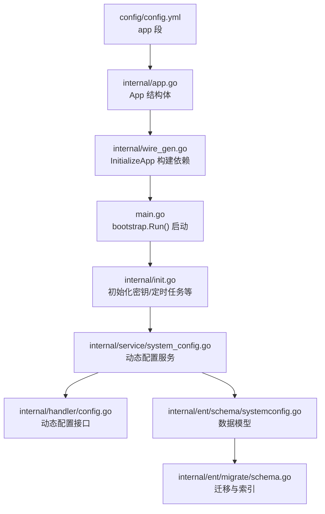
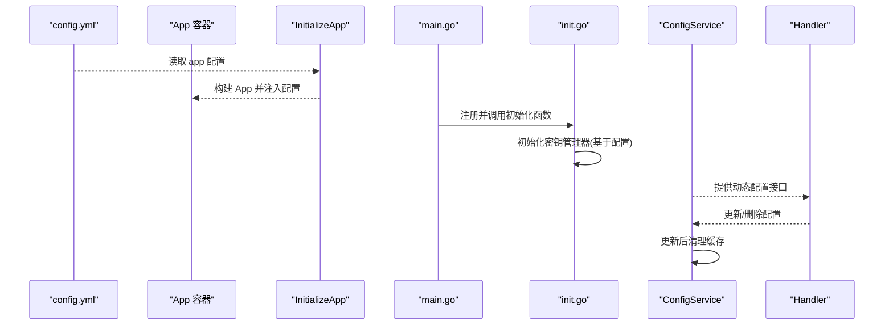
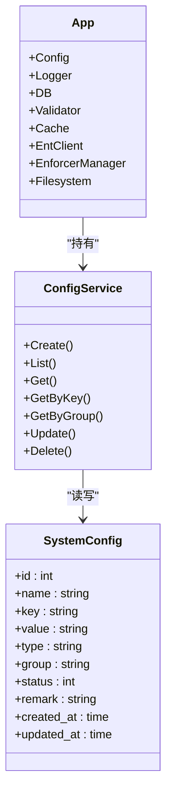

# 应用配置

<cite>
**本文引用的文件**
- [config.yml](file://config/config.yml)
- [app.go](file://internal/app.go)
- [wire_gen.go](file://internal/wire_gen.go)
- [init.go](file://internal/init.go)
- [system_config.go](file://internal/service/system_config.go)
- [config.go](file://internal/handler/config.go)
- [systemconfig.go](file://internal/ent/schema/systemconfig.go)
- [schema.go](file://internal/ent/migrate/schema.go)
- [main.go](file://main.go)
</cite>

## 目录
1. [简介](#简介)
2. [项目结构](#项目结构)
3. [核心组件](#核心组件)
4. [架构总览](#架构总览)
5. [详细组件分析](#详细组件分析)
6. [依赖关系分析](#依赖关系分析)
7. [性能考量](#性能考量)
8. [故障排查指南](#故障排查指南)
9. [结论](#结论)
10. [附录](#附录)

## 简介
本章节面向 Go Admin 系统的应用配置模块，聚焦 config.yml 中 app 配置段的各项参数，逐项解释其作用、取值范围与推荐值，并结合系统实际实现说明配置项之间的依赖关系与约束条件。同时给出不同环境下的配置示例与最佳实践，覆盖配置验证规则、错误处理机制以及配置热更新的支持情况与限制。

## 项目结构
Go Admin 的应用配置位于 config/config.yml 文件中，app 段落定义了应用运行所需的关键参数；系统通过内部依赖容器与引导流程读取并应用这些配置，动态配置能力由 Ent 数据模型与服务层共同支撑。

**图表来源**
- [config.yml](file://config/config.yml)
- [app.go](file://internal/app.go)
- [wire_gen.go](file://internal/wire_gen.go)
- [main.go](file://main.go)
- [init.go](file://internal/init.go)
- [system_config.go](file://internal/service/system_config.go)
- [config.go](file://internal/handler/config.go)
- [systemconfig.go](file://internal/ent/schema/systemconfig.go)
- [schema.go](file://internal/ent/migrate/schema.go)

**章节来源**
- [config.yml](file://config/config.yml)
- [app.go](file://internal/app.go)
- [wire_gen.go](file://internal/wire_gen.go)
- [main.go](file://main.go)
- [init.go](file://internal/init.go)
- [system_config.go](file://internal/service/system_config.go)
- [config.go](file://internal/handler/config.go)
- [systemconfig.go](file://internal/ent/schema/systemconfig.go)
- [schema.go](file://internal/ent/migrate/schema.go)

## 核心组件
- 应用配置源：config/config.yml 的 app 段落，包含应用名称、端口、调试模式、空闲超时、预取 fork、Swagger 开关、普通用户密钥、管理员密钥、登录过期时间、管理员刷新过期时间、请求体大小限制等。
- 依赖容器：internal/app.go 定义的 App 结构体，承载配置、日志、数据库、校验器、缓存、实体客户端、权限管理器与文件系统等。
- 引导与初始化：main.go 通过 Bootstrap 注册初始化函数、中间件与路由；internal/init.go 进行密钥管理器、定时任务、Nonce 存储等初始化。
- 动态配置：基于 Ent 的 SystemConfig 实体与 service 层实现的动态配置增删改查，配合缓存与校验规则。

**章节来源**
- [config.yml](file://config/config.yml)
- [app.go](file://internal/app.go)
- [wire_gen.go](file://internal/wire_gen.go)
- [main.go](file://main.go)
- [init.go](file://internal/init.go)
- [system_config.go](file://internal/service/system_config.go)

## 架构总览
应用配置在启动阶段被读取并注入到 App 容器中，随后在初始化流程中被用于设置密钥轮换周期、登录过期时间等关键行为。动态配置能力允许在运行时通过接口修改配置，并在更新后清理缓存以保证一致性。

**图表来源**
- [config.yml](file://config/config.yml)
- [wire_gen.go](file://internal/wire_gen.go)
- [main.go](file://main.go)
- [init.go](file://internal/init.go)
- [system_config.go](file://internal/service/system_config.go)
- [config.go](file://internal/handler/config.go)

## 详细组件分析

### app 配置段参数详解
以下参数均来自 config/config.yml 的 app 段落，系统在启动与初始化过程中使用这些参数控制应用行为。

- 名称（name）
  - 作用：应用对外显示的名称，用于日志、监控与运维识别。
  - 推荐值：小写字母、数字、短横线组合，避免空格与特殊字符。
  - 依赖与约束：无硬性依赖，但建议与部署命名空间一致。
  - 参考实现：作为日志输出与中间件描述的一部分出现。
  - **章节来源**
    - [config.yml](file://config/config.yml)
    - [main.go](file://main.go)

- 端口（port）
  - 作用：应用监听的 TCP 端口。
  - 推荐值：开发环境可用 9000+；生产环境使用 80/443 或反向代理暴露。
  - 依赖与约束：需确保端口未被占用；与反向代理/容器编排配置一致。
  - 参考实现：由引导流程与 Fiber 应用绑定端口。
  - **章节来源**
    - [config.yml](file://config/config.yml)
    - [main.go](file://main.go)

- 调试模式（debug）
  - 作用：开启调试模式以输出更详细的日志与堆栈信息。
  - 推荐值：开发环境开启，生产环境关闭。
  - 依赖与约束：影响日志级别与错误回显策略。
  - 参考实现：日志初始化与中间件行为受此开关影响。
  - **章节来源**
    - [config.yml](file://config/config.yml)
    - [main.go](file://main.go)

- 空闲超时（idle_timeout）
  - 作用：HTTP 连接空闲超时秒数，用于回收长时间空闲连接。
  - 推荐值：生产环境建议 60~120 秒；高并发场景可适当增大。
  - 依赖与约束：与服务器 keep-alive 行为相关。
  - 参考实现：由底层 HTTP 框架在连接层面生效。
  - **章节来源**
    - [config.yml](file://config/config.yml)

- 预取 fork（prefork）
  - 作用：是否启用多进程预取以提升吞吐。
  - 推荐值：生产环境建议关闭（false）以简化进程管理；如启用需配合进程管理器。
  - 依赖与约束：与操作系统与容器平台兼容性有关。
  - 参考实现：由底层框架在启动时解析。
  - **章节来源**
    - [config.yml](file://config/config.yml)

- Swagger 文档（swagger）
  - 作用：是否启用在线接口文档。
  - 推荐值：开发环境开启，生产环境关闭以减少暴露面。
  - 依赖与约束：与路由注册与中间件配置相关。
  - 参考实现：由引导流程中的中间件与路由注册逻辑控制。
  - **章节来源**
    - [config.yml](file://config/config.yml)
    - [main.go](file://main.go)

- 密钥（secret）
  - 作用：用于签发与校验普通用户令牌的密钥材料。
  - 推荐值：强随机字符串，长度≥32；定期轮换。
  - 依赖与约束：与密钥管理器初始化周期共同决定令牌有效期与轮换策略。
  - 参考实现：初始化密钥管理器时使用该密钥进行加密材料准备。
  - **章节来源**
    - [config.yml](file://config/config.yml)
    - [init.go](file://internal/init.go)

- 管理员密钥（admin_secret）
  - 作用：用于签发与校验管理员 JWT 令牌的独立密钥材料，与普通用户 secret 隔离。
  - 推荐值：强随机字符串，长度≥32；定期轮换。
  - 依赖与约束：与 admin_login_expires 共同决定管理员会话安全策略。
  - 参考实现：JWT 中间件使用 config.App.AdminSecret 初始化管理员令牌校验。
  - **章节来源**
    - [config.yml](file://config/config.yml)

- 登录过期时间（login_expires）
  - 作用：普通用户登录态的有效秒数，用于令牌过期控制。
  - 推荐值：开发环境可设为较大值；生产环境建议 1 天（86400）以内，结合刷新策略。
  - 依赖与约束：与密钥轮换周期共同影响安全策略。
  - 参考实现：初始化密钥管理器时使用该参数设置轮换周期。
  - **章节来源**
    - [config.yml](file://config/config.yml)
    - [init.go](file://internal/init.go)

- 管理员登录过期（admin_login_expires）
  - 作用：管理员 access token 的有效秒数。
  - 推荐值：生产环境建议 7200（2小时），配合 admin_refresh_expires 实现无感刷新。
  - 依赖与约束：与 admin_secret 和 admin_refresh_expires 配合使用。
  - 参考实现：管理员 JWT 签发时使用此值设置 access token 过期时间。
  - **章节来源**
    - [config.yml](file://config/config.yml)

- 管理员刷新过期（admin_refresh_expires）
  - 作用：管理员 refresh token 的有效秒数。
  - 推荐值：生产环境建议 86400（1天），根据安全需求调整。
  - 依赖与约束：必须大于 admin_login_expires，用于 token 刷新机制。
  - 参考实现：管理员刷新 token 接口使用此值校验 refresh token 有效期。
  - **章节来源**
    - [config.yml](file://config/config.yml)

- 请求体大小限制（body_limit）
  - 作用：限制 HTTP 请求体的最大字节数，防止大请求耗尽服务器资源。
  - 推荐值：默认 10485760（10MB），根据上传文件大小需求调整。
  - 依赖与约束：影响附件上传、API 请求体大小上限。
  - 参考实现：由 Fiber 应用在启动时通过 config.App.BodyLimit 设置。
  - **章节来源**
    - [config.yml](file://config/config.yml)

### 配置项之间的依赖关系与约束
- debug 与 swagger：两者均为运行时开关，互不影响，但建议在生产关闭 swagger 以降低攻击面。
- secret、admin_secret 与 login_expires、admin_login_expires：共同决定令牌生命周期与安全性，建议定期轮换密钥并根据业务调整过期时间。
- admin_login_expires 与 admin_refresh_expires：刷新过期必须大于登录过期，以实现无感刷新。
- port 与反向代理/容器编排：需与 Nginx、Docker、Kubernetes 等外部配置保持一致。
- body_limit 与附件上传：大文件上传场景需将 body_limit 调整为适当大小。
- idle_timeout 与服务器负载：高并发场景应适当增大以减少连接抖动。
- prefork 与进程管理：启用时需确保进程管理器正确管理子进程。

**章节来源**
- [config.yml](file://config/config.yml)
- [init.go](file://internal/init.go)
- [main.go](file://main.go)

### 配置验证规则与错误处理
- 配置文件层面：YAML 语法错误会在启动阶段被解析器拦截，导致应用无法启动。
- 运行时参数：若端口冲突、权限不足或资源不可用，启动过程会报错并终止。
- 动态配置（SystemConfig）：字段长度、类型与唯一性均有约束，违反时返回相应错误码与消息。
- 错误处理：系统在初始化与接口层均对异常进行捕获与统一响应包装。

**章节来源**
- [systemconfig.go](file://internal/ent/schema/systemconfig.go)
- [schema.go](file://internal/ent/migrate/schema.go)
- [system_config.go](file://internal/service/system_config.go)
- [config.go](file://internal/handler/config.go)

### 配置热更新支持与限制
- 应用级配置（app 段）：属于启动时读取的静态配置，不支持热更新；修改后需重启应用以生效。
- 动态配置（SystemConfig）：支持运行时增删改查，更新后会清理相关缓存键，确保后续读取到最新值。
- 缓存一致性：更新/删除操作会主动清理缓存，避免脏读；建议在高并发场景下配合幂等设计。

**章节来源**
- [config.yml](file://config/config.yml)
- [system_config.go](file://internal/service/system_config.go)
- [config.go](file://internal/handler/config.go)

### 不同环境下的配置示例与最佳实践
- 开发环境
  - 建议：debug=true、swagger=true、port=9501、idle_timeout=60、prefork=false、secret=自定义强密钥、login_expires=较短（便于测试）。
  - 最佳实践：开启详细日志与文档，关闭生产敏感开关。
- 测试环境
  - 建议：debug=false、swagger=false、port=固定端口、idle_timeout=60、prefork=false、secret=独立密钥、login_expires=适中。
  - 最佳实践：模拟生产网络与资源限制，验证性能与稳定性。
- 生产环境
  - 建议：debug=false、swagger=false、port=80/443、idle_timeout=60~120、prefork=false、secret=强密钥、admin_secret=独立强密钥、login_expires=1 天以内、admin_login_expires=2小时、admin_refresh_expires=1天、body_limit=10485760。
  - 最佳实践：配合反向代理、容器编排与密钥管理服务，定期轮换密钥并审计日志。

**章节来源**
- [config.yml](file://config/config.yml)
- [init.go](file://internal/init.go)
- [main.go](file://main.go)

## 依赖关系分析
应用配置通过依赖注入进入 App 容器，并在引导流程中被初始化与使用。动态配置能力由服务层与数据模型共同实现，接口层负责参数校验与错误封装。

**图表来源**
- [app.go](file://internal/app.go)
- [system_config.go](file://internal/service/system_config.go)
- [systemconfig.go](file://internal/ent/schema/systemconfig.go)

**章节来源**
- [app.go](file://internal/app.go)
- [system_config.go](file://internal/service/system_config.go)
- [systemconfig.go](file://internal/ent/schema/systemconfig.go)

## 性能考量
- 端口与连接：合理设置 idle_timeout 与反向代理 keep-alive，避免频繁重建连接。
- body_limit：合理设置请求体大小限制，避免过大请求导致内存溢出。
- 预取 fork：在单机多核场景下可考虑启用以提升吞吐，但需评估内存与进程管理复杂度。
- Swagger：仅在开发环境启用，避免生产环境额外开销。
- 动态配置缓存：GetByKey 与按组查询具备缓存，建议结合业务热点与更新频率调优 TTL。

**章节来源**
- [config.yml](file://config/config.yml)
- [system_config.go](file://internal/service/system_config.go)

## 故障排查指南
- 启动失败
  - 检查 YAML 语法与字段拼写；确认端口未被占用；验证文件权限。
- 日志异常
  - 检查 debug 与输出目标配置；确认日志目录存在且可写。
- 令牌验证失败
  - 检查 secret/admin_secret 是否正确配置；确认登录过期时间未过期。
- 请求体过大
  - 检查 body_limit 配置；确认客户端发送的请求体大小未超过限制。
- 动态配置接口错误
  - 校验请求参数长度与类型；关注唯一键冲突；查看服务层错误码与响应体。
- 缓存不一致
  - 更新/删除后会清理缓存；若仍出现脏读，检查缓存驱动与键空间隔离。

**章节来源**
- [config.yml](file://config/config.yml)
- [system_config.go](file://internal/service/system_config.go)
- [config.go](file://internal/handler/config.go)

## 结论
app 配置段为 Go Admin 的运行时基础，直接影响日志、安全、性能与可观测性。建议在不同环境中采用差异化配置，并结合动态配置能力实现非敏感参数的运行时治理。对于静态配置变更，遵循"变更即重启"的原则，确保配置生效与一致性。

## 附录
- 关键实现位置参考
  - 应用配置读取与注入：[config.yml](file://config/config.yml)、[wire_gen.go](file://internal/wire_gen.go)
  - 启动与初始化：[main.go](file://main.go)、[init.go](file://internal/init.go)
  - 动态配置接口与服务：[config.go](file://internal/handler/config.go)、[system_config.go](file://internal/service/system_config.go)
  - 数据模型与迁移：[systemconfig.go](file://internal/ent/schema/systemconfig.go)、[schema.go](file://internal/ent/migrate/schema.go)
