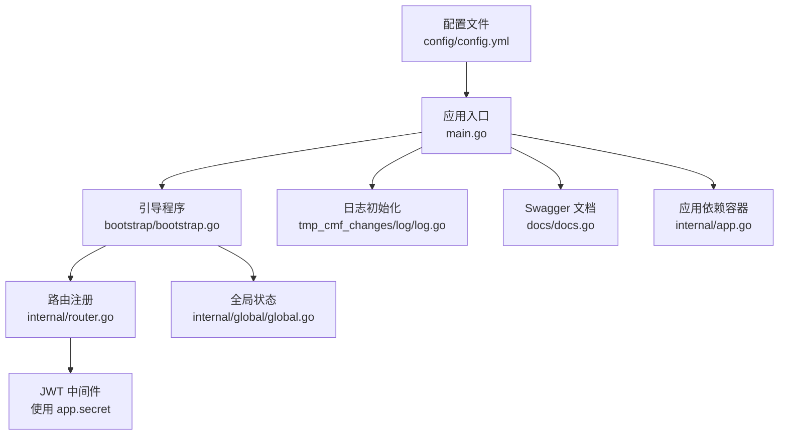
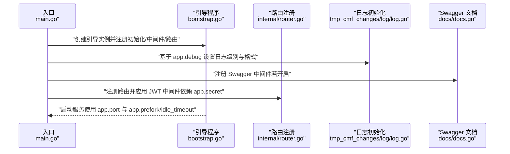
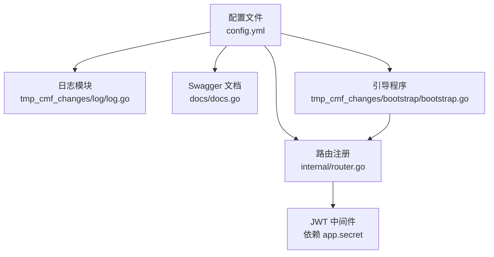

# 应用配置

<cite>
**本文引用的文件**
- [config.yml](file://config/config.yml)
- [main.go](file://main.go)
- [internal/router.go](file://internal/router.go)
- [internal/init.go](file://internal/init.go)
- [tmp_cmf_changes/log/log.go](file://tmp_cmf_changes/log/log.go)
- [tmp_cmf_changes/bootstrap/bootstrap.go](file://tmp_cmf_changes/bootstrap/bootstrap.go)
- [docs/docs.go](file://docs/docs.go)
- [internal/app.go](file://internal/app.go)
- [internal/global/global.go](file://internal/global/global.go)
</cite>

## 目录
1. [简介](#简介)
2. [项目结构](#项目结构)
3. [核心组件](#核心组件)
4. [架构总览](#架构总览)
5. [详细组件分析](#详细组件分析)
6. [依赖关系分析](#依赖关系分析)
7. [性能考量](#性能考量)
8. [故障排查指南](#故障排查指南)
9. [结论](#结论)
10. [附录](#附录)

## 简介
本文件聚焦于应用配置中的 app 节，系统性解释以下配置项的作用、默认值、可选范围与适用场景，并给出开发、测试、生产三类环境的最佳实践建议。同时提供配置验证规则与常见错误排查方法，帮助运维与开发人员快速定位问题并正确部署。

## 项目结构
与应用配置直接相关的关键位置如下：
- 配置文件：config/config.yml
- 应用入口与引导：main.go、tmp_cmf_changes/bootstrap/bootstrap.go
- 路由与鉴权：internal/router.go
- 日志与调试级别：tmp_cmf_changes/log/log.go
- Swagger 文档：docs/docs.go
- 全局状态：internal/global/global.go
- 应用依赖容器：internal/app.go

**图示来源**
- [config.yml:1-143](file://config/config.yml#L1-L143)
- [main.go:47-104](file://main.go#L47-L104)
- [tmp_cmf_changes/bootstrap/bootstrap.go:47-89](file://tmp_cmf_changes/bootstrap/bootstrap.go#L47-L89)
- [internal/router.go:16-149](file://internal/router.go#L16-L149)
- [tmp_cmf_changes/log/log.go:144-172](file://tmp_cmf_changes/log/log.go#L144-L172)
- [docs/docs.go:4492-4508](file://docs/docs.go#L4492-L4508)
- [internal/global/global.go:11-16](file://internal/global/global.go#L11-L16)
- [internal/app.go:15-25](file://internal/app.go#L15-L25)

**章节来源**
- [config.yml:1-143](file://config/config.yml#L1-L143)
- [main.go:47-104](file://main.go#L47-L104)
- [tmp_cmf_changes/bootstrap/bootstrap.go:47-89](file://tmp_cmf_changes/bootstrap/bootstrap.go#L47-L89)
- [internal/router.go:16-149](file://internal/router.go#L16-L149)
- [tmp_cmf_changes/log/log.go:144-172](file://tmp_cmf_changes/log/log.go#L144-L172)
- [docs/docs.go:4492-4508](file://docs/docs.go#L4492-L4508)
- [internal/global/global.go:11-16](file://internal/global/global.go#L11-L16)
- [internal/app.go:15-25](file://internal/app.go#L15-L25)

## 核心组件
本节对 app 节中的关键配置项进行逐条解析，结合代码使用点说明其作用与影响。

- 名称（name）
  - 作用：应用对外展示的名称，常用于日志、监控与告警标识。
  - 默认值：来自配置文件。
  - 可选范围：字符串，建议使用简短、稳定且不含空格的标识符。
  - 使用场景：开发、测试、生产环境均应保持一致，便于统一观测。
  - 关联代码：日志初始化会根据 Debug 决定日志级别与格式，但不会直接消费该字段；该字段在其他模块（如监控）可能被使用。

- 端口（port）
  - 作用：HTTP 服务监听端口。
  - 默认值：来自配置文件。
  - 可选范围：1–65535，需避免与系统保留端口冲突。
  - 使用场景：开发环境可自定义端口；生产环境建议固定端口并配合反向代理。
  - 关联代码：Fiber 在引导阶段运行服务，端口来源于配置。

- 调试模式（debug）
  - 作用：控制日志级别与输出格式。开启后日志级别通常为 debug，输出格式为 console。
  - 默认值：来自配置文件。
  - 可选范围：布尔值。
  - 使用场景：开发调试期间开启；生产环境关闭以降低开销。
  - 关联代码：日志初始化逻辑会依据该标志设置默认日志级别与格式。

- 空闲超时（idle_timeout）
  - 作用：连接空闲超时秒数，用于控制 HTTP 连接生命周期。
  - 默认值：来自配置文件。
  - 可选范围：正整数（秒），建议根据业务并发与资源情况调整。
  - 使用场景：高并发或长连接场景下适当增大；低负载场景可适度减小。
  - 关联代码：Fiber 服务器配置中会使用该值，具体行为取决于 Fiber 版本与配置方式。

- 预取 fork（prefork）
  - 作用：是否启用多进程预取模式（Fork 模式），提升吞吐能力。
  - 默认值：来自配置文件。
  - 可选范围：布尔值。
  - 使用场景：生产环境在具备多核 CPU 且无共享状态时可开启；需评估内存与进程管理成本。
  - 关联代码：Fiber 支持该模式，实际效果取决于运行环境与部署方式。

- Swagger 开关（swagger）
  - 作用：是否启用在线 API 文档（Swagger UI）。
  - 默认值：来自配置文件。
  - 可选范围：布尔值。
  - 使用场景：开发与联调阶段开启；生产环境建议关闭或仅在内网访问。
  - 关联代码：引导程序会注册中间件以提供 Swagger 文档服务；文档元信息也在此处声明。

- 密钥（secret）
  - 作用：JWT 签名与校验使用的密钥，必须保密且在各环境保持一致。
  - 默认值：来自配置文件。
  - 可选范围：字符串，建议足够长度且复杂。
  - 使用场景：所有需要 JWT 认证的接口都会使用该密钥进行签发与校验。
  - 关联代码：路由注册中使用 JWT 中间件，依赖 app.secret；密钥变更会导致历史 Token 失效。

- 登录过期时间（login_expires）
  - 作用：登录 Token 的有效期（秒）。
  - 默认值：来自配置文件。
  - 可选范围：正整数（秒），建议结合业务安全策略设定。
  - 使用场景：短期会话可设较小值；长周期会话可适当增大。
  - 关联代码：JWT 中间件与登录处理器会基于该配置签发/刷新 Token。

**章节来源**
- [config.yml:1-9](file://config/config.yml#L1-L9)
- [tmp_cmf_changes/log/log.go:144-172](file://tmp_cmf_changes/log/log.go#L144-L172)
- [internal/router.go:53-59](file://internal/router.go#L53-L59)
- [docs/docs.go:4492-4508](file://docs/docs.go#L4492-L4508)
- [tmp_cmf_changes/bootstrap/bootstrap.go:47-89](file://tmp_cmf_changes/bootstrap/bootstrap.go#L47-L89)

## 架构总览
下图展示了应用启动到路由注册的关键流程，以及 app 配置项如何参与其中：

**图示来源**
- [main.go:47-104](file://main.go#L47-L104)
- [tmp_cmf_changes/bootstrap/bootstrap.go:47-89](file://tmp_cmf_changes/bootstrap/bootstrap.go#L47-L89)
- [internal/router.go:16-149](file://internal/router.go#L16-L149)
- [tmp_cmf_changes/log/log.go:144-172](file://tmp_cmf_changes/log/log.go#L144-L172)
- [docs/docs.go:4492-4508](file://docs/docs.go#L4492-L4508)

## 详细组件分析

### 配置项详解与最佳实践
- 名称（name）
  - 作用：作为应用标识，便于日志与监控聚合。
  - 最佳实践：命名简洁、跨环境一致；避免使用特殊字符。
  - 风险提示：与其他系统重复可能导致混淆。

- 端口（port）
  - 作用：HTTP 服务监听端口。
  - 最佳实践：
    - 开发：可使用非标准端口（如 9501）以便并行运行多个实例。
    - 测试：与 CI/CD 环境约定端口，便于自动化测试。
    - 生产：固定端口并通过反向代理暴露，避免端口冲突。
  - 风险提示：端口占用将导致启动失败；需确保防火墙放行。

- 调试模式（debug）
  - 作用：决定日志级别与输出格式。
  - 最佳实践：
    - 开发：开启以获得更详细的日志与控制台输出。
    - 生产：关闭以减少日志体积与 CPU 开销。
  - 风险提示：生产开启会增加 IO 与存储压力。

- 空闲超时（idle_timeout）
  - 作用：连接空闲超时秒数。
  - 最佳实践：
    - 高并发：适当增大以减少频繁重建连接的开销。
    - 低负载：适度减小以释放资源。
  - 风险提示：过小可能导致频繁断连；过大可能占用资源。

- 预取 fork（prefork）
  - 作用：启用多进程预取模式。
  - 最佳实践：
    - 单机多核：开启以提升吞吐。
    - 有共享状态：谨慎开启，避免竞态与数据不一致。
  - 风险提示：进程管理复杂度上升，需关注内存与句柄限制。

- Swagger 开关（swagger）
  - 作用：是否启用在线 API 文档。
  - 最佳实践：
    - 开发：开启以辅助联调。
    - 生产：关闭或仅内网访问，避免泄露接口细节。
  - 风险提示：敏感信息泄露风险。

- 密钥（secret）
  - 作用：JWT 签名密钥。
  - 最佳实践：
    - 必须保密，定期轮换。
    - 各环境一致，避免跨环境 Token 不兼容。
  - 风险提示：密钥泄露将导致伪造 Token；密钥变更会导致历史 Token 失效。

- 登录过期时间（login_expires）
  - 作用：登录 Token 有效期。
  - 最佳实践：
    - 短期会话：较短有效期（如 1 小时）。
    - 长期会话：较长有效期（如 1 天），并结合刷新机制。
  - 风险提示：过长有效期增加安全风险；过短影响用户体验。

**章节来源**
- [config.yml:1-9](file://config/config.yml#L1-L9)
- [tmp_cmf_changes/log/log.go:144-172](file://tmp_cmf_changes/log/log.go#L144-L172)
- [internal/router.go:53-59](file://internal/router.go#L53-L59)
- [docs/docs.go:4492-4508](file://docs/docs.go#L4492-L4508)

### 配置验证规则与常见错误
- 配置验证规则
  - 类型匹配：布尔值字段（debug、prefork、swagger）必须为 true/false。
  - 数值范围：port 必须在 1–65535；idle_timeout、login_expires 必须为正整数。
  - 字符串规范：name、secret 必须为非空字符串；建议避免特殊字符。
  - 一致性要求：secret 在各环境保持一致；否则历史 Token 将失效。
  - 互斥与组合：prefork 与多实例部署需结合；swagger 仅用于开发/测试。

- 常见错误与排查
  - 端口被占用
    - 现象：启动报错，无法绑定端口。
    - 排查：确认端口未被占用；修改 port 或释放占用进程。
  - JWT 认证失败
    - 现象：登录成功但后续接口返回认证错误。
    - 排查：检查 app.secret 是否一致；确认 login_expires 设置合理；核对客户端请求头 Authorization 格式。
  - Swagger 无法访问
    - 现象：访问 /swagger 路径返回 404。
    - 排查：确认 swagger 开关已开启；检查引导程序中间件注册顺序。
  - 日志级别不符合预期
    - 现象：生产环境仍输出大量 debug 日志。
    - 排查：确认 app.debug 已关闭；检查日志初始化逻辑是否覆盖了默认值。
  - 连接频繁断开
    - 现象：高并发场景下连接频繁断开。
    - 排查：适当增大 idle_timeout；评估网络与代理超时设置。

**章节来源**
- [config.yml:1-9](file://config/config.yml#L1-L9)
- [tmp_cmf_changes/log/log.go:144-172](file://tmp_cmf_changes/log/log.go#L144-L172)
- [internal/router.go:53-59](file://internal/router.go#L53-L59)
- [docs/docs.go:4492-4508](file://docs/docs.go#L4492-L4508)

## 依赖关系分析
- 配置来源与使用
  - 配置文件提供原始值，引导程序与日志模块按需消费。
  - 路由注册依赖 app.secret 进行 JWT 中间件初始化。
  - Swagger 文档与主机信息在入口注释中声明，与 app.port 协同工作。

**图示来源**
- [config.yml:1-9](file://config/config.yml#L1-L9)
- [tmp_cmf_changes/log/log.go:144-172](file://tmp_cmf_changes/log/log.go#L144-L172)
- [docs/docs.go:4492-4508](file://docs/docs.go#L4492-L4508)
- [internal/router.go:16-149](file://internal/router.go#L16-L149)
- [tmp_cmf_changes/bootstrap/bootstrap.go:47-89](file://tmp_cmf_changes/bootstrap/bootstrap.go#L47-L89)

**章节来源**
- [config.yml:1-9](file://config/config.yml#L1-L9)
- [tmp_cmf_changes/log/log.go:144-172](file://tmp_cmf_changes/log/log.go#L144-L172)
- [docs/docs.go:4492-4508](file://docs/docs.go#L4492-L4508)
- [internal/router.go:16-149](file://internal/router.go#L16-L149)
- [tmp_cmf_changes/bootstrap/bootstrap.go:47-89](file://tmp_cmf_changes/bootstrap/bootstrap.go#L47-L89)

## 性能考量
- 端口与连接
  - 合理设置 idle_timeout，避免频繁重建连接带来的延迟。
  - 在高并发场景下评估是否启用 prefork，结合 CPU 核心数与内存上限。
- 日志
  - 生产关闭 debug，采用 JSON 输出以利于日志收集与检索。
- Swagger
  - 仅在开发/测试环境启用，避免对生产性能造成影响。
- JWT
  - 合理设置 login_expires，平衡安全与体验；结合刷新 Token 机制优化用户体验。

[本节为通用指导，无需列出“章节来源”]

## 故障排查指南
- 启动失败（端口占用）
  - 步骤：检查端口占用；修改 port；重启服务。
- 认证失败（JWT）
  - 步骤：核对 app.secret；确认 login_expires；检查请求头格式。
- Swagger 404
  - 步骤：确认 swagger 开关；检查中间件注册顺序。
- 日志异常
  - 步骤：确认 app.debug；检查日志输出配置；核对文件权限。
- 连接不稳定
  - 步骤：增大 idle_timeout；检查网络与代理超时设置。

**章节来源**
- [config.yml:1-9](file://config/config.yml#L1-L9)
- [tmp_cmf_changes/log/log.go:144-172](file://tmp_cmf_changes/log/log.go#L144-L172)
- [internal/router.go:53-59](file://internal/router.go#L53-L59)
- [docs/docs.go:4492-4508](file://docs/docs.go#L4492-L4508)

## 结论
app 节配置直接影响应用的运行行为与可观测性。遵循本文提供的默认值、可选范围与最佳实践，可在不同环境中稳定运行。务必重视密钥与 Swagger 的安全配置，合理设置日志与连接参数以兼顾性能与可维护性。

[本节为总结性内容，无需列出“章节来源”]

## 附录
- 部署环境建议摘要
  - 开发环境
    - debug: true
    - swagger: true
    - port: 自定义端口（如 9501）
    - idle_timeout: 60–120
    - prefork: false
    - secret: 强随机字符串
    - login_expires: 1 小时
  - 测试环境
    - debug: false
    - swagger: false
    - port: 固定端口
    - idle_timeout: 60
    - prefork: false
    - secret: 与开发一致
    - login_expires: 1 小时
  - 生产环境
    - debug: false
    - swagger: false
    - port: 固定端口
    - idle_timeout: 60–120
    - prefork: 根据 CPU 与资源评估开启
    - secret: 强随机字符串，严格保密
    - login_expires: 1 天或更短

[本节为通用指导，无需列出“章节来源”]