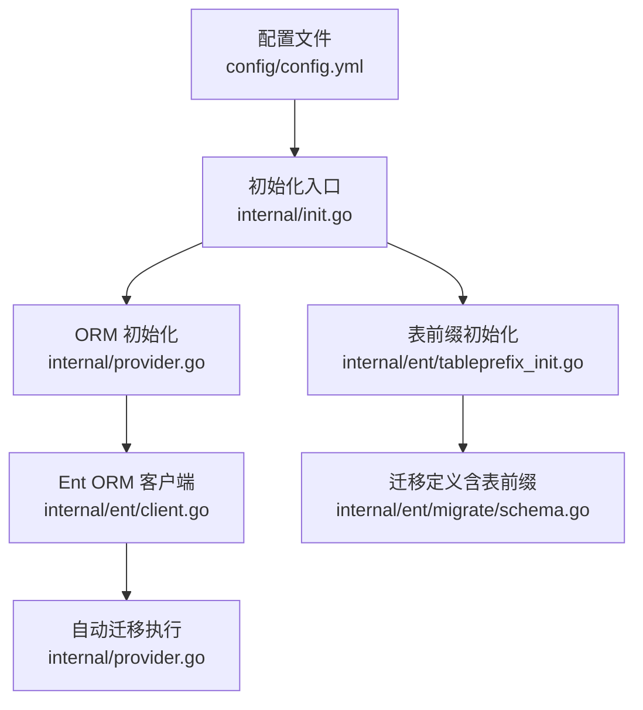
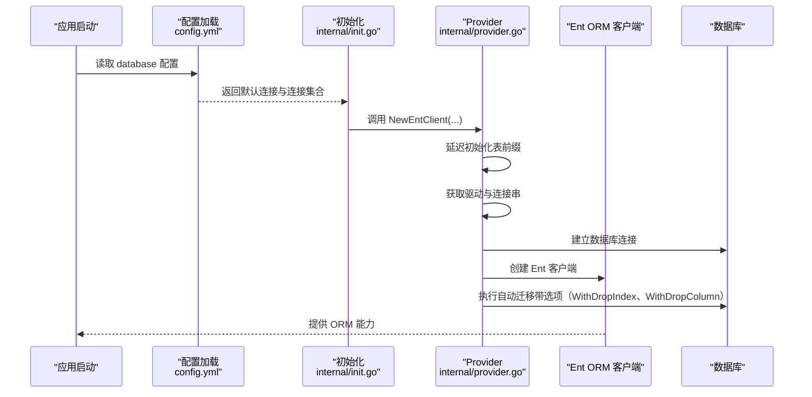
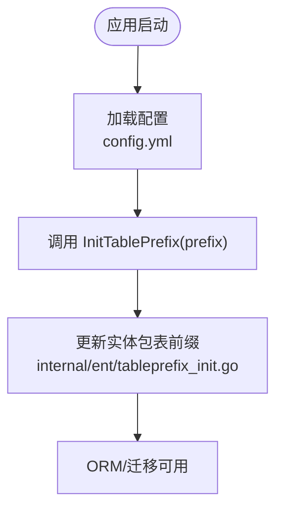
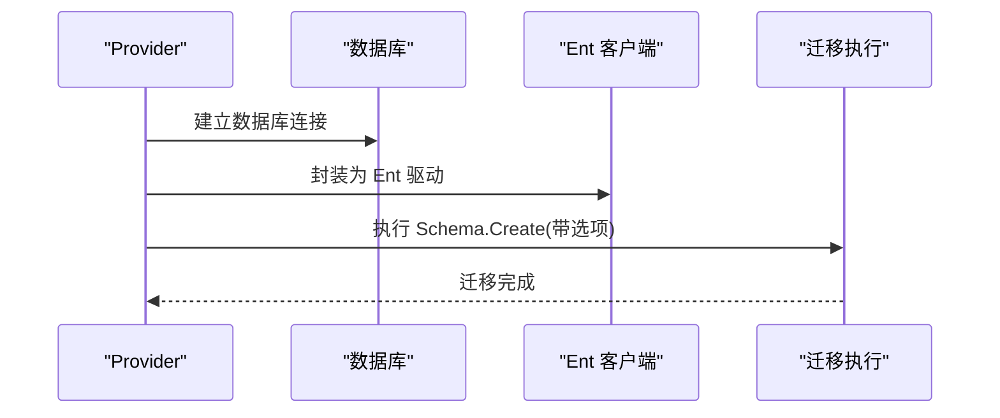
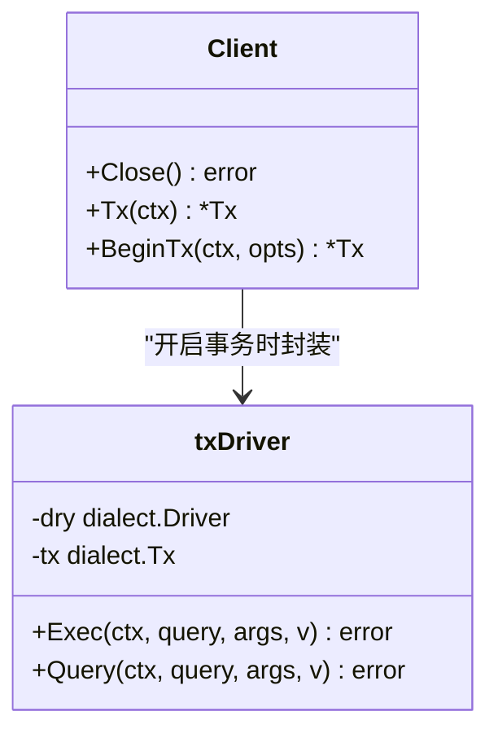
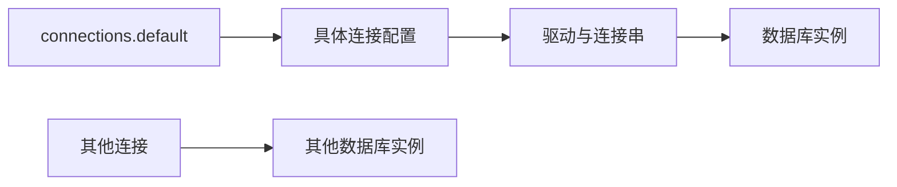
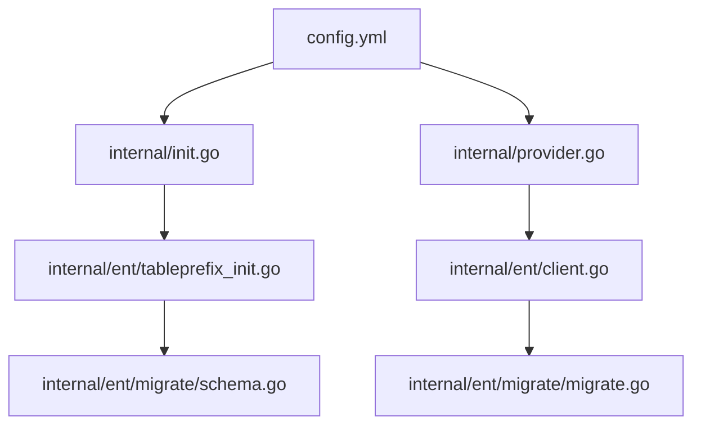

# 数据库配置

<cite>
**本文引用的文件**
- [config.yml](file://config/config.yml)
- [init.go](file://internal/init.go)
- [provider.go](file://internal/provider.go)
- [tableprefix_init.go](file://internal/ent/tableprefix_init.go)
- [schema.go](file://internal/ent/migrate/schema.go)
- [client.go](file://internal/ent/client.go)
- [tx.go](file://internal/ent/tx.go)
- [adapter.go](file://internal/casbin/adapter/adapter.go)
</cite>

## 目录
1. [简介](#简介)
2. [项目结构](#项目结构)
3. [核心组件](#核心组件)
4. [架构总览](#架构总览)
5. [详细组件分析](#详细组件分析)
6. [依赖关系分析](#依赖关系分析)
7. [性能考量](#性能考量)
8. [故障排查指南](#故障排查指南)
9. [结论](#结论)
10. [附录](#附录)

## 简介
本章节面向 Go Admin 系统的数据库配置模块，围绕 config.yml 中 database 配置段进行深入解析，覆盖默认连接配置、连接池参数、驱动程序设置、SSL 模式配置与表前缀设置；解释 MySQL 连接参数的作用与性能影响；给出连接字符串的构造方法与安全配置建议；说明多数据库连接的支持与切换机制；并提供连接池调优参数与监控指标建议，以及数据库迁移配置与版本管理方法。

## 项目结构
数据库相关配置集中在配置文件中，并通过初始化流程在应用启动时加载与生效。Ent ORM 负责数据库连接、Schema 迁移与事务处理；表前缀通过延迟初始化在配置加载后统一注入到各实体与迁移定义中。

**图表来源**
- [config.yml](file://config/config.yml#L23-L34)
- [init.go](file://internal/init.go)
- [provider.go](file://internal/provider.go)
- [tableprefix_init.go](file://internal/ent/tableprefix_init.go)
- [schema.go](file://internal/ent/migrate/schema.go)
- [client.go](file://internal/ent/client.go)

**章节来源**
- [config.yml](file://config/config.yml#L23-L34)
- [init.go](file://internal/init.go)
- [provider.go](file://internal/provider.go)
- [tableprefix_init.go](file://internal/ent/tableprefix_init.go)
- [schema.go](file://internal/ent/migrate/schema.go)
- [client.go](file://internal/ent/client.go)

## 核心组件
- 配置文件 database 段：定义默认连接名、连接集合、驱动、主机、端口、用户名、密码、数据库名、SSL 模式与表前缀。
- 初始化流程：在应用启动时读取配置，构建数据库连接，创建 Ent ORM 客户端，并执行自动迁移。
- 表前缀机制：延迟初始化，确保在配置加载完成后、首次使用 ORM 或迁移前完成注入。
- 迁移与版本管理：基于 Ent 的 Schema.Create 自动创建/变更表结构，支持丢弃列与索引选项以保证演进灵活性。
- 事务与连接池：通过 Ent 的 txDriver 实现事务包装，底层连接池由数据库驱动与 SQL 层控制。

**章节来源**
- [config.yml](file://config/config.yml#L23-L34)
- [init.go](file://internal/init.go)
- [provider.go](file://internal/provider.go)
- [tableprefix_init.go](file://internal/ent/tableprefix_init.go)
- [schema.go](file://internal/ent/migrate/schema.go)
- [client.go](file://internal/ent/client.go)

## 架构总览
下图展示从配置到数据库连接、迁移与事务的整体流程。

**图表来源**
- [config.yml](file://config/config.yml#L23-L34)
- [init.go](file://internal/init.go)
- [provider.go](file://internal/provider.go)

## 详细组件分析

### 配置文件 database 段详解
- default：指定默认连接名，用于初始化与迁移。
- connections.\<name\>：连接集合，每个连接包含 driver、host、port、user、password、name、ssl_mode、table_prefix 等字段。
- driver：数据库驱动类型，如 mysql。
- host/port/user/password/name：标准连接凭据。
- ssl_mode：布尔值，控制是否启用 SSL/TLS 连接。
- table_prefix：表前缀，用于所有实体与迁移表名的统一前缀化。

上述字段在初始化阶段被读取并用于构建连接与迁移环境。

**章节来源**
- [config.yml](file://config/config.yml#L23-L34)

### 表前缀初始化机制
- 延迟初始化：在配置加载完成后、首次使用 ORM 或迁移前调用 InitTablePrefix。
- 作用范围：更新各实体包的 TablePrefix 与 Table 变量，同时更新 migrate 包中的表名。
- 生效时机：确保所有后续查询与迁移均使用统一表前缀。

**图表来源**
- [tableprefix_init.go](file://internal/ent/tableprefix_init.go)
- [schema.go](file://internal/ent/migrate/schema.go)

**章节来源**
- [tableprefix_init.go](file://internal/ent/tableprefix_init.go)
- [schema.go](file://internal/ent/migrate/schema.go)

### 连接建立与迁移执行
- 驱动选择：根据配置中的 driver 与连接串创建数据库连接。
- 连接封装：使用 Ent 的 SQL 驱动封装，形成 Ent 客户端。
- 自动迁移：在创建客户端后执行 Schema.Create，支持丢弃列与索引选项（WithDropIndex(true)、WithDropColumn(true)），确保结构演进的灵活性。

**图表来源**
- [provider.go](file://internal/provider.go)
- [schema.go](file://internal/ent/migrate/schema.go)

**章节来源**
- [provider.go](file://internal/provider.go)
- [schema.go](file://internal/ent/migrate/schema.go)

### 事务与连接池
- 事务包装：通过 txDriver 将底层事务嵌入到 Ent 驱动层，保证事务期间的查询走同一连接。
- 连接池：底层连接池由数据库驱动与 SQL 层控制，Ent 仅负责连接生命周期与事务封装。
- 关闭连接：通过 Client.Close 关闭底层连接。

**图表来源**
- [client.go](file://internal/ent/client.go)
- [tx.go](file://internal/ent/tx.go)

**章节来源**
- [client.go](file://internal/ent/client.go)
- [tx.go](file://internal/ent/tx.go)

### 多数据库连接与切换机制
- 连接集合：config.yml 的 connections 支持定义多个连接，default 指向当前使用的连接名。
- 切换方式：通过修改 default 或在初始化阶段传入目标连接名，即可切换到不同数据库实例。
- 兼容性：Casbin 适配器支持按驱动名与连接串创建独立客户端，便于跨库场景。

**图表来源**
- [config.yml](file://config/config.yml#L23-L34)
- [adapter.go](file://internal/casbin/adapter/adapter.go)

**章节来源**
- [config.yml](file://config/config.yml#L23-L34)
- [adapter.go](file://internal/casbin/adapter/adapter.go)

### 连接字符串构造与安全建议
- 构造方法：根据 driver 与连接参数生成连接串，驱动层负责拼接与转义。
- 安全建议：
  - 使用只读账号用于只读查询，主从分离场景下区分读写库。
  - 启用 ssl_mode 并校验证书链路，生产环境强制 TLS。
  - 将敏感信息置于环境变量或密钥管理服务，避免硬编码在配置文件中。
  - 限制最大连接数与空闲超时，避免资源耗尽。
  - 定期轮换数据库密码与证书，缩短失效窗口。

[本节为通用实践说明，不直接分析具体文件]

### 连接池调优参数与监控指标
- 调优参数（建议项，需结合驱动与运行环境）：
  - 最大打开连接数：限制并发上限，避免数据库过载。
  - 最大空闲连接数：维持一定空闲连接以降低握手开销。
  - 连接最大生命周期：定期回收连接，规避长连接异常。
  - 连接最大空闲时间：空闲连接回收策略。
- 监控指标（建议项）：
  - 连接池活跃连接数、空闲连接数、等待获取连接的请求数。
  - 数据库慢查询数量与耗时分布。
  - 错误率（连接失败、超时、死锁等）。

[本节为通用实践说明，不直接分析具体文件]

### 数据库迁移配置与版本管理
- 迁移触发：初始化阶段执行 Schema.Create，自动创建/变更表结构。
- 选项控制：
  - WithDropIndex(true)：允许删除旧索引，便于灵活调整索引策略。
  - WithDropColumn(true)：允许删除旧列，便于字段演进。
  - WithForeignKeys(false)：可选择关闭外键生成，减少迁移成本。
- 版本管理建议：
  - 将迁移脚本纳入版本控制系统，记录每次变更的意图与影响。
  - 在预生产环境先行验证迁移，再灰度到生产。
  - 对关键表的变更采用"影子表"或"双写+对账"策略，降低风险。

**章节来源**
- [provider.go](file://internal/provider.go)
- [schema.go](file://internal/ent/migrate/schema.go)

## 依赖关系分析
- 配置依赖：config.yml 提供 database 段，init 与 provider 依赖其解析结果。
- ORM 依赖：Ent ORM 客户端依赖底层数据库驱动与连接池。
- 表前缀依赖：tableprefix_init 在 ORM 使用前注入，影响所有实体与迁移。
- 迁移依赖：schema.go 中的 TablePrefix 与各实体表名依赖于表前缀注入。

**图表来源**
- [config.yml](file://config/config.yml#L23-L34)
- [init.go](file://internal/init.go)
- [provider.go](file://internal/provider.go)
- [tableprefix_init.go](file://internal/ent/tableprefix_init.go)
- [schema.go](file://internal/ent/migrate/schema.go)
- [client.go](file://internal/ent/client.go)

**章节来源**
- [config.yml](file://config/config.yml#L23-L34)
- [init.go](file://internal/init.go)
- [provider.go](file://internal/provider.go)
- [tableprefix_init.go](file://internal/ent/tableprefix_init.go)
- [schema.go](file://internal/ent/migrate/schema.go)
- [client.go](file://internal/ent/client.go)

## 性能考量
- 连接参数影响：
  - 连接超时与读写超时：影响请求排队与失败率，需结合业务峰值与数据库承载能力设定。
  - 最大连接数与空闲连接数：过高导致数据库连接压力增大，过低导致排队等待。
  - 表前缀与索引：合理设计索引可显著降低查询耗时；表前缀不影响性能，但需确保迁移一致性。
- 事务与批处理：
  - 批量插入/更新可减少往返次数，但需注意单事务大小与锁竞争。
  - 事务粒度应尽量小，避免长时间持有行锁或表锁。

[本节为通用性能建议，不直接分析具体文件]

## 故障排查指南
- 连接失败：
  - 检查 host/port 与网络连通性。
  - 核对 user/password 与数据库权限。
  - 若启用 ssl_mode，请确认证书链与主机名匹配。
- 迁移失败：
  - 查看迁移选项是否与数据库版本兼容（如外键支持）。
  - 检查是否存在未授权的列/索引删除操作。
- 事务异常：
  - 确认事务提交/回滚调用是否正确。
  - 检查长事务与锁等待情况。
- ORM 关闭：
  - 应用退出时调用 Client.Close，确保连接池释放。

**章节来源**
- [client.go](file://internal/ent/client.go)
- [tx.go](file://internal/ent/tx.go)

## 结论
Go Admin 的数据库配置以 config.yml 为中心，配合初始化与 Provider 流程完成连接建立、表前缀注入与自动迁移。通过合理的连接参数与迁移选项，可在保证稳定性的同时获得良好的性能表现。建议在生产环境中启用 TLS、严格权限控制与完善的监控告警体系，并将迁移过程纳入受控的版本管理流程。

## 附录
- 关键流程路径参考：
  - 配置读取与初始化：[config.yml](file://config/config.yml#L23-L34)、[init.go](file://internal/init.go)
  - ORM 客户端创建与迁移：[provider.go](file://internal/provider.go)
  - 表前缀注入与迁移表名：[tableprefix_init.go](file://internal/ent/tableprefix_init.go)、[schema.go](file://internal/ent/migrate/schema.go)
  - 事务与连接池：[client.go](file://internal/ent/client.go)、[tx.go](file://internal/ent/tx.go)
