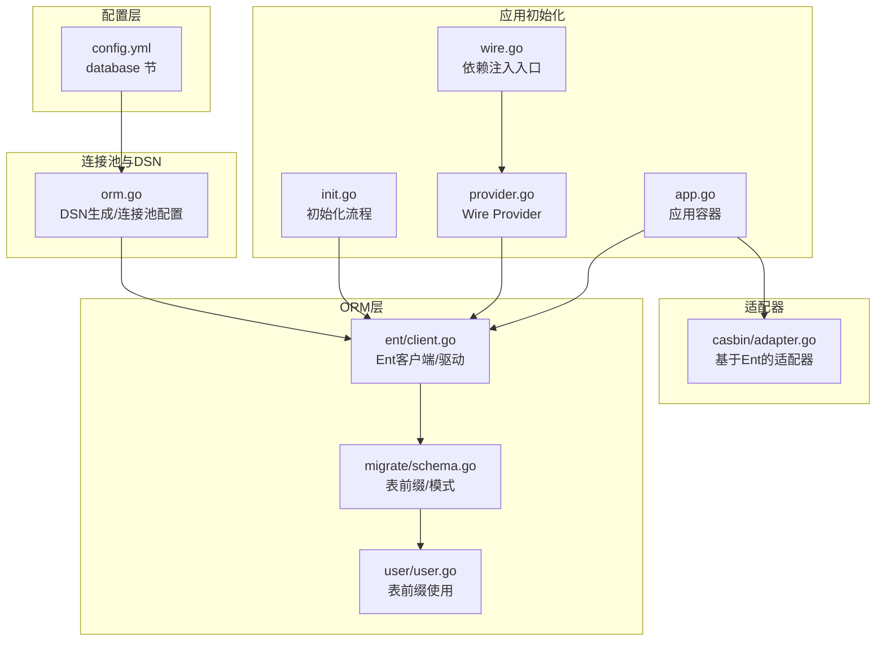
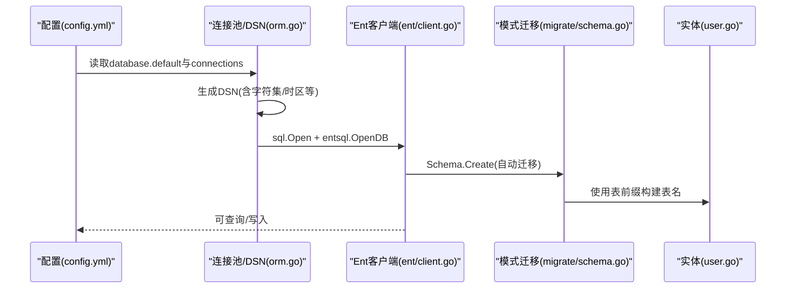
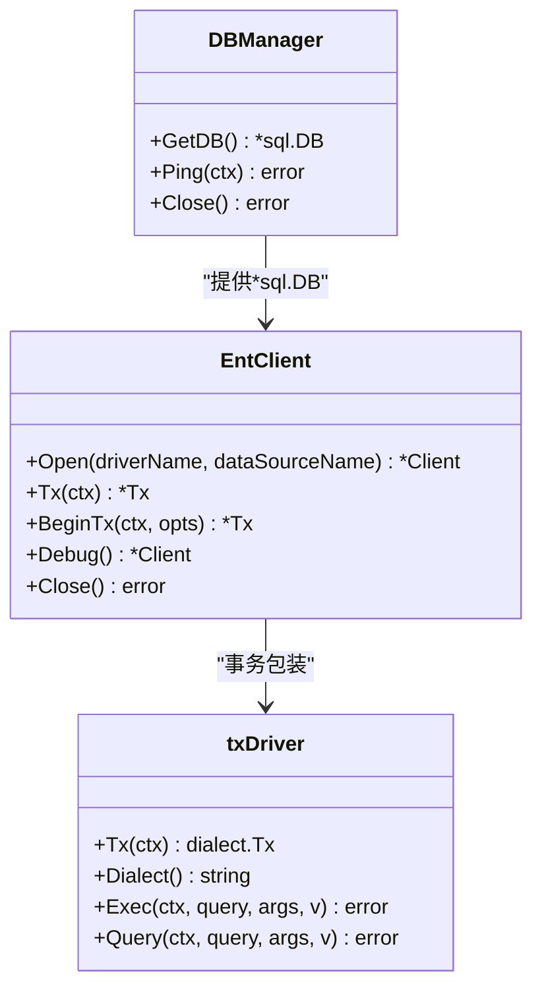
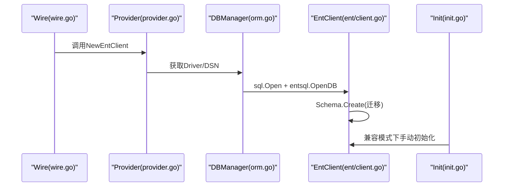
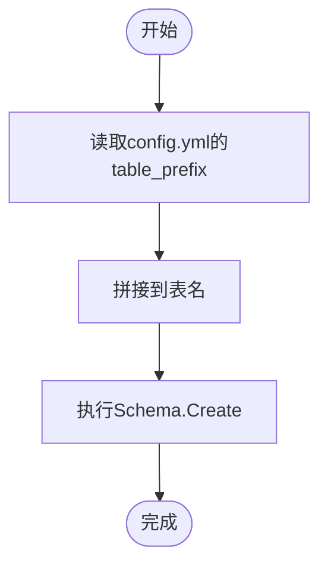
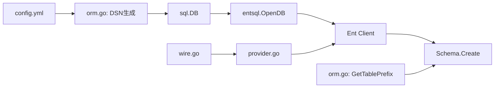

# 数据库配置

<cite>
**本文引用的文件**
- [config.yml](file://config/config.yml)
- [orm.go](file://d:\www\cmf\orm\orm.go)
- [client.go](file://internal/ent/client.go)
- [init.go](file://internal/init.go)
- [provider.go](file://internal/provider.go)
- [wire.go](file://internal/wire.go)
- [adapter.go](file://internal/casbin/adapter/adapter.go)
- [app.go](file://internal/app.go)
- [schema.go](file://internal/ent/migrate/schema.go)
- [user.go](file://internal/ent/user/user.go)
</cite>

## 目录
1. [简介](#简介)
2. [项目结构](#项目结构)
3. [核心组件](#核心组件)
4. [架构总览](#架构总览)
5. [详细组件分析](#详细组件分析)
6. [依赖分析](#依赖分析)
7. [性能考虑](#性能考虑)
8. [故障排查指南](#故障排查指南)
9. [结论](#结论)
10. [附录](#附录)

## 简介
本文件面向数据库配置与连接管理，围绕 config.yml 中 database 节的配置项进行深入解析，并结合 Ent ORM 的连接配置、连接池参数调优与多数据库支持进行说明。同时提供 MySQL 连接配置最佳实践（连接超时、重连机制、字符集设置等），以及数据库配置验证与连接故障排查方法，帮助开发者快速理解并正确配置生产环境数据库。

## 项目结构
数据库相关配置与实现主要分布在以下位置：
- 配置文件：config/config.yml
- 连接池与 DSN 生成：d:\www\cmf\orm\orm.go
- Ent ORM 客户端与驱动：internal/ent/client.go
- 应用初始化与注入：internal/init.go、internal/provider.go、internal/wire.go
- 表前缀与模式迁移：internal/ent/migrate/schema.go、internal/ent/user/user.go
- Casbin 适配器（基于 Ent）：internal/casbin/adapter/adapter.go
- 应用容器定义：internal/app.go

图表来源
- [config.yml:19-31](file://config/config.yml#L19-L31)
- [orm.go:78-98](file://d:\www\cmf\orm\orm.go#L78-L98)
- [client.go:127-141](file://internal/ent/client.go#L127-L141)
- [schema.go:257-269](file://internal/ent/migrate/schema.go#L257-L269)
- [user.go:49-52](file://internal/ent/user/user.go#L49-L52)
- [init.go:69-84](file://internal/init.go#L69-L84)
- [provider.go:17-33](file://internal/provider.go#L17-L33)
- [wire.go:22-37](file://internal/wire.go#L22-L37)
- [adapter.go:62-95](file://internal/casbin/adapter/adapter.go#L62-L95)
- [app.go:15-25](file://internal/app.go#L15-L25)

章节来源
- [config.yml:19-31](file://config/config.yml#L19-L31)
- [orm.go:78-98](file://d:\www\cmf\orm\orm.go#L78-L98)
- [client.go:127-141](file://internal/ent/client.go#L127-L141)
- [schema.go:257-269](file://internal/ent/migrate/schema.go#L257-L269)
- [user.go:49-52](file://internal/ent/user/user.go#L49-L52)
- [init.go:69-84](file://internal/init.go#L69-L84)
- [provider.go:17-33](file://internal/provider.go#L17-L33)
- [wire.go:22-37](file://internal/wire.go#L22-L37)
- [adapter.go:62-95](file://internal/casbin/adapter/adapter.go#L62-L95)
- [app.go:15-25](file://internal/app.go#L15-L25)

## 核心组件
- 配置文件 config.yml 的 database 节：定义默认连接名、连接集合及各连接的驱动、主机、端口、用户、密码、数据库名、SSL 模式、表前缀等。
- 连接池与 DSN 生成：根据配置生成数据库连接字符串（DSN），并设置连接池参数（最大打开连接数、最大空闲连接数、连接最大生命周期、连接最大空闲时间）。
- Ent ORM 客户端：通过 Ent 的 sql.Open 与 entsql.OpenDB 构建驱动，支持事务、调试日志、拦截器等。
- 应用初始化与依赖注入：通过 Wire 组装 DBManager、EntClient、Casbin 适配器等，确保初始化顺序与生命周期可控。
- 表前缀：通过 orm.GetTablePrefix 获取配置中的表前缀，并在模式迁移与实体定义中使用。

章节来源
- [config.yml:19-31](file://config/config.yml#L19-L31)
- [orm.go:24-50](file://d:\www\cmf\orm\orm.go#L24-L50)
- [client.go:127-141](file://internal/ent/client.go#L127-L141)
- [provider.go:17-33](file://internal/provider.go#L17-L33)
- [schema.go:257-269](file://internal/ent/migrate/schema.go#L257-L269)
- [user.go:49-52](file://internal/ent/user/user.go#L49-L52)

## 架构总览
下图展示从配置到 ORM 的完整数据流，包括 DSN 生成、连接池配置、Ent 客户端构建与模式迁移。

图表来源
- [config.yml:19-31](file://config/config.yml#L19-L31)
- [orm.go:78-98](file://d:\www\cmf\orm\orm.go#L78-L98)
- [client.go:127-141](file://internal/ent/client.go#L127-L141)
- [schema.go:257-269](file://internal/ent/migrate/schema.go#L257-L269)
- [user.go:49-52](file://internal/ent/user/user.go#L49-L52)

## 详细组件分析

### config.yml 中 database 节配置详解
- default：默认连接名，若未显式指定连接，将使用该值。
- connections：连接集合，键名为连接名，值为具体连接配置。
  - driver：数据库驱动类型，如 mysql、postgres、sqlite3。
  - host/port/user/password/name：数据库主机、端口、用户名、密码、数据库名。
  - ssl_mode：是否启用 SSL（布尔值）。
  - table_prefix：表前缀，用于所有实体表名拼接，便于多租户或多实例隔离。

章节来源
- [config.yml:19-31](file://config/config.yml#L19-L31)

### 连接池配置与 DSN 生成
- DSN 生成逻辑：
  - mysql：包含字符集 utf8mb4、parseTime=True、loc=Local 等参数，确保时间字段解析与本地时区一致。
  - postgres：标准连接串格式。
  - sqlite3：直接使用文件路径。
- 连接池参数设置：
  - MaxOpenConns：最大打开连接数。
  - MaxIdleConns：最大空闲连接数。
  - ConnMaxLifetime：连接最大生命周期。
  - ConnMaxIdleTime：连接最大空闲时间。
- 表前缀获取：通过 orm.GetTablePrefix 从配置中读取，供模式迁移与实体使用。

章节来源
- [orm.go:78-98](file://d:\www\cmf\orm\orm.go#L78-L98)
- [orm.go:24-50](file://d:\www\cmf\orm\orm.go#L24-L50)
- [orm.go:123-127](file://d:\www\cmf\orm\orm.go#L123-L127)

### Ent ORM 的连接配置与事务
- 支持的驱动：MySQL、Postgres、SQLite。
- 连接建立：通过 sql.Open 获取 *sql.DB，再用 entsql.OpenDB 包装为 Ent 驱动。
- 事务：支持 Tx 与 BeginTx，内部通过 txDriver 包装，保证事务内查询走同一连接。
- 调试与拦截：可通过 Debug 选项开启调试日志；支持全局与实体级拦截器。

图表来源
- [orm.go:16-68](file://d:\www\cmf\orm\orm.go#L16-L68)
- [client.go:127-141](file://internal/ent/client.go#L127-L141)
- [client.go:172-197](file://internal/ent/client.go#L172-L197)
- [client.go:183-231](file://internal/ent/client.go#L183-L231)

章节来源
- [client.go:127-141](file://internal/ent/client.go#L127-L141)
- [client.go:172-197](file://internal/ent/client.go#L172-L197)
- [client.go:183-231](file://internal/ent/client.go#L183-L231)

### 多数据库支持与依赖注入
- 多连接：config.yml 的 connections 支持多个命名连接；orm.GetDatabaseConfig 会优先使用传入的连接名，否则回退到 default。
- Wire 注入：通过 internal/provider.go 的 NewEntClient 与 internal/wire.go 的 InitializeApp，将 DBManager、EntClient、Casbin 适配器按需注入。
- 初始化流程：internal/init.go 在未注入 EntClient 时，手动创建连接、构建 Ent 客户端并执行 Schema.Create。

图表来源
- [wire.go:22-37](file://internal/wire.go#L22-L37)
- [provider.go:17-33](file://internal/provider.go#L17-L33)
- [orm.go:24-50](file://d:\www\cmf\orm\orm.go#L24-L50)
- [client.go:127-141](file://internal/ent/client.go#L127-L141)
- [init.go:69-84](file://internal/init.go#L69-L84)

章节来源
- [wire.go:22-37](file://internal/wire.go#L22-L37)
- [provider.go:17-33](file://internal/provider.go#L17-L33)
- [orm.go:100-121](file://d:\www\cmf\orm\orm.go#L100-L121)
- [init.go:69-84](file://internal/init.go#L69-L84)

### 表前缀与模式迁移
- 表前缀来源：config.yml 的 table_prefix。
- 使用方式：
  - 模式迁移：schema.go 中的表名拼接 TablePrefix。
  - 实体定义：user.go 中通过 orm.GetTablePrefix 获取并拼接表名。
- 影响范围：所有实体表名均带前缀，便于多租户隔离与多实例部署。

图表来源
- [config.yml](file://config/config.yml#L30)
- [schema.go:257-269](file://internal/ent/migrate/schema.go#L257-L269)
- [user.go:49-52](file://internal/ent/user/user.go#L49-L52)

章节来源
- [config.yml](file://config/config.yml#L30)
- [schema.go:257-269](file://internal/ent/migrate/schema.go#L257-L269)
- [user.go:49-52](file://internal/ent/user/user.go#L49-L52)

### Casbin 适配器与数据库连接
- 适配器通过 open 函数创建 Ent 客户端，底层使用 sql.Open + entsql.OpenDB。
- 适配器初始化时会执行 Schema.Create，确保策略表存在。
- 该适配器与主应用共享数据库连接，避免重复连接。

章节来源
- [adapter.go:62-95](file://internal/casbin/adapter/adapter.go#L62-L95)

## 依赖分析
- 配置到连接池：config.yml -> orm.GetDatabaseSourceDns -> sql.Open -> DBManager
- 连接池到 ORM：DBManager.GetDB -> entsql.OpenDB -> Ent Client
- 初始化链路：Wire -> Provider -> DBManager/EntClient -> Schema.Create
- 表前缀：orm.GetTablePrefix -> 模式/实体使用

图表来源
- [config.yml:19-31](file://config/config.yml#L19-L31)
- [orm.go:78-98](file://d:\www\cmf\orm\orm.go#L78-L98)
- [orm.go:24-50](file://d:\www\cmf\orm\orm.go#L24-L50)
- [provider.go:17-33](file://internal/provider.go#L17-L33)
- [client.go:127-141](file://internal/ent/client.go#L127-L141)
- [schema.go:257-269](file://internal/ent/migrate/schema.go#L257-L269)

章节来源
- [config.yml:19-31](file://config/config.yml#L19-L31)
- [orm.go:78-98](file://d:\www\cmf\orm\orm.go#L78-L98)
- [provider.go:17-33](file://internal/provider.go#L17-L33)
- [client.go:127-141](file://internal/ent/client.go#L127-L141)
- [schema.go:257-269](file://internal/ent/migrate/schema.go#L257-L269)

## 性能考虑
- 连接池参数建议
  - MaxOpenConns：根据并发请求峰值与数据库最大连接限制设定，避免过高导致数据库压力过大。
  - MaxIdleConns：保持一定数量空闲连接，降低频繁创建连接的开销。
  - ConnMaxLifetime：建议设置为小于数据库服务器的 wait_timeout，避免连接被服务端回收。
  - ConnMaxIdleTime：控制空闲连接的存活时间，定期清理过期连接。
- 字符集与时区
  - MySQL DSN 已包含 utf8mb4、parseTime=True、loc=Local，确保时间解析与字符集一致性。
- 事务与批量操作
  - 合理使用 BeginTx/Commit/Rollback，避免长事务占用连接。
  - 对批量写入场景，可考虑使用批量插入或事务包裹减少往返次数。
- 并发与锁竞争
  - 控制并发度，避免对热点表造成锁竞争；必要时拆分读写库或引入缓存。

[本节为通用性能建议，无需特定文件来源]

## 故障排查指南
- 连接失败
  - 检查 config.yml 中 driver/host/port/user/password/name/ssl_mode/table_prefix 是否正确。
  - 使用 DBManager.Ping 进行健康检查。
- 字符集/时区问题
  - 确认 DSN 中字符集与时区参数已生效（mysql 已内置）。
- 表前缀导致的迁移异常
  - 确认 table_prefix 与实际部署环境一致，避免跨环境误用。
- 事务相关错误
  - 避免在同一事务客户端上重复开启事务；注意 txDriver 的非 goroutine 安全特性。
- 依赖注入问题
  - 确认 Wire 注入链路正常，NewEntClient 能成功创建 EntClient 并执行 Schema.Create。

章节来源
- [orm.go:58-60](file://d:\www\cmf\orm\orm.go#L58-L60)
- [client.go:143-144](file://internal/ent/client.go#L143-L144)
- [client.go:183-231](file://internal/ent/client.go#L183-L231)
- [init.go:69-84](file://internal/init.go#L69-L84)

## 结论
本项目通过 config.yml 提供清晰的数据库配置入口，配合 orm.go 的 DSN 生成与连接池参数设置，以及 Ent ORM 的驱动封装与模式迁移能力，实现了可扩展、可维护的数据库连接方案。结合 Wire 依赖注入，应用可在不同部署环境下灵活切换连接与适配器。建议在生产环境中合理设置连接池参数、统一字符集与时区，并通过健康检查与日志监控保障连接稳定性。

[本节为总结性内容，无需特定文件来源]

## 附录

### MySQL 连接配置最佳实践
- 连接超时
  - 在 DSN 中设置 connect_timeout（如需要自定义），或通过 sql.DB 的 SetConnMaxLifetime 控制连接生命周期。
- 重连机制
  - 由 Go 标准库与数据库驱动负责；建议在应用层面捕获断连错误后重试（需谨慎避免无限重试）。
- 字符集设置
  - 已在 DSN 中设置 utf8mb4，确保表情符号与多语言支持。
- 时区设置
  - 已在 DSN 中设置 loc=Local，确保时间字段解析为本地时区。
- SSL 模式
  - ssl_mode 为布尔值，按需开启；生产环境建议开启并配置 CA 证书。

章节来源
- [orm.go:87-98](file://d:\www\cmf\orm\orm.go#L87-L98)
- [config.yml](file://config/config.yml#L29)

### 配置验证清单
- 必填项：driver、host、port、user、password、name。
- 可选项：ssl_mode、table_prefix。
- 连接池参数：MaxOpenConns、MaxIdleConns、ConnMaxLifetime、ConnMaxIdleTime（如需）。
- 表前缀：确保与部署环境一致，避免迁移冲突。

章节来源
- [config.yml:19-31](file://config/config.yml#L19-L31)
- [orm.go:32-44](file://d:\www\cmf\orm\orm.go#L32-L44)