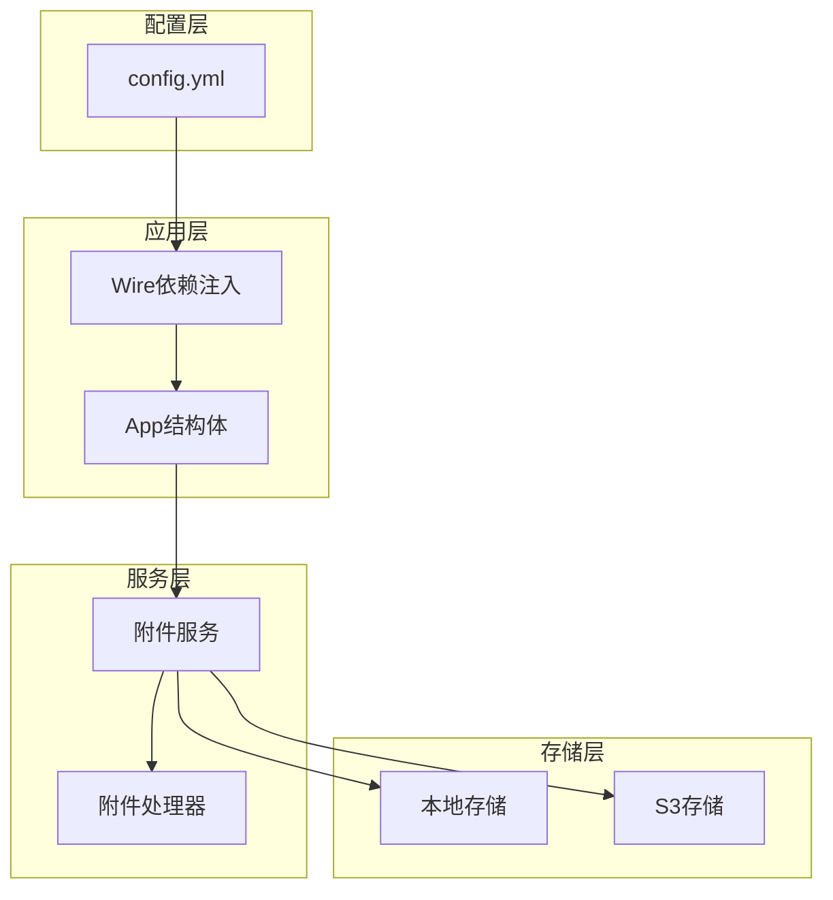
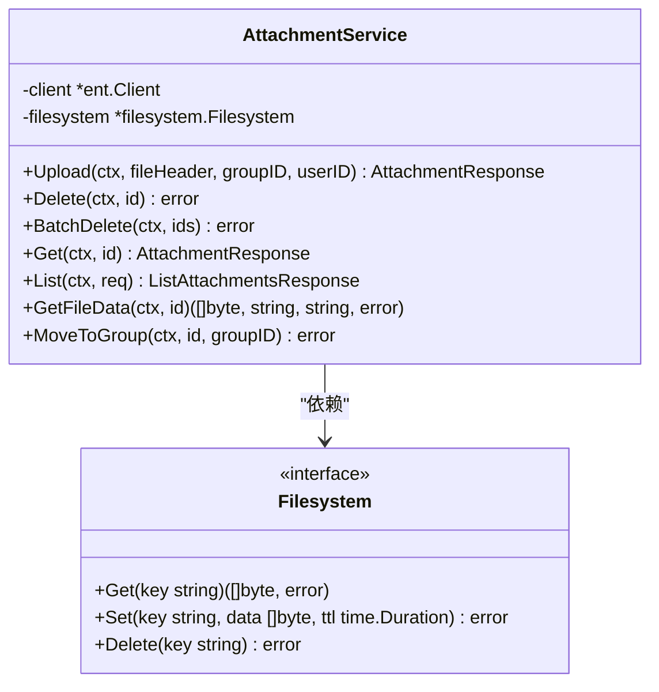
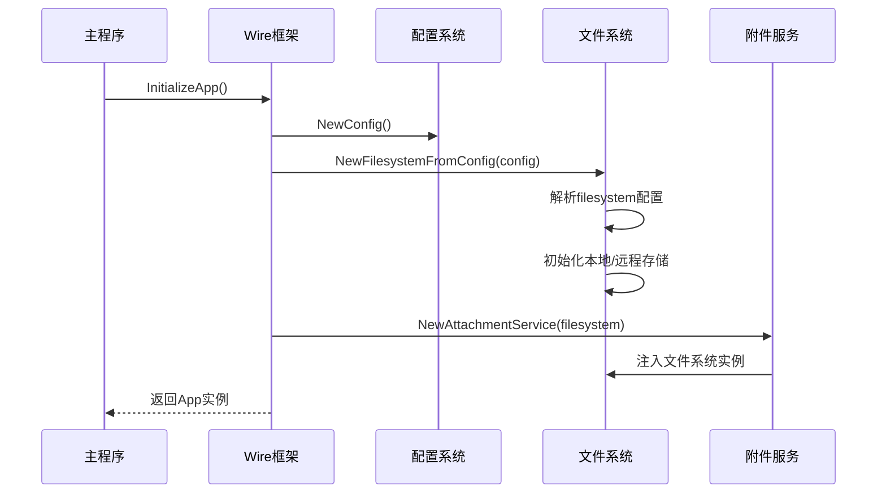
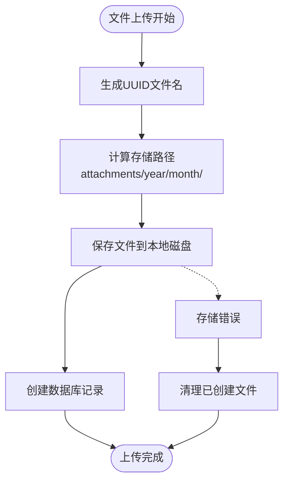
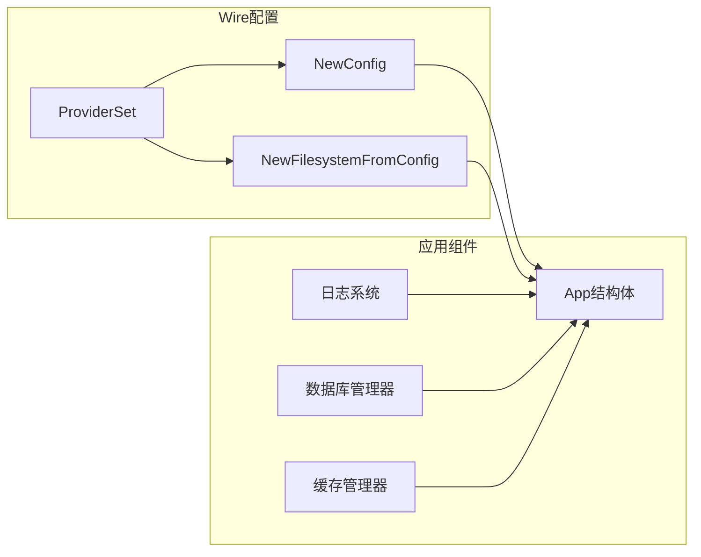
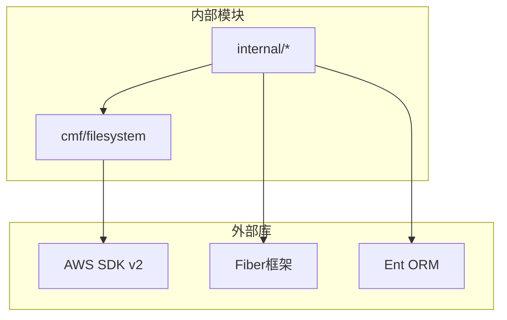
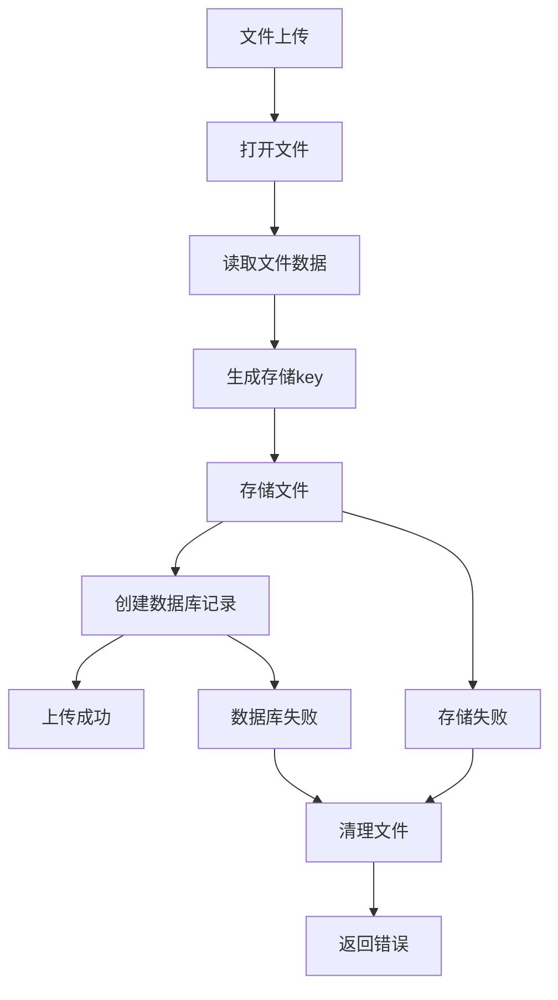

# 文件系统配置

<cite>
**本文档引用的文件**
- [config.yml](file://config/config.yml)
- [attachment.go](file://internal/service/attachment.go)
- [attachment_test.go](file://internal/service/attachment_test.go)
- [attachment.go](file://internal/handler/attachment.go)
- [wire.go](file://internal/wire.go)
- [wire_gen.go](file://internal/wire_gen.go)
- [app.go](file://internal/app.go)
- [go.mod](file://go.mod)
</cite>

## 目录
1. [简介](#简介)
2. [项目结构](#项目结构)
3. [核心组件](#核心组件)
4. [架构概览](#架构概览)
5. [详细组件分析](#详细组件分析)
6. [依赖分析](#依赖分析)
7. [性能考虑](#性能考虑)
8. [故障排除指南](#故障排除指南)
9. [结论](#结论)

## 简介

本文档详细说明了项目中的文件系统配置，特别是config.yml中filesystem节的配置结构和使用方式。该系统支持多种存储后端，包括本地磁盘存储和S3兼容云存储，并提供了灵活的配置选项以适应不同的部署场景。

## 项目结构

项目采用模块化设计，文件系统功能主要集中在以下位置：



**图表来源**
- [config.yml:60-76](file://config/config.yml#L60-L76)
- [wire.go:24-35](file://internal/wire.go#L24-L35)
- [app.go:16-25](file://internal/app.go#L16-L25)

**章节来源**
- [config.yml:60-76](file://config/config.yml#L60-L76)
- [wire.go:24-35](file://internal/wire.go#L24-L35)
- [app.go:16-25](file://internal/app.go#L16-L25)

## 核心组件

### 文件系统配置结构

filesystem节定义了整个文件存储系统的配置，包含以下关键部分：

#### 默认磁盘驱动
- `default`: 指定默认使用的存储磁盘
- `is_and_local`: 布尔值，控制是否与本地存储结合使用

#### 磁盘配置
每个磁盘都有独立的配置结构：

```yaml
disks:
  local:
    driver: local
    options:
      root: ./data/storage
  s3:
    driver: s3
    options:
      access_key: ""
      secret_key: ""
      region: ""
      bucket: ""
      endpoint: ""
```

**章节来源**
- [config.yml:60-76](file://config/config.yml#L60-L76)

### 附件服务集成

附件服务通过统一的文件系统接口进行操作：



**图表来源**
- [attachment.go:39-50](file://internal/service/attachment.go#L39-L50)
- [attachment.go:124-127](file://internal/service/attachment.go#L124-L127)

**章节来源**
- [attachment.go:39-50](file://internal/service/attachment.go#L39-L50)
- [attachment.go:124-127](file://internal/service/attachment.go#L124-L127)

## 架构概览

系统采用依赖注入模式，通过Wire框架自动配置文件系统组件：



**图表来源**
- [wire.go:24-35](file://internal/wire.go#L24-L35)
- [wire_gen.go:47-50](file://internal/wire_gen.go#L47-L50)

**章节来源**
- [wire.go:24-35](file://internal/wire.go#L24-L35)
- [wire_gen.go:47-50](file://internal/wire_gen.go#L47-L50)

## 详细组件分析

### 本地存储配置

本地存储是最简单的部署方案，适用于单机环境：

#### 配置参数
- `driver`: 设置为"local"
- `options.root`: 指定存储根目录路径

#### 存储策略
系统使用UUID作为文件名，按年月分目录组织：



**图表来源**
- [attachment.go:120-127](file://internal/service/attachment.go#L120-L127)

**章节来源**
- [attachment.go:120-127](file://internal/service/attachment.go#L120-L127)

### S3存储配置

S3兼容存储提供云端文件管理能力：

#### 必需配置参数
- `access_key`: 访问密钥
- `secret_key`: 密钥
- `region`: 区域
- `bucket`: 存储桶名称
- `endpoint`: 服务端点（可选）

#### 支持的S3服务
系统基于AWS SDK v2，支持：
- AWS S3服务
- 兼容S3 API的对象存储服务
- 自建S3兼容存储

**章节来源**
- [config.yml:68-75](file://config/config.yml#L68-L75)
- [go.mod:34-48](file://go.mod#L34-L48)

### 依赖注入配置

系统通过Wire框架实现自动依赖注入：



**图表来源**
- [wire.go:24-35](file://internal/wire.go#L24-L35)
- [wire_gen.go:47-50](file://internal/wire_gen.go#L47-L50)

**章节来源**
- [wire.go:24-35](file://internal/wire.go#L24-L35)
- [wire_gen.go:47-50](file://internal/wire_gen.go#L47-L50)

## 依赖分析

### 外部依赖关系

系统对外部库的依赖主要体现在文件系统抽象上：



**图表来源**
- [go.mod:34-48](file://go.mod#L34-L48)
- [attachment.go:17-18](file://internal/service/attachment.go#L17-L18)

**章节来源**
- [go.mod:34-48](file://go.mod#L34-L48)
- [attachment.go:17-18](file://internal/service/attachment.go#L17-L18)

### 内部组件耦合

文件系统配置与各组件的耦合度较低，通过接口实现松耦合：

```mermaid
classDiagram
class Config {
+filesystem FilesystemConfig
}
class FilesystemConfig {
+default string
+disks map[string]DiskConfig
}
class DiskConfig {
+driver string
+options map[string]interface{}
}
class LocalDisk {
+root string
}
class S3Disk {
+access_key string
+secret_key string
+region string
+bucket string
+endpoint string
}
Config --> FilesystemConfig
FilesystemConfig --> DiskConfig
DiskConfig <|-- LocalDisk
DiskConfig <|-- S3Disk
```

**图表来源**
- [config.yml:60-76](file://config/config.yml#L60-L76)

**章节来源**
- [config.yml:60-76](file://config/config.yml#L60-L76)

## 性能考虑

### 存储性能优化

1. **本地存储优化**
   - 使用SSD存储设备
   - 合理设置目录层级，避免单目录文件过多
   - 定期清理临时文件

2. **S3存储优化**
   - 启用对象版本控制
   - 使用适当的存储类别
   - 配置CDN加速热门文件

3. **并发处理**
   - 附件服务支持并发上传
   - 数据库连接池优化
   - 缓存层配合使用

### 安全配置最佳实践

1. **密钥管理**
   - 使用环境变量存储敏感信息
   - 定期轮换访问密钥
   - 最小权限原则

2. **访问控制**
   - S3存储桶策略最小化
   - CDN访问限制
   - HTTPS强制使用

3. **数据保护**
   - 文件完整性校验
   - 访问日志审计
   - 自动备份策略

## 故障排除指南

### 常见问题诊断

#### 本地存储问题
- **权限错误**: 检查存储目录写入权限
- **磁盘空间不足**: 监控存储空间使用情况
- **路径解析错误**: 验证root路径配置

#### S3存储问题
- **认证失败**: 验证access_key和secret_key
- **网络连接**: 检查endpoint可达性
- **桶权限**: 确认桶策略配置

#### 依赖注入问题
- **配置解析错误**: 检查config.yml语法
- **组件初始化失败**: 查看Wire生成代码

**章节来源**
- [attachment_test.go:25-54](file://internal/service/attachment_test.go#L25-L54)
- [attachment.go:142-144](file://internal/service/attachment.go#L142-L144)

### 错误处理流程



**图表来源**
- [attachment.go:94-147](file://internal/service/attachment.go#L94-L147)

**章节来源**
- [attachment.go:94-147](file://internal/service/attachment.go#L94-L147)

## 结论

本文件系统配置提供了灵活的多存储后端支持，通过统一的接口抽象实现了本地存储和S3云存储的无缝切换。配置简单直观，易于在不同部署环境中使用。建议根据实际需求选择合适的存储方案，并遵循相应的安全和性能最佳实践。