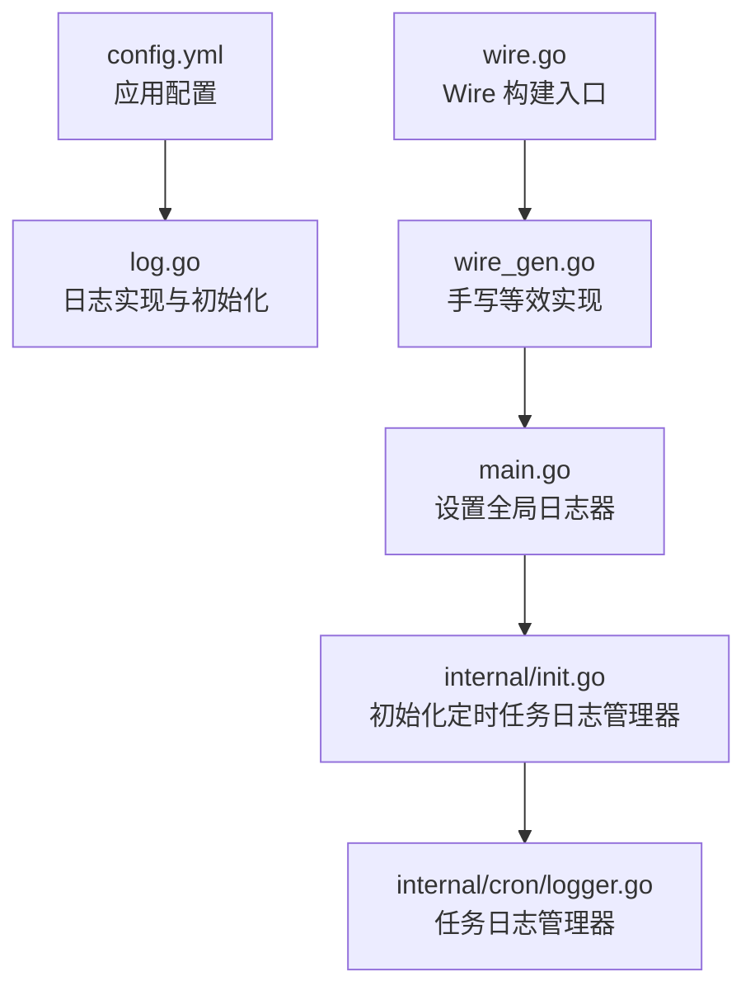
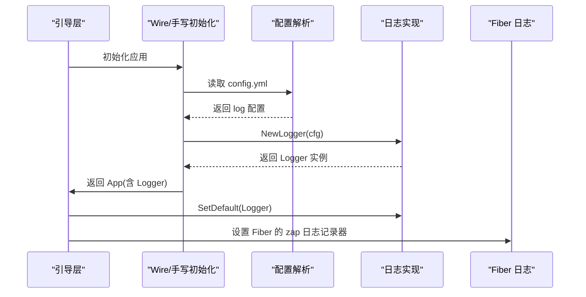
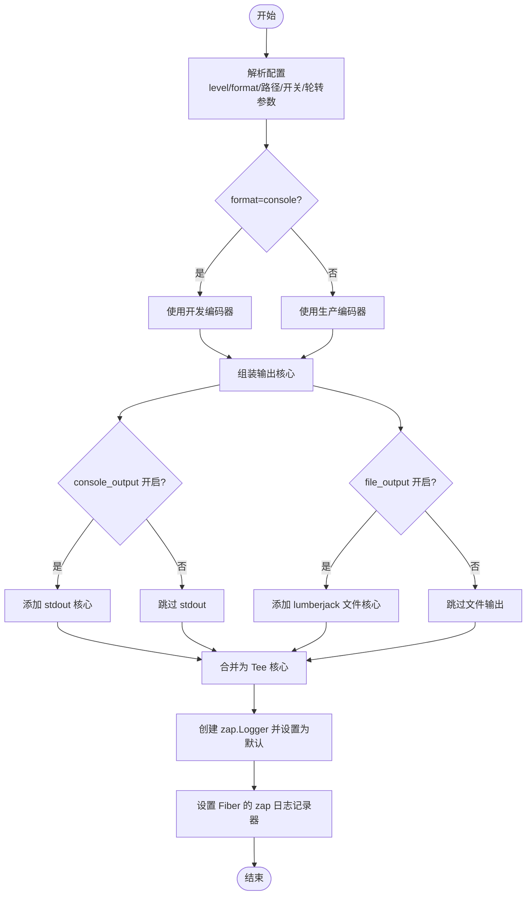
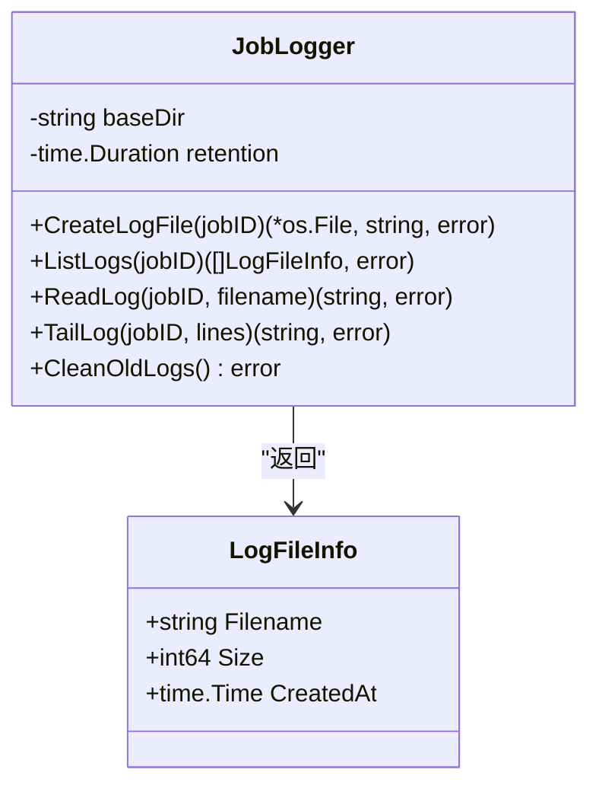
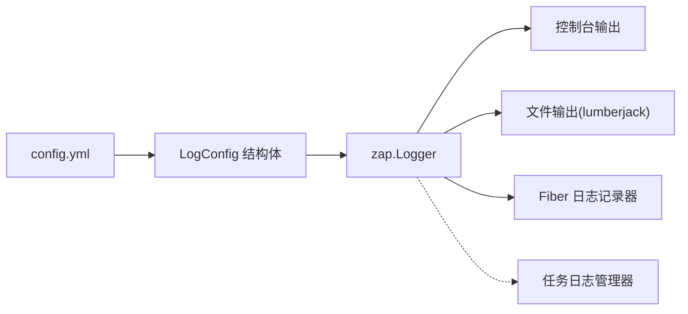

# 日志配置

<cite>
**本文引用的文件**
- [config.yml](file://config/config.yml)
- [log.go](file://tmp_cmf_changes/log/log.go)
- [logger.go](file://internal/cron/logger.go)
- [main.go](file://main.go)
- [init.go](file://internal/init.go)
- [wire_gen.go](file://internal/wire_gen.go)
- [wire.go](file://internal/wire.go)
</cite>

## 目录
1. [简介](#简介)
2. [项目结构](#项目结构)
3. [核心组件](#核心组件)
4. [架构总览](#架构总览)
5. [详细组件分析](#详细组件分析)
6. [依赖分析](#依赖分析)
7. [性能考虑](#性能考虑)
8. [故障排查指南](#故障排查指南)
9. [结论](#结论)
10. [附录](#附录)

## 简介
本文件面向运维与开发人员，系统化说明项目中基于 YAML 的日志配置与运行时行为，覆盖以下主题：
- config.yml 中 log 节点各配置项的含义与取值范围
- 控制台输出与文件输出的开关策略
- 日志轮转机制（大小、备份数量、保留天数）与性能影响
- 输出格式（JSON/控制台）对可观测性的影响
- 不同环境（开发/生产）的日志级别与配置建议
- 日志文件管理与故障排查最佳实践

## 项目结构
与日志配置直接相关的文件与职责如下：
- config/config.yml：应用配置入口，定义 log 节点的各项参数
- tmp_cmf_changes/log/log.go：日志实现与初始化逻辑，负责解析配置、构建编码器、组装多核输出、集成 Fiber 日志
- internal/cron/logger.go：定时任务专用日志管理器，独立于应用日志，支持任务级日志目录、滚动与清理
- internal/init.go：应用初始化阶段创建定时任务日志管理器，并传入 cron 日志根目录与保留时长
- internal/wire*.go：依赖注入初始化链路，确保应用启动时注入并设置全局日志器
- main.go：应用入口，设置全局日志器并启动服务

**图示来源**
- [config.yml:11-17](file://config/config.yml#L11-L17)
- [log.go:144-172](file://tmp_cmf_changes/log/log.go#L144-L172)
- [wire.go:22-37](file://internal/wire.go#L22-L37)
- [wire_gen.go:17-62](file://internal/wire_gen.go#L17-L62)
- [main.go:55-57](file://main.go#L55-L57)
- [init.go:60-64](file://internal/init.go#L60-L64)
- [logger.go:26-32](file://internal/cron/logger.go#L26-L32)

**章节来源**
- [config.yml:11-17](file://config/config.yml#L11-L17)
- [log.go:144-172](file://tmp_cmf_changes/log/log.go#L144-L172)
- [wire.go:22-37](file://internal/wire.go#L22-L37)
- [wire_gen.go:17-62](file://internal/wire_gen.go#L17-L62)
- [main.go:55-57](file://main.go#L55-L57)
- [init.go:60-64](file://internal/init.go#L60-L64)
- [logger.go:26-32](file://internal/cron/logger.go#L26-L32)

## 核心组件
- 日志配置结构体：封装日志级别、输出格式、文件路径、控制台/文件输出开关、轮转参数（单文件最大大小、备份数、保留天数）
- 日志实现：基于 zap 与 lumberjack，支持 Tee 多核输出（同时输出到控制台与文件），并根据配置启用压缩
- Fiber 集成：将 zap 作为 Fiber 的日志记录器，保证框架层日志一致性
- 任务日志管理器：独立于应用日志，按任务 ID 分目录存储日志，支持尾读、清理过期日志

**章节来源**
- [log.go:29-39](file://tmp_cmf_changes/log/log.go#L29-L39)
- [log.go:177-218](file://tmp_cmf_changes/log/log.go#L177-L218)
- [log.go:220-242](file://tmp_cmf_changes/log/log.go#L220-L242)
- [logger.go:20-24](file://internal/cron/logger.go#L20-L24)

## 架构总览
应用启动时，Wire/手写初始化链路从 config.yml 读取日志配置，构建日志器并设置为全局默认；同时将 zap 作为 Fiber 的日志记录器。应用运行期间，业务日志与 HTTP 请求日志均通过该全局日志器输出。定时任务有独立的日志目录与清理策略。

**图示来源**
- [wire.go:22-37](file://internal/wire.go#L22-L37)
- [wire_gen.go:17-62](file://internal/wire_gen.go#L17-L62)
- [log.go:144-172](file://tmp_cmf_changes/log/log.go#L144-L172)
- [log.go:274-284](file://tmp_cmf_changes/log/log.go#L274-L284)
- [main.go:55-57](file://main.go#L55-L57)

## 详细组件分析

### config.yml 中 log 节配置项详解
- file_path：日志文件绝对或相对路径，需确保进程有写权限
- console_output：是否输出到控制台
- file_output：是否输出到文件（结合 lumberjack 轮转）
- max_size：单个日志文件最大大小（单位：MB）
- max_backups：保留的旧日志文件数量
- max_age：旧日志文件最大保留天数

上述字段在运行时被映射到日志配置结构体，并驱动编码器选择与多核输出组装。

**章节来源**
- [config.yml:11-17](file://config/config.yml#L11-L17)
- [log.go:146-155](file://tmp_cmf_changes/log/log.go#L146-L155)

### 日志实现与初始化流程
- 配置解析：若未显式设置 level/format，则依据 app.debug 自动推断默认级别与格式
- 编码器：console 模式使用开发编码器，json 模式使用生产编码器，统一时间字段与 ISO8601 时间格式
- 多核输出：根据开关组合控制台与文件输出；若两者都关闭，则回退到控制台输出
- 轮转：文件输出使用 lumberjack，按大小、备份数、保留天数滚动压缩
- Fiber 集成：将 zap 作为 Fiber 的日志记录器，保证框架层日志一致

**图示来源**
- [log.go:144-172](file://tmp_cmf_changes/log/log.go#L144-L172)
- [log.go:177-218](file://tmp_cmf_changes/log/log.go#L177-L218)
- [log.go:274-284](file://tmp_cmf_changes/log/log.go#L274-L284)

**章节来源**
- [log.go:127-142](file://tmp_cmf_changes/log/log.go#L127-L142)
- [log.go:177-218](file://tmp_cmf_changes/log/log.go#L177-L218)
- [log.go:274-284](file://tmp_cmf_changes/log/log.go#L274-L284)

### HTTP 请求日志中间件
- 在每个请求结束后记录方法、路径、状态码、耗时、客户端 IP 等关键指标
- 便于快速定位请求异常与性能瓶颈

**章节来源**
- [log.go:220-242](file://tmp_cmf_changes/log/log.go#L220-L242)

### 任务日志管理器（独立于应用日志）
- 按任务 ID 创建独立目录，文件名采用时间戳格式
- 支持列出、读取、尾读最近 N 行
- 支持按保留时长清理过期日志文件，并在目录为空时删除空目录

**图示来源**
- [logger.go:20-24](file://internal/cron/logger.go#L20-L24)
- [logger.go:13-18](file://internal/cron/logger.go#L13-L18)

**章节来源**
- [logger.go:26-32](file://internal/cron/logger.go#L26-L32)
- [logger.go:53-86](file://internal/cron/logger.go#L53-L86)
- [logger.go:88-105](file://internal/cron/logger.go#L88-L105)
- [logger.go:107-146](file://internal/cron/logger.go#L107-L146)
- [logger.go:148-191](file://internal/cron/logger.go#L148-L191)

### 依赖注入与全局日志器设置
- Wire 构建链路：从配置读取日志配置，创建日志器并注入到 App
- 手写等效实现：在未启用 Wire 时，同样从配置创建日志器
- 入口设置：main.go 将应用日志器设置为全局默认，并设置 Fiber 的日志记录器

**章节来源**
- [wire.go:22-37](file://internal/wire.go#L22-L37)
- [wire_gen.go:17-62](file://internal/wire_gen.go#L17-L62)
- [main.go:55-57](file://main.go#L55-L57)

## 依赖分析
- 配置来源：config.yml → 日志配置结构体
- 运行时：日志实现 → zap 核心 → lumberjack 轮转 → 控制台/文件输出
- 集成点：Fiber 日志记录器与应用日志器绑定
- 任务日志：独立模块，不依赖应用日志配置，但共享目录结构与清理策略

**图示来源**
- [config.yml:11-17](file://config/config.yml#L11-L17)
- [log.go:146-155](file://tmp_cmf_changes/log/log.go#L146-L155)
- [log.go:177-218](file://tmp_cmf_changes/log/log.go#L177-L218)
- [log.go:274-284](file://tmp_cmf_changes/log/log.go#L274-L284)
- [logger.go:26-32](file://internal/cron/logger.go#L26-L32)

**章节来源**
- [config.yml:11-17](file://config/config.yml#L11-L17)
- [log.go:146-155](file://tmp_cmf_changes/log/log.go#L146-L155)
- [log.go:177-218](file://tmp_cmf_changes/log/log.go#L177-L218)
- [log.go:274-284](file://tmp_cmf_changes/log/log.go#L274-L284)
- [logger.go:26-32](file://internal/cron/logger.go#L26-L32)

## 性能考虑
- 输出路径
  - 控制台输出：低延迟，适合开发调试
  - 文件输出：磁盘 IO 成本较高，建议在生产开启文件输出并合理设置轮转参数
- 轮转参数
  - max_size：建议根据峰值日志速率设定，避免频繁滚动
  - max_backups：建议与 max_age 组合，避免磁盘占用过大
  - max_age：建议按合规与容量需求设定，定期清理过期日志
- 编码器
  - JSON 格式更利于结构化采集与检索，但体积略大
  - 控制台格式更易读，但不适合生产日志收集
- Fiber 集成
  - 将 zap 作为 Fiber 日志记录器，减少额外开销，保证框架层日志一致性

[本节为通用性能讨论，无需“章节来源”]

## 故障排查指南
- 无法写入日志文件
  - 检查 file_path 所在目录是否存在且具备写权限
  - 确认 max_size/max_backups/max_age 参数不会导致磁盘空间不足
- 日志未输出到文件
  - 检查 file_output 是否开启
  - 确认 lumberjack 配置正确（路径、大小、备份数、保留天数）
- 日志未输出到控制台
  - 检查 console_output 是否开启
- 任务日志异常
  - 检查任务日志根目录是否存在
  - 使用 TailLog 查看最新日志，确认文件命名与时间戳格式
  - 使用 CleanOldLogs 清理过期日志，观察目录是否被正确删除
- 请求日志缺失
  - 确认已注册请求日志中间件
  - 检查全局日志器是否已设置

**章节来源**
- [logger.go:34-51](file://internal/cron/logger.go#L34-L51)
- [logger.go:107-146](file://internal/cron/logger.go#L107-L146)
- [logger.go:148-191](file://internal/cron/logger.go#L148-L191)
- [log.go:220-242](file://tmp_cmf_changes/log/log.go#L220-L242)
- [main.go:55-57](file://main.go#L55-L57)

## 结论
本项目的日志体系以 YAML 配置为核心，结合 zap 与 lumberjack 实现高性能、可维护的日志输出与轮转。通过 Fiber 集成与任务日志管理器，既满足应用层面的统一观测，又兼顾定时任务的独立管理。建议在不同环境下遵循相应的配置与轮转策略，确保可观测性与资源占用的平衡。

[本节为总结性内容，无需“章节来源”]

## 附录

### 不同环境下的日志级别与配置建议
- 开发环境
  - 建议：level=debug，format=console，console_output=true，file_output=false
  - 说明：便于本地调试，控制台输出更直观
- 生产环境
  - 建议：level=info，format=json，console_output=false，file_output=true
  - 说明：JSON 格式利于结构化采集，文件输出配合轮转与压缩，降低运维成本

**章节来源**
- [log.go:156-169](file://tmp_cmf_changes/log/log.go#L156-L169)

### 日志轮转机制与参数说明
- 触发条件：当日志文件达到 max_size（MB）时触发滚动
- 备份策略：最多保留 max_backups 个历史文件
- 保留策略：历史文件保留不超过 max_age（天）
- 压缩策略：滚动时启用压缩，节省磁盘空间

**章节来源**
- [log.go:200-209](file://tmp_cmf_changes/log/log.go#L200-L209)
- [config.yml:15-17](file://config/config.yml#L15-L17)

### 日志文件管理最佳实践
- 定期检查磁盘空间，确保日志目录有足够容量
- 对生产日志启用压缩与轮转，避免单文件过大
- 使用任务日志管理器对定时任务进行独立归档与清理
- 在 CI/CD 中统一日志采集与告警策略

**章节来源**
- [logger.go:148-191](file://internal/cron/logger.go#L148-L191)