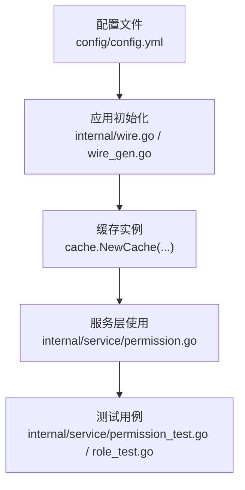
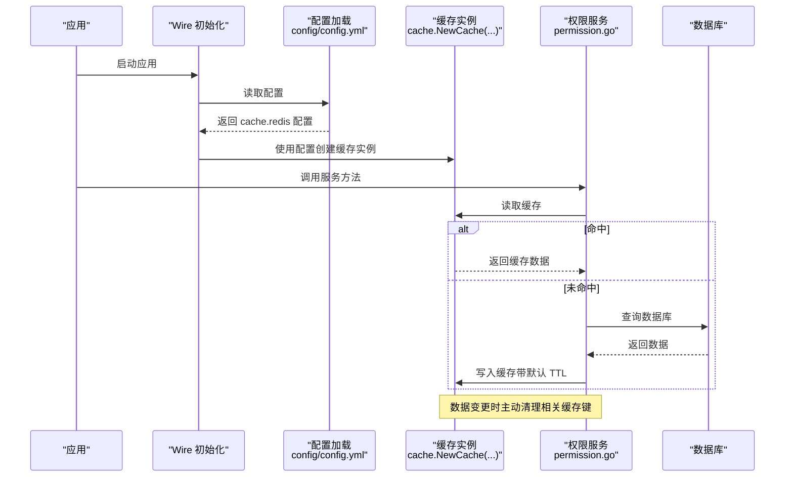
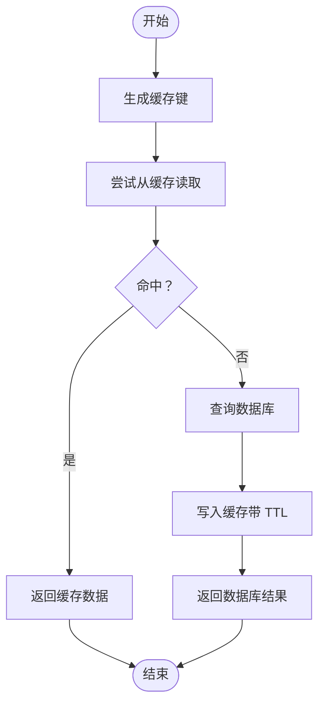
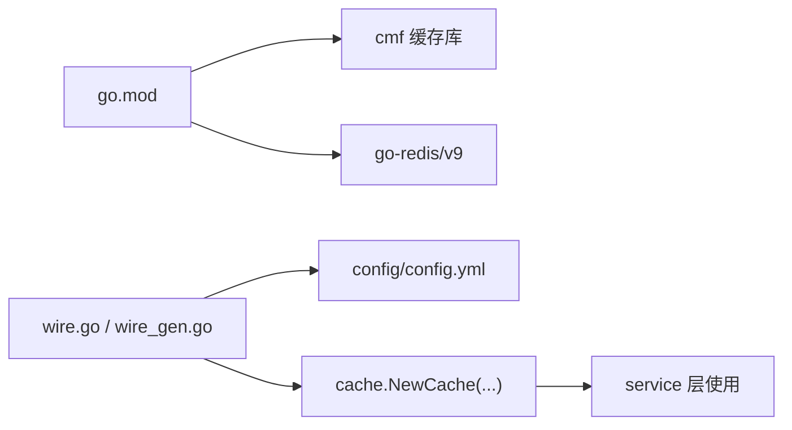

# 缓存配置

<cite>
**本文引用的文件**
- [config.yml](file://config/config.yml)
- [go.mod](file://go.mod)
- [permission.go](file://internal/service/permission.go)
- [permission_test.go](file://internal/service/permission_test.go)
- [role_test.go](file://internal/service/role_test.go)
- [wire.go](file://internal/wire.go)
- [wire_gen.go](file://internal/wire_gen.go)
</cite>

## 目录
1. [简介](#简介)
2. [项目结构](#项目结构)
3. [核心组件](#核心组件)
4. [架构总览](#架构总览)
5. [详细组件分析](#详细组件分析)
6. [依赖分析](#依赖分析)
7. [性能考虑](#性能考虑)
8. [故障排查指南](#故障排查指南)
9. [结论](#结论)

## 简介
本文件聚焦于项目的缓存配置与使用，围绕 config.yml 中的 cache 与 redis 节展开，系统性说明默认缓存驱动、内存缓存与 Redis 缓存的配置参数、连接与池化参数、超时设置、默认 TTL 等，并结合实际代码使用场景给出不同环境下的策略建议、性能调优与故障处理最佳实践。

## 项目结构
与缓存配置直接相关的文件与位置如下：
- 配置文件：config/config.yml
- 应用初始化：internal/wire.go 与 internal/wire_gen.go
- 缓存使用示例：internal/service/permission.go、internal/service/permission_test.go、internal/service/role_test.go
- 外部依赖：go.mod（包含 cmf 缓存库与 go-redis）

图表来源
- [config.yml](file://config/config.yml)
- [wire.go](file://internal/wire.go)
- [wire_gen.go](file://internal/wire_gen.go)
- [permission.go](file://internal/service/permission.go)
- [permission_test.go](file://internal/service/permission_test.go)
- [role_test.go](file://internal/service/role_test.go)

章节来源
- [config.yml](file://config/config.yml)
- [wire.go](file://internal/wire.go)
- [wire_gen.go](file://internal/wire_gen.go)

## 核心组件
- 默认缓存驱动
  - 在 cache.default 中指定默认驱动为 memory，表示应用启动时默认使用内存缓存。
- 缓存存储定义
  - memory 存储：driver 为 memory，default_ttl 为 3600 秒。
  - redis 存储：driver 为 redis，default_ttl 为 3600 秒。
- Redis 连接与池参数
  - 地址与认证：addr、username、password、db。
  - 超时控制：dial_timeout、read_timeout、write_timeout。
  - 连接池：pool_size、min_idle_conns、max_idle_conns、conn_max_idle_time、conn_max_lifetime。
  - TLS：use_tls。
- 服务层缓存使用
  - 权限服务在获取角色权限与用户菜单权限时进行缓存读写；当权限发生变更时，主动清理相关缓存键，确保一致性。

章节来源
- [config.yml](file://config/config.yml)
- [permission.go](file://internal/service/permission.go)

## 架构总览
下图展示应用如何从配置加载缓存，以及服务层如何使用缓存与触发失效：

图表来源
- [config.yml](file://config/config.yml)
- [wire.go](file://internal/wire.go)
- [wire_gen.go](file://internal/wire_gen.go)
- [permission.go](file://internal/service/permission.go)

## 详细组件分析

### 配置结构与参数说明
- cache 节点
  - default：默认驱动，当前为 memory。
  - stores.memory
    - driver：memory
    - default_ttl：3600 秒
  - stores.redis
    - driver：redis
    - default_ttl：3600 秒
- redis 节点
  - default：默认连接名，当前为 redis。
  - connections.redis
    - addr：地址与端口
    - username/password：认证信息
    - db：数据库编号
    - dial_timeout：连接建立超时
    - read_timeout：读超时
    - write_timeout：写超时
    - pool_size：最大连接数
    - min_idle_conns/max_idle_conns：空闲连接池上下限
    - conn_max_idle_time：连接最大空闲时间
    - conn_max_lifetime：连接最大生命周期
    - use_tls：是否启用 TLS

章节来源
- [config.yml](file://config/config.yml)

### 内存缓存与 Redis 缓存对比
- 默认驱动
  - 当前默认使用 memory，适合开发与单实例部署。
- Redis 驱动
  - 适用于多实例、分布式部署，具备持久化与高可用能力。
- TTL 设计
  - 配置层提供 default_ttl；服务层也针对特定场景设置了默认 TTL（例如 5 分钟），用于覆盖配置层默认值。

章节来源
- [config.yml](file://config/config.yml)
- [permission.go](file://internal/service/permission.go)

### 服务层缓存使用模式
- 缓存键命名规范
  - 采用统一前缀与分段拼接，便于清理与管理。
- 读写流程
  - 先尝试从缓存读取，命中则直接返回；未命中则查询数据库并写入缓存（带 TTL）。
- 失效策略
  - 在权限创建、更新、删除、角色权限变更等关键操作后，主动清理相关缓存键，保证一致性。

图表来源
- [permission.go](file://internal/service/permission.go)

章节来源
- [permission.go](file://internal/service/permission.go)

### 测试中的缓存配置与使用
- 测试通过构造 Config 并设置 cache.default 为 memory，再创建缓存实例，验证缓存命中与失效行为。
- TypedCache 的使用确保了类型安全的缓存读写。

章节来源
- [permission_test.go](file://internal/service/permission_test.go)
- [role_test.go](file://internal/service/role_test.go)

## 依赖分析
- cmf 缓存库
  - 项目通过 replace 指向本地 cmf 源码，内部提供 cache.NewCache 与 TypedCache 等能力。
- go-redis
  - 项目依赖 go-redis/v9，用于 Redis 连接与操作。
- 初始化链路
  - Wire 初始化应用时，先加载配置，再创建缓存实例，最后注入到服务层。

图表来源
- [go.mod](file://go.mod)
- [wire.go](file://internal/wire.go)
- [wire_gen.go](file://internal/wire_gen.go)
- [config.yml](file://config/config.yml)

章节来源
- [go.mod](file://go.mod)
- [wire.go](file://internal/wire.go)
- [wire_gen.go](file://internal/wire_gen.go)

## 性能考虑
- TTL 策略
  - 对热点数据可适当缩短 TTL，降低陈旧风险；对不常变数据可延长 TTL，减少查询压力。
  - 服务层针对权限场景设置较短 TTL（如 5 分钟），平衡一致性与性能。
- 连接池优化
  - 根据并发与延迟要求调整 pool_size、min_idle_conns、max_idle_conns。
  - 合理设置 conn_max_idle_time 与 conn_max_lifetime，避免连接老化导致的抖动。
- 超时设置
  - dial_timeout、read_timeout、write_timeout 应结合网络状况与 Redis 实例性能调优。
- 缓存命中率
  - 通过合理的键设计与 TTL 策略提升命中率；对批量读取场景可考虑预热常用键。

## 故障排查指南
- 缓存未生效
  - 检查 cache.default 是否正确指向 desired 驱动（memory 或 redis）。
  - 确认服务层是否传入了有效的缓存实例。
- 缓存命中异常
  - 核对缓存键生成逻辑是否一致。
  - 关注服务层在数据变更后是否执行了缓存清理。
- Redis 连接问题
  - 校验 addr、username、password、db 是否正确。
  - 检查网络连通性与防火墙策略。
  - 调整超时与连接池参数，观察日志定位瓶颈。
- 一致性问题
  - 确保所有写操作后均调用清理方法（如清除用户/角色相关缓存）。
  - 对批量操作建议集中清理，避免遗漏。

章节来源
- [permission.go](file://internal/service/permission.go)
- [permission_test.go](file://internal/service/permission_test.go)
- [role_test.go](file://internal/service/role_test.go)

## 结论
- 开发环境建议使用 memory 驱动，快速迭代且无需外部依赖。
- 生产环境建议使用 Redis 驱动，结合合理的连接池与超时参数，保障稳定性与扩展性。
- 通过明确的 TTL 策略与主动失效机制，在性能与一致性之间取得平衡。
- 建议持续监控缓存命中率与 Redis 指标，按需调优连接池与 TTL。