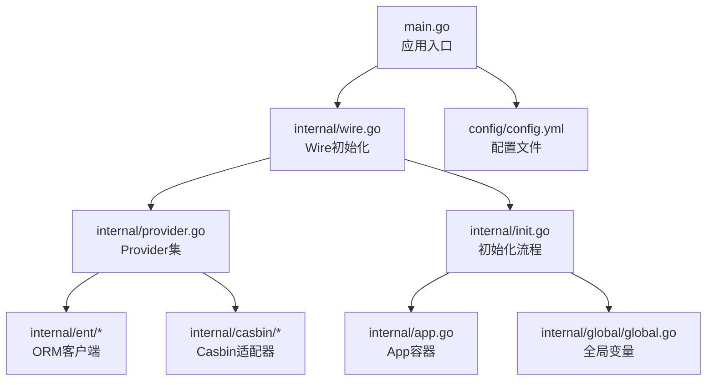
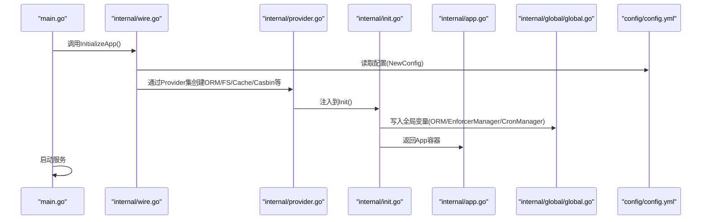
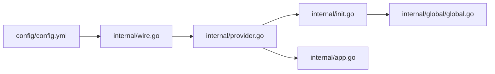

# 配置管理

<cite>
**本文引用的文件**
- [config.yml](file://config/config.yml)
- [main.go](file://main.go)
- [init.go](file://internal/init.go)
- [provider.go](file://internal/provider.go)
- [wire.go](file://internal/wire.go)
- [app.go](file://internal/app.go)
- [global.go](file://internal/global/global.go)
- [go.mod](file://go.mod)
</cite>

## 目录
1. [简介](#简介)
2. [项目结构](#项目结构)
3. [核心组件](#核心组件)
4. [架构总览](#架构总览)
5. [详细组件分析](#详细组件分析)
6. [依赖分析](#依赖分析)
7. [性能考量](#性能考量)
8. [故障排查指南](#故障排查指南)
9. [结论](#结论)
10. [附录](#附录)

## 简介
本文件面向Go Admin管理系统，系统性梳理配置管理方案与最佳实践，重点覆盖以下方面：
- config.yml配置项详解：应用、日志、数据库、缓存、Redis、文件系统、Casbin等
- 环境差异化策略：开发、测试、生产环境的配置差异与落地方式
- 配置加载顺序、环境变量覆盖机制、配置验证与错误处理
- 配置热更新支持现状与建议
- 配置安全性考虑与常见错误排查

## 项目结构
系统采用模块化设计，配置文件集中于config目录，运行入口位于根目录main.go，初始化逻辑集中在internal包中，通过Wire依赖注入构建应用。

图表来源
- [main.go:47-104](file://main.go#L47-L104)
- [wire.go:22-37](file://internal/wire.go#L22-L37)
- [provider.go:17-43](file://internal/provider.go#L17-L43)
- [init.go:31-67](file://internal/init.go#L31-L67)
- [app.go:15-26](file://internal/app.go#L15-L26)
- [global.go:11-16](file://internal/global/global.go#L11-L16)
- [config.yml:1-143](file://config/config.yml#L1-L143)

章节来源
- [main.go:47-104](file://main.go#L47-L104)
- [wire.go:22-37](file://internal/wire.go#L22-L37)
- [provider.go:17-43](file://internal/provider.go#L17-L43)
- [init.go:31-67](file://internal/init.go#L31-L67)
- [app.go:15-26](file://internal/app.go#L15-L26)
- [global.go:11-16](file://internal/global/global.go#L11-L16)
- [config.yml:1-143](file://config/config.yml#L1-L143)

## 核心组件
- 配置源：config/config.yml
- 初始化链路：main.go -> internal.InitializeApp(Wire) -> internal.Init -> 各子系统初始化
- 全局共享：internal/global/global.go中的ORM、Bootstrap、EnforcerManager、CronManager
- 依赖注入：internal/wire.go + internal/provider.go
- 运行期配置读取：internal/init.go与internal/app.go

章节来源
- [main.go:47-104](file://main.go#L47-L104)
- [wire.go:22-37](file://internal/wire.go#L22-L37)
- [provider.go:17-43](file://internal/provider.go#L17-L43)
- [init.go:31-67](file://internal/init.go#L31-L67)
- [app.go:15-26](file://internal/app.go#L15-L26)
- [global.go:11-16](file://internal/global/global.go#L11-L16)

## 架构总览
下图展示配置在系统中的流转与使用路径。

图表来源
- [main.go:47-104](file://main.go#L47-L104)
- [wire.go:22-37](file://internal/wire.go#L22-L37)
- [provider.go:17-43](file://internal/provider.go#L17-L43)
- [init.go:31-67](file://internal/init.go#L31-L67)
- [app.go:15-26](file://internal/app.go#L15-L26)
- [global.go:11-16](file://internal/global/global.go#L11-L16)
- [config.yml:1-143](file://config/config.yml#L1-L143)

## 详细组件分析

### 应用配置（app）
- 关键项：name、port、debug、idle_timeout、prefork、swagger、secret、login_expires
- 作用：定义应用名称、监听端口、调试模式、空闲超时、是否预fork、Swagger开关、密钥、登录过期时间等
- 读取位置：配置文件；运行期可通过内部服务读取用于JWT签发与登录有效期控制

章节来源
- [config.yml:1-9](file://config/config.yml#L1-L9)
- [init.go:159-209](file://internal/service/user.go#L159-L209)

### 日志配置（log）
- 关键项：file_path、console_output、file_output、max_size、max_backups、max_age
- 作用：日志输出目标与轮转策略，支持同时输出到控制台与文件
- 读取位置：配置文件；初始化阶段由日志库按配置生效

章节来源
- [config.yml:11-17](file://config/config.yml#L11-L17)

### 数据库配置（database）
- 关键项：default、connections.default.driver/host/port/user/password/name/ssl_mode/table_prefix
- 作用：指定默认连接驱动、主机、端口、账号、密码、数据库名、SSL模式、表前缀
- 初始化：Wire注入ORM客户端；若未注入则在init.go中手动初始化并执行Schema迁移

章节来源
- [config.yml:19-31](file://config/config.yml#L19-L31)
- [provider.go:17-33](file://internal/provider.go#L17-L33)
- [init.go:69-84](file://internal/init.go#L69-L84)

### 缓存配置（cache）
- 关键项：default、stores.memory.driver/default_ttl、stores.redis.driver/default_ttl
- 作用：选择默认缓存驱动（内存/Redis），统一TTL
- 初始化：通过Wire注入缓存组件供各模块使用

章节来源
- [config.yml:32-41](file://config/config.yml#L32-L41)
- [wire.go:26-31](file://internal/wire.go#L26-L31)

### Redis配置（redis）
- 关键项：default、connections.redis.addr/username/password/db/dial_timeout/read_timeout/write_timeout/pool_size/min_idle_conns/max_idle_conns/conn_max_idle_time/conn_max_lifetime/use_tls
- 作用：Redis连接参数与连接池配置
- 初始化：通过Wire注入Redis连接供缓存/消息等场景使用

章节来源
- [config.yml:42-58](file://config/config.yml#L42-L58)
- [wire.go:26-31](file://internal/wire.go#L26-L31)

### 文件系统配置（filesystem）
- 关键项：default、is_and_local、disks.local.driver/options.root、disks.s3.driver/options.access_key/secret_key/region/bucket/endpoint
- 作用：本地磁盘与S3对象存储的默认驱动与参数
- 初始化：通过Wire注入文件系统组件供附件上传/下载使用

章节来源
- [config.yml:60-76](file://config/config.yml#L60-L76)
- [wire.go:26-31](file://internal/wire.go#L26-L31)

### Casbin权限配置（casbin）
- 关键项：domains_default、domains[*].name/auto_load/model_text/model_path
- 作用：多域RBAC模型配置，支持默认域与自定义域；可内联模型文本或外部模型文件
- 初始化：通过Wire注入Casbin适配器与EnforcerManager；支持启动时自动加载或按需加载

章节来源
- [config.yml:77-143](file://config/config.yml#L77-L143)
- [provider.go:35-43](file://internal/provider.go#L35-L43)
- [init.go:86-100](file://internal/init.go#L86-L100)

### JWT认证配置关联点
- 登录过期时间与密钥来源于应用配置项，用于生成访问令牌与刷新令牌
- 读取位置：用户服务中通过配置对象读取登录过期与密钥

章节来源
- [config.yml:1-9](file://config/config.yml#L1-L9)
- [init.go:159-209](file://internal/service/user.go#L159-L209)

### 配置加载顺序与环境变量覆盖
- 加载顺序
  1) main.go调用internal.InitializeApp()
  2) internal/wire.go通过Wire构建，其中config.NewConfig从config.yml读取
  3) internal/provider.go基于配置创建ORM、Casbin适配器、缓存、文件系统等
  4) internal/init.go接收配置并写入全局变量
- 环境变量覆盖
  - 当前仓库未见显式Viper/Godotenv等环境变量解析逻辑
  - 若需启用环境变量覆盖，请在配置加载处引入相应机制，并确保在config.NewConfig之前完成环境变量注入

章节来源
- [main.go:47-104](file://main.go#L47-L104)
- [wire.go:22-37](file://internal/wire.go#L22-L37)
- [provider.go:17-43](file://internal/provider.go#L17-L43)
- [init.go:31-67](file://internal/init.go#L31-L67)

### 配置验证与错误处理
- 验证点
  - 数据库连接参数完整性（驱动、主机、端口、账号、密码、库名）
  - Redis连接参数合理性（超时、池大小、生命周期）
  - 文件系统驱动与S3参数一致性
  - Casbin模型文本或模型文件路径有效性
- 错误处理
  - 初始化失败直接返回错误；数据库Schema迁移失败会记录致命日志并终止
  - 建议在配置层增加字段校验与默认值设置，避免运行期异常

章节来源
- [provider.go:17-33](file://internal/provider.go#L17-L33)
- [init.go:69-84](file://internal/init.go#L69-L84)
- [init.go:86-100](file://internal/init.go#L86-L100)

### 配置热更新支持
- 当前实现未发现内置热更新机制
- 建议方案
  - 引入配置变更监听（如文件监控或配置中心推送）
  - 对可热替换组件（如日志、缓存、文件系统）提供重载接口
  - 对数据库/Redis连接等资源，采用连接池与优雅关闭策略

[本节为通用建议，无需特定文件引用]

### 环境差异化策略
- 开发环境
  - debug=true、swagger=true、日志输出到控制台与文件
  - 数据库/Redis可使用本地或容器化实例
- 测试环境
  - 使用独立数据库与Redis实例，开启必要的日志轮转
  - 禁用或简化Casbin自动加载，减少启动开销
- 生产环境
  - debug=false、禁用Swagger
  - 严格设置连接池与超时参数，启用TLS
  - 使用S3等云存储，配置合理的轮转与保留策略

[本节为通用建议，无需特定文件引用]

### 配置安全性考虑
- 密钥与密码
  - secret、数据库密码、Redis密码、S3凭据应来自安全渠道（如密钥管理服务或环境变量）
- 网络与传输
  - 启用SSL/TLS（database.ssl_mode、redis.use_tls）
  - 限制暴露端口与访问来源
- 最小权限
  - 数据库账号仅授予必要权限
  - S3凭据遵循最小权限原则

[本节为通用建议，无需特定文件引用]

## 依赖分析
- Wire依赖注入链路清晰，配置作为输入贯穿ORM、Casbin、缓存、文件系统等组件
- 全局变量集中于internal/global/global.go，便于跨模块共享

图表来源
- [config.yml:1-143](file://config/config.yml#L1-L143)
- [wire.go:22-37](file://internal/wire.go#L22-L37)
- [provider.go:17-43](file://internal/provider.go#L17-L43)
- [init.go:31-67](file://internal/init.go#L31-L67)
- [app.go:15-26](file://internal/app.go#L15-L26)
- [global.go:11-16](file://internal/global/global.go#L11-L16)

章节来源
- [wire.go:22-37](file://internal/wire.go#L22-L37)
- [provider.go:17-43](file://internal/provider.go#L17-L43)
- [init.go:31-67](file://internal/init.go#L31-L67)
- [app.go:15-26](file://internal/app.go#L15-L26)
- [global.go:11-16](file://internal/global/global.go#L11-L16)

## 性能考量
- Casbin域加载
  - 高频访问域建议auto_load=true，减少首次请求延迟
- Redis连接池
  - 合理设置pool_size、max_idle_conns、conn_max_idle_time/conn_max_lifetime
- 日志轮转
  - 控制max_size、max_backups、max_age，平衡磁盘占用与检索效率

章节来源
- [config.yml:86-87](file://config/config.yml#L86-L87)
- [config.yml:54-57](file://config/config.yml#L54-L57)
- [config.yml:15-17](file://config/config.yml#L15-L17)

## 故障排查指南
- 数据库连接失败
  - 检查主机、端口、账号、密码、库名与SSL模式
  - 查看初始化日志，确认Schema迁移是否成功
- Casbin初始化失败
  - 检查domains配置、模型文本或模型文件路径
  - 确认EnforcerManager是否成功注入
- 文件系统异常
  - 检查本地root路径与S3参数一致性
- Redis连接异常
  - 检查地址、认证、DB索引与连接池参数
- 日志不输出
  - 检查console_output与file_output开关及file_path

章节来源
- [provider.go:17-33](file://internal/provider.go#L17-L33)
- [init.go:69-100](file://internal/init.go#L69-L100)
- [config.yml:19-76](file://config/config.yml#L19-L76)

## 结论
本系统通过config.yml集中管理配置，并借助Wire实现依赖注入与初始化编排。建议在现有基础上补充环境变量覆盖、配置验证与热更新能力，以满足多环境部署与高可用需求。同时强化敏感配置的安全管理与最小权限原则，确保系统稳定与安全。

[本节为总结，无需特定文件引用]

## 附录

### 配置项速查表
- 应用：name、port、debug、idle_timeout、prefork、swagger、secret、login_expires
- 日志：file_path、console_output、file_output、max_size、max_backups、max_age
- 数据库：default、connections.default.driver/host/port/user/password/name/ssl_mode/table_prefix
- 缓存：default、stores.memory.driver/default_ttl、stores.redis.driver/default_ttl
- Redis：default、connections.redis.*（含连接池与TLS）
- 文件系统：default、is_and_local、disks.local.driver/options.root、disks.s3.driver/options.*
- Casbin：domains_default、domains[*].name/auto_load/model_text/model_path

章节来源
- [config.yml:1-143](file://config/config.yml#L1-L143)