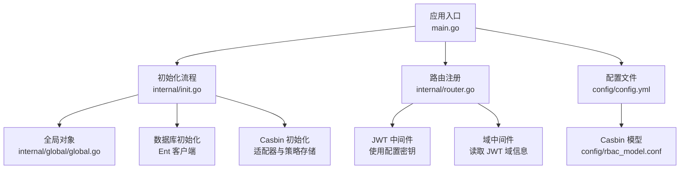
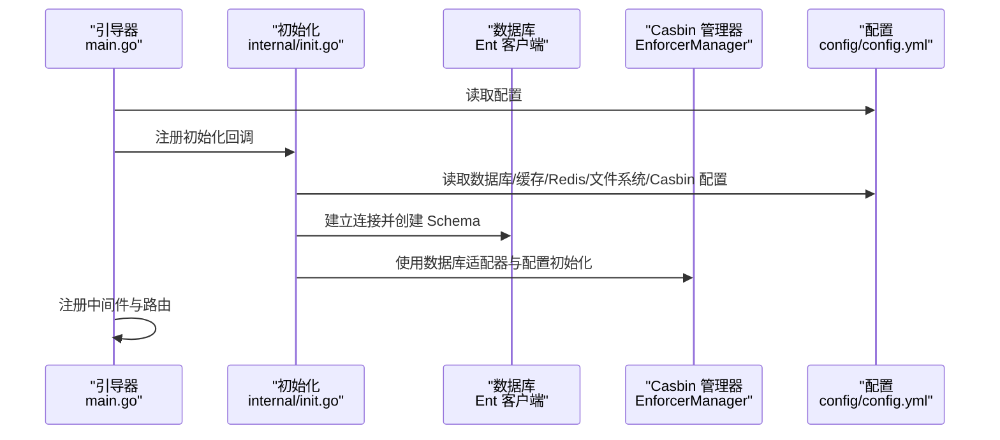
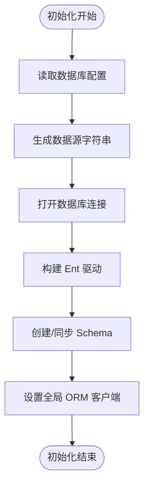
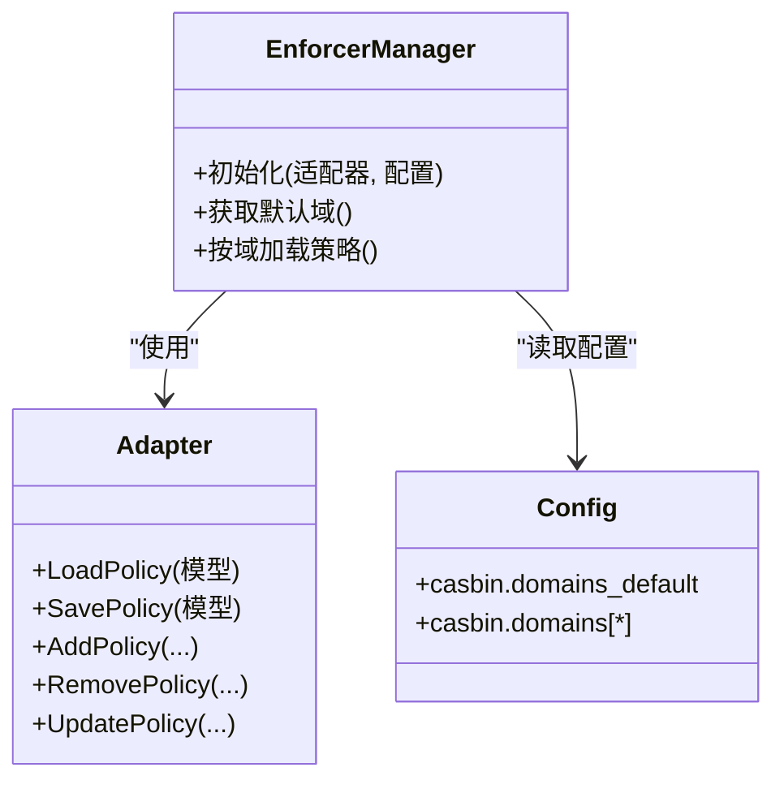
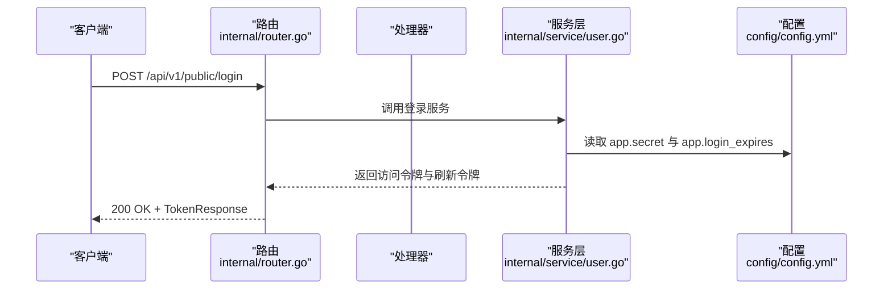
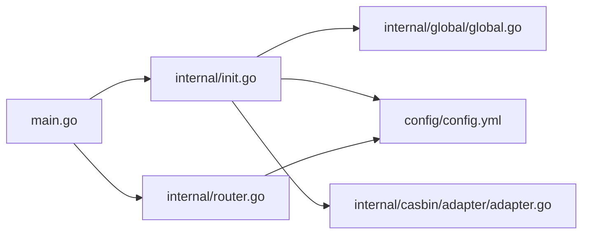

# 配置管理

<cite>
**本文引用的文件**
- [config.yml](file://config/config.yml)
- [rbac_model.conf](file://config/rbac_model.conf)
- [main.go](file://main.go)
- [init.go](file://internal/init.go)
- [global.go](file://internal/global/global.go)
- [router.go](file://internal/router.go)
- [adapter.go](file://internal/casbin/adapter/adapter.go)
- [user.go](file://internal/service/user.go)
- [permission.go](file://internal/middleware/permission.go)
- [go.mod](file://go.mod)
</cite>

## 目录
1. [简介](#简介)
2. [项目结构](#项目结构)
3. [核心组件](#核心组件)
4. [架构总览](#架构总览)
5. [详细组件分析](#详细组件分析)
6. [依赖关系分析](#依赖关系分析)
7. [性能考量](#性能考量)
8. [故障排查指南](#故障排查指南)
9. [结论](#结论)
10. [附录](#附录)

## 简介
本文件系统化梳理 Go Admin 管理系统的配置管理，围绕 config.yml 配置文件展开，涵盖数据库、JWT、Redis 缓存、文件系统与 Casbin 权限模型等关键模块；说明环境变量使用与优先级、多环境配置策略、配置加载顺序与覆盖机制、配置验证与错误处理、动态调整策略以及常见场景模板与最佳实践。

## 项目结构
- 配置文件位于 config 目录，核心为 config.yml 与 rbac_model.conf。
- 应用入口 main.go 通过 Bootstrap 初始化流程注册中间件、路由与清理函数。
- 初始化流程在 internal/init.go 中完成数据库与 Casbin 的初始化。
- 全局共享对象在 internal/global/global.go 中定义，便于跨模块使用。
- JWT 与权限中间件在 internal/router.go 与 internal/middleware/permission.go 中使用配置中的密钥与域信息。

**图表来源**
- [main.go:43-89](file://main.go#L43-L89)
- [init.go:17-65](file://internal/init.go#L17-L65)
- [global.go:10-14](file://internal/global/global.go#L10-L14)
- [router.go:14-72](file://internal/router.go#L14-L72)
- [permission.go:55-67](file://internal/middleware/permission.go#L55-L67)
- [config.yml:1-143](file://config/config.yml#L1-L143)
- [rbac_model.conf:1-15](file://config/rbac_model.conf#L1-L15)

**章节来源**
- [main.go:43-89](file://main.go#L43-L89)
- [init.go:17-65](file://internal/init.go#L17-L65)
- [global.go:10-14](file://internal/global/global.go#L10-L14)
- [router.go:14-72](file://internal/router.go#L14-L72)
- [permission.go:55-67](file://internal/middleware/permission.go#L55-L67)
- [config.yml:1-143](file://config/config.yml#L1-L143)
- [rbac_model.conf:1-15](file://config/rbac_model.conf#L1-L15)

## 核心组件
- 应用配置（app）：应用名、监听端口、调试模式、空闲超时、是否预取 fork、Swagger 开关、密钥、登录过期时长等。
- 日志配置（log）：日志输出到文件与控制台、文件路径、滚动大小、备份数量、保留天数。
- 数据库配置（database）：默认连接名、驱动、主机、端口、用户名、密码、数据库名、SSL、表前缀。
- 缓存配置（cache）：默认缓存存储、内存与 Redis 存储项及其默认 TTL。
- Redis 连接配置（redis）：默认连接、地址、认证、DB、拨号/读写超时、连接池大小与空闲连接数、连接最大空闲/生命周期、TLS。
- 文件系统配置（filesystem）：默认磁盘、是否 AND 本地、本地磁盘根目录、S3 驱动的密钥、区域、桶、端点。
- Casbin 权限模型（casbin）：默认域、多域配置列表（域名、自动加载、模型文本或模型路径）、模型文本示例与注释说明。

**章节来源**
- [config.yml:1-143](file://config/config.yml#L1-L143)

## 架构总览
配置在应用启动阶段被加载并注入到初始化流程中，随后用于：
- 数据库连接与迁移（通过 ORM 与 Ent）。
- Casbin 执行器管理器初始化（基于数据库适配器与配置）。
- JWT 密钥用于签发与校验令牌。
- 权限中间件从 JWT 中提取域信息，结合 Casbin 多域模型进行授权判断。

**图表来源**
- [main.go:43-89](file://main.go#L43-L89)
- [init.go:17-65](file://internal/init.go#L17-L65)
- [config.yml:19-76](file://config/config.yml#L19-L76)

**章节来源**
- [main.go:43-89](file://main.go#L43-L89)
- [init.go:17-65](file://internal/init.go#L17-L65)
- [config.yml:19-76](file://config/config.yml#L19-L76)

## 详细组件分析

### 应用与日志配置
- 应用层参数决定运行行为与可观测性，如端口、调试、Swagger、密钥与登录过期。
- 日志层支持文件与控制台双输出，具备滚动策略（大小、备份数、保留天数），便于生产环境长期留存与检索。

**章节来源**
- [config.yml:1-17](file://config/config.yml#L1-L17)

### 数据库配置与初始化
- 默认连接名为 default，驱动为 MySQL，包含主机、端口、用户、密码、数据库名、SSL 与表前缀。
- 初始化流程使用 ORM 获取数据库源字符串并建立连接，随后通过 Ent 创建 Schema。

**图表来源**
- [init.go:33-47](file://internal/init.go#L33-L47)
- [config.yml:19-30](file://config/config.yml#L19-L30)

**章节来源**
- [init.go:33-47](file://internal/init.go#L33-L47)
- [config.yml:19-30](file://config/config.yml#L19-L30)

### 缓存与 Redis 配置
- cache.default 指定默认缓存存储，支持 memory 与 redis 两种存储。
- redis.default 指定默认 Redis 连接，包含地址、认证、DB、超时、连接池参数与 TLS 开关。
- 该配置用于后续缓存层与任务队列等模块的统一接入。

**章节来源**
- [config.yml:32-58](file://config/config.yml#L32-L58)

### 文件系统配置
- filesystem.default 指定默认磁盘，支持 local 与 s3 驱动。
- local 驱动需指定 root 根目录；s3 驱动需提供密钥、区域、桶、端点等参数。
- 该配置用于上传、静态资源存储等场景。

**章节来源**
- [config.yml:60-76](file://config/config.yml#L60-L76)

### Casbin 权限模型与多域
- casbin.domains_default 指定默认域。
- domains 列表支持多域配置，每域可设置：
  - name：域名称（唯一标识）
  - auto_load：启动时是否自动加载
  - model_text 或 model_path：模型定义（优先使用 model_text）
- 若未配置 domains，系统会使用 model_path 为默认域创建配置。
- 内置了带域的 RBAC 模型示例，便于多租户或多业务域隔离。

**图表来源**
- [config.yml:77-143](file://config/config.yml#L77-L143)
- [adapter.go:115-175](file://internal/casbin/adapter/adapter.go#L115-L175)

**章节来源**
- [config.yml:77-143](file://config/config.yml#L77-L143)
- [adapter.go:115-175](file://internal/casbin/adapter/adapter.go#L115-L175)

### JWT 设置与使用
- app.secret 作为 JWT 密钥，用于签发与校验访问令牌与刷新令牌。
- 登录流程中根据配置的登录过期时长生成访问令牌；刷新令牌流程中同样使用配置密钥与过期时长。
- 路由中间件使用 app.Secret 对请求进行鉴权；域中间件从 JWT 中提取 domain 并设置到上下文。

**图表来源**
- [router.go:28-29](file://internal/router.go#L28-L29)
- [user.go:153-190](file://internal/service/user.go#L153-L190)
- [config.yml:8-9](file://config/config.yml#L8-L9)

**章节来源**
- [router.go:28-29](file://internal/router.go#L28-L29)
- [user.go:153-190](file://internal/service/user.go#L153-L190)
- [config.yml:8-9](file://config/config.yml#L8-L9)

### 权限中间件与域
- 域中间件从 JWT 中读取 domain 字段，若缺失则返回未授权错误。
- 权限中间件在后续流程中结合 Casbin 多域模型进行策略匹配。

**章节来源**
- [permission.go:55-67](file://internal/middleware/permission.go#L55-L67)

## 依赖关系分析
- 应用入口 main.go 通过 Bootstrap 注册初始化、中间件与路由。
- 初始化 init.go 依赖配置模块读取数据库、缓存、Redis、文件系统与 Casbin 配置。
- 全局对象 global.go 暴露 ORM、Bootstrap 与 EnforcerManager，供其他模块使用。
- 路由 router.go 依赖配置中的 app.Secret 进行 JWT 中间件鉴权。
- Casbin 适配器 adapter.go 依赖数据库连接与 Ent 模型进行策略持久化。

**图表来源**
- [main.go:43-89](file://main.go#L43-L89)
- [init.go:17-65](file://internal/init.go#L17-L65)
- [global.go:10-14](file://internal/global/global.go#L10-L14)
- [router.go:14-72](file://internal/router.go#L14-L72)
- [adapter.go:115-175](file://internal/casbin/adapter/adapter.go#L115-L175)
- [config.yml:1-143](file://config/config.yml#L1-L143)

**章节来源**
- [main.go:43-89](file://main.go#L43-L89)
- [init.go:17-65](file://internal/init.go#L17-L65)
- [global.go:10-14](file://internal/global/global.go#L10-L14)
- [router.go:14-72](file://internal/router.go#L14-L72)
- [adapter.go:115-175](file://internal/casbin/adapter/adapter.go#L115-L175)
- [config.yml:1-143](file://config/config.yml#L1-L143)

## 性能考量
- Casbin 多域建议高频访问域开启 auto_load，避免首次使用时的延迟。
- Redis 连接池参数（pool_size、min_idle_conns、max_idle_conns）与连接生命周期（conn_max_idle_time、conn_max_lifetime）应结合并发与延迟要求调优。
- 数据库连接与表前缀配置影响初始化与查询性能，建议在生产环境开启 SSL 并合理设置超时。
- 日志滚动策略避免单文件过大，建议结合集中化日志收集。

[本节为通用指导，无需列出具体文件来源]

## 故障排查指南
- 数据库连接失败：检查主机、端口、用户、密码、数据库名与 SSL 配置；确认驱动与网络连通性。
- Casbin 初始化异常：确认数据库适配器可用、策略表已创建；检查 domains 配置与模型文本/路径。
- JWT 校验失败：确认 app.secret 一致且未变更；检查登录过期时长与刷新令牌流程。
- 权限中间件报错：确认 JWT 中包含 domain 字段；检查 Casbin 策略是否正确加载。
- 日志文件未生成：检查 log.file_path 与目录权限；确认 lumberjack 滚动配置合理。

**章节来源**
- [init.go:33-47](file://internal/init.go#L33-L47)
- [adapter.go:115-175](file://internal/casbin/adapter/adapter.go#L115-L175)
- [user.go:153-190](file://internal/service/user.go#L153-L190)
- [permission.go:55-67](file://internal/middleware/permission.go#L55-L67)
- [config.yml:11-17](file://config/config.yml#L11-L17)

## 结论
本配置体系以 config.yml 为核心，贯穿数据库、缓存、Redis、文件系统与 Casbin 权限模型，配合 Bootstrap 初始化流程实现模块化装配。通过合理的多环境配置策略、明确的加载与覆盖机制、完善的错误处理与日志策略，可满足开发、测试与生产的差异化需求。

[本节为总结性内容，无需列出具体文件来源]

## 附录

### 环境变量使用与优先级
- 项目引入 viper 与 gotenv 等依赖，通常用于从环境变量加载配置并覆盖默认值。
- 一般优先级顺序：命令行参数 > 环境变量 > 配置文件 > 默认值。
- 建议在容器化部署时通过环境变量覆盖敏感配置（如数据库密码、Redis 密钥、JWT 密钥）。

**章节来源**
- [go.mod:93-94](file://go.mod#L93-L94)
- [go.mod:94](file://go.mod#L94)

### 多环境配置策略
- 开发环境：开启 debug、Swagger，使用本地 Redis 与本地文件系统，简化 SSL 与认证。
- 测试环境：使用独立数据库与 Redis 实例，启用 SSL，最小化日志滚动规模。
- 生产环境：关闭 debug、Swagger，启用 SSL，严格控制日志滚动与保留策略，使用高可用 Redis 与 S3 存储。

[本节为通用指导，无需列出具体文件来源]

### 配置加载顺序与覆盖机制
- 应用启动时先加载 config.yml，再读取环境变量与命令行参数进行覆盖。
- 初始化流程在内部按需读取对应子配置（如 database、redis、casbin）并应用到相应组件。

**章节来源**
- [main.go:43-89](file://main.go#L43-L89)
- [init.go:17-65](file://internal/init.go#L17-L65)

### 动态调整配置（无需重启）
- 对于不涉及数据库与 Casbin 策略的配置（如日志、Swagger、端口等），可在运行时通过外部配置中心或热重载机制更新。
- 对于数据库、Redis、JWT 密钥、Casbin 模型等关键配置，建议通过滚动更新或重启生效，确保一致性。

[本节为通用指导，无需列出具体文件来源]

### 配置最佳实践与安全建议
- 敏感信息（数据库密码、Redis 密钥、JWT 密钥）必须通过环境变量注入，不在仓库中提交明文。
- 生产环境启用 SSL 与强密码策略，定期轮换密钥。
- 合理设置日志滚动与保留策略，避免磁盘占用过高。
- Casbin 多域模型建议按租户或业务域拆分，高频域开启自动加载。

[本节为通用指导，无需列出具体文件来源]

### 配置验证与错误处理
- 初始化阶段对数据库连接与 Schema 创建进行错误捕获与日志记录。
- Casbin 初始化失败时记录错误并中断启动，避免运行时权限异常。
- JWT 中间件在缺少域信息时直接返回未授权响应。

**章节来源**
- [init.go:33-47](file://internal/init.go#L33-L47)
- [adapter.go:115-175](file://internal/casbin/adapter/adapter.go#L115-L175)
- [permission.go:55-67](file://internal/middleware/permission.go#L55-L67)

### 常见配置场景模板
- 开发环境模板：启用 debug、Swagger，本地 Redis，本地文件系统，短登录过期。
- 生产环境模板：关闭 debug、Swagger，启用 SSL，高可用 Redis，S3 存储，严格日志滚动。

[本节为通用指导，无需列出具体文件来源]